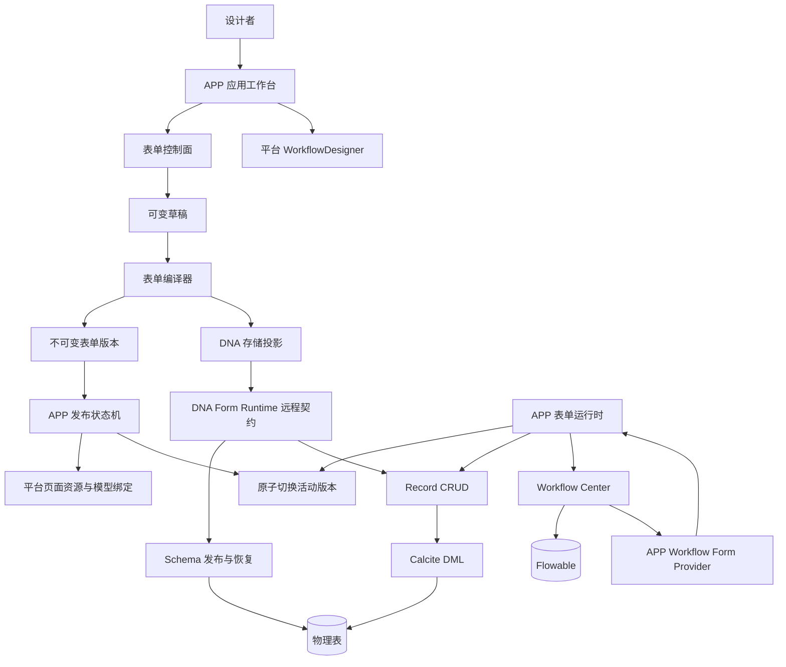

# 应用工作台与表单引擎完整实施计划

> 状态：阶段 0–5 的基础闭环、阶段 7 已完成；阶段 6 的高级扩展单独跟踪\
> 最新交付：2026-10-14 三引擎已部署 `20261014-engine5` 并完成真实验收，见第 43 节和 [验收报告](../validation/form-workflow-20261014.md)。\
> 基线日期：2026-10-13\
> 适用范围：`simplepoint-service-app`、`simplepoint-app`、DNA Runtime、Workflow Center、平台资源权限与共享前端组件

> 2026-10-13 架构复审结论：总体边界通过，阶段 1 继续进行。进入阶段 2 发布编排前，必须完成业务必填与物理非空分离、记录状态、历史 Schema 兼容、组件版本化属性、规范化双 checksum、Record 幂等、索引定义、发布退役状态及租户组合关系。详细依据见[表单引擎架构评审](../reviews/application-form-engine-design-review-20261013.md)。

## 1. 产品目标

在现有应用工作台中形成从设计到运行的完整闭环：

1. 租户用户创建应用，一个应用可以包含多个表单和多个导航页面。
2. 每个表单有且仅有一个主场景，可以增加弹窗、抽屉等辅助场景。
3. 用户通过拖拽完成字段、布局、动作和场景设计，通过属性面板完成细节配置。
4. 表单的业务记录由 DNA Runtime 管理，每个表单对应一张真实物理主表。
5. 表单可以绑定平台现有 Workflow Center；流程定义、实例、任务和历史继续由 Workflow 领域负责。
6. 发布后自动完成物理模型发布、页面资源注册、权限绑定和运行版本切换。
7. 运行态支持标准列表、详情、新增、修改、软删除、流程发起和任务办理。
8. 提供覆盖正常、失败、并发、权限、迁移和恢复场景的测试数据与自动化证据。

产品交互保持直接：设计者看到的是“保存草稿、预览、发布、查看数据和设计流程”，不要求理解物理表、迁移步骤、Calcite 或 Flowable。复杂的幂等、锁、版本、恢复和补偿由服务端承担。

## 2. 已确认边界与方向判断

### 2.1 已确认决策

- APP、DNA、Workflow 是独立领域和独立服务。
- 每个表单对应一张真实物理主表，支持直接 SQL 查询。
- DNA Runtime 负责物理模型、Schema 迁移、Record CRUD、租户/行/字段权限、审计和缓存一致性。
- Workflow Center 使用现有 Flowable 集成，不新增第二套流程引擎。
- 平台已有表格、动作、表单和选择组件可以满足需求时，业务页面必须使用平台组件。
- 跨数据源写入、分片和分批写入继续沿用 DNA 后续规划，不作为表单基础闭环的前置条件。

### 2.2 关键架构判断

表单 UI 定义不能直接等同于数据库结构，也不能直接等同于流程变量。一个不可变表单版本由三个相互关联但独立演进的部分组成：

| 部分 | 内容 | 是否触发 DNA 迁移 |
| --- | --- | --- |
| `dataSchema` | 持久化字段、业务类型、默认值、约束、关系 | 持久化投影变化时触发 |
| `uiSchema` | 场景、布局、控件、弹窗、抽屉、动作 | 单纯展示变化不触发 |
| `ruleSchema` | 条件必填、显隐、只读、联动、计算和提交规则 | 只有影响存储约束时触发 |

元数据快照允许以版本化 JSON 保存；用户提交的业务数据仍存入 DNA 管理的真实物理表。这样既保留设计器扩展性，也不退回 EAV 或单列 JSON 业务存储。

### 2.3 页面、场景和表单的关系

- **应用页面**是可导航、可授权的运行入口，继续使用 `WorkspaceApplicationPage` 表示。
- **表单**是稳定的数据与交互定义，一个应用可以有多个表单。
- **表单场景**属于某个表单版本：`MAIN` 是完整主页面；`DIALOG` 和 `DRAWER` 是由动作打开的辅助容器。
- 一个应用页面绑定一个已发布表单的 `MAIN` 场景。
- 弹窗和抽屉默认继承打开它的页面资源及数据权限，不单独注册菜单资源；需要独立分享或独立授权时再显式发布为应用页面。
- 页面与表单是多对一绑定，不能把页面 ID 当作物理模型 ID。

## 3. 总体架构



浏览器只访问 APP 的表单设计与运行接口。`physicalModelId`、数据源、Schema、物理表名、租户字段和权限条件全部由服务端解析，不能由浏览器指定。

## 4. 模块设计

### 4.1 后端模块

新增 API 与实现分层：

| 模块 | 职责 | 依赖约束 |
| --- | --- | --- |
| `simplepoint-plugin-app-form-api` | 表单命令、视图、稳定错误码、状态、远程契约、扩展 SPI | 不依赖 JPA、MVC 和具体数据库 |
| `simplepoint-plugin-app-form-implementation` | 表单领域、持久化、编译、发布状态机、运行校验、DNA/Workflow 协调 | 依赖 API、DNA Runtime API、Workflow API |
| `simplepoint-service-app` | REST、认证装配、资源 Schema、服务路由适配 | Controller 不编排迁移和事务 |
| `simplepoint-plugin-dna-runtime-*` | 已有物理模型、迁移和 Record 能力 | 不感知设计器布局和流程 UI |
| `simplepoint-plugin-workflow-*` | 已有流程定义、实例和任务 | 通过版本化表单提供方契约访问 APP |

跨服务调用必须使用平台 Service Router/OAuth2 服务身份和组织上下文传播。不得由 APP 直接访问 DNA 或 Workflow 数据表。

### 4.2 前端模块

| 位置 | 职责 |
| --- | --- |
| `simplepoint-react/libs/components/FormDesigner` | 可复用拖拽画布、组件面板、属性面板、预览和设计器命令 |
| `simplepoint-react/libs/components/FormRuntime` | 版本化场景渲染、校验、动作执行和只读模式 |
| `simplepoint-react/libs/components/WorkflowForms` | 继续作为流程表单适配器注册点 |
| `simplepoint-react/modules/simplepoint-app` | 应用/表单/数据/流程工作台及 APP 表单提供方 |
| `simplepoint-react/modules/simplepoint-workflow` | 继续使用公共 WorkflowDesigner 与 WorkflowForms，不复制表单引擎 |

拖拽底层使用仓库已有 `@dnd-kit/core`、`@dnd-kit/sortable` 和 `@dnd-kit/utilities`。不再引入另一套拖拽框架。

## 5. 领域模型

### 5.1 控制面实体

| 实体 | 核心字段 | 说明 |
| --- | --- | --- |
| `FormDefinition` | tenantId、appId、code、name、status、draftRevision、publishedVersion、physicalModelId、lockVersion | 表单稳定身份 |
| `FormDraft` | formId、revision、documentJson、checksum、updatedBy、updatedAt | 每个表单唯一可变草稿 |
| `FormVersion` | formId、version、documentJson、storageSchemaJson、physicalModelVersion、rendererVersion、checksum | 发布后不可变 |
| `FormPublication` | formId、formVersion、migrationId、state、step、idempotencyKey、errorCode、attempt | 跨服务发布状态机 |
| `FormPageBinding` | pageId、formId、sceneId、formVersion、resourceCode、status | 页面到主场景的发布绑定 |
| `FormWorkflowBinding` | formId、workflowDefinitionId、workflowVersionPolicy、startSceneId | 表单提交与流程启动策略 |
| `FormSubmissionLink` | formId、formVersion、recordId、processInstanceId、status、idempotencyKey | 只保存数据/流程关联，不复制业务字段 |
| `FormSubmissionOperation` | tenantId、operationId、formId、formVersion、requestFingerprint、recordRevision、submissionSnapshotId、step、status | 跨服务写入前持久化意图；引用不可变提交值快照，不用最新记录替代审批历史 |
| `AppOutboxEvent` | aggregateId、type、payload、idempotencyKey、status、attempt | 可靠的发布及流程协调事件 |

所有实体都必须带租户边界、创建/更新时间、操作者和乐观锁。表单编码在应用内唯一；版本号在表单内唯一；发布幂等键在租户内唯一。

### 5.2 稳定字段身份

每个持久化字段必须包含：

- `fieldId`：不可变平台身份，删除后不能复用。
- `storageCode`：第一次发布后不可变，对应可读的物理列名。
- `label`：可修改展示名称，不产生 DDL。
- `storageLabel`：物理列注释，第一次发布后默认不可变；与界面 `label` 分离。
- `logicalType`：平台逻辑类型。
- `storageMode`：`STORED`、`COMPUTED`、`REFERENCE`、`ATTACHMENT` 或 `TRANSIENT`。
- `submitRequired`：提交阶段的业务必填，不直接等同于数据库非空。
- `storageRequired`：所有记录状态均满足的物理非空约束；第一版只有非空安全默认值的持久化字段可启用。
- `writePolicy`：持久化字段的业务写入规则，独立于控件只读和数据权限。基础生命周期规则已接入，详见第 22 节。
- 默认值、长度/精度及校验规则。

运行时协议使用 `fieldId` 作为稳定键，表单编译器负责映射到 DNA `storageCode`。不通过普通改名操作重命名物理列；必须重命名时进入显式管理迁移并保留别名兼容策略。

`dataSchema` 还包含以稳定 `indexId` 标识的普通/唯一索引定义。索引只引用 `fieldId`，存储投影编译器负责生成 DNA `LogicalIndexDefinition`，第一版不开放表达式索引。

### 5.3 场景与节点

一个表单文档必须包含且只包含一个 `MAIN` 场景，并可包含多个 `DIALOG`、`DRAWER` 场景。场景由树形节点构成：

- 布局节点：分栏、栅格、分组、折叠、标签页、分隔区。
- 字段节点：引用 `fieldId`，一个字段可以出现在多个场景，但只有一个数据定义。
- 展示节点：标题、说明、静态文本。
- 动作节点：保存、提交、删除、打开场景、确认场景、关闭场景、启动流程及自定义受控动作。
- 数据节点：子表、关联记录和只读数据视图，分阶段开放。

同一个字段可在不同场景复用，但在同一场景内只能绑定一次，避免一个 SForm 出现重复字段输入。打开场景的引用图必须无环，最多同时打开 8 层（含主场景）；返回上一场景使用关闭动作，不通过再次打开祖先场景模拟返回。后端校验与前端防护使用同一限制。

组件实例拥有稳定 `componentId`，并固定 `componentType + componentVersion`。组件扩展属性由对应版本注册表中的属性 Schema 校验，不能保存任意可执行代码、URL 模块或脚本表达式。注册表组合平台内置项和受信 SPI，重复类型与版本在启动时失败。

## 6. 表单组件注册表

平台维护受信的 `FormComponentDescriptor`：

```text
type
version
category
displayName
icon
allowedParents
allowedChildren
propertySchema
defaultProps
storageProjection
runtimeRenderer
designerRenderer
migrationPolicy
```

首批组件：

- 文本、长文本、数字、金额、开关。
- 单选、多选、下拉选择。
- 日期、时间、日期时间。
- 用户、角色、组织、租户选择，复用平台公共选择组件。
- 附件引用，文件本体进入平台对象存储。
- 分组、两栏/三栏栅格、标签页、说明和分隔区。
- 保存、提交、重置、打开弹窗、打开抽屉、关闭容器动作。

第二批组件：子表、实体引用、级联选择、富文本、位置和只读数据视图。组件注册表通过 SPI 扩展，但生产环境只加载平台签名或显式安装的受信组件。

## 7. 设计器交互

应用编辑页使用统一三段式布局：

```text
┌──────────────── 顶部：返回 / 保存状态 / 撤销重做 / 预览 / 发布 ────────────────┐
│ 左侧资源树          │ 中央设计画布                         │ 右侧属性面板       │
│ 应用                │ 主场景 / 弹窗 / 抽屉                │ 表单/场景/组件属性 │
│ ├─ 表单 A           │ 拖入、排序、嵌套、选择              │ 校验/数据/动作     │
│ │  ├─ 主场景        │                                      │                    │
│ │  ├─ 新建弹窗      │                                      │                    │
│ │  └─ 编辑抽屉      │                                      │                    │
│ ├─ 数据             │                                      │                    │
│ └─ 流程             │                                      │                    │
└───────────────────────────────────────────────────────────────────────────┘
```

交互门禁：

- 拖拽和点击添加均可用；键盘用户可以移动、复制和删除节点。
- 草稿自动保存采用防抖、修订号和冲突提示；不能静默覆盖另一个标签页的修改。
- 画布支持撤销/重做、复制粘贴、层级导航、空状态和即时预览。
- 删除已发布字段前展示数据影响，不直接执行破坏性迁移。
- 发布入口只有一个，迁移计划和失败原因通过面向用户的摘要展示，详细步骤进入高级详情。
- 页面刷新、路由切换和关闭抽屉时使用平台脏状态保护。

## 8. 平台 UI 强制标准映射

| 场景 | 必须使用 |
| --- | --- |
| 应用、表单、版本、发布记录、数据记录标准列表 | `SimpleTable` + 服务端 `/schema` + 服务端分页/筛选/排序 |
| 设计器画布、迁移差异、规则列表等复合或内存数据 | `DataTable` 或专用画布 |
| 标准列表及记录动作 | `SimpleTable` 或 `TableActions` |
| 属性编辑、应用/表单创建、运行时表单 | `SForm` |
| 用户、角色、组织、租户和实体选择 | 平台 `UserSelect`、`RoleSelect`、`OrganizationSelect`、`TenantSelect`、`EntitySelect` |
| 流程设计 | 平台 `WorkflowDesigner` |
| 流程状态 | 平台 `ProcessStatusDiagram` |
| 表格样式和交互 | 平台 `SimpleTable` / `DataTable`，禁止业务页直接使用 Ant Design `Table` |

设计画布、拖拽传感器、弹窗/抽屉容器和确认对话框属于专用交互，可以使用底层库；其工具栏动作仍通过 `TableActions` 或新增的平台设计器动作组件统一渲染。

## 9. 编译与发布流程

### 9.1 表单编译

服务端编译器执行：

1. 校验文档契约版本、节点数量、深度和组件注册表版本。
2. 校验唯一主场景、场景引用、字段引用和动作目标。
3. 校验字段代码、类型、默认值、条件规则和计算依赖，拒绝循环依赖。
4. 只提取 `STORED`、`REFERENCE` 和附件引用字段形成 DNA 存储投影。
5. 生成规范化 checksum；相同语义文档必须得到相同 checksum。
6. UI 或规则变更未改变存储投影时，复用当前 DNA 物理模型版本。

### 9.2 一键发布状态机

```text
DRAFT
  → VALIDATING
  → VERSION_FROZEN
  → DATA_PREPARING
  → DATA_READY
  → RESOURCE_BINDING
  → ACTIVATING
  → ACTIVE

任意非终态 → FAILED → RETRYING
旧活动版本 → RETIRED
```

发布顺序：

1. 使用草稿修订号和幂等键声明发布。
2. 冻结不可变 `FormVersion`。
3. 创建或复用 DNA 物理模型版本，读取并展示迁移计划。
4. 只自动执行 `SAFE` 计划；条件或破坏性计划进入明确的治理流程。
5. 注册或更新页面资源，绑定资源与 DNA 物理模型。
6. 验证 Workflow 绑定引用的流程版本和表单版本。
7. 在 APP 控制库中原子切换活动版本和页面绑定。
8. 写入 outbox，刷新运行时缓存并发布版本事件。

目标数据库 DDL、DNA 控制库和 APP 控制库不存在统一事务。失败后不伪造回滚：已经完成的 DNA 版本保留为未被 APP 激活的准备版本，用户点击“重试发布”继续执行。普通用户只看到发布结果和可恢复错误。

## 10. DNA 集成契约

新增窄范围 `DnaFormRuntimeRemoteService`，组合现有 DNA 服务，不暴露任意 SQL：

- 注册物理模型。
- 创建不可变目标 Schema 版本。
- 读取结构差异和风险。
- 发布、读取状态和失败重试。
- 绑定/解绑页面资源。
- 分页、详情、count、新增、更新、软删除。
- 同一模型 1–100 条原子命令。

Record 调用增加：

- `requestedSchemaVersion`：验证版本属于同一模型，且当前活动结构向后兼容其字段投影；不能要求与活动版本简单相等。
- `idempotencyKey`：防止新增或提交重试产生重复记录。
- 稳定 `fieldId` 到 `storageCode` 的服务端映射。

运行时禁止客户端提交 `physicalModelId`。APP 根据当前租户、应用页面、表单版本和资源绑定解析，并把服务端选定的模型传给 DNA。

## 11. 运行时与数据管理

### 11.1 运行页面

运行态读取已发布快照，不读取可变草稿。`FormRuntime` 根据场景渲染 `SForm` 和平台控件，执行相同的客户端提示与服务端强校验。

标准动作：

- `SAVE_DRAFT`：以平台拥有的 `DRAFT` 记录状态保存不完整业务记录，不启动流程。
- `SUBMIT`：校验并提交；有流程绑定时进入启动协调。
- `UPDATE`：携带 `expectedVersion` 乐观更新。
- `DELETE`：软删除并执行资源和数据权限。
- `OPEN_DIALOG` / `OPEN_DRAWER`：打开同版本的目标场景。
- `APPLY`：通过当前场景的类型校验后，把本地编辑及已确认的子场景结果合并到父场景，不发出数据库写入；允许不完整的业务草稿，完整必填规则在 `SUBMIT` 时执行。
- `CLOSE`：关闭当前容器。存在本地修改时先确认是否丢弃，取消子场景不能修改父场景快照；丢弃父场景同时丢弃尚未向上确认的后代编辑。
- `RESET`：重置当前场景的可编辑字段，不清空其他场景或只读字段。

各场景使用同一已发布文档和整条记录计算条件规则，只把本场景字段投影传给 SForm。场景打开时复制父级草稿；嵌套确认逐层合并。保存/提交从任意场景发起时提交完整合并快照，仍由外层记录会话选择新增或乐观更新。服务端提交校验覆盖所有场景，并继承容器显示规则，不能只校验主页面。

场景中的保存失败反馈与重试动作必须显示在当前最上层容器内；结果不确定时禁止继续编辑原意图。保存成功或幂等重放成功后关闭本次编辑的场景栈，以服务端记录结果建立新快照。页面切后台时隐藏所有弹窗和抽屉并暂停内部自动查询，返回原页面后恢复未提交的本地状态。

浏览器写入必须携带打开页面时观察到的 `runtime.formId + runtime.formVersion`；删除通过查询参数传递同一身份。APP 在解析当前活动页面绑定后检查身份，缺失、版本变化或页面改绑返回 `RUNTIME_VERSION_CONFLICT`（HTTP 409），不能静默使用另一表单或另一版本解释旧请求。该校验固定本次请求解析到的版本，不承诺把跨服务发布切换和正在执行的目标库写入纳入同一个事务。

保存草稿后保留服务端返回的记录 ID 与记录版本，后续保存和提交均更新该记录；成功提交后才开始新的填写会话。完整编辑快照中的字段清空编译为显式 `null`，未归属当前场景或没有编辑权限的字段不能被清空。网络失败或服务端结果不明时，保留原请求并以同一幂等键重试，不自动新建第二次业务意图。

运行页使用平台保留页面路由、授权作用域和操作锁。租户/角色/授权上下文变化时重建本地编辑会话；后台标签页保留草稿并禁止新写入；自动发现新发布版本时保留当前内容，由用户确认后加载新版本。权限只读是不可被业务规则放宽的约束。

业务记录状态至少包含 `DRAFT` 和 `SUBMITTED`，并与记录在同一目标库事务中变更。`submitRequired` 在提交阶段由服务端执行，`storageRequired` 在任意状态都由物理结构保证。

### 11.2 数据页

每个表单提供标准记录资源：

```text
GET  /applications/{appId}/forms/{formId}/records/schema
GET  /applications/{appId}/forms/{formId}/records
GET  /applications/{appId}/forms/{formId}/records/{recordId}
POST /applications/{appId}/forms/{formId}/records
PUT  /applications/{appId}/forms/{formId}/records/{recordId}
DELETE /applications/{appId}/forms/{formId}/records/{recordId}
```

数据页使用 `SimpleTable`。字段列、筛选、排序、动作和字段权限由服务端 Schema 生成。弹窗或抽屉编辑继续使用同一已发布场景，不建立另一套表单。

## 12. Workflow Center 集成

现有 `WorkflowFormContract.Binding` 已固定 `provider + formId + version`，现有 `WorkflowFormProvider` 和前端适配器注册表继续作为集成点。

APP 提供方标识固定为 `simplepoint-app`：

- 设计时列出租户内可绑定的已发布表单版本和场景。
- 发布流程版本时由服务端验证 APP 表单版本存在、已发布且当前调用方有权绑定。
- 启动和任务办理时读取绑定的不可变表单版本，不自动升级到最新版。
- 表单字段到流程变量使用显式映射；未映射的业务字段不复制进 Flowable 变量。
- 流程只保存必要的判断变量以及 `formId`、`formVersion`、`recordId` 等业务引用。

表单提交启动流程采用可恢复协调：

1. 在 APP 控制库持久化提交意图、请求指纹与目标表单/流程版本，再开始任何远程写入。
2. 使用操作幂等键在 DNA 创建或更新记录，记录确定的记录修订与提交值快照引用；结果不明时先核对原操作。
3. 写入 `FormSubmissionLink` 的 `PROCESS_PENDING` 状态。恢复任务可以从先前持久化的意图补齐关联，覆盖记录已提交、关联未写入时宕机的窗口。
4. 通过 Workflow 远程契约按业务键幂等启动实例。
5. 回写流程实例 ID 并置为 `RUNNING`，完成操作回执。
6. 失败时按已完成步骤继续；相同业务键不能创建第二个实例。历史办理页面读取提交快照/记录修订，不能仅固定表单定义却读取最新业务值。

任务表单可配置只读/可编辑字段集合。办理前 Workflow 调用 APP 表单提供方执行版本、记录、字段和业务规则校验。流程结束状态通过 outbox/幂等回调更新关联状态，不覆盖原始业务记录。

## 13. 权限、安全与租户

- 应用、表单、草稿、版本、发布、页面绑定和提交关联全部强制租户隔离。
- 设计权限、发布权限、数据查看、数据新增、编辑、删除和流程绑定使用独立资源动作。
- 草稿不注册运行资源，未发布版本不能通过运行接口访问。
- 页面资源、表单绑定、DNA 模型绑定、平台行权限和字段权限取交集。
- 弹窗/抽屉继承打开页面的资源上下文，服务端不接受客户端伪造资源代码。
- 所有动态值参数绑定；表单规则禁止脚本、任意表达式求值和动态模块 URL。
- 审计不记录业务字段值、附件内容、密码或连接凭据。
- 附件只保存对象引用，下载继续由对象存储授权边界控制。

## 14. 性能与容量边界

第一版默认限制：

- 每个应用最多 100 个表单。
- 每个表单最多 300 个字段、50 个场景、1000 个组件节点。
- 场景树最大 12 层；规则最大 500 条。
- 草稿文档 UTF-8 最大 2 MiB；单次运行提交最大 1 MiB，不含附件本体。
- 记录列表每页最大 100 条；设计器目录使用懒加载。
- 自动保存最短间隔 800 ms，只发送当前规范化文档和期望修订号。

所有限制由服务端执行并使用稳定错误码返回。后续可配置，但不能在前端静默放宽。

## 15. 分阶段实施计划

状态使用 `NOT_STARTED`、`IN_PROGRESS`、`BLOCKED`、`DONE`。只有代码、测试、文档、数据库升级和运行证据齐全才能标记 `DONE`。

2026-10-14 状态以第 43.3 节与验收报告为准。下列“2026-10-13”实现证据保留当时的未完成项，不代表当前环境。基础设计/运行/审批闭环已收口；任意计算、数据联动、模板和通用关系等高级扩展归入阶段 6，未计入本次完成。

### 阶段 0：基线与架构冻结 — `DONE`

- 盘点 APP、DNA、Workflow 和平台组件现状。
- 明确页面/场景/表单边界、版本边界和发布状态机。
- 落本计划、完成定义和测试矩阵。

### 阶段 1：表单领域与版本契约 — `DONE`

- 新建 App Form API/Implementation 模块并接入 APP 服务。
- 建立 `FormDefinition`、`FormDraft`、`FormVersion`、`FormPublication` 及仓储约束。
- 定义版本化表单文档、字段、场景、组件和规则协议。
- 完成创建表单、读取、保存草稿、修订冲突和服务端文档校验。
- 提供真实升级脚本、租户/并发/不可变版本测试。
- 完成架构复审要求的协议硬化：字段约束与记录状态、组件版本与受控属性、索引定义、规范化双 checksum、发布退役状态和租户组合关系。

当前实现证据（2026-10-13）：

- App Form API、Implementation 已接入 APP Service；表单、草稿、不可变版本和发布聚合对应四张控制面表。
- 文档协议已区分 `submitRequired`、`storageRequired`、`label` 与 `storageLabel`，并支持稳定索引、组件版本、受控扩展属性及组合式组件 SPI。
- 不可变版本同时保存原始文档 checksum、规范化 DNA 存储投影及 storage checksum；UI-only 标签变化不会产生新的存储 checksum。
- 应用父记录悲观锁保护每应用 100 表单上限；草稿修订、版本序号和表单编码具备并发及数据库唯一约束。
- PostgreSQL 17 生产迁移重复执行、租户组合外键和 Hibernate 映射校验通过；APP Service 以 `ddl-auto=validate` 启动后健康状态为 `UP`。
- App Form API、Implementation 与 APP Service 的 Gradle `check` 通过。

2026-10-13 曾等待环境升级；当前升级与产物部署已完成，见第 43.3 节。

### 阶段 2：DNA 发布与运行记录闭环 — `DONE`

- 建立 DNA 窄范围远程契约和服务身份传播。
- 实现表单存储投影编译器及规范化 checksum。
- 实现发布计划、幂等状态机、重试和页面资源绑定。
- 调整 Record Schema 兼容校验、字段身份映射和新增幂等；旧表单版本通过兼容投影访问当前活动物理结构，不能使用简单版本相等判断。
- 完成一个表单从发布建表到结构化 CRUD 的真实 PostgreSQL/MySQL 回归。

当前实现证据（2026-10-13）：

- APP 存储投影编译器可以确定性生成 DNA `PhysicalSchemaDefinition`，并把字段身份映射、规范化 Schema JSON 与 storage checksum 固化到表单版本。
- APP 与 DNA 已建立 `dna.form-runtime:v1` 窄范围远程契约；APP 只传递经过边界限制的租户、用户、组织、资源、行权限和字段权限快照，DNA 仅在同步调用范围内恢复并在结束后清理上下文。DNA 只接受显式白名单中的调用服务，白名单为空时默认拒绝。
- Record 请求必须携带不可变 Schema 版本和 checksum。DNA 按稳定 `fieldId` 校验历史投影与活动物理结构的兼容性，读写时把历史字段代码映射到当前物理列。
- 单条新增必须携带 `idempotencyKey`。DNA 控制库先保存请求指纹和确定性记录 ID；同键同请求重放首次结果，同键不同请求返回 `RECORD_IDEMPOTENCY_CONFLICT`。目标库已提交但响应丢失时，通过确定性 ID 恢复首次创建结果。
- 新增回执迁移在 PostgreSQL 17 验证了重复执行、状态约束、幂等唯一约束和租户组合外键；DNA Runtime API、Implementation 及 DNA Service 测试通过。
- DNA 已提供按表单归属查询物理模型、按模型与目标版本查询发布记录的恢复接口；APP Schema 准备协调器可以恢复注册、版本创建和发布响应丢失，只自动执行 `SAFE` 迁移。

- APP 发布聚合已接入 Schema 准备协调器和租户动态页面资源端口；发布顺序固定为准备 DNA、准备不可见页面资源、绑定 DNA 模型资源、激活页面资源、完成 APP 绑定。运行解析只接受 `ACTIVE` 页面绑定，重复发布可以从持久化步骤恢复。
- APP 记录门面已实现分页、详情、新增、修改和软删除。浏览器只提交页面、稳定 `fieldId`、版本和幂等键；APP 服务端解析物理模型、Schema 版本及 checksum，再调用 DNA 结构化 Record API。
- 每张表单物理表自动包含受平台控制的 `record_state` 字段，草稿允许不完整，提交由服务端执行完整必填及条件规则校验；已提交记录禁止退回草稿。
- 动态页面资源权限同时作用于 APP 动作能力和 DNA 行/字段权限。默认记录投影会排除 `HIDDEN` 字段，`MASKED` 字段不可筛选或排序，更新提交规则使用保留行权限的服务端完整字段快照，完整值不会返回浏览器。

2026-10-13 阶段 2 曾保持 `IN_PROGRESS`（后续收口见第 20–43 节）。带键的原子命令组已接入目标库事务回执，页面改绑的 DNA 资源退役已加入版本化协议（详见第 20、21 节），仍需完成自动恢复、页面归档生命周期、存量目标库基础设施升级，以及 PostgreSQL 17/MySQL 8.4 从发布建表到 APP 记录 CRUD 的完整真实数据库回归。新增回执必须至少保留到调用方承诺的最大重试窗口结束；清理回执前要确保对应幂等键不会再次发送，否则无法保证跨长期重试去重。

### 阶段 3：平台表单设计器 — `DONE`

当前实现（2026-10-13）：应用表单目录提供 `/forms/catalog`、`/forms/catalog/schema` 与 `/forms/designer-contract`，复用平台查询、分页、字段策略和服务端动作权限。目录与计数同时施加租户和应用边界，组件声明固定版本。

- 工作台已经接入 `SimpleTable` 表单目录和共享 `FormDesigner`；专用拖拽画布、属性 `SForm`、`TableActions` 工具栏及内存字段 `DataTable` 分工明确。
- 已有拖拽/点击插入、移动、复制粘贴、撤销重做，以及主场景/弹窗/抽屉的设计和共享运行时预览。字段可跨场景复用，删除控件不删除存储定义；场景引用拒绝循环。
- 草稿自动保存固定修订号；保存响应丢失后按规范化文档核对；保存期间的新编辑不会被旧响应覆盖。首次打开等待最新草稿，后台页面暂停新自动保存，授权上下文切换重建会话。
- 设计器新增发布入口，使用平台 `EntitySelect` 分页选择应用页面。版本创建固定已保存修订号和 checksum；发布重试固定版本、页面与幂等键。已发布页面的数据入口复用运行端 `RecordTable`/`SimpleTable`，服务端仍独立检查页面数据权限。
- 冻结版本和首次准备发布时检查基础必填字段是否有从主场景可达的可编辑控件或有效默认值。草稿仍可保存不完整设计；发布失败沿用平台 `VALIDATION_FAILED`/`fieldErrors` 契约并显示受影响字段。
- 页面发布意图在任何 DNA 远程写入前持久化，绑定记录以 `DATA_PREPARING` 起步；跨刷新后通过服务端发布记录目录发现原操作，按发布 ID 继续原页面、原表单版本和原幂等键。恢复不冻结当前草稿。发布记录使用 `SimpleTable`、服务端分页/筛选/排序和权限过滤动作，数据查看继续由运行页面权限校验。
- 新页面绑定激活时退役该页面此前的绑定和未完成意图，清除旧执行令牌/租约；迟到的失败回调不能重新打开已退役操作。先刷新旧活动绑定的退役，再激活新绑定，满足 PostgreSQL 单页面活动绑定的部分唯一索引。这里的 APP 绑定退役不代表 DNA 旧资源绑定已完成退役治理。

字段类型、精确默认值、存储非空及普通/唯一组合索引已接入共享数据设计器（见第 23 节）；声明式条件规则编辑已接入平台条件树（见第 24 节）。2026-10-13 尚待收口：受保护字段规则一致性、版本治理、统一流程入口及真实数据库到页面验收，后续证据见第 20–43 节；计算与数据联动等高级扩展留在阶段 6。基础必填入口检查不是对任意条件规则可满足性的证明。

本轮验证：APP Form Implementation 与 APP Service 的 Gradle `check` 通过（合计 100 项测试，其中 PostgreSQL 环境测试 1 项未启用）；前端全模块 `pnpm typecheck`、APP 生产构建、i18n 校验以及 31 项设计器/运行模型/发布恢复测试通过。生产产物浏览器 fixture 已覆盖拖拽、嵌套场景、草稿响应丢失、修订冲突、后台暂停保存、只读权限、冻结版本/发布响应丢失恢复、发布后平台表格 CRUD 和关闭数据窗口恢复编辑；原工作台浏览器回归通过。上述 HTTP fixture 不替代真实数据库、真实授权资源注册和 Workflow 验收。

发布恢复补充验证（2026-10-13）：APP Form Implementation 84 项、APP Service 26 项测试全部通过（110 项、无跳过），包含独立 PostgreSQL 17 上生产升级重复执行、保存尚未进入 DNA 的意图和 Hibernate 映射校验。H2/HTTP 回归覆盖意图重开、跨租户/应用/表单拒绝、幂等目标冲突、旧租约/迟到回调、历史分页与权限动作。前端全模块类型检查、APP 构建、i18n 和 32 项模型测试通过；浏览器 fixture 覆盖真实刷新后重新进入工作台恢复发布、后续草稿不被误发布、历史入口数据读取和只读历史。升级需在 `20261013-app-form-domain.sql` 后执行 `20261013-app-form-release-intent.sql`，再部署新 APP 服务；未声明已升级当前集成环境。

- 新增共享 `FormDesigner` 和组件注册表。
- 完成字段、布局、主场景、弹窗、抽屉、动作和属性编辑。
- 完成拖拽、键盘操作、撤销重做、复制粘贴、自动保存和预览。
- 应用工作台形成“表单 / 数据 / 流程”统一编辑入口。
- 所有列表、动作、表单和选择器通过平台组件门禁。

### 阶段 4：表单运行时与数据管理 — `DONE`

- 新增共享 `FormRuntime`，渲染已发布版本。
- 完成动态 `/schema`、`SimpleTable` 数据页和场景编辑。
- 完成服务端业务规则、乐观锁、幂等、字段权限和错误映射。
- 完成页面资源发布、运行路由和授权闭环。

当前实现证据（2026-10-13）：

- 已发布页面由服务端活动绑定固定到不可变表单版本和兼容的 DNA Schema；运行接口不会接收物理模型、表名、数据源或存储代码。
- 共享 `FormRuntime` 已通过 `SForm` 渲染主场景，支持平台用户、角色、组织、租户、附件等控件以及受限的显示、隐藏、启用、禁用和必填规则。
- 浏览器运行协议使用独立安全投影，移除了 `storageCode`、存储约束和索引；`HIDDEN` 字段及依赖它的客户端规则会在服务端裁剪，`VISIBLE`/`MASKED` 组件强制只读。
- 记录数据页已提供权限过滤的动态 `/schema`，并使用平台 `SimpleTable`、服务端分页、筛选、排序、标准动作、乐观锁和单记录确认删除；没有新增业务自有表格或按钮体系。
- 运行页面提供“表单 / 数据”入口，保存草稿后提交复用记录 ID 和乐观锁版本；新增/修改/删除均带表单版本检查。主场景通过已发布文档解析，不再假设场景 ID 为 `main`。
- 运行页接入平台 `usePageLocation`、`useOperationScope`、`usePageRetention` 和 `PageSection`；写入结果不明确时保留原请求重试，新版本发现与草稿丢弃分开处理。
- 静态选项由服务端在草稿写入时校验本次字段，在正式提交时校验合并后的完整记录；允许显式 null 清空可选项。旧选项可以随未改动草稿保留，但再次提交必须满足当前绑定版本的选项约束。设计校验拒绝类型不匹配、语义重复、超出长度/精度的选项以及不属于选项的默认值。
- 前后端统一选项值类型：布尔与 INT32 使用对应 JSON 标量，INT64 与 DECIMAL 使用精确字符串。表单和数据页的选项 Schema、默认值与记录返回值保持一致；不能将长整数或小数转换成 JavaScript Number。JSON 不支持静态标量选项，未知/脱敏的已有值保持原样，不伪造为有效选项。
- 条件规则复用平台精确十进制比较，规则不能解除权限只读；清空字段使用显式 null。动作切换必须完成 SForm 校验协议更新后才能提交，避免草稿校验规则被用于正式提交。
- 运行组件已拆分为版本化组件注册表、场景编译器、稳定 SForm 布局模板和场景宿主。分组、栅格、标签页及按设计位置摆放的动作均保留树结构；未知组件版本明确拒绝，受信调用者可以显式组合注册表。
- 弹窗、抽屉及嵌套场景已接入确认/取消、脏状态确认、后台保留和最上层保存错误反馈；场景内保存/提交与主页面共享同一记录会话。后端补充跨场景必填规则与容器可见性继承，以及无环导航/单场景字段唯一性校验。
- 2026-10-13 时设计器、历史场景、Workflow 入口与真实验收尚未完成；后续已按第 20–43 节收口。

2026-10-13 记录的后续正确性问题（阶段 5 的持久化提交意图与只读审批方案见第 43 节）：修改/删除的会话内可靠重试已接入目标库回执，见下文进展；浏览器刷新后的写入意图发现与恢复尚未完成。界面只读/禁用与业务不可修改约束已经分离；字段生命周期写入规则已由服务端执行，详见第 22 节。条件写入规则、流程节点级写入约束仍需后续实现。

### 阶段 5：Workflow 集成 — `DONE`

- 实现 `simplepoint-app` Workflow 表单提供方及前端适配器。
- 完成流程设计器中的表单版本/场景选择和变量映射。
- 完成幂等启动、任务办理、驳回、撤回、取消、重提和状态回写。
- 运行实例固定表单与流程版本，历史数据可重现。定义版本不能代替业务值历史；接入前明确提交快照/记录修订策略。
- 跨 DNA/Workflow 提交先持久化操作意图，再按幂等步骤写记录、创建关联及启动流程；覆盖数据提交后、关联写入前宕机的恢复窗口。

### 阶段 6：关系、附件和高级场景 — `IN_PROGRESS`

- 主子表和同数据源多模型事务。
- 实体引用、附件、数据视图和受控自定义动作。
- 表单复制、模板、导入导出和版本差异。
- 归档和生命周期治理，不开放普通用户直接 DROP/TRUNCATE。

### 阶段 7：质量收口、测试数据和交付 — `DONE`

- 全量后端、前端、真实数据库和浏览器门禁。
- 建立测试应用与多场景数据集。
- 生产构建、升级/回滚、部署、Consul 健康和真实 HTTPS 验收。
- 完成用户指南、运维指南、兼容矩阵和已知限制。

## 16. 测试矩阵

### 16.1 后端

- 领域单元测试：状态转换、规范化、checksum、容量限制、规则依赖和稳定字段身份。
- JPA 集成测试：租户隔离、唯一约束、乐观锁、不可变版本和发布幂等。
- DNA 契约测试：首次建表、无存储变化发布、字段增加、索引、失败重试、漂移和缓存刷新。
- Record 测试：Unicode、空值、日期、数值、JSON、乐观冲突、软删除、行列权限和幂等新增。
- Workflow 测试：版本固定、启动、审批、驳回、撤回、取消、重提、重复回调和表单提供方不可用。
- 安全测试：跨租户 ID、伪造页面/模型/版本、隐藏字段筛选、越权发布和服务上下文缺失。

### 16.2 前端

- 纯模型测试：拖拽结果、节点树、撤销重做、复制、字段引用和规则编译。
- 组件测试：属性 Schema、平台选择器、场景打开关闭、只读和权限动作。
- 契约测试：服务端 Schema 与 `SimpleTable`、`SForm`、Workflow 绑定一致。
- 浏览器测试：创建应用、多个表单、设计、预览、发布、数据 CRUD、弹窗/抽屉和完整流程。
- 视口与可访问性：桌面/窄屏、键盘拖动、焦点恢复、滚动容器和错误定位。

当前基础运行页回归入口：

```bash
cd simplepoint-react
node --experimental-strip-types --test libs/components/FormRuntime/*.test.mjs
MF_SMOKE_APP_FORM_RUNTIME_ONLY=1 node --experimental-strip-types scripts/smoke-mf.mjs
node --experimental-strip-types --test libs/components/FormDesigner/*.test.mjs modules/simplepoint-app/src/views/Workbench/forms/publication.test.mjs
MF_SMOKE_FORM_DESIGNER_ONLY=1 node scripts/smoke-mf.mjs
```

浏览器回归使用已构建 APP/Host 产物与隔离 HTTP fixture，覆盖自定义主场景 ID、必填提交、草稿原记录提交、重复点击、响应丢失重放、字段清空、规则只读、保留页面、版本变化及授权上下文切换，以及嵌套弹窗/抽屉的确认、取消、标签页字段保留和场景内保存恢复。这不替代真实数据库和 Workflow 的端到端验收。运行前须构建所需前端产物。

### 16.3 正式测试数据

交付至少包含以下可重复 fixture：

1. **客户档案**：中英文/日文、联系方式、枚举、日期、附件、唯一约束、编辑抽屉。
2. **采购申请**：金额、申请人/部门、明细子表、提交确认弹窗、多级审批、驳回和重提。
3. **设备巡检**：条件字段、照片附件、位置文本、异常分支、只读详情抽屉。
4. **版本演进**：增加可空字段、增加必填默认值、标签改名、UI-only 发布、破坏性变更拒绝。
5. **权限场景**：管理员、设计者、提交者、部门审批人、只读用户和跨租户攻击样例。

测试数据创建器必须幂等，默认只用于开发/验收环境，不在生产启动时自动写入。

## 17. 质量门禁与完成定义

每个阶段只有同时满足以下条件才能标记 `DONE`：

1. API、领域、持久化、REST 和 UI 职责分离，没有巨型 Controller 或页面承担发布编排。
2. 平台组件守卫通过，没有业务页用 Ant Design 原生表格、按钮或表单复制平台能力。
3. 新增实体有新建库和升级脚本；迁移顺序、数据影响和回滚边界已记录。
4. 权限、租户、并发、失败和恢复路径有与风险匹配的测试。
5. 正式支持的数据库经过真实版本集成测试，不能只依据 H2。
6. 后端对应 Gradle `check`、前端 typecheck/test/build/i18n/组件守卫全部通过。
7. 公开契约有稳定错误码和兼容版本；不静默降级或依赖解析异常文本。
8. 文档同步说明配置、运行边界、兼容矩阵和遗留限制。
9. 当前环境完成生产产物部署、健康检查和真实浏览器闭环验收。

最终产品完成还必须逐项证明：应用可创建；多个表单可设计；主场景、弹窗和抽屉可拖拽设计；表单可发布到 DNA 真实物理表；数据可增删改查；页面资源和权限生效；流程可设计、发布、发起和办理；历史版本可重现；失败可恢复；测试数据覆盖上述场景。任何一项缺少权威证据都不能声明整体完成。

## 18. 明确禁止项

- 禁止浏览器直接调用 DNA 内部模型/记录接口。
- 禁止 APP 拼接 DDL、物理表名或包含业务值的 SQL。
- 禁止把整个业务记录默认塞入单个 JSON 列。
- 禁止把可修改展示标签当作物理列身份。
- 禁止普通发布直接删除字段、DROP 或 TRUNCATE。
- 禁止通过保存脚本、Java 类名、动态 URL 或任意表达式扩展表单动作。
- 禁止在 APP 中复制 Workflow 实例和任务事实表。
- 禁止为表单页面建立第二套表格、按钮、选择器或权限体系。
- 禁止用当前最新版本渲染历史流程实例。
- 禁止用“编译通过”代替数据库、权限和浏览器闭环证据。

## 19. 关联文档

- [表单引擎架构评审](../reviews/application-form-engine-design-review-20261013.md)
- [DNA 表单数据底座实施计划](dna_form_engine_data_foundation_plan.md)
- [DNA 表单 Runtime 支持矩阵与运维指南](../architecture/dna_form_runtime_operations.md)
- [流程中心设计与交付基线](workflow_center.md)
- [服务间认证](../architecture/service_to_service_auth.md)
- [平台 Schema 驱动 UI](../architecture/schema_driven_ui.md)
- [全仓代码组织审查与拆分计划](../reviews/code-organization-review-20261013.md)


## 20. Record 操作回执与可靠重试（2026-10-13）

### 20.1 已实现的协议

- DNA 的带键 UPDATE、软 DELETE 和同模型原子命令组，将操作回执与业务 DML 放在同一个目标数据库事务中。回执位于受控基础表 `simpoint_dna_record_operations_v1`，同一目标 catalog/schema 共享一张表，按租户、模型和幂等键派生稳定操作 ID。
- 回执记录原操作者、规范化请求指纹及有界结果元数据（操作类型、记录 ID、版本、操作时间），不记录业务字段值。先插入回执以串行化同键竞争，任意业务语句失败则整组回滚；提交响应丢失后使用新连接核对回执。同键不同负载或不同操作者拒绝。
- `RecordTransactionService.findResult` / `DnaFormRuntimeService.findRecordUpdateResult` 提供只读核对。核对前仍执行租户、模型版本兼容、页面资源和字段权限校验；回执查询纳入审计。结果为空只表示本次观察没有已提交回执，不能据此认定并发操作永远不会提交。
- APP 修改先核对原请求，再对目标记录的期望版本执行业务校验。首次核对与后续读取/校验/写入之间发生竞争时，失败路径再次核对同一操作。已经完成的旧操作不会因为记录后来提交、编辑或软删除而重复执行。
- APP POST/PUT 返回 `ApplicationFormRecordMutationView`：`recordId`、`version`、`state` 是原操作确认；`currentRecord` 是另行按当前权限读取的最新记录，可能为空。记录已删除或不可见不撤销已提交确认，不能用请求值伪造可读取数据。其他读取失败继续返回可重试错误。
- APP PUT 请求增加必需的 `idempotencyKey`；DELETE 查询参数也必须带同一操作的幂等键。DNA 原有不带键的内部命令仍保留乐观锁语义，不能将其描述为具备持久化重放保证。
- 运行表单保留原请求与键，成功后更新记录会话。平台数据表格用 `SimpleTable` 新增的通用 `formReadOnly` / `formCloseDisabled` 能力，在结果不明时固定本次编辑，原提交入口执行重试。删除沿用平台确认与错误交互，同一记录修订重试使用原键。
- 单条新增继续沿用已有控制库回执及确定性记录 ID，原操作时间从事先持久化的意图恢复，不再从不同 JDBC 时间表示反推。该路径和新事务回执都不以记录当前修订代替原操作证据。
- Calcite 借用 JDBC 连接时，Statement、ResultSet 和 DatabaseMetaData 的回引用均受所有权边界保护；普通查询关闭时恢复方言会话设置。回滚失败时中止连接，不重新开启自动提交，避免意外提交半组业务写入。

### 20.2 部署前置条件

回执表由 DNA 的版本化 Schema Planner、方言和 JDBC 执行器创建、核对，只发生在授权 Schema 发布路径；普通记录读写不执行 DDL。新模型首次发布自动准备回执表。已有目标 namespace 必须先准备回执基础设施，再启用新 APP 写入契约：

1. 部署新 DNA，读取租户模型的当前 `activeVersion` 和 `lockVersion`。
2. 通过已有授权发布接口 `POST /internal/dna/runtime/models/{modelId}/publish`，提交该活动版本和当前锁版本。已完成发布的重放会核对/补齐回执表，不重做业务表 DDL；接口返回失败时必须处理，不能只凭旧迁移记录的 `ACTIVE` 状态认定准备成功。
3. 对每个正在使用的目标 namespace 验证准备完成后，协调部署 APP 服务及 APP 前端。POST/PUT 响应结构改变、PUT/DELETE 增加必需键，不能只更新一端。

APP 活动发布重放只核对资源关联，不会自动为旧目标补做上述回执表升级；升级执行及真实环境闭环继续作为交付门禁。本轮未部署当前集成环境。禁止手工编辑/清空内部回执表；清理必须满足重试窗口和幂等键不再重发的约束，本版不自动清理。

### 20.3 验证与剩余边界

- 独立 PostgreSQL 17、MySQL 8.4：同事务回执、提交成功后连接报错、同键并发、后续修改/软删除后的重放、命令组失败及回滚自身报错后的原子性；服务层核对与资源撤销拒绝也经过真实 Calcite/JDBC。
- DNA Runtime API/Implementation、APP Form API/Implementation、APP Service 的 `check`，以及 DNA Service 的 `test` 已通过；相关测试合计 224 项，无失败或跳过，包含 PostgreSQL APP 生产迁移与 Hibernate 校验。DNA Service 完整 `check` 仍有既有 7 文件、87 项 Checkstyle 告警，不将测试通过表述为该服务全部质量门禁通过。
- 前端全模块 `pnpm typecheck`、APP 生产构建、i18n 校验和 19 项运行模型测试通过。实际浏览器 HTTP fixture 覆盖运行表单修改丢失响应后再被编辑、同键重试、平台表格抽屉只读重试、删除重试及原发布恢复路径。fixture 仍不替代浏览器到真实服务/数据库的全链路。
- 尚未实现浏览器刷新后的记录写入意图目录/恢复、自动恢复与页面归档、完整规则设计器、Workflow 可靠提交与历史值快照。业务字段写入规则、字段/索引设计的后续进展见第 22、23 节。阶段 2、3、4 及总体目标继续保持进行中。

## 21. 页面资源关联版本与旧关联退役（2026-10-13）

### 21.1 实现边界

- APP 在首次持久化页面发布意图时，在既有页面锁内分配租户/页面级递增 `generation`。跨表单改绑也递增；同一意图重试保留原版本，执行令牌独立更新。
- DNA `PhysicalModelResourceProjectionCommand` 接收服务端模型、资源、所有者及版本。每个租户/资源保存不可删除的控制记录；同一控制库事务内检查所有者/版本、锁定活动目标模型、退役该资源的其他模型关联并建立目标关联。其他页面的关联保持不变。
- 低版本请求返回 `RESOURCE_PROJECTION_SUPERSEDED`，同版本不同目标和不同所有者拒绝；旧式绑定/解绑也获取同一资源锁，不能绕过已建立的管理所有权。
- 软删除的绑定使用显式租户条件读取并复用原行，避免重复插入违反永久唯一约束。首次控制行并发创建在独立事务失败后重试，不能在已回滚事务内继续写入。
- APP 将过期投影映射为 `PAGE_BINDING_SUPERSEDED` / HTTP 409，将该未完成意图置为 `RETIRED` 并清理执行令牌及租约。迟到失败不能重新打开已退役操作。
- 授权重放活动发布时，APP 从持久化记录与当前页面绑定重建关联，并用原版本核对 DNA。不会创建新草稿、表单版本或执行 DDL；活动绑定在失败时不被改成未完成意图。已退役发布不做远程修复。
- 发布完成和重放统一使用应用/页面到绑定的锁顺序，与声明发布保持一致；远程 DNA/RBAC 调用仍在 APP 短事务之外。

### 21.2 升级与可用性约束

1. 暂停所有旧版 APP 发布写入。DNA 控制库在 Runtime/Record/新增回执迁移后执行 `20261013-dna-resource-projections.sql`；APP 控制库在 domain、release-intent 后执行 `20261013-app-form-resource-generations.sql`。
2. APP 迁移为历史意图按租户/页面稳定赋值，重放不会重新编号已有版本。数据库强制版本为正以及同页版本唯一。
3. 先部署 DNA，再更新全部 APP 发布节点。按当前活动发布 ID 调用既有授权恢复接口，接管并清理历史资源关联；该操作不替代第 20 节目标 namespace 的回执表升级。
4. 保留投影控制行和 APP 版本作为迟到请求屏障。禁止回滚为无版本发布写入者，禁止清空控制行以恢复旧绑定通道。

该协议保证 DNA 内部原子切换，不能声称 APP、DNA、RBAC 之间存在全局事务。DNA 已切换、APP 尚未完成激活时，旧 APP 页面可能暂时被拒绝；继续原发布可恢复。当前保留现有“继续发布”交互，自动恢复调度与独立页面归档/停用流程尚未实现。当前集成环境尚未升级。

### 21.3 本轮验证

- APP Form API/Implementation、DNA Runtime API/Implementation、APP Service 的 Gradle `check` 通过；测试共 196 项，193 项通过、3 项 MySQL 环境测试因未提供本轮 MySQL 环境跳过，无失败。本轮未改前端。
- H2 与独立 PostgreSQL 17 使用真实事务验证旧关联退役、保留其他页面关联、A→B→A 行复用、同版本重放、过期版本拒绝、所有者冲突、禁止旧式旁路、租户/权限拒绝、失败不推进版本、首次创建并发竞争。
- PostgreSQL 生产迁移重复执行并通过 Hibernate validate；APP 历史赋值、已有版本不被重新编号、同页唯一及正值约束均已验证。
- APP 状态与 HTTP 回归覆盖跨表单递增、重试保留版本、活动发布修复、退役不可重开、过期错误映射为 409；DNA 远程适配验证可信调用检查及权限上下文恢复。
- DNA Service 的依赖集成与 HTTP 测试另有 37 项全部通过；未重复其存在既有 Checkstyle 问题的全 check 门禁。
- 上述证据不等于当前环境部署或浏览器到真实数据库全链路验收。后续继续业务不可修改约束、完整设计器、Workflow 和交付门禁；总体目标保持进行中。

## 22. 字段生命周期写入约束（2026-10-13）

### 22.1 契约与服务端执行

持久化字段新增可选 `writePolicy`，归属于不可变表单定义，不属于物理 Schema：

| 策略 | 新增记录 | 已保存草稿 | 已提交记录 |
| --- | --- | --- | --- |
| 未配置 / `EDITABLE` | 可写 | 可写 | 可写 |
| `CREATE_ONLY` | 可写 | 不可写 | 不可写 |
| `UNTIL_SUBMITTED` | 可写 | 可写，包括提交当次 | 不可写 |

“可写”仍受当前页面、行、字段权限限制，策略不会授予权限。APP 使用 DNA 返回的持久化记录状态及乐观锁版本验证更新，不能通过客户端提交的目标状态解除锁定。`TRANSIENT` / `COMPUTED` 不允许配置该策略。

- 更新是字段补丁：受限字段必须从 `values` 中省略；传入原值、null 或其他值都被拒绝，返回既有 `RECORD_INVALID` / HTTP 400。不自动忽略非法字段，也不把界面禁用当作业务授权。
- `CREATE_ONLY` 且基础 `submitRequired=true` 的字段必须在首次保存草稿时有值或有效默认值；这一新增阶段约束不会被界面可选规则取消，避免保存出后续无法补全的锁定空值。可选字段允许新增时留空，之后仍不可写。
- 原写入回执核对先于当前业务约束。已经提交成功的同键重试仍返回原操作确认，不会因为记录后来变成只读而被错误判为未成功。
- 默认策略在 JSON 中省略，已有文档解码与规范化 checksum 保持兼容。非默认策略参与文档 checksum；DNA 存储投影及 storage checksum 不变，修改写入规则不会引发 DDL。
- 基础实现最初按页面绑定版本执行；现已增加表单级统一写入限制，见第 26 节。页面版本与最高已激活版本的字段写入策略取交集，不改写历史定义，也不将 APP 领域规则下沉为任意 SQL 的数据库约束；普通用户继续通过 APP 受控入口写入。

### 22.2 平台交互

- 服务端 `/designer-contract` 明确返回支持的 `writePolicies`。设计器字段属性使用现有 `SForm` 提供选项；未声明能力的服务端不展示新增配置。
- `FormRuntime` 从独立的记录会话状态编译主场景、弹窗和抽屉；界面 ENABLE 规则不能解除业务锁或权限只读。保存期间显式禁用输入，避免用户编辑即将被保存响应替换的会话。
- 数据页通过 `SimpleTable.formSchemaTransform`，根据原编辑记录生成字段只读及新增阶段必填属性；没有新增本地表格/表单。运行表单和数据表格更新请求都自动排除锁定字段，原操作重试仍固定原请求。
- 设计器预览默认模拟新增记录。完整规则编辑、流程节点限制和自定义条件写入并未因此完成。

### 22.3 升级与验证范围

本项没有新增数据库迁移。先更新所有 APP 服务节点，再发布新前端及带策略的表单；不允许旧版运行服务继续处理已启用策略的表单。旧字段默认可编辑，存量数据不会自动补值或改写。

本轮验证覆盖策略拒绝、首次草稿完整性、提交当次写入、回执重放、历史序列化兼容、存储投影不变、运行协议透传及无持久化字段的拒绝。浏览器使用生产前端产物和独立 HTTP fixture，覆盖设计器配置/保存/发布、主表单与嵌套抽屉锁定、平台数据表格中的辅助场景字段只读，以及保存响应丢失恢复。这不是当前环境部署或浏览器到真实业务数据库的全链路验收；总体目标继续进行中。

本轮门禁：APP Form API/Implementation 与 APP Service 的 Gradle `check` 通过；后端共 128 项测试，127 项通过、1 项 PostgreSQL 迁移环境测试未启用，无失败。本轮未新增数据库迁移。前端全模块 `pnpm typecheck`、APP 生产构建、i18n 校验、29 项设计器/运行模型测试，以及运行页和设计器两组生产产物浏览器 HTTP fixture 回归通过。当前环境尚未部署。

## 23. 字段与索引数据设计器（2026-10-13）

### 23.1 交互和模块边界

- 共享 `FormDesigner` 的“数据设计”包含字段和索引两个入口，复用 `DataTable`、`TableActions` 和 `SForm`；业务页面没有新增原生表格、按钮或表单实现。
- 支持独立新增数据字段、编辑字段与跨场景复用。字段名称、类型、长度/精度、提交必填、生命周期写入规则、存储非空、默认值和静态选项集中编辑。编辑缓冲只在“应用修改”后进入设计历史与自动保存；取消未应用修改有确认，后台页面隐藏弹窗并保留编辑。
- 新字段具有稳定 `fieldId`/`storageCode`；已存在字段的存储身份与存储标签不会被普通编辑改写。类型选择取所有绑定控件支持类型的交集，并遵守 REFERENCE/ATTACHMENT 的类型边界；已有条件规则引用时保持原类型，待规则编辑能力处理引用。类型切换保留用户输入的默认值与选项，不静默清空不兼容值。
- 普通/唯一索引支持新增、修改、移除，引用 1–8 个不重复的持久化字段；字段顺序由平台数组编辑器调整，顺序参与存储语义。每表最多 50 个索引，编辑不改变索引身份，删除后撤销恢复原身份。移除只修改草稿，物理 DDL 仍须经过 DNA 发布。
- 数据编辑命令合并到最新文档，保留无关布局修改；同一字段/索引在编辑期间变化时拒绝覆盖。字段和索引命令均进入共享撤销/重做历史，服务端的设计权限继续决定可编辑能力。

### 23.2 类型与服务端校验

- 默认值明确区分未设置、显式 NULL 和指定值。INT64/DECIMAL 保留精确字符串，JSON 仅验证语法并保留原文；不通过 JavaScript Number 转换业务数值。
- 指定默认值与选项检查类型、长度、精度、语义重复及默认值是否属于选项。存储非空必须具有非空默认值；这项约束在草稿状态也成立。
- 服务端复用存储字面量约束检查默认值和选项，拒绝超长文本、精度/小数位越界及超预算数字指数；非法日期/时间返回稳定领域校验错误，JSON 拒绝空白、非法语法和额外尾随值。
- UI 不提供物理字段删除和直接 SQL，不绕过既有 DNA `SAFE` 迁移保护。字段版本演进、迁移差异/审核和所有历史入口的业务策略治理继续作为后续能力。

### 23.3 验证与交付范围

本次不增加数据库表或迁移。APP Form Implementation 与 APP Service 的 `check`、全模块前端类型检查、APP 生产构建和 i18n 检查通过；设计器/运行模型测试 35 项通过。后端共 130 项，129 项通过、1 项 PostgreSQL 环境测试未启用。

设计器与运行页两组生产产物浏览器 HTTP fixture 通过。覆盖类型切换、64 位整数边界、精确小数默认值进入嵌套运行预览、存储非空、非法编辑不进入自动保存、后台保留/放弃及只读能力、独立字段撤销、组合索引重复拒绝/排序/删除与撤销，以及既有设计、发布与记录 CRUD、运行会话回执重试场景。该测试使用独立 HTTP 服务，不代表浏览器到真实 APP/DNA/数据库的完整验收；当前集成环境尚未部署。完整规则编辑、Workflow 提交意图及历史值快照等仍按原计划推进，总体交付保持进行中。

## 24. 条件规则设计与精确数值运行契约（2026-10-13）

### 24.1 平台交互与规则边界

- 共享设计器新增“交互规则”：DataTable 展示执行顺序、目标和条件，TableActions 提供新增、编辑、排序、移除，SForm 编辑效果与目标，复用平台 ConditionEditor/QueryValue 编辑条件树。不引入脚本或另一套条件编辑器。
- 支持 AND/OR/NOT、等于/不等于、集合、空值与数值/日期/时间比较；显隐、启用和必填共六种效果明确展示条件不成立时的相反结果。相同目标的同类效果按列表顺序以后者为准。启用不能解除权限只读或字段生命周期写入限制。
- 规则编辑使用局部缓冲，应用后纳入草稿自动保存和撤销历史；关闭未应用编辑时确认丢弃。目标按场景路径选择；必填/可选只能指向持久化字段输入。服务端同步验证目标类型，不能通过直接 API 保存无效目标。
- 条件最多 32 个节点、4 层、每集合 100 值，规则最多 500 条；值采用既有类型化字面量。把组合条件切换为 NOT 时保留整个原条件组，不丢弃兄弟节点。

### 24.2 前后端值语义

- 抽取后端 FormRuleEvaluator 和前端 conditions/literals，使用同一份 32 场景 JSON fixture 验证精确数值、Unicode、空白、缺失值、布尔、集合、UUID、JSON 文本、日期、时区及纳秒时间。比较非法数值不会降级为字符串排序；JSON 按传输原文比较，不执行表达式或重写原始数字。
- 修复浏览器中“精确小数默认值显示正确但确认失败”的问题：普通 INT64/DECIMAL 字段同静态选项一样使用字符串传输。运行表单和数据页 Schema 使用平台 Decimal 控件与 x-decimal 约束，明确范围和小数位，避免 RJSF 数字字段转换为 JavaScript Number。记录响应也统一为精确字符串，脱敏值保持原样。
- 规则比较阈值不强制套用持久化字段长度/精度；存储约束继续由数据层执行。必填由服务端在 SUBMITTED 时验证；DRAFT 保留原有不完整保存语义。

### 24.3 验证、升级与剩余问题

APP Form Implementation 与 APP Service 的 Gradle check 通过：134 项，133 项通过、1 项 PostgreSQL 环境测试未启用，无失败。前端全模块 typecheck、APP 生产构建、i18n 校验及 72 项设计器/运行模型测试通过。两组生产前端浏览器 HTTP fixture 通过，覆盖条件树编辑、非法值拒绝、复合条件取反保留、顺序/移除/撤销、跨场景显隐、超大精度默认值直接确认和既有发布/记录生命周期。

本轮无数据库迁移；须先更新全部 APP 服务节点，再发布前端和使用新规则的表单，避免混合节点出现时间比较或数值传输差异。上述浏览器验证采用独立 HTTP fixture；尚未部署当前集成环境，也不代表真实 APP/DNA/目标数据库的全链路验收。

下一优先项：受保护字段的客户端规则与服务端完整值校验一致性，以及只读/脱敏值的展示和校验；跨页面/表单版本的统一业务约束；显隐交互与不可取消的业务约束分层。随后继续迁移审核、Workflow 提交意图/历史业务值快照、关系附件和真实环境闭环。现有条件编辑不等于计算引擎、数据联动或 Workflow 集成已完成，总体阶段保持进行中。

## 25. 只读和脱敏值的显示与提交（2026-10-13）

### 25.1 平台实现

- 平台 SForm 新增显式 `x-display-only: true` 契约。此类字段通过共享 DisplayValue 字段原样显示授权响应，保留已知选项的标签和未知历史值；不解析数字/日期、不触发引用查询、不发出修改事件。可编辑字段继续使用原有控件及完整校验。
- 投影仅作用于显式声明的字段，支持内联 properties/items；普通 readOnly 不会自动取消其原校验。仅展示字段不参与客户端输入类型、格式、枚举和必填校验，其他字段及对象约束保留。该标记不是权限凭据，不代替服务端校验；暂不扩展到复杂引用/条件组合 Schema 的通用权限投影。
- 运行场景按控件只读、继承只读、条件禁用和记录生命周期编译仅展示标记；数据页服务端 Schema 与记录状态转换使用同一平台能力。运行会话与数据页仍按允许写入的字段集合生成请求，禁用和脱敏值不能随其他字段一起写回。
- 后端区分 MASKED 与可读取原值的 READ_ONLY。脱敏字段不再向浏览器发送默认值、选项或依赖其原值的条件规则，避免把掩码当作业务值比较；VISIBLE 只读字段仍可作为客户端规则依赖。字段权限优先于计算字段的默认只读状态。

### 25.2 验证与边界

前端 75 项设计器/运行/平台投影模型测试、全模块 typecheck、APP 生产构建及 i18n 检查通过。实际浏览器 HTTP fixture 覆盖数字、长整数、日期、布尔、JSON 掩码和失效历史选项的原样显示，保存草稿、提交及响应丢失重试均可继续，所有相关请求都排除这些展示值；既有设计器、规则、嵌套场景、发布及数据 CRUD 回归通过。APP Form Implementation/Service 的 Gradle check 通过：136 项，135 项通过、1 项 PostgreSQL 环境测试未启用，无失败。

没有新增数据库迁移；更新 APP 服务以裁剪受保护元数据，再更新前端以支持仅展示协议。尚未部署当前集成环境，HTTP fixture 不代表真实 APP/DNA/目标数据库全链路。服务端正式提交仍使用完整记录执行原业务校验，未因客户端减少展示值校验而放宽约束。

本项完成显示/输入校验隔离及受保护元数据裁剪，不宣称解决所有权限条件交互。依赖受保护字段的服务端条件必填与客户端可操作提示仍需设计统一语义；不得简单返回原值、未经授权的谓词结果，或关闭服务端规则来消除差异。跨版本统一业务约束、独立业务不变量、迁移审核、Workflow 与完整环境交付继续按原目标推进。

## 26. 跨页面写入策略与新增回执核对（2026-10-13）

### 26.1 表单级写入限制

- 以已持久化且单调递增的 FormDefinition.publishedVersion 为治理版本，即最高已激活版本；冻结草稿、仅准备数据、失败发布不改变该指针，重新发布旧版本也不会降低它。缺少治理版本或其数据绑定时拒绝运行，不回退为可写状态。
- 每次运行解析加载页面绑定定义及治理版本，对稳定 fieldId 对应的持久化字段取写入权限交集：CREATE_ONLY 比 UNTIL_SUBMITTED 严格，后者比 EDITABLE 严格。新版本可以收紧旧页面；治理版本放宽时，历史页面自身更严格的约束仍然保留，须显式更新对应页面版本才能一并放宽。
- 投影只改变请求内的有效 writePolicy；历史标签、场景、条件、默认值、选项、物理 Schema 引用和持久化 checksum 均不改写。治理版本的新字段不自动插入旧页面。所有 APP Record 写入继续走同一解析与编译链路，DNA 行/字段权限独立取交集。
- 运行描述增加 writePolicyVersion 表示治理来源。前端按有效字段写入策略识别变化，发现变化时保留当前草稿并通过既有平台动作请求确认加载；另一页面只有布局变化时不提示重载。设计器属性说明明确提示发布的写入限制会影响旧页面，不增加发布配置步骤。

### 26.2 策略变化后仍可确认原操作

- DNA 窄契约增加 findRecordCreateResult。核对遵守当前租户/服务调用/Schema/资源及字段写入授权，按原操作者、模型、幂等键和指纹查找回执；不存在时返回空，不占用幂等键、不执行 INSERT。PENDING 回执只有在目标库确认原确定性 ID 已提交后才补齐结果。
- APP 新增与修改都在可变业务校验前核对原结果，失败时再核对一次以覆盖并发窗口。已成功的空草稿新增不会因为随后激活了“仅新增且必填”而被当成未执行；后来删除或不可见时仍返回原操作元数据，currentRecord 可以为空。
- 新增回执的 claim/load/find/complete 同时校验原操作者，不能由另一个操作者复用相同键领取结果。当前权限被撤销或请求指纹不同仍拒绝，不能借助回执获得记录值。

### 26.3 验证与升级

DNA Runtime API/Implementation、APP Form Implementation、APP Service 的 Gradle check 及 DNA Service test 通过；这五个模块共 256 项测试，248 项通过、8 项环境测试未启用，无失败。验证覆盖权限交集全组合、H2 中旧页面/新治理版本/未激活版本区分、历史快照不变、旧页面完成发布不降低治理版本、新增缺失/待确认/已完成回执、操作者及指纹校验、APP 策略变化前后和并发响应丢失恢复、远程上下文清理。DNA Service 的既有全量 Checkstyle 门禁不在本轮通过声明中。

前端 76 项模型测试、全模块类型检查、APP 生产构建、i18n 和两组浏览器 HTTP fixture 回归通过。新增浏览器场景覆盖其他页面收紧写入、旧页面写入被拒绝、原操作回执仍可确认、页面版本不变时发现有效策略变化、用户确认前保留草稿，以及既有设计器/数据/规则/发布交互。

本轮没有数据库迁移；部署顺序为 DNA（新增远程方法和回执归属校验）→ 全部 APP 服务节点 → 前端。不可让旧 APP 节点继续处理需要全局策略约束的写入。当前未部署集成环境，真实 PostgreSQL/MySQL、服务到浏览器完整闭环仍未验收。

### 26.4 未扩大的保证与下一步

- 写入使用请求解析时的策略快照；本项不建立 APP 发布与远程 DNA 写入之间的全局事务，已经解析并执行中的请求可能使用先前策略。任意 SQL/其他非 APP 写入口不执行 APP 业务规则。
- 策略收紧不回填存量数据。将必填字段改为 CREATE_ONLY 可能使已有空草稿无法继续补填；上线前仍须补齐存量影响检查、审核/修复入口，不能将该规则投影当作迁移治理已完成。
- 本项只统一基础生命周期写入限制，不自动把新版条件、选项、业务必填或计算规则套到历史页面。独立业务不变量、权限依赖条件语义、跨版本提交约束、迁移审核、Workflow 可靠提交/业务值快照、关系附件以及真实环境验收仍按完整目标推进。

## 27. 发布影响检查的数据基础（2026-10-14）

### 27.1 已实现的 DNA 检查契约

- 新增 `RecordInspectionService.inspectCompleteness` 及远程 `DnaFormRuntimeService.inspectRecordCompleteness`。输入包含模型、应用/表单归属、不可变 Schema 引用、1–100 个唯一字段及已有结构化过滤条件；字段、过滤树和身份沿用 Runtime 验证预算。没有新增公开的业务数据浏览接口。
- 该能力属于模型管理检查，要求管理身份；远程适配器仍先检查可信服务白名单，再恢复租户/操作者上下文。未来 APP 消费方必须先完成应用归属及发布权限校验。DNA 独立验证活动租户、模型所有者、Schema checksum 和历史兼容映射。
- 检查覆盖当前租户、目标模型内未软删除的记录，不继承发布者作为普通数据阅读者的行/字段裁剪，避免 SELF 范围或隐藏字段让发布检查漏报。只返回符合过滤条件的记录总数及各字段缺失数，不返回记录 ID 或业务值，不授予普通记录读写额外权限。
- STRING/TEXT 的缺失语义为 null、空字符串或仅含 ECMAScript trim 空白（包括 NBSP、全角空格和 BOM）；其他类型仅判断 null，零、false 和 JSON 对象不算缺失。SQL 使用参数绑定、当前物理字段映射和统一租户/软删除谓词。
- 所有检查仍经 Calcite。专用聚合调用在同步线程范围内禁用服务端聚合回退，要求数据库聚合；不支持时在规划阶段失败，不拉取全量逐行结果。限制在成功/失败后都解除，普通查询不受影响。检查沿用 Record 并发准入、30 秒执行超时、审计和指标；截断、缺列、负数、溢出或不可能的统计结果均失败，不解释成零影响。

### 27.2 真实数据库与回归证据

- DNA Runtime API/Implementation、APP Form Implementation、APP Service 的 Gradle `check` 和 DNA Service `test` 通过。本次完整模块运行共 269 项测试，259 项通过、10 项环境用例未启用、无失败；DNA Service 的既有全量 Checkstyle 不包含在通过声明中。
- 随后为本项启动独立 PostgreSQL 17 和 MySQL 8.4 实例，连同 H2、远程上下文、错误结果处理及聚合规划隔离重跑 16 项定向测试，全部通过且无跳过。数据库用例实际执行 Calcite 聚合并检查下推 SQL，覆盖空表、25 种空白及交替空白、非空 Unicode、零/false、JSON、其他租户、软删除、状态筛选、历史字段名映射和错误所有者。
- 本项没有前端改动、数据库升级或集成环境部署，不据此声明浏览器 → APP → DNA → 目标库的发布闭环已经验收。

### 27.3 发布接入与并发保障仍需完成

本节完成的是可复用数据检查能力，**尚未接入 APP 发布阻断，也没有解决检查后并发写入的窗口**。第 26.4 节的风险继续成立。

后续按以下顺序完成，不增加普通用户的发布配置步骤：

1. 基于目标治理版本和所有受影响的活动历史页面构造检查要求；不能只比较当前页面，也不能只用新版 `submitRequired` 替代旧页面的提交规则。条件业务约束与基础必填的覆盖范围须分别验证。
2. 在 DNA 实际目标库事务边界建立持久化的写入代次/发布屏障协议，让旧请求、检查与新策略准入有确定顺序。远程调用超时不等于目标事务结束，因此仅在 APP 控制库持锁、仅使用进程锁或只做一次 count 均不构成此保障。不能通过跨 RPC 持有控制库事务来宣称目标库写入已被隔离。
3. 检查和屏障步骤纳入既有发布意图、幂等及恢复流程；已提交操作的回执核对仍能完成。必须覆盖在途写入、响应丢失、APP 激活失败、服务重启和重试，不能以静默放宽规则恢复可用性。
4. 沿用平台发布动作与错误契约展示受影响字段和可授权的数据处理入口；通过检查后自动继续，不让用户选择数据库锁或版本代次。完成真实服务及浏览器验收后，才能关闭此发布缺口。

## 28. 目标库写入版本屏障基础（2026-10-14）

### 28.1 事务原语与方言边界

- 新增目标命名空间基础表 `simpoint_dna_record_write_fences_v1`，按租户/模型保存当前写入版本、前序版本和发布指纹，不保存业务值。Schema 使用既有 DNA 方言规划、执行和复核能力；新 provisioner 与原操作回执表共享基础设施 DDL 恢复逻辑，避免重复实现。
- `RecordWriteFence` 的普通写入准入使用共享行锁，发布使用排他行锁。共享写入可以并行，其他模型不受影响；发布在此前写入事务结束后运行检查，并在同一目标事务中推进版本。版本、前序版本或指纹不符返回稳定的 `RECORD_WRITE_POLICY_CONFLICT`。
- 已提交的同一发布重试返回原版本，不重新运行受存量数据变化影响的检查；初始化只建立缺失基线，不能覆盖已有版本。缺失/不一致的基础设施拒绝准入，不自动按旧版本放行。
- 原语要求调用方拥有显式 `READ_COMMITTED` 物理事务，负责提交、回滚和连接生命周期。禁止自动提交及旧快照隔离级别，避免发布在等锁之前建立的快照漏掉刚提交的旧写入。检查回调收到受保护的同一物理连接视图，不能提交、回滚或更改隔离级别。
- 原生 SQL 仅用于平台事务锁元数据，其表标识、幂等初始化及锁语句由 Runtime 方言 SPI 提供；业务查询、检查和 DML 仍经 Calcite。当前支持 PostgreSQL 13+、MySQL 8+ 的方言实现，其他方言默认拒绝，不用进程锁或空实现替代。
- 抽取既有 `TransactionConnectionDataSource` 供事务内 Calcite 操作复用；连接借用边界同时禁止改变隔离级别和只读属性，防止借用者破坏后端拥有的事务状态。SQL 参数继续绑定，锁等待设置有界超时。

### 28.2 已完成的验证

- 独立 PostgreSQL 17 与 MySQL 8.4 实际完成基础表重复准备、并发初始化、租户/模型隔离、同模型共享写入、发布等锁、检查读取已提交数据、发布期间旧写入等待及提交后拒绝、检查失败回滚、未提交连接关闭、提交响应丢失后重放、指纹/前序版本冲突和锁超时恢复。
- 测试先在发布事务中读到旧数据，再等待旧写入完成，确认受保护检查能读到新提交值；受保护的业务 INSERT 和 COUNT 均实际经 Calcite，并验证 Calcite 借用连接关闭不会释放外层事务锁。另一模型在发布锁期间仍能准入。
- 本项两种数据库测试与原操作回执两种数据库回归共 4 项全部通过、无跳过；Runtime Implementation 的主/测试 Checkstyle 通过。相关完整后端门禁仍为 DNA Runtime API/Implementation、APP Form Implementation、APP Service 的 `check` 及 DNA Service `test`，不将 DNA Service 既有全量 Checkstyle 问题包含在通过声明中。

### 28.3 下一步接入要求

**本节完成时只是经过真实数据库验证的内部事务原语，尚未接入普通 Record 写链或 APP 发布编排。普通 Record 写链的后续接入见第 29 节；APP 发布协调仍未完成，不能据此认定现有页面已获得发布并发保障。** 本项未部署，没有自动在当前业务库建立基础表，也没有改变前端交互。

下一步必须完成以下完整接线后再关闭第 26.4 节风险：

1. 为所有 Record 新写入传递服务端选定的写入版本，并在同一物理事务内执行准入检查。不得依赖请求开始时读取的“是否启用”标志跳过检查；已经提交的操作回执先核对，不能让版本变化破坏原操作确认。执行策略版本不得无意改变既有业务操作指纹。
2. 对存量模型完成显式基础设施准备与基线初始化，定义旧 DNA/APP 节点退出及新节点接管顺序。不能在普通记录写入中偷偷建表或缺行自动降级为版本 0。
3. 将第 27 节聚合检查组合到排他锁持有期间，用同一个借用物理连接执行全部检查。现有独立 `inspectCompleteness` 是观察接口，会打开自己的连接，不能直接当作该事务内检查。跨批检查必须共享屏障和总时间预算。
4. APP 根据目标治理版本及所有受影响页面形成持久化发布意图和指纹；在完成目标屏障后切换活动版本。覆盖多个页面并发发布、目标已提交但 APP 未激活、进程退出和原发布恢复，不通过回退写入版本解除错误。
5. 接入既有平台发布动作、冲突/字段错误反馈与授权数据处理入口，完成服务/浏览器实际闭环；不把数据库锁、写入版本和恢复令牌变成用户配置项。


## 29. Record 写入版本准入接入（2026-10-14）

### 29.1 生产写链与回执语义

- 新增、修改、软删除和同模型原子命令组统一携带 `writePolicyVersion`。该值由调用服务选择；旧构造器和缺少该 JSON 字段的请求选择基线 0，负数拒绝。基线 0 仍必须与目标库当前版本匹配，不能作为绕过检查的兼容开关。
- 单条新增协调器、单条修改/删除到事务组的转换均保留该版本。目标后端已移除无准入参数的写入重载，所有新业务 DML 在同一个物理事务内取得租户/模型共享锁并检查版本，再执行回执与业务写入。缺失版本行失败，不自动初始化或降级。
- 事务连接由 `RecordTargetTransaction` 统一拥有，显式使用 READ_COMMITTED；提交/回滚后才恢复连接状态，回滚异常时中止连接，避免恢复自动提交而意外提交部分工作。锁保持到物理事务结束。
- 已提交的操作先核对回执，允许跨策略版本确认原结果；准入版本不进入既有业务指纹。当前授权、原操作者、请求指纹及 Schema 兼容校验继续执行，不因重放而放宽。单条新增仍使用原有控制面回执与确定性记录身份，未改写其持久化协议。
- APP 将 `RECORD_WRITE_POLICY_CONFLICT` 映射为既有记录冲突，沿用平台错误交互，不新增用户配置。APP 此时仍发送基线 0，尚未把表单级治理版本与目标库版本关联；不能直接把表单发布版本号塞入该字段，否则尚处基线的目标库会拒绝写入。

### 29.2 Schema 准备与存量接管

- 正常 DNA Schema 发布在准备操作回执表后准备写入版本基础表并初始化租户/模型基线，再执行业务结构步骤。授权重放已 ACTIVE 的原 Schema 发布同样执行准备。重复初始化保留现有版本与发布指纹，不重置为 0。
- 本次没有独立控制库迁移；目标基础表通过既有 Schema 方言 SPI 创建/校验，普通 Record 请求不执行 DDL。
- 存量环境升级必须先暂停旧 Record 写入及发布，退出不执行准入检查的旧 DNA 节点；部署新 DNA 后，按原发布身份重放每个存量活动模型的 DNA Schema 发布，并确认基础设施准备成功，再恢复业务写入。APP 活动页面发布的快捷重放不等于 DNA Schema 重放，不能用它替代此步骤。
- 本阶段保持 APP 默认版本 0。未来推进非零目标版本前，必须先完成 APP 发布意图、版本选择与恢复协议；不允许自动补取最新版本后重试旧业务请求，也不允许回滚到旧 DNA 写入者绕过屏障。

### 29.3 验证范围与下一步

- 独立 PostgreSQL 17/MySQL 8.4 的 6 项定向用例全部通过，无失败或跳过：实际 Calcite 业务事务、事务屏障原语、操作回执各覆盖两种数据库。
- 操作回执数据库用例新增经过生产 Command/Coordinator/Transaction/Backend 的验证：策略 0→7→8，旧版本新增/修改/删除/有键及无键命令组被拒绝，新版本成功，失败命令不留下目标写入/成功回执，重复 Schema 准备不降级，删除后的历史操作仍可跨版本重放，权限撤销后不能查回执。单条新增的控制面回执存储在该用例中使用测试替身，目标事务真实执行；持久化存储本身继续由既有测试覆盖。
- API 覆盖四类请求的新版本序列化、旧请求缺字段与负数；指纹回归证明版本变化不改变原业务身份。平台严格 JSON 解析会拒绝把缺失值直接赋给 long，因此四类 DTO 使用显式 JSON 工厂将可选准入版本归一为 0，保持其他原始类型字段的严格校验。DNA HTTP 回归覆盖旧请求和显式非零版本；APP 覆盖目标策略冲突映射。没有本轮前端代码变更或集成环境部署。
- DNA Runtime API/Implementation、APP Form Implementation、APP Service 的 `check` 及 DNA Service `test` 全部通过：277 项测试，265 项通过、12 项环境用例未启用，无失败。前述 6 项真实数据库定向测试独立执行且无跳过；未声称 DNA Service 既有全量 Checkstyle 已通过。`git diff --check` 通过。
- 下一步仍须提供受信管理发布协议，在排他锁持有期间通过同一物理连接执行全部影响检查，再推进目标版本；APP 对所有受影响的活动历史页面生成检查要求，协调多个页面发布以及目标成功、APP 激活失败后的恢复。只有该流程和真实服务/浏览器验收完成，才可关闭第 26.4 节风险。Workflow、关系附件和最终产品交付继续按完整计划推进。


## 30. DNA 事务内发布检查协议（2026-10-14）

### 30.1 管理契约与发布结果

- 新增 `RecordWritePolicyService.publish` 和受信远程入口 `DnaFormRuntimeService.publishRecordWritePolicy`。命令固定租户上下文内的模型/应用/表单归属、不可变 Schema、前序/目标写入版本、发布键、策略 checksum，以及带稳定检查 ID 的完整性要求。没有开放普通浏览器管理接口。
- 每个检查复用 `RecordCompletenessQuery`，可以引用该模型的历史兼容 Schema 和结构化筛选。一次命令最多 100 个检查、合计 1000 个字段投影，单个检查仍最多 100 字段，整个调用使用 1–120000 ms 的统一执行预算。空检查集合用于确实没有存量完整性要求的受信发布；APP 必须负责完整生成受影响页面要求，不能把空集合当作用户可选择的跳过开关。
- 所有权检查与只读观察接口复用 `RecordManagementAccess`；普通读者的数据范围不裁剪发布检查，返回值只有检查 ID、字段代码和聚合计数。远程入口先通过调用服务白名单，再建立/恢复管理上下文。每个历史投影均校验归属、物理目标和活动 Schema 一致性。
- 成功返回 `published=true`、目标版本及服务端发布指纹；检查未通过返回 `published=false`、未推进的前序版本和按检查 ID 归类的缺失统计。非法聚合、查询失败、权限拒绝、版本冲突和超时返回错误，不能被解释为零影响。
- 服务端指纹覆盖完整发布意图、策略 checksum 与检查要求，排除可调整的执行超时。相同意图提交成功后重试不重新扫描已经变化的业务数据；不同策略或检查要求不能借用原成功身份。调用方必须保存确切原意图，不从当前可变草稿重新构造恢复命令。

### 30.2 物理事务与执行预算

- 新管理服务编译所有要求后，目标后端只打开一个物理连接，在 READ_COMMITTED 事务中取得租户/模型排他锁；等待此前普通写入事务结束，然后在同一受保护借用连接上执行各批 Calcite 聚合。它不调用会打开另一连接的独立 `inspectCompleteness`。
- 任意批次存在缺失值，整个发布事务回滚，写入版本保持不变，修复数据后可以重试原命令。全部通过后才在同一事务推进版本并提交。结构准备仍仅走第 29 节的授权 Schema 发布流程。
- 查询复用强制目标库聚合规划限制及严格结果解码，不回退为服务端逐行聚合。连接所有权仍由目标后端持有，检查不能提交、回滚或改变隔离级别。
- `RecordExecutionDeadline` 在元数据准备、等待锁、每批查询、推进版本及提交前共享剩余时间预算，避免每批重新获得完整超时。JDBC 查询取消精度受驱动影响，该预算不等同于对建连/网络/提交响应的硬实时保证；提交响应丢失时仍须按原意图恢复，不能推断事务未提交。
- 发布沿用租户并发准入、审计与指标。审计不保存业务值，检查阻断使用 `RECORD_WRITE_POLICY_PRECHECK_FAILED`，版本不符仍使用 `RECORD_WRITE_POLICY_CONFLICT`。

### 30.3 验证与 APP 接入边界

- 独立 PostgreSQL 17、MySQL 8.4 加 H2 的 7 项定向用例全部通过，无失败/跳过。两种目标库的操作回执测试增加实际管理服务验证：第一批通过、后一批缺失时阻断，修复后提交，提交响应丢失，新版本准入、旧版本拒绝，数据再次变化后原发布重放，变更策略指纹拒绝，以及发布等锁超时后恢复。物理连接计数证明两批聚合与锁在同一连接中执行；非管理身份和错误所有者被拒绝。
- API 测试覆盖命令/阻断结果序列化、检查总预算、跨所有者要求、单调版本和结果一致性；远程测试验证受信管理上下文及异常后的恢复，拒绝不受信服务调用。既有完整性与屏障真实数据库用例继续通过。
- DNA Runtime API/Implementation、APP Form Implementation、APP Service 的 `check` 和 DNA Service `test` 全部通过：280 项测试，268 项通过、12 项环境用例未启用。DNA Service 既有全量 Checkstyle 不在本通过声明内。`git diff --check` 通过。
- 本项未修改前端、未部署，也未接入 APP 发布状态机。下一步必须在 APP 持久化表单级策略发布意图及目标版本，从所有受影响的活动页面版本生成检查；目标发布成功后协调 APP 激活，并在该窗口阻止新的同表单策略发布越过未完成意图。目标成功但 APP 未激活时重放原命令恢复，不能用回退版本或自动取最新版本重试旧请求解除阻断。
- APP 普通 Record 调用仍使用基线 0，须在上述协调接入后由服务端选定与业务校验一致的目标版本。现有发布动作、错误与数据处理入口继续复用平台组件，用户不配置锁、代次或恢复令牌。第 26.4 节的整体验收风险继续保留，Workflow、独立业务约束、关系附件和页面到数据库最终交付尚未完成。


## 31. APP 表单级发布意图与激活边界（2026-10-14）

### 31.1 持久化协调与页面保护

- 新增 `simpoint_app_form_policy_publications`，固定页面发布绑定、表单归属、治理定义版本、前序/目标 DNA 写入版本和完整原始命令 JSON。状态只单向推进 `PREPARED → TARGET_READY → ACTIVE`；检查阻断统计保存在 PREPARED 意图上，网络错误不清除意图、不分配新版本。目标已确认后，迟到的阻断结果不能覆盖确认事实。
- `FormWritePolicyImpact` 将服务端生成的检查绑定到观察到的写入版本、治理表单版本及全部活动页面绑定 ID 集合。首次冻结在应用/页面/表单锁内重新核对；任何版本或页面集合变化都拒绝旧分析。重试优先返回原持久化命令，不用新草稿或重新提供的检查覆盖它。
- `FormWritePolicyPublicationGuard` 已接入页面 reserve、claim 与 complete。同表单另一个页面、同页面另一个表单，以及移除受影响历史页面的改绑，都不能越过未完成策略意图。不同表单的不相关页面仍可继续。过期租约只允许原页面操作重新认领，不解除目标事务结果不明的持久化限制。
- 生产 PostgreSQL 通过租户/表单和租户/页面的部分唯一索引限制各自最多一个未完成意图，并用组合外键验证绑定与治理版本归属。新建/认领/激活统一采用应用/页面 → 表单 → 绑定的锁顺序。

### 31.2 远程调用与运行态版本

- `FormWritePolicyPublicationCoordinator` 先通过短控制库事务持久化意图，再调用第 30 节 DNA 管理接口；远程执行不持有 APP 控制库事务。响应丢失后使用同一已保存命令重试；TARGET_READY 可直接继续 APP 激活，不重复目标工作。
- 已接入页面 complete 的策略激活钩子：存在意图时必须先确认目标成功；页面、治理定义和 APP `write_policy_version` 在同一个控制库事务激活。失败回滚保留 TARGET_READY，等待原页面发布重试。已经进入非零治理版本的表单不能通过没有策略意图的发布返回旧路径。
- Runtime resolver 同时读取页面定义版本、表单级业务治理版本和独立的目标写入准入版本。APP 新增、修改、软删除及回执核对现在传递服务端读取的 `writeAdmissionVersion`；浏览器仍不提交目标版本。页面定义版本与目标版本可以不同，不能互相替代。
- **本项尚未在一键发布编排中自动生成影响要求或调用 prepareTarget。** 目前尚未生成策略意图的基线 0 表单维持原发布行为，不能据此声称所有页面发布已经受事务检查保护。本项不增加启用开关；下一步须在现有编排中强制加入正确的影响分析与协调，不能直接传空检查使界面显示成功。

### 31.3 升级与验证

- APP 控制库按 domain → release-intent → resource-generations → `20261014-app-form-policy-publications.sql` 升级。旧表单写入版本初始化为 0，重复升级保留非零值和已有目标确认。先停止旧发布者；DNA 第 29 节的目标基础设施准备仍独立执行。不能在已经存在非零策略版本后恢复不识别意图的旧 APP 节点。
- 新安装 `schema.sql` 同步增加字段与意图表，保持兼容 Spring SQL 初始化器；升级脚本中的 PostgreSQL DO/事务块不复制到启动初始化脚本。独立 PostgreSQL 17 实际验证升级重放、确认事实保留、非零版本保留、跨租户组合外键、未完成意图唯一性、确认字段约束、Hibernate validate，以及 Spring ScriptUtils 新安装/重复初始化。
- H2 状态测试覆盖两个页面并发冻结仅一个成功、过期失败意图不被别的页面越过、其他表单改绑不能移除受影响页面、活动页面集合变化拒绝、原命令跨会话恢复、旧执行令牌拒绝、迟到阻断不撤销确认、无目标确认禁止激活，以及激活事务异常后页面/写入版本一起回滚。协调器测试覆盖持久化先于远程调用及丢失响应原意图恢复；Record 测试核对三类命令的非零版本传播。
- 39 项定向测试（含两个 PostgreSQL 门禁）全部通过，无失败/跳过。DNA Runtime API/Implementation、APP Form Implementation、APP Service 的 `check` 与 DNA Service `test` 全部通过：288 项测试，275 项通过、13 项环境门禁未启用；DNA Service 既有全量 Checkstyle 不在声明范围内。`git diff --check` 通过。
- 本项没有部署，没有前端变更。下一步必须完成全部活动历史页面的影响要求生成及既有发布错误/数据修复交互，然后由一键发布串接协调器。条件必填、字段生命周期和受保护字段必须按 APP 的服务端语义分析，不能仅用新版本基础必填替代旧页面规则；还需对齐 APP 空 JSON 集合与 DNA 当前仅把 JSON null 视为缺失的差异，不能直接套用基础完整性聚合宣称覆盖所有业务约束。Workflow、关系附件及真实页面到数据库交付继续保持未完成。


## 32. 提交要求共享编译与发布输入检查（2026-10-14）

### 32.1 共享服务端语义

- 新增 APP 内部 `FormSubmissionRequirements`，将不可变文档编译为按稳定字段 ID 组织的必填条件。谓词保留常量、原始类型化条件、非、且、或结构，不生成脚本，不扩展为可能指数增长的条件组合。
- 保留现行语义：同一组件的后续显隐/必填规则分别覆盖先前规则；父容器隐藏作用于后代；同一字段在任一场景可见且必填即须满足；没有控件的持久化字段仍执行基础必填。禁用/只读不取消服务端提交要求。瞬态和计算字段不变成存储完整性要求。
- `FormRecordPayloadCompiler` 已通过该编译结果执行正式提交校验。历史页面经写入策略投影后仍保留原页面的条件、选项和必填规则，不能把当前治理版本的基础必填直接套用到所有历史页面。
- 结构化条件保留 APP 的两值否定、精确十进制及类型化比较；后续 DNA 检查转换必须证明语义一致，不能把这些条件直接翻译成具有 SQL NULL 三值或数据库排序规则差异的普通筛选。

### 32.2 发布前的输入检查与首次保存

- `FormPublicationValidator` 复用同一要求编译结果，除基础必填外，也检查可能触发的条件必填字段是否拥有从主场景可达的可编辑输入或有效默认值。孤立弹窗/抽屉和只读容器不能作为有效输入；只读动作及只读祖先下的打开动作不能证明目标场景可达。
- 文本默认值的空值判断与提交校验统一，NBSP、全角空格、BOM 及交替空白不能被当作有效默认值。U+0085、零宽空格和正常 Unicode 文本仍按原值处理。
- 首次保存时，`CREATE_ONLY` 字段若基础必填或当前条件使其必填，必须先提供值，避免保存为空后立即失去填写能力。前端共享 `FormRuntime` 使用现有 `SForm` required 契约，服务端独立校验，草稿模式不能跳过；没有新增页面操作或原生组件。
- 此项不改变文档契约/checksum 格式，不修改已有不可变快照或物理结构，不引入数据库升级步骤。已保存草稿和提交回执的恢复身份不变。

### 32.3 验证与未完成边界

- APP Form Implementation 与 APP Service 的 Gradle `check` 通过：161 项测试，159 项通过、2 项数据库环境门禁未启用，无失败；包含共享条件编译、跨场景/容器、规则覆盖、精确数值和 NULL 否定、历史版本策略投影、条件必填输入可达性及首次保存生命周期。APP 服务构建依赖中的前端生产构建通过。
- 前端 `pnpm typecheck` 全模块通过；运行模型、条件和场景状态共 48 项 Node 测试通过，无跳过。`git diff --check` 通过。本轮没有运行浏览器或真实目标数据库测试，没有部署。
- 当前静态输入检查只证明存在潜在可用输入或默认值，不声称证明任意动态规则组合都可满足。创建之后其他字段变化而触发已锁字段必填、受保护字段参与条件、JSON 文本/容器空值的一致解释仍须进一步治理。
- 本项为第 31 节的自动影响分析提供已被真实提交路径使用的要求模型，**尚未完成跨页面存量检查生成或一键发布协调器接入**。不能以此启用空检查或声称发布治理已完成。
- 下一步按真实语义完成 DNA 检查表达、全部活动历史页面与候选版本的影响分析、授权修复反馈及原发布恢复，再接通事务发布；独立表单级业务约束、Workflow 提交值快照/可靠启动、关系附件及页面到数据库完整交付继续保持未完成。


## 33. DNA 类型化检查条件与精度边界（2026-10-14）

### 33.1 独立于普通 SQL 筛选的检查契约

- `RecordCompletenessQuery` 新增可选的 `RecordValueCondition`，与既有 RecordFilter 同时存在时取交集。普通列表/查询的筛选行为不变；新条件只进入受信管理检查及其事务发布调用。
- 条件支持 TRUE/FALSE、AND/OR/NOT、IS_EMPTY/IS_NOT_EMPTY、相等/不等、集合包含/不包含及有序类型的大小比较。叶节点使用已有 LogicalValue 类型化字面量，字段必须属于请求的不可变 Schema，再按稳定字段身份映射到当前物理列；不接受任意 SQL 或系统字段替代业务字段。
- 比较 null 得到 false 后再执行否定；因此 NOT_EQUALS/NOT_IN 包含 null，与 APP 的两值条件语义相容。文本相等通过字符长度与精确 REPLACE 匹配实现，不受 MySQL 默认大小写/重音/尾部空格比较影响，也不依赖哈希相等。全部值仍参数绑定。
- 已执行验证的比较类型为 STRING/TEXT、BOOLEAN、INT32/INT64、DECIMAL、DATE、TIME、DATETIME、UUID；文本/布尔/UUID 不开放有序比较。JSON/BINARY 的比较明确拒绝，不能降级为文本比较。空值判断仍沿用 DNA 完整性语义，JSON 此时仅判断 SQL null；这尚不等同于 APP 的空 JSON 容器语义。
- 每个条件最多 32 层，节点和字面量合计最多 4096 个成本单位；单个字面量最多 2000 字符，集合最多 100 值。一次策略发布总条件成本最多 16384，继续保留原检查数/投影字段数预算。
- 新属性为 null 时不进入序列化，保留原六参数构造和旧 JSON 读取。固定旧版本指纹测试验证已有持久化命令不变；新的条件内容参与发布指纹，不能借用不同检查要求的成功回执。

### 33.2 数值、时间与聚合正确性

- DECIMAL 比较使用当前活动物理字段的 precision/scale，不能使用历史定义的较小精度。不可表示的相等阈值直接为 false；有序阈值按实际存储步长向下取整并调整严格/非严格关系，超出物理数值范围时按数学关系折叠，避免数据库悄然舍入或溢出改变判断。字面量本身的精度/指数也受预算约束。
- TIME/DATETIME 保留 Runtime 物理列的微秒精度。对于落在两个微秒之间的条件值，同样按数学关系比较，不把条件舍入为另一个时间点；DATETIME 字面量统一为 UTC instant。
- Calcite 原默认类型系统会把 TIME(6) 压成 TIME(3)。共享 CalciteSchemaConfigurer 增加受信、仅当前会话生效的类型系统及时区扩展点；Runtime catalog 使用 RuntimeRecordTypeSystem 与 UTC，其他调用者继续使用默认配置。该扩展不允许 SQL/浏览器指定类名，也不代表已保证任意本地时间运算或 APP 全部时间值读写归一化。
- 继续禁止管理检查回退为服务端聚合。常量假条件可能被 Calcite 化简为空 Values，新增标准 AGGREGATE_VALUES 规则仅折叠常量关系上的聚合，允许返回零统计；没有恢复 EnumerableAggregate 规则或允许拉取业务记录。
- 新条件复用原事务发布路径。条件解析/字段错误在打开目标连接前拒绝；检查仍与版本屏障共享目标连接和事务，响应丢失继续重放原意图。

### 33.3 验收范围与下一步

- 真实 PostgreSQL 17、MySQL 8.4、H2 检查覆盖大小写/重音/规范化形式差异、尾部空格、日文、emoji、引号与反斜杠、NULL 否定/嵌套组合、38 位小数及数值范围、历史精度扩展、微秒与亚微秒阈值、时区等价、历史列名、租户和软删除边界。数据库检查持续验证聚合下推；常量零结果只能使用无表扫描的 Values 计划。
- 生产事务发布的真实数据库用例加入类型化条件和常量假检查，继续覆盖同连接执行、阻断后修复、提交响应丢失、原意图重放以及非法字段在打开连接前拒绝。
- 最终门禁：Calcite Core、DNA Runtime API/Implementation、APP Form Implementation、APP Service 的 Gradle `check` 与 DNA Service `test` 通过。共 307 项，305 项通过、2 项 APP PostgreSQL 初始化/迁移环境用例未启用，无失败；DNA Runtime Implementation 的 79 项（包括独立 PostgreSQL/MySQL 数据库用例）全部执行通过。没有把 DNA Service 既有全量 Checkstyle 包含在通过声明中。`git diff --check` 通过。
- **本项仍未将 APP 的全部要求转换为新条件，也未接通一键发布协调器。** JSON 空值/比较、APP 与 DNA 时间值的完整读写语义、受保护字段和创建后条件变化必须继续对齐，再生成所有受影响历史页面的检查与授权修复反馈；不得以本节的 DNA 比较测试替代 APP 服务端提交一致性验收。
- 没有本轮前端修改、数据库迁移或集成环境部署。Workflow、关系附件及最终浏览器到真实数据库的产品交付继续保持未完成。


## 34. 时间值写入、回读与 APP 规则契约（2026-10-14）

### 34.1 问题复现与契约

第 33 节验证了检查条件的精度，但没有证明 Record 写入和回读保持相同语义。本轮用生产 SQL 编译器、Calcite 后端和查询服务，在独立 PostgreSQL 17、MySQL 8.4 和 H2 上复现：日期时间参数原先截断到秒；`java.sql.Time` 丢失小数秒；Calcite JDBC 元数据导入把 TIME/TIMESTAMP 的精度压到毫秒或整秒；原生时间值经过 Enumerable/JDBC 回读还可能受 JVM 默认时区影响，产生跨日或小时偏移。

统一的持久化值契约为：

- DATE 为无时区 ISO 日期字符串；TIME 为无时区 ISO 时间字符串，包含秒并保留可表示的小数秒。
- DATETIME 接受带偏移量的 ISO 时间点，物理写入按 UTC 解释，Record 回读返回 ISO UTC（`Z`）字符串。
- TIME/DATETIME 的物理精度为微秒。业务输入、持久化默认值和选项必须可以无损表示；非零的亚微秒部分被明确拒绝，不自动舍入。服务端审计时钟单独截取到微秒。
- 条件比较的阈值仍允许纳秒精度，沿用第 33 节的边界编译，不能把存储精度限制误加到条件阈值。
- 返回的普通时间字段值可以直接再次提交。空值保持 null，脱敏值先执行平台掩码再返回，不尝试把掩码解析成日期时间。

### 34.2 模块与实现边界

- `RecordSqlParameters` 保留微秒 CAST；TIME 采用 `LocalTime` 参数编码，避免经 `java.sql.Time` 丢失精度。
- Runtime catalog 对受管业务表及内部操作回执表包装 JDBC Table 元数据，恢复平台规定的 TIME(6)/TIMESTAMP(6)，其余列、物理命名和 JDBC DML 仍委托 Calcite。不会修改普通 SQL 控制台的全局类型系统或回读格式。
- `RuntimeSchemaDialect.recordSqlDialectFactory` 提供内部扩展点。MySQL 实现通过 Calcite SQL AST 输出 `DATETIME(p)`，修复原始方言遗漏 CAST 精度的问题；Record 业务编译器不加入数据库产品分支。
- 查询先在目标库把日期时间投影为字符，再转为 ISO wire value，避免 Calcite 的毫秒中间表示。时间投影使用本次调用内的 planner hook 禁止本地 Project/Calc 回退；无法下推时失败，不返回被改变的值。普通非时间查询和调用结束后的规划不受此限制。
- APP 草稿/提交值、持久化字段默认值与选项增加同一存储精度校验。运行规则继续接受 ISO 回读值和等价偏移量，前后端共用案例覆盖微秒与纳秒阈值。

### 34.3 验证、升级与剩余工作

- 新增三个真实数据库场景，覆盖写入→详情→原值更新→分页、精确过滤、事务检查条件、闰日、午夜、1970 年之前的时间点、时区偏移、亚微秒拒绝、清空和脱敏。检查实际计划含 JDBC 投影、时间转换没有落到 Enumerable Project/Calc。
- 默认 JVM 时区下完整门禁通过：Calcite Core、DNA Runtime API/Implementation、APP Form Implementation、APP Service 的 `check`，以及 DNA Service 的 `test`。共 313 项：311 通过、2 项 APP PostgreSQL 环境测试未启用，零失败；DNA 的 PostgreSQL/MySQL 环境测试全部执行。DNA Service 全模块 Checkstyle 不在本次通过声明内。
- 另以 `America/Los_Angeles` JVM 时区重跑三个时间数据库场景，全部通过，覆盖与开发机默认时区不同的运行环境。
- 前端条件、选项和运行模型 51 项测试通过，`pnpm typecheck` 全模块通过。此次没有前端组件代码变更，没有浏览器到真实 APP/DNA 服务的完整验收。
- 没有新增数据库迁移，也没有部署当前集成环境。部署应先更新 DNA 再更新 APP，确保处理同一表单的服务节点使用一致的时间契约；旧存量记录中已被截断的小数秒无法由本次修复恢复。存量超出微秒精度的默认值/选项需要显式修正后再发布，不伪造精度。
- **整体目标继续进行。** JSON 空值/比较、动态生命周期与受保护字段规则、跨历史页面影响编译及一键发布协调器接入仍未完成；Workflow 提交意图、历史业务值快照、关系附件和真实页面到数据库交付继续按原计划推进。


## 35. JSON 数据字段、原生存储与检查语义（2026-10-14）

### 35.1 平台字段和共享值契约

- 新增版本化 `field.json@1`，由后端组件注册表发布能力，设计器通过既有组件目录提供拖拽，运行时仍使用平台 `SForm` 的文本区域。数据列表编辑的服务端 Schema 同样使用 `x-json-value` 与平台 JSON 编辑契约，没有新增业务页原生表单或按钮。
- APP JSON 字段使用无损 JSON 文本传输，长整数和高精度小数不得经过 JavaScript Number。字段校验拒绝重复键、尾随内容、非法 Unicode 代理项及超限结构。前后端共同执行同一组值用例：对象键顺序和数字写法不改变比较结果，数组顺序与字符串内容保留意义。
- SQL null、未填写编辑器、JSON null、空对象、空数组和空白 JSON 字符串属于缺失值；0、false、字符串 `"[]"`、`[null]` 与 `{"a":null}` 不是缺失。前端必填、APP 正式提交与发布默认值检查使用同一口径。清空编辑器写 SQL null；未提交字段保持未修改；非空原始文本仍进入原操作意图，不能因重新排版改变丢失响应后的重试请求。
- 解析限制为 64 层容器、10,000 个值节点、输入及规范化输出各最多 1,048,576 个 UTF-16 code unit，数字原文及展开后各最多 2,000 字符，指数和 scale 有界；接口整体请求体限制继续独立生效。数据库回读允许受控排版余量，再恢复相同规范化大小限制。

### 35.2 DNA 原生 JSON 与 Calcite 边界

- Record 参数生成标准 Calcite `FORMAT JSON` 表达式；PostgreSQL/MySQL 的 Runtime 方言通过 SQL AST 分别生成 JSONB/JSON 转换。APP 不生成厂商 SQL；普通 SQL 控制台的方言行为不随此修改。
- 修正 JDBC 原生 JSON 列导入的 ANY 类型：原先 ANY 携带无效精度，可能导致省略可空 JSON 列的普通新增也无法规划。JSON 与时间值通过统一 `RecordWireValues` 在目标数据库完成文本投影，避免 Calcite 本地表示改变值。
- 实际大值测试复现 Calcite 查询类型系统和方言类型系统分别限制字符串转换长度的问题；Record 专用类型系统与两种方言现在保留受控长度。MySQL 的 VARCHAR 转换会生成 CHAR，必须同时保留该渲染路径的长度。接近公开大小上限的值可写入、回读、更新及执行缺失值聚合，不依赖小样本通过。
- PostgreSQL 保留支持范围内的精确 JSON 数字；MySQL 原生 JSON 无法往返保留的数值由方言校验拒绝，返回 `VALUE_CONVERSION_FAILED`，事务与记录版本不发生部分更新。不能通过转浮点数或转字符串悄悄改变用户值。

### 35.3 检查协议兼容与升级

- `RecordCompletenessQuery.jsonSemantics = STRUCTURAL_V1` 显式启用结构化 JSON 缺失判断，类型化条件支持 JSON 等值/集合及否定，不开放 JSON 有序比较。检查仍在数据库聚合，不拉取业务行到 APP。
- 未提供该属性的旧检查仍只把 SQL null 视为 JSON 缺失，null 属性不进入序列化；固定旧发布请求指纹保持不变，显式语义版本参与新指纹。旧持久化发布命令重试不会被替换成新的检查意义。
- 不重写历史表单文档、存储投影或它们的 checksum。APP JSON 条件从原文比较调整为内容比较；已有依赖空格/键顺序的 JSON 规则需要在升级前复核。严格校验也会拒绝重复键及超限历史默认值，须显式修正后重新发布。
- 无新增数据库迁移。本轮没有部署；启用新 JSON 控件前须协调更新 DNA、APP 和前端，保证服务端能力与渲染版本一致。

### 35.4 剩余实施边界

- 本项补齐 JSON 数据与规则基础，尚未生成全部活动历史页面的发布影响检查，也尚未在一键发布中调用 `prepareTarget`；不能用空检查代替影响分析。
- 后续继续完成独立表单业务约束、创建后条件变化与受保护字段语义、影响分析/授权修复/发布恢复，然后接入平台 Workflow 的提交意图、业务值快照和幂等流程启动。
- JSON 数据控件不等于附件或关联模型已完成；关系、附件生命周期、多模型事务以及浏览器通过真实 APP/DNA 到目标库的最终交付仍按原目标推进。

### 35.5 验证证据

- 最终门禁：Calcite Core、DNA Runtime API/Implementation、APP Form Implementation、APP Service 的 `check`，以及 DNA Service 的 `test` 全部通过。319 项测试中 317 通过、2 项 APP PostgreSQL 环境测试未启用，无失败；本轮 DNA PostgreSQL/MySQL 环境测试全部执行。DNA Service 全模块 Checkstyle 不在通过声明内。
- 原生 JSON 数据库场景覆盖省略可空列的新增、精确整数/小数/中日文写入回读、原值更新、结构等值、类型化 NOT/SQL null、缺失值聚合、旧语义保留、MySQL 有损值拒绝和接近大小上限的数据。长值截断先在两种真实数据库复现，再通过专用类型与方言修复验证。
- 前端 124 项 JSON/平台表单/运行模型/设计器模型测试通过，`pnpm typecheck` 全模块通过，APP 生产构建与 i18n 检查通过。真实浏览器验证平台 JSON 输入、重复键拒绝、结构必填、精确文本提交、草稿清空为 null，并回归多场景、回执重试、权限与发布版本变化。
- 浏览器仍使用独立 HTTP fixture；上述数据库集成测试独立运行。这两类证据不等于浏览器经过真实 APP/DNA 服务到数据库的完整验收。本轮没有部署，也没有宣称表单引擎整体交付。

## 36. 历史页面影响编译与非法值发布检查（2026-10-14）

### 36.1 APP 影响快照与保存状态校验

- `FormPublicationImpactService` 从不可变版本读取候选页面和同表单所有继续活动的历史页面。被替换页面的旧版本不再增加约束，但其绑定仍进入观察集合；退役页面排除。同版本页面去重，历史页面保留自身规则、选项及物理 Schema，只叠加有效的字段写入限制。
- 影响结果固定观察到的写入代次、治理版本、活动绑定集合。原有策略意图准备事务在持锁后再次核对，集合或代次变化时拒绝冻结旧结果；持久化意图重试仍读取原命令。最多读取 1000 个活动绑定，版本采用标量快照查询并逐个编译，避免在持久化上下文积累全部版本实体。
- `FormSubmissionRequirements` 按目标记录状态提供同一套要求，供实际保存与发布检查使用。可编辑草稿仍可不完整；条件变化导致已锁字段成为必填时拒绝此次保存，避免生成不能提交的草稿。CREATE_ONLY 基础必填继续保留首次保存的严格要求。字段能否修改仍取决于服务端当前状态，不由客户端目标状态授予。
- 必填检查按历史 Schema、记录状态和类型化谓词合并，并将宽表字段分成每批最多 100 个。相同历史要求去重；SQL NULL 不被存储字段默认值替换。非持久化条件按当前服务端缺省/默认值语义折叠，这不证明未来任意交互的可满足性。

### 36.2 选项约束与 DNA 事务检查

- 新增 `RecordViolationQuery`，描述必须没有匹配记录的类型化条件。发布命令的可选 `valueChecks` 与原必填 `checks` 共用总量、复杂度和执行时间预算；结果用独立 `valueViolations` 返回计数，不返回业务值或记录身份。
- 标量选项编译使用与保存相同的规范化身份，保留 INT64/DECIMAL 精度。最多 200 个选项拆为两个受限 IN 再组合。SQL NULL 由必填规则决定是否合法，空白字符串是实际选项值，不能用“空值”筛选将其忽略。普通可编辑草稿保留修复机会；已提交记录和选项字段已锁定的草稿进入检查。
- 所有必填与非法值检查在同一目标连接和写入屏障事务中执行，通过 Calcite 下推聚合。任一项不满足即回滚版本推进；修复后重试原命令。已提交命令即使响应丢失，重放也不重复检查变化后的数据。非法聚合形状、截断、负数、非整数及溢出拒绝为成功结果。
- 新字段为空时从 wire JSON 省略，旧命令反序列化为空集合；既有固定发布指纹保持不变。新增非法值检查参与指纹，不能在重试时删减检查。APP 将两类检查共同持久化到原策略意图中，不新增业务值副本。

### 36.3 验证与升级

- APP Form Implementation、DNA Runtime API/Implementation、APP Service 的 `check` 与 DNA Service 的 `test` 通过：328 项中 326 通过、2 项 APP PostgreSQL 环境测试未启用。DNA PostgreSQL 17/MySQL 8.4 环境测试全部执行；DNA Service 全量 Checkstyle 不在本轮通过声明内。
- H2 真实持久化测试覆盖历史页面保留/排除、候选版本、观察集合变更、租户与执行令牌、两类检查的持久化及重新打开后恢复。编译测试覆盖锁定字段条件变化、200 个精确整数选项、可编辑草稿、预算、历史规则和宽表去重。
- PostgreSQL/MySQL 生产发布服务测试覆盖非空非法值阻断、同时缺失与非法、修复、单物理连接、响应丢失后确认，以及删掉非法值检查的重试被拒绝。既有事务/回执/时间/JSON 测试一起通过。验证日志为本机 `/tmp/sp-impact-check5.log`，权威测试结果在各模块 `build/test-results/test`。
- 本项无数据库迁移、前端改动或环境部署。启用新发布检查之前必须先升级全部 DNA 节点，再升级 APP；存在含 `valueChecks` 的持久化意图后，不能回退到不了解该属性的执行节点。

### 36.4 仍需完成的发布闭环

- 影响编译和持久化准备已具备可验证的服务基础，但一键发布仍未调用影响服务及 `prepareTarget`，不能声称生产发布已经自动阻断上述问题。
- 下一步必须完成受权修复/阻断反馈与恢复路径，再接入发布入口。当前 PREPARED 意图阻止相关发布越过；不能仅根据一次旧的阻断响应取消意图，因为其他重试可能已推进目标代次。
- 当前检查反映各历史页面的提交要求和选项，并非已经建立整张表统一的业务约束。仍需明确独立于组件显隐的业务不变量、历史页面规则兼容、受保护字段的校验反馈及未来所有写入保持这些不变量的机制；发布时检查通过不能代替写入时校验。
- Workflow 提交意图/业务值快照、关系与附件、多模型事务、真实浏览器到 APP/DNA/数据库、升级部署与最终产品验收继续按完整目标推进。本节不关闭任何未完成阶段。

## 37. 目标库确认的发布取消协议（2026-10-14）

### 37.1 已实现的 DNA 协议

- `RecordWritePolicyService.cancel` 和受信 `dna.form-runtime.cancelRecordWritePolicy` 接收原持久化发布命令，继续执行租户、模型所有权、管理授权、限流、审计与共享执行预算。取消不信任 APP 上一次收到的阻断结果，也不把租约到期解释为目标事务已回滚。
- 取消和发布在同一目标写入屏障行上使用排他锁。取消先获得锁时，将原预期代次推进到原目标代次，并写入独立的取消指纹；不执行存量业务检查，不修改业务记录，不回退已经准备的物理结构。迟到的原发布因代次/指纹不符而拒绝，不能重新激活被取消的意图。
- 原发布已提交时，取消返回 `cancelled=false`、原目标版本及原发布指纹，不覆盖已经提交的目标事实。APP 必须据此继续原发布激活，不能报告“取消成功”。取消已提交时重试返回原取消确认；尚未提交的取消事务回滚后，不影响原代次或后续正常发布。
- 取消指纹使用独立的 `record.write-policy.cancel.v1` 域及完整原发布指纹生成，保留原所有者、版本、规则与检查身份；只允许重试时改变执行超时。`RecordWritePolicyCancellationView` 同时保留原发布指纹和目标实际指纹，校验取消与已经发布两种结果不能混淆。
- 无需新增目标库表或字段。取消也消耗写入代次：旧代次写请求必须被拒绝，APP 接收确认后需在控制库事务中保存新代次，并继续使用旧页面和旧业务规则。服务端确认前的短暂写入拒绝通过恢复原取消意图解决，不通过绕开屏障解决。

### 37.2 验证范围

- PostgreSQL 17 与 MySQL 8.4 使用实际事务和两个连接验证发布/取消两种竞争顺序、锁等待、取消重放、不同意图冲突、未提交取消回滚、旧/新写入代次准入。取消优先的测试确认迟到发布不会进入检查回调；发布优先的测试确认取消不会覆盖原发布指纹。
- 生产 DNA 服务验证无管理权限/跨应用所有者拒绝、单物理连接、取消提交响应丢失、原意图重试、业务记录数量不变及后续发布。远程适配验证受信调用方守卫、组织租户上下文及异常后恢复上下文；API 验证明确结果和序列化。
- DNA Runtime API/Implementation、APP Form Implementation、APP Service 的 `check` 及 DNA Service 的 `test` 通过。331 项中 329 通过、2 项 APP PostgreSQL 环境测试未启用；DNA 两种真实数据库环境测试全部执行。最后门禁日志为 `/tmp/sp-policy-cancel-check3.log`，实际数据库测试输出在同批模块的 `build/test-results/test`；此前 check2 仅测试代码格式失败，所有测试已通过，随后修复格式并通过最终门禁。
- 本项没有前端改动、APP 状态迁移或部署，DNA Service 全量 Checkstyle 不在通过声明内。先升级 DNA 再接入 APP 调用；浏览器到真实 APP/DNA/数据库的最终验收继续保留。

### 37.3 APP 接入的下一步约束

1. 先持久化“请求取消”，再调用目标库；超时后恢复同一取消命令，不释放表单/页面保护，不分配新的代次。目标库只保留最后一次屏障确认，APP 必须先持久化终态才允许下一次发布。
2. 目标确认取消后，在同一 APP 事务中保存新的写入代次、取消终态和候选页面绑定终态，保留旧活动页面、治理版本及原记录。若目标确认原发布已提交，转入既有确认/激活路径。迟到的失败/阻断回调不能撤销任何终态。
3. 目前 `FormPageBinding` 对租户/页面/表单/版本有永久唯一约束，`createVersion` 对相同 checksum 重用版本。不能只给旧绑定打取消标记，否则用户无法重发同一版本。接入时必须调整发布尝试的持久化唯一性和查询：旧幂等键始终返回旧取消结果，新幂等键可生成新的绑定身份和页面 generation；活动/在途目标仍受锁及数据库约束保护。不能通过强制修改草稿或复用原取消指纹规避。
4. 平台发布记录和发布窗口提供服务端授权的“继续发布/取消本次发布”，清楚展示已确认结果。关闭窗口不等于取消；前端不能清理本地状态后自行解除服务端意图。取消与重试均复用 TableActions、SimpleTable 等既有组件。
5. 完成上述 APP 状态、迁移、恢复及用户反馈后，再把影响分析和 `prepareTarget` 强制接入一键发布。取消入口、发布阻断反馈、统一业务不变量、受权修复及完整发布入口仍未完成，不能将 DNA 取消协议作为产品闭环完成的证明。

## 38. APP 取消确认与发布尝试身份（2026-10-14）

### 38.1 持久化取消与原子确认

- APP 策略意图增加 `CANCELLING`、`CANCELLED`。协调器先持久化取消决定，再调用 DNA；响应丢失后恢复原取消命令，不重新执行发布。未确认结果继续占用表单和页面，不能靠前端关闭窗口释放。
- 目标确认取消后，在一个 APP 事务中保存确认结果、新写入代次和候选绑定的取消终态，保留原活动页面及治理版本。事务失败整体回滚；迟到的失败或阻断结果不能重开已取消意图。
- 目标报告原发布已经提交时进入 `TARGET_READY`，按原发布继续激活；只有原子激活时才同步 APP 写入代次。此结果不能显示为取消成功。

### 38.2 同版本重新发布与请求键保留

- 页面绑定的永久目标唯一约束改为活动/在途目标的部分唯一索引，排除 `RETIRED`、`CANCELLED`。新请求可以为同一个不可变版本创建新绑定和 generation，不要求修改草稿。
- 新增 `simpoint_app_form_release_keys` 保存所有已接受请求键，包括命中同一活动目标时的不同请求键。查询先解析原键，再查活动目标；旧键始终返回原发布尝试，不能在取消后变成新发布。
- 请求键按租户唯一，复合外键禁止跨租户绑定。键与发布历史一起保留；当前没有自动清理策略，未来若增加保留期限，必须先明确幂等重放期限与归档契约。

### 38.3 平台界面与升级边界

- 发布窗口识别确认的取消终态、停止轮询并允许发起新请求；发布记录保留取消状态，禁用继续发布。沿用平台 `TableActions`、`SimpleTable` 和 `EntitySelect`，补齐中英文文案。
- 新增升级脚本 `doc/deployment/sql/20261014-app-form-policy-cancellation.sql`，在 policy-publications 脚本之后执行。先升级 DNA，停止旧 APP 发布写入，再执行控制库迁移并更新 APP/前端；包含请求键回填与一致性校验，允许重复执行。新安装 `schema.sql` 同步约束且保持 Spring 初始化兼容。不能混跑不了解取消状态和请求键映射的旧 APP 发布节点。
- 本轮尚未开放取消 REST 接口和操作按钮，一键发布也尚未调用影响分析及 `prepareTarget`。当前提供内部持久化协议和终态显示，不代表用户已经能发起完整取消流程；尚未部署。

### 38.4 验证与后续工作

- APP Form Implementation 与 APP Service 的 `check` 通过：184 项测试全部通过，无跳过。真实 PostgreSQL 验证升级重放、键回填、租户外键、活动目标唯一性、取消确认约束、Hibernate 映射和新安装初始化；H2 验证重新打开后的旧键重放、同版本新尝试、原子回滚、跨发布保护及发布先提交的恢复。
- 前端全模块 `pnpm typecheck`、APP 生产构建、4 项发布模型测试及 i18n 检查通过。真实浏览器使用生产构建验证取消后停止轮询、同版本新请求重发、取消历史不可恢复，并回归设计器、跨刷新恢复和发布后 CRUD；首次运行发现测试脚本未等待预览输入挂载，增加明确的挂载等待后通过。独立 HTTP fixture 与数据库测试不能替代真实 APP/DNA 全链路验收。
- 最终日志：`/tmp/sp-app-cancel-check3.log`、`/tmp/sp-app-cancel-typecheck.log`、`/tmp/sp-app-cancel-build.log`、`/tmp/sp-app-cancel-i18n-final.log` 和 `/tmp/sp-app-cancel-browser2.log`。后端权威结果位于对应模块 `build/test-results/test`。
- 下一步接入服务端授权的取消/恢复入口，保证失败或租约更替后仍恢复持久化决定，再补齐发布阻断反馈与授权修复，最后强制串接影响检查与一键发布。统一业务不变量、Workflow 提交意图与快照、关系附件和最终部署验收继续按完整产品目标推进。

## 39. 授权取消入口与原决定恢复（2026-10-14）

### 39.1 服务端操作与安全阶段

- 新增发布 ID 级别的 `cancel` 服务与 REST 接口，使用 `app.workbench.forms.publish` 或管理员权限，继续检查当前租户、应用及表单归属。客户端不能替换原版本、目标页面或请求键。
- 未开始资源执行（attempt 为 0）的 DATA_PREPARING/FAILED 尝试可在 APP 本地原子取消，不要求物理模型已建立，也不停止共享的 Schema 准备。迟到数据准备结果可以保留，但不能认领或激活已取消页面。
- 已有 PREPARED 策略意图的取消，在相同页面/表单锁下原子更换执行令牌并保存 CANCELLING。旧执行令牌不能再保存结果或激活；目标发布与取消谁先完成，仍由 DNA 原协议裁决。新令牌先 flush，再由加入同一事务的策略服务 refresh，避免刷新丢弃尚未写入的认领状态；回滚测试覆盖该边界。
- CANCELLING 的有效租约由当前执行者继续处理，重复请求不反复抢占；失败或租约到期后按原意图认领。目标确认取消才结束，目标报告已发布则完成原激活。已进入资源执行但没有策略意图的旧发布拒绝取消，继续原发布；不能将租约到期等同于远端没有提交。

### 39.2 恢复顺序与平台交互

- 普通发布重放和发布记录恢复，在 DNA Schema 或资源准备前先查找持久化策略意图。存在意图时按原命令恢复发布或取消，取消完成不进入资源投影和页面激活。新发布尚未自动创建该意图，本项不代表影响检查入口已接通。
- 发布记录 Schema 根据服务端权限提供“取消本次发布”，行数据根据共享领域规则返回 `canCancel`。列表使用 `SimpleTable` 及其动作渲染，终态/不安全旧阶段禁用取消；接口再次检查条件，处理页面加载后的状态变化。
- 前端记录当前恢复动作，取消处理中继续同一种请求，确认终态后停止轮询。取消先完成保留旧活动页面；发布先完成显示实际发布成功。取消终态优先于共享数据准备的失败状态，避免同时显示取消成功与发布失败。关闭窗口不等于取消。

### 39.3 验证及交付边界

- APP Form Implementation/APP Service `check` 通过，共 192 项测试：190 通过、2 项 PostgreSQL 环境用例未启用。本轮未修改数据库结构，沿用第 38 节已验证的升级脚本，服务 README 补齐该脚本的执行顺序；本轮没有重新执行 PostgreSQL/MySQL 环境测试。
- 新增 H2 实际持久化测试覆盖无物理模型的早期取消、迟到认领拒绝、令牌更换、旧执行回调拒绝、取消失败后重新打开会话恢复，以及取消认领/决定共同回滚。编排测试验证恢复取消时不调用 Schema/资源、目标发布先完成时按序激活；Spring 方法安全代理验证缺少发布权限时拒绝调用，HTTP 仅使用路径中的原发布身份。列表验证权限和阶段共同限制能力。
- 前端全模块 typecheck、APP 生产构建、i18n 检查及生产构建的浏览器 HTTP fixture 通过。浏览器实际操作发布记录取消按钮，验证保留旧活动页面、不新增版本、终态禁用操作及停止轮询，同时回归设计器/CRUD/跨刷新恢复。日志为 `/tmp/sp-app-cancel-entry-check4.log`、`/tmp/sp-app-cancel-entry-typecheck.log`、`/tmp/sp-app-cancel-entry-build.log`、`/tmp/sp-app-cancel-entry-i18n.log`、`/tmp/sp-app-cancel-entry-browser.log`。
- 未部署。取消入口目前在发布记录中，发布窗口继续显示终态；新发布影响分析/策略准备、可理解的阻断反馈与受权修复、统一业务不变量及全部写入路径校验仍需补齐。Workflow 意图/业务快照、关系附件、真实跨服务数据库验收及最终产品交付继续保留，不能以 fixture 和独立模块测试宣称整体闭环完成。


## 40. 发布检查闭环与活动页面写入约束（2026-10-14）

### 40.1 强制发布顺序与修复反馈

- 新发布在资源准备之后、DNA 资源投影和页面激活之前，强制编译候选/历史页面影响并持久化策略意图。目标报告不满足要求时保留 PREPARED，释放执行租约并返回 `PUBLICATION_DATA_CONFLICT`；旧页面保持活动，重试继续原命令。
- 发布窗口和平台发布记录提供持久化检查报告：字段标签、必填/非法值类型、精确计数字符串和检查时间。不回传业务值或记录身份，不把重叠计数相加。授权修复入口只指向可编辑的活动页面，实际数据访问仍由运行端独立验证。
- 新增不可变 `policy_protocol_version`。新尝试为 1；旧版已开始资源执行但无策略意图的尝试保留 0，沿原资源路径完成，不临时套用新取消语义。新策略准备持表单锁检查未完成旧尝试，避免跨页面发布越过旧执行者。新增可重放的 protocol 迁移；未执行旧尝试和已有策略意图回填为 1。

### 40.2 保存时保持活动页面要求

- APP 新增和修改均在原页面校验之外检查其他活动页面的持久化要求。计划绑定当前治理版本与目标写入代次，目标乐观锁和 admission 屏障拒绝期间发生的记录变更或发布切换。已提交幂等回执仍优先恢复，不以新的规则否认旧操作已经完成。
- 新增使用当前物理治理版本默认值，SQL NULL 不继承历史页面默认值。修改使用保留行权限的服务端验证上下文读取，不向浏览器暴露被屏蔽字段；所有批次须匹配原记录版本和状态。
- 历史定义按不同版本共享 4 MiB 字符预算，发布与运行使用相同预算，避免发布可通过而运行不能加载。活动绑定继续有 1000 个上限。
- 宽表列表、详情和校验按最多 99 个业务列加状态列读取；合并核对身份、版本、分页计数与重复字段。并发修改导致不一致时拒绝结果。写入确认后的当前视图读失败不撤销已确认回执。
- 这些要求仍来源于现有页面规则，尚未建立独立于 UI 的通用业务约束领域模型。Workflow 提交意图/业务快照、关系附件和自动恢复调度继续保留为后续工作，不在本节宣称完成。

### 40.3 验证与部署记录

- 当前环境已更新至 `20261014-form-policy5`。9 个服务均通过容器和 Consul 健康检查；运行 JAR 的 SHA-256、镜像身份、源码快照与发布清单逐一匹配。保留升级前数据库备份、配置快照及固定镜像回退点。控制库迁移包含取消协议与 protocol 版本迁移，业务物理表使用已有 PostgreSQL 数据源中的 `app_forms` schema。
- 后端相关 10 个模块共 **934 项测试，0 失败、0 错误、0 跳过**：Remoting 2、Service Router 26、Calcite 6、APP Implementation 169、DNA API 29、DNA Implementation 85、APP Service 31、DNA Service 39、Common Service 370、Tenant Implementation 177。真实 PostgreSQL 17 / MySQL 8.4 验证事务、迁移、并发和取消屏障；最终契约调整后重新执行相关回归。
- 前端全模块 `pnpm typecheck`、i18n 同步检查及生产构建通过。生产构建 HTTP fixture 验证发布检查报告、授权修复、同请求重试、跨刷新恢复、取消与 CRUD。最终环境另通过真实登录、浏览器表单提交、平台表格编辑/删除与读回，多语言及超过 JavaScript 安全整数范围的精度检查；不能将这两类证据混为一谈。
- 真实 HTTPS → Host → APP → DNA/Common → PostgreSQL 验收覆盖：同表单多页面发布；发布者未获运行权限时 403；显式页面授权；Unicode、INT64/JSON 无损往返；并发同键新增只落一条；异内容重放 409；条件查询/字段投影/分页上限；不存在记录 404；已有缺失数据阻断发布且保留旧页面；原页面修复后恢复同一发布；历史页面与当前页面共同保持业务要求；竞争更新恰好一个 200、一个 409；非法选项阻断；确认取消/重复取消；同版本新请求发布；软删除及精确重复删除；撤销授权立即拒绝访问且不影响其他页面；伪造租户上下文不能越权。
- 最终浏览器实际新增、列表读取、编辑含 NULL 的记录、确认删除均通过，表单操作无 JavaScript 异常及 HTTP 失败。物理存储保留 3 条记录与 3 份创建回执，其中 2 条已软删除、1 条可见；编辑未改变未填写字段的 NULL。
- 直接连接实际 PostgreSQL 核对同一表单只有一张物理表，记录/创建回执数量一致，大整数与 JSON 精度正确，租户正确，删除保留物理行但不再通过业务查询返回。验收应用和证据保留；早期验收尝试授予的页面权限已撤回，只保留最终演示页面。
- 验收日志：`/tmp/sp-form-engine-router-final-gate.log`、`/tmp/sp-form-engine-final-typecheck.log`、`/tmp/sp-form-engine-ui-package.log`、`/tmp/sp-form-engine-policy5-api.log`、`/tmp/sp-form-engine-policy5-browser.log`、`/tmp/sp-form-engine-policy5-browser-edit-delete.log`、`/tmp/sp-form-engine-projection-frontend-tests.log`、`/tmp/sp-form-engine-projection-browser-fixture.log`、`/tmp/sp-form-engine-policy5-verify.log`。部署快照、API/物理存储证据及截图保存在本机受限目录 `.simplepoint/deploy203/release-20261014-form-policy5/`；其中包含环境备份，不得提交到仓库。

### 40.4 实测发现并修复的部署边界

1. 发布只读查询复用了写锁，PostgreSQL 拒绝只读事务中的 `FOR NO KEY UPDATE`。将读查询与认领写锁分开，并以实际 PostgreSQL 只读事务回归。
2. Common 与 Authorization 同时导出受管资源服务，自动发现可能选错提供者。服务提供端改为显式开启，Common 默认开启，APP 固定路由至 Common；实际 Consul 中该能力只有 Common 提供。调用者 owner allowlist 与默认物理表 placement 均明确配置；APP 远程等待窗口覆盖 DNA 操作超时。
3. 跨服务异常被统一转换成通用错误，导致乐观冲突返回 500。新增由本地契约声明的稳定错误解码能力，保持现有响应信封兼容；DNA 错误还原为类型化异常，APP 映射为 400/403/404/409。业务拒绝不自动重试、不进入 fallback；未知代码保留原通用处理。真实并发与不存在记录已回归。
4. 浏览器编辑验证发现 SQL NULL 与字符串 Schema 不匹配，空 JSON 字段阻断无关字段更新。统一运行表格与场景模型的空值声明，选项字段允许清空，必填字段去掉 null 分支；NULL 不转成缺失属性，避免历史默认值重填。72 项前端表单模型测试和后端 Schema 回归通过。
5. `SimpleTable` 在应用移除系统字段的编辑 Schema 后仍传入原始整行，导致 `additionalProperties: false` 拒绝记录 ID/版本/状态。共享组件增加与 Schema 一致的表单数据投影，仅移除显式排除字段；原记录仍用于权限、版本和命令身份，未知字段仍交给校验器拒绝。相关前端表单/投影共 75 项测试通过，并使用真实服务返回的 Schema 与 SQL NULL 记录复验。
6. 补齐运行表格中草稿/已提交状态翻译。现存组织 Logo 的存储对象已失效（404），顶部品牌图增加默认 Logo 回退；浏览器确认显示正常。该历史资源请求与表单业务请求分开记录，表单运行过程无 JavaScript 异常及 HTTP 失败。

### 40.5 当前交付范围与后续顺序

本次完成并部署的是发布检查、修复/取消恢复、多活动页面约束和基础记录操作的集成阶段，不能标记整个表单引擎为 100% 完成。
后续依次补齐：独立于 UI 的通用业务不变量、Workflow 提交意图/不可变业务快照及任务联动、关系与附件生命周期、自动恢复调度。
宽表当前支持分批读取与一致性核对；DNA 单次写入仍受 100 字段契约限制，不能把宽表可读推断为任意宽度可写。
跨数据源、分片/分批写入继续保持后续规划。所有实现继续遵循平台组件、服务端权限、标准契约与质量门禁。

## 41. 设计器界面与布局优化（2026-10-14）

- 组件库按基础字段、布局与展示、业务组件、操作组件分组，仅展示服务端允许且运行端支持的组件；每项使用图标和名称，空分组隐藏。
- 设计器占满当前页面可用高度，组件库、画布、属性面板各自滚动。较窄窗口保留三栏编辑关系，横向滚动限制在工作区内，不把属性面板挤到页尾。
- 去除大标题与常驻说明块，保留紧凑的表单名称、保存状态和必要操作。帮助使用可聚焦的问号提示；校验错误、发布冲突等实际状态继续明确显示。
- 复制、粘贴、副本、上移、下移、移除归入控件右键菜单；新增/移除场景归入场景菜单。保留点击“更多”的等效入口和现有快捷键。菜单复用平台 `TableActions` 的权限、选择和可用性契约，操作对象固定为点击的控件/场景，根节点不可删除或复制。
- 属性表单使用平台 `SForm` 的横向标签和 tooltip 描述配置。画布采用标签与输入预示同行；设计器和运行预览的 24 单位栅格使用单元格边距，消除每个嵌套布局累计 23 个列间距造成的挤压。
- 质量验证包含全前端类型检查、90 项设计器/运行模型测试、国际化检查，以及生产构建浏览器回归。新增浏览器测量覆盖嵌套半宽字段、右键未选中对象、复制/粘贴/移除、1600/1024 两档窗口的固定高度与页内滚动；保留原有发布恢复、权限只读、并发草稿、数据操作和场景预览回归。
- 已部署 `20261014-form-designer1`（APP、Common、Host）；9 个服务的容器与 Consul 检查均正常。生产资源浏览器回归及真实登录后的设计器检查通过，已有草稿前后完全一致；本次无数据库迁移，保留精确镜像回退点。证据位于本机受限目录 `.simplepoint/deploy203/release-20261014-form-designer1/`。

## 42. 网格布局与明细子表（2026-10-14）

### 扩展边界

- `layout.grid` 继续表示 24 列栅格；`layout.matrix@1` 表示行 × 列的网格（各 1–6），自动拥有 `layout.cell@1` 结构单元格。调整行列保留原坐标的单元格身份，禁止隐式移除有控件或规则引用的单元格。
- `FormComponents` 放置组件模型、属性编辑器、画布预览和运行时字段渲染器。通用设计器通过行为注册表和编辑器注册表调用扩展；组件不注册任意远程脚本。
- `data.detail@1` 通过 `detailId` 绑定 `ApplicationFormDocument.details`，列定义复用表单字段/索引契约。删除画布控件不会删除数据定义，复制控件生成独立子表定义。
- 明细列编辑复用 `DataSchemaEditor`，明细数据使用 `DataTable`、`TableActions` 和 `SForm`。`SimpleTable.loadEditingRecord` 支持编辑前加载完整记录，`formFields` 支持受信任的复杂字段渲染器；列表保持服务端查询及权限契约。

### 数据与发布

- 每个明细定义对应一个真实 DNA 物理模型，同一应用、同一数据源及命名空间，一级主子关系。父记录 UUID、行顺序由服务端写入，不接受浏览器指定关联键。
- `PhysicalSchemaDefinition.owner` 保存模型所有权关系；目前由聚合接口维护引用一致性，不宣称存在数据库外键。
- 先准备主表，再通过同一可恢复发布协调器准备各子表；全部激活后才进入 DATA_READY。每个不可变表单版本记录子模型 ID、结构版本、校验和；浏览器运行时不返回这些物理元数据。
- 部署迁移：`doc/deployment/sql/20261014-app-form-details.sql`，增加可空 `detail_bindings_json`。无明细的旧表单保持原序列化、校验和与 CRUD 路径。
- 首版以最近的不可变表单版本为基线，已有明细结构不做隐式迁移或删除（包括已生成版本但尚未发布的情况）；后续版本可增加新的明细定义。修改已有结构需后续补充专门的迁移评审与历史数据检查，不能绕过该检查直接执行 DDL。

### 主子事务

- `DnaOwnedRecordService` 为独立的聚合远程契约；APP 通过 `FormDetailRecordCoordinator` 转换稳定字段 ID，统一验证必填、选项、类型和写入规则。
- 主表及指定明细集合的新增、修改、移除通过同一个 Calcite/JDBC 事务提交。父记录乐观锁、发布写入屏障及持久化幂等回执继续生效。删除主记录同时软删除当前治理版本的全部子表记录。
- 更新中未提交的明细集合保持原样；提交集合中的已有行必须携带真实 ID 与版本，并归属于当前父记录。不能通过普通独立模型 CRUD 绕过父记录资源权限和行权限访问子表。
- 每表单最多 5 个明细定义，每明细最多 48 个业务字段、8 个业务索引、40 行；单次聚合最多 200 行、401 条业务变更语句。回执只保存父记录确认结果，避免子行数量放大回执存储。
- 明细唯一索引自动包含父记录关联列，唯一性作用于同一主记录。

### 验证与交付

- 已增加网格尺寸/保留规则、结构单元格保护、复制身份、明细独立定义、运行时编译及权限字段投影测试。
- 已增加真实 Calcite/JDBC 主子 CRUD、幂等、跨主记录拒绝和失败回滚测试；PostgreSQL 与 MySQL 使用独立临时命名空间，测试后清理。
- 浏览器测试覆盖 2×3 网格、独立列编辑器，以及中文／日文明细的新增、编辑和移除。
- 95 项设计器／运行模型测试、全前端 `pnpm typecheck`、国际化检查、生产构建及浏览器 fixture 回归通过；APP/DNA 实现与服务模块相关测试通过。真实 PostgreSQL / MySQL 主子事务、回滚、幂等测试通过。本次仓库全量 `./gradlew test` 曾被外部中断，不将其记为全仓测试通过。
- 已部署最终版本 `20261014-form-details3`。9 个服务的容器及 Consul 健康检查全部通过，逐一核对运行 JAR 的 SHA-256、镜像版本和源码清单身份；保留数据库备份与固定镜像回退点。
- 实际 HTTPS → APP → DNA → PostgreSQL 验收通过：主／子表发布激活、不可变子模型绑定落库、中文／日文往返、精确请求重放、同次修改新增／更新／移除明细、必填字段拒绝、跨主记录明细替换拒绝、仅修改主表时保留子表、显式空集合清空、主记录删除后子表有效行数归零。
- 实际并发更新恰好返回一个 200 和一个 409，最终主表与明细来自同一个成功请求；缺少明细必填返回 400，跨主记录替换返回 409。
- 实际登录浏览器通过应用目录打开网格设计器，再从发布记录进入平台数据表格，完成主记录及明细新增、重新加载完整明细、编辑既有子行和 API 读回。表单草稿前后保持一致，业务操作无 JavaScript 异常及 HTTP 失败。
- 实测修复 `SimpleTable` 的异步加载编辑记录完成后仍被操作锁拦截的问题，并加入列表不含明细时的完整加载回归。明细字段只读规则使用不可变的原记录状态，避免修改表单值后丢失状态或由客户端值改变策略；相关模型回归已补充。
- 最终日志：`/tmp/sp-detail-model-tests-final.log`、`/tmp/sp-detail-typecheck-final2.log`、`/tmp/sp-detail-final-tests.log`、`/tmp/sp-owned-real-tests.log`、`/tmp/sp-detail-browser-final2.log`、`/tmp/sp-detail-final-api.log`、`/tmp/sp-detail-final-concurrency.log`、`/tmp/sp-detail-final-browser.log`、`/tmp/sp-detail-final-verify.log`。部署备份、运行清单、实际 API／并发证据和浏览器截图保存在本机受限目录 `.simplepoint/deploy203/release-20261014-form-details3/`，不得提交环境备份。


## 43. DNA／表单／Workflow 正式使用闭环（2026-10-14，`DONE`）

用户授权持续推进至三个引擎真实打通并部署验收，质量优先、不以速度限制实现范围。本轮起始环境为 `20261014-form-details3`，最终部署为 `20261014-engine5`。

### 本轮完成定义

- 发布的 APP 表单及场景可以绑定不可变流程版本；字段到流程变量必须显式映射，并保留精确数值。
- 创建／提交业务记录、主子表事务、不可变业务快照、启动流程、领取／审批、驳回重提、撤回／取消、历史查看和状态回写形成完整链路。
- 远程写入前持久化意图；流程引擎操作与幂等回执同事务；服务重启、提交响应丢失、并发请求和重复事件不会重复启动／办理或覆盖新状态。
- 所有设计、提交、审批、历史读取同时执行租户、参与人、页面／字段与节点权限；不能通过绑定或任务标识访问无权业务数据。
- 提供幂等验收数据创建器及采购审批、客户档案、巡检分支、版本演进、权限拒绝场景；保留流程、表单、记录、快照、回执之间可核对的身份和状态。
- 通过相关模块与全量质量门禁、真实数据库、实际 HTTPS 和浏览器验证，再更新当前环境并核对升级、健康与恢复证据。
- 跨数据源、分片／分批写入继续遵循此前后续规划；它们不是本轮单数据源业务流程闭环的必要条件。

### 执行顺序

1. **已完成**：Workflow 引擎操作幂等回执、绑定契约及受信服务边界。
2. APP 提交意图与不可变业务快照、流程启动／任务办理协调、关联状态和恢复任务。
3. 表单／流程设计绑定、变量映射、运行页和工作台入口，复用平台 UI 与既有渲染器。
4. 权限、生命周期、失败恢复与并发收口；可重复验证数据、真实部署与验收报告。

本节只记录本轮边界与实施顺序；没有测试和运行证据的能力不得标记完成。


### 43.1 已部署的服务端基础

- Workflow 发起、完成、驳回、撤回、取消、重提使用与 Flowable/JPA 同事务的操作回执，绑定租户、原操作人和规范化请求指纹。精确重试返回原确认，改变内容或调用人不能复用回执。业务提交另有唯一关联，避免换操作键重复启动同一提交。
- DNA 的主子聚合写入可以在同一 Calcite/JDBC 事务内捕获不可变快照；快照独立存储于 `simpoint_dna_record_snapshots_v1`，业务回执仍只保存确认元数据。捕获省略修改的明细集合、数据库默认值与真实版本；回滚不留下快照。普通无快照 CRUD 保留原路径。
- APP 增加持久化提交意图、版本固定的表单与权限上下文、当次业务快照、流程关联及可恢复租约。步骤为 PREPARED → DATA_COMMITTED → STARTED → TERMINAL；技术处理状态与流程业务状态分别保存。只有已经接受的同一意图可以通过原权限快照恢复，不允许用它授权新的用户操作。
- 数据写入前预检当前表单版本、字段映射、必填、权限、流程变量、人员与角色；实际写入仍再次执行 DNA 乐观锁、写入屏障与字段约束。审批使用冻结数据，普通记录后续修改不改写审批证据。`SUBMITTED` 是业务记录状态；审批结果独立记录，不通过回退 DRAFT 或覆盖业务值表达。
- 明确的 `decimal` 流程变量在线路上使用十进制字符串，进入引擎事务才转换为 BigDecimal。INT64／DECIMAL 不能映射到会丢失精度的普通 number。真实 Flowable 测试覆盖超安全整数金额的条件分支和历史回读。
- Workflow 的表单提供方接口增加发布校验、引擎生成的业务上下文、唯一业务引用及映射变量保护能力。APP 提供方验证精确版本、字段类型和已提交快照；工作流核心通过 SPI 调用，业务值不会作为任意引擎内部对象执行。
- 审批参与关系授权读取该事项的冻结提交，同时与当前 APP 页面、字段权限取交集；此授权不开放源业务表的列表、编辑或删除。历史快照保留原表单文档，隐藏字段及其元数据剔除，脱敏字段重新脱敏。业务映射变量从通用任务表单读接口剔除，防止绕过快照权限读取。
- 内部调用统一验证 OAuth 签名中的 client_id、client_credentials 授权方式及 service-router.invoke scope；名称相同的普通用户不能冒充服务。上线需先更新授权服务，再重启调用方获取新令牌，并配置 APP ↔ Workflow 的显式服务白名单。

已通过的分项证据：`/tmp/sp-engine-workflow-receipts-test.log`、`/tmp/sp-engine-snapshot-test.log`、`/tmp/sp-owned-real-tests.log`（PostgreSQL / MySQL）、`/tmp/sp-engine-boundary-test.log`、`/tmp/sp-engine-decimal-test.log`、`/tmp/sp-engine-recovery-test.log`、`/tmp/sp-engine-security-test.log`、`/tmp/sp-engine-snapshot-boundary.log`。它们证明对应分项，不等同于整体上线验收。

以上能力已在 `20261014-engine4` 实际部署，并通过跨服务与浏览器验证；最终发布及完整证据统一记录于第 43.3 节。

### 43.2 已部署的页面链路与契约验证

- 宿主显式注册 `simplepoint-app` 流程表单适配器；绑定编辑复用 `EntitySelect` 与 `SForm`，选择已发布版本、展示场景和类型兼容的字段映射。服务端在发布时再次核对版本、场景和映射，浏览器配置不直接授权业务数据访问。
- 流程中心与应用运行页共用 APP 提交窗口，通过准备接口获取版本固定的业务表单和未映射流程输入。业务字段从 DNA 已提交快照映射，不能在普通流程变量表单里覆盖。已有记录列表提供服务端 Schema 授权的提交入口。
- 提交历史使用 `SimpleTable`、服务端分页和权限动作，提供快照、流程进度、原意图重试和修改后重提。重提保留原表单／流程版本，按当前页面权限与治理写入策略重新加载业务记录，检查最新乐观版本；不修改原审批证据。
- 审批任务和流程进度提供业务快照，普通审批变量仍使用类型化平台表单。共享运行器新增只读浏览模式，精确数值及脱敏值按显示值呈现，允许查看次级场景，不提供保存或修改入口。
- 发起和任务办理遇到不确定网络结果时保留原请求，冻结输入并以原幂等身份重试。APP 后台恢复使用原已接受意图；前台新操作仍重新授权。状态轮询与流程事实同步采用持久化任务，未宣称已实现推送事件／事件发件箱协议。
- 新增真实 Flowable 测试验证已发布绑定目录、同业务身份重复启动拒绝、任务无显式绑定时读取原业务快照、映射金额保护、撤销页面权限后完成操作回滚。新增 H2 目录测试验证租户隔离、分页、历史版本解析及页面发起权限。日志：`/tmp/sp-engine-bound-form-test.log`、`/tmp/sp-engine-catalog-test.log`。
- 最新前端全模块类型检查通过，表单与流程变量模型 90 项通过；日志：`/tmp/sp-engine-ui-typecheck.log`、`/tmp/sp-engine-ui-model-tests.log`。APP／Workflow 实现模块整套测试通过，日志 `/tmp/sp-engine-latest-test.log`。全仓回归、实际数据库、生产浏览器及真实环境部署的最终结果见第 43.3 节。

**验收范围**：生产构建与浏览器操作、原环境升级及机器令牌刷新、既有业务命名空间快照基础表准备、真实 HTTPS 三引擎提交与审批／驳回／重提／撤回／取消、跨用户与租户拒绝、并发与丢响应恢复、数据库事实核对、可重复验证数据与部署清单。结果见第 43.3 节。


### 43.3 最终部署与验收（2026-10-14，`DONE`）

- 9 个服务已更新到 `20261014-engine5`，实际 JAR 校验和、镜像与源码标识、容器健康及 Consul 全部核对通过。存量业务命名空间通过带乐观锁和治理权限的 `prepare-storage` 接口补齐快照表。
- 全仓后端 523 套件/3599 用例，0 失败/0 错误；默认任务中 32 个环境用例跳过，另已启用 PostgreSQL/MySQL 真实主子事务及 PostgreSQL Flowable 专项。APP/Workflow/DNA Checkstyle、8 个前端模块类型检查、生产构建、100 项共享表单测试、i18n/资源体积门禁通过。
- 正式 HTTPS 采购主子表、客户资料更新、巡检精确条件分支通过；普通用户授予/撤权、不同提交人、真实跨租户上下文、领取/审批、驳回重提、撤回/取消均有实际数据。
- 生产浏览器验证表单设计绑定目录、流程中心 APP 入口、Unicode/精确金额/明细提交、双击去重、提交历史与只读审批。服务端已提交后主动丢弃浏览器响应，界面冻结原输入，显式重试保持完全相同请求并返回原流程，随后审批完成。
- 故障演练暂停 Workflow，在 DNA 提交后强制终止 APP。租约到期后自动恢复原记录与唯一流程；普通 Workflow 入口不能抢先启动同一 APP 意图；恢复后审批正常结束。没有通过直接修改业务/流程表制造通过结果。
- 精确值跨 JSON 丢失、Flowable 阈值 double 转换、控制器参数缺失、快照只读与标签、直接启动绕过均已修复并回归。网关空闲连接回收后 15/25/65 秒读取通过。
- 完整身份、状态、测试日志、浏览器证据及升级/回滚边界见 [验收报告](../validation/form-workflow-20261014.md)、[验证数据](../validation/form-workflow-20261014-data.json)、[使用与运维](../validation/form-workflow-operations.md)。可复测验证器见 `scripts/verification/`。

本次交付能力是单数据源、一级明细、版本化审批及恢复。阶段 6 中模板、任意脚本/计算、通用关系等高级扩展仍单独推进；跨数据源、分片/分批写入继续遵循用户已确认的后续规划。不得将这些规划项或未知生产峰值的容量计入本轮通过。


## 44. MQ 基础设施、列表卡片视图与表单资源生命周期（2026-10-15，进行中）

来源：用户确认采用 MQ 作为平台基础设施，授权按以下三个阶段实现，质量优先。沿用 RabbitMQ / AMQP 技术栈；业务只依赖平台事件契约。不得把计划、编译通过或 broker 确认计为业务验收完成。

### 44.1 现状与缺口

- 仓库的 `simplepoint-data-amqp-core` 提供 RabbitTemplate 消息包装，`simplepoint-data-amqp-rpc` 提供旧 RPC 协议；二者未列入当前显式 Gradle 模块清单。持久消息属性不能保证数据库提交与发送原子性。
- Workflow 通知 outbox、插件 JDBC 事件中继和通知 Redis/SSE 分别解决局部问题，没有共享的事务发布、持久订阅、消费去重、租约抢占、隔离重试、人工重放协议。
- 现有表单发布已创建托管页面/动作资源。资源 deactivate 只修改 enabled 并刷新授权版本，不等同于正式下线及清除授权。
- SimpleTable / Table / DataTable 已集中管理权限动作、分页、筛选和列偏好；卡片能力必须扩展共享组件，业务页不另建卡片控制器。

### 44.2 阶段 A：统一可靠事件标准（已完成并部署）

1. 分离事件契约、JDBC 可靠存储与 RabbitMQ 适配。旧 RPC 不自动切换；新跨服务业务事件统一经事件发布/订阅接口。
2. 事件包含稳定 ID、类型/版本、租户、业务对象/代次、操作/关联标识、生产者、时间和显式 JSON 载荷。禁止 Java 类名反序列化、凭据及用户权限快照；受信发布者由 broker 权限与消费契约校验共同约束。
3. 业务状态和 outbox 在同一本地数据库事务提交；多实例可恢复租约领取；发送期间不持有业务事务。持久拓扑、消息持久化、publisher confirms 与 mandatory return 共同确认送达 broker；结果不确定按相同 eventId 重发。
4. 每个逻辑订阅独立持久队列，实例共享消费；接收持久化 inbox 后确认，业务处理、去重完成与回执 outbox 同事务。可恢复处理、有界退避/死信、人工审计重放、容量与积压监控。至少一次投递，不宣称跨服务 exactly-once。
5. 固定订阅清单独立于在线服务发现；补齐部署、版本化迁移、凭据隔离、启动检查与运维说明。单机 MQ 验证不代表三节点高可用验收。
6. 门禁：事务回滚、并发重复、消费者/生产者中断、确认丢失、路由缺失、毒消息、重放、租户与生产者伪造拒绝；真实数据库和 RabbitMQ 验证。

### 44.3 阶段 B：平台列表 / 卡片视图（已完成并部署）

- 扩展共享 Table / DataTable，SimpleTable 保留唯一 CRUD 控制器。视图切换使用带 tooltip 和无障碍名称的图标；按用户/页面保存偏好。
- 卡片标题、副标题、状态和字段允许配置，默认来自授权 schema / 列。复用 TableActions、选择、刷新、筛选、排序、字段隐藏/脱敏，禁止从原始未授权字段生成卡片。
- 平面列表支持卡片；树和展开表保持现有模式。列宽、最小卡宽与间距决定列数，默认三行，可选二/三/四行，页大小遵守服务端上限。
- 改变视图、列数或行数以原起始记录为锚点换算页码；宽度变化防抖、不接受过期请求、删除后页码纠正、清除不可见选择。卡片等高截断，避免尺寸反馈循环。
- 门禁：分页边界与尺寸变化模型测试、前端全量类型检查、生产构建、真实浏览器多宽度/权限/排序/筛选/删除验证。

### 44.4 阶段 C：表单资源上线 / 下线（已完成并部署）

- 复用当前发布版本、页面绑定、DNA 投影及托管 RBAC 资源。上线预检版本/存储/流程绑定，保持稳定资源身份；权限标准与内置资源相同。
- 正式下线前检查未完成提交与流程；接受下线与新提交必须有并发屏障，不能只做一次列表检查。进入下线中后拒绝新访问/写入/发起。
- 持久生命周期操作记录必需参与方和代次；通过 MQ 请求各模块本地处理，再通过完成事件确认。RBAC 负责回收角色/资源等授权绑定并更新授权版本，DNA 负责撤销对应运行投影；APP 不直接操作其他模块表。
- 只有必需步骤完成才进入下线完成；重试与重复/乱序事件受 operationId + generation 约束，旧下线事件不能撤销新上线授权。临时禁用与正式下线语义分开。
- 保留业务表、数据、版本与历史；不删除共享权限策略。再次上线不恢复旧普通授权。服务端实时权限校验是安全边界，菜单/SSE 更新只是体验。
- 下线预检/状态/失败重试在平台动作体系中呈现，禁止在业务页手写原生按钮。
- 门禁：普通用户授权/撤权、跨租户与越权拒绝、运行流程阻断、并发提交/下线、故障恢复、重复乱序、再次上线不复活旧授权、服务离线期间积压及恢复。

### 44.5 交付与进度规则

按 A → B → C 推进，分阶段记录实现、测试和剩余风险。完成后构建不可变发布包、备份与迁移、更新当前环境，核对实际 JAR/前端产物/健康和 Consul；创建可重复验证数据并记录真实 API / 浏览器 / MQ 故障证据。迁移和回滚必须覆盖已接受但尚未完成的事件/生命周期操作。未通过上述检查的项目保持待完成，不以开发完成代替上线完成。


### 44.6 实现及部署前验证记录

- 已建立 `simplepoint-events-api/jdbc/rabbit` 三层：事务 outbox/inbox、持久接收 ACK、JSON/身份校验、fenced lease、退避/DEAD、隔离存储、审计重放 SPI、指标及启动配置检查。当前平台拓扑固定在 `doc/deployment/rabbitmq/resource-lifecycle-v1.json`；已有旧 AMQP/RPC 不自动迁移。
- 共享 Table/DataTable 已增加卡片视图、图标切换、用户偏好与按容器列数计算的分页；SimpleTable 保留唯一服务端查询控制器。分页变更保持原首条记录锚点，卡片使用同一授权列/格式化与 TableActions。
- 表单生命周期已有持久下线操作及 common/DNA 完成事件；运行入口、提交接受、角色授权写入和 DNA 目标事务使用各自所属模块的并发屏障。资源/投影的代次阻止旧激活、旧下线和旧预备写入影响重新上线。失败恢复可按原操作重新发送，重试有身份与速率约束。
- 已通过全仓 Gradle test（日志 `/tmp/sp-mq-lifecycle-all-test.log`）、相关模块专项、真实 PostgreSQL/RabbitMQ 可靠投递与来源校验、8 个前端模块类型检查、生产构建及分页模型测试。RabbitMQ 单节点已配置持久卷、4 个 quorum 订阅与服务隔离账号，业务开关尚待发布切换。
- 全模块 Checkstyle 检查另发现既有目录/组织读取和 APP 目录代码中的历史规范问题；本轮新增基础设施及生命周期类的限定检查通过，未把限定检查宣称为全仓 Checkstyle 通过。最终验收仍需新环境真实 API/浏览器/故障场景，未完成前不标记本节 DONE。


### 44.7 当前环境最终验收（2026-10-15，DONE）

三个阶段已实现并部署到 `20261015-mq2`。真实验收发现并修复了 MQ 健康导致服务退出发现、历史软删除授权被重新计算、取消/失败发布遮蔽生命周期代次等问题；修正后重新通过全仓后端测试、前端类型检查/构建和真实故障回归。

- MQ 停机期间 readiness/Consul 保持服务，可靠保存下线请求，恢复后自动完成 common 与 DNA 处理。最终 21 条事件工作全部 DONE，9 个服务产物及健康验证通过。
- 重新上线保留资源身份、45 条主记录和 45 条明细；普通用户在重新授权前返回 403，旧操作不能关闭新代次。
- 浏览器通过列表/卡片图标切换、宽度与分页换算、锚点、偏好、筛选/排序、选择、标准编辑/删除及生命周期双重确认/完成验证。
- 详细证据、体验数据和运维边界见 [验收报告](../verification/20261015-mq-resource-lifecycle.md)。当前单节点 MQ 不等于跨主机高可用；历史全仓 Checkstyle 问题没有被计为通过。

## 45. 人力办公业务搭建与三引擎验收（2026-10-15）

用户要求在“人力办公”目录中建立可实际操作的会议室申请、日报填写、财务报销，明确授权新建独立测试账号，并按企业常见规则配置审批。本节记录已实施的业务配置；金额阈值和组织角色是本次初始配置，不是普适企业制度。

### 45.1 业务与入口

租户：`SimplePoint 示例组织`；应用 ID：`06165401-1851-4bda-bb6a-f0511a1cab7a`。登录当前环境 `https://home.simplepoint.online:8000/`，从 **人力办公** 目录进入；审批人在 **我的 → 我的待办** 办理。

| 业务 | 表单内容 | 审批规则 |
| --- | --- | --- |
| 会议室申请 | 19 个主字段；申请人、会议室、起止时间、人数、主持人、议程、设备、外部接待、保密及会务要求 | 员工提交 → 行政确认 |
| 日报填写 | 14 个主字段、9 个工作明细字段；工作日期、总结、成果、风险、协作、次日计划、项目、任务、工时、进度和状态 | 员工提交 → 部门负责人确认 |
| 财务报销 | 20 个主字段、9 个费用明细字段；费用归属、业务背景、明细金额、税额、凭证、收款信息、附件 | 员工提交 → 部门负责人 → 金额超过 5,000 元时增加分管负责人 → 财务复核 |

配置源：`scripts/business/hr-office/forms.mjs`、`workflows.mjs`。表单、流程均通过平台 API 创建、冻结、发布与授权；业务记录经 APP 聚合边界调用 DNA，流程由平台工作流引擎执行。未为三项业务另写专属数据库 CRUD。

### 45.2 独立账号与权限

已新建员工、部门负责人、行政、财务、分管负责人五个账号，邮箱分别为 `office.employee@example.test`、`office.manager@example.test`、`office.administration@example.test`、`office.finance@example.test`、`office.director@example.test`。

- 员工：三项申请的创建、草稿编辑、删除及提交；数据范围 SELF，不具备审批操作权限。
- 部门负责人：业务读取和审批操作；数据范围 DEPT_AND_BELOW。
- 行政：仅会议室业务及审批；财务、分管负责人：仅报销业务及审批。其 ALL 数据范围仍受本租户和已授权业务资源约束。
- 密码为独立随机生成值，仅保存在私有 `.simplepoint/deploy203/office-20261015/accounts.json`，未写入仓库或本报告。五个账号均已实际登录验证。

### 45.3 本次补齐的通用能力

1. 应用可显式启用菜单目录；资源发布使用原有托管资源协议，将页面放到应用目录下。目录非可授予权限资源，子页面继续走标准授权；发布后续页面不会重新启用已经在线的目录及其兄弟页面。
2. 版本化表单聚合约束支持范围、时间先后、明细数量、明细数值范围及精确求和。服务端校验聚合后的主子记录；前端自动计算合计并提供反馈。约束不包含可执行脚本，隐藏字段的约束不会泄漏到运行文档。
3. 附件采用结构化文件 ID、名称、大小引用，经统一对象存储上传。服务端验证租户、来源、元数据及新增附件上传者；每单最多 10 个、每个不超过 10 MB。只读审批快照仍能鉴权下载。
4. 提交后冻结的表单在驳回重提时创建关联的新修订记录，保留原主表、明细、提交快照和审批轨迹；不放松 DNA 写策略。
5. 修正 DECIMAL 默认值到 DNA 的定标转换：例如 scale=2 的 0 转为 `0.00`。真实日报发布暴露该问题，修复后发布成功，失败历史保留。
6. 页面使用平台 SimpleTable、DataTable、SForm、TableActions；表单标签同行排布，长标签可换行，并按实际容器宽度适配审批抽屉与嵌套场景。

### 45.4 验证证据

[结构化验收数据](../verification/20261015-hr-office.json) 包含表单/页面/流程/物理表标识、审批任务、最终状态、主子表数量及附件 SHA-256，不含凭据。

- 实际形成 3 张业务主表、2 张明细子表，全部 ACTIVE。保留 7 条主记录、12 条明细；两张子表孤立记录数均为 0。
- 7 次真实流程实例：会议室、日报、普通报销、大额报销、驳回申请、关联修订申请、浏览器提交报销；其中 6 次 COMPLETED，1 次按预期 REJECTED，没有遗留测试待办。
- 普通报销 4,800 元走负责人和财务；大额 6,800 元增加分管负责人。拒绝篡改合计以绕过金额分支。
- 验证结束时间错误、空明细、工时合计不符、报销合计不符、缺附件、伪造附件引用均被服务端拒绝；申请人审批被拒绝，行政访问财务表单返回 403。
- 员工浏览器实际上传 PDF、修改明细并提交；负责人和财务通过“我的待办”分别认领、查看业务快照及批准。财务从浏览器下载的 PDF 与原文件 SHA-256 相同。
- 浏览器验证明细工时 5.50 + 2.50 自动汇总为 8.00，移除首行后为 2.50；查看三项菜单和已完成快照，无前端异常或业务接口失败。
- APP 表单实现、APP 服务、对象存储实现模块后端测试通过；8 个前端模块类型检查、78 个表单运行/附件相关测试、生产构建通过。修改 Java 文件的限定 Checkstyle 通过；全 APP 服务 Checkstyle 仍有此前 6 个无关文件的 57 项问题，未计为通过。本轮未重新执行全仓后端测试。

私有原始证据：`.simplepoint/deploy203/office-20261015/` 下 `live-flows.json`、`browser-business.json`、`browser-detail.json`、`final-check.json`、测试日志、PDF、截图。构建和部署保留数据库备份、镜像回退标记、源码清单及 JAR 校验值；最终部署及健康结果见同目录 `office5-verify.log`。

### 45.5 当前业务边界

- 会议室为 A301（10 人）、A502（20 人）、B201（40 人）的初始清单。当前是申请审批，容量与占用冲突由行政核实；没有宣称实现自动占用锁或并发预约引擎。
- 财务流程完成代表审批完成，不代表银行付款；验收收款账号和凭证均明确标记为仿真，不发起实际支付。
- 工时与报销合计由明细精确汇总。加班工时范围、税额非负已校验；“加班不超过总工时”“每行税额不超过含税金额”仍需审核人复核，当前约束尚未实现这两项数值字段间比较。
- 聚合约束在 APP 业务写入边界生效，不能等同于对任意原生 SQL 写入的全局业务约束。审批候选组是本次租户角色配置，多部门推广时应配置相应组织审批路由。
- 新部署增加 `20261015-app-navigation-groups.sql`；此前环境缺失的平台安全状态单例已按现有迁移的幂等初始化语句补齐，账户创建仍使用平台创建与口令确认流程。

### 45.6 业务列表与明细布局修正（2026-10-15）

用户明确纠正：业务页面应遵循平台 CRUD 页面模式，进入即数据列表；新增、编辑才打开设计好的表单，不应设置“表单 / 数据 / 提交记录”一级页签。同时要求详情中的明细随容器适配，宽高不足时内部滚动。该要求已补入根目录 `AGENTS.md`。

- 通用运行页直接承载 SimpleTable，移除顶部大标题、额外卡片及三个业务页签；查询、分页、列表/卡片切换、选择和刷新继续使用原平台控制器。
- SimpleTable 增加 `renderForm` 布局扩展，设计表单使用同一抽屉、草稿、权限门控、提交锁、错误恢复及放弃修改确认；不再并存独立的页面表单写入控制器。新增、编辑读取完整主子记录并复用设计器分组及组件布局。
- 服务端 schema 提供“详情”和“审批记录”操作，审批提交保留在列表动作中。只读角色可查看详情，不获得创建、编辑、删除或提交权限；已提交记录不能从列表再次发起普通提交，驳回重提继续使用审批记录中的关联修订入口。
- 明细 DataTable 采用有界列宽、固定表头、内部横向滚动及 `min(320px, 45dvh)` 行区高度；编辑动作固定在右侧，长内容可悬停查看。新增、编辑、详情及审批快照共用该组件。
- 真实浏览器验证：新增/编辑落库、未保存关闭确认、模拟 503 后原请求幂等重试、40 行明细双向滚动、详情和编辑无外溢、审批历史可达；三项业务均直接进入列表，财务只读账号没有写入按钮。
- 900 × 700 窗口实测：明细可视区 767 × 300，内容 1786 × 1880；详情抽屉内容宽与滚动宽均为 831，横向内容限制在明细表内部。测试用临时草稿及 40 行明细通过平台删除，原有审批验收数据保留。
- 后端 APP 表单模块与 APP 服务测试、91 项前端模型测试、8 个模块类型检查、i18n 校验、修改 Java 类 Checkstyle 与相关生产构建通过。APP/common/workflow 更新到 `20261015-office-list1`，部署产物哈希及 9 个服务健康核验通过。

补充复查：日报和报销详情分别在 1440 × 1000、900 × 700、600 × 400 窗口验证，明细可视宽度随容器缩放，横向滚动实际可移动；抽屉内容宽与滚动宽一致，无横向外溢。行区高度上限分别为 320、315、180 像素，少量数据按内容高度展示；8 个前端模块类型检查再次通过。

原始证据保存在 `.simplepoint/deploy203/office-list-20261015/`；公开结果见 [列表与明细验收数据](../verification/20261015-hr-office-list.json)。


### 45.7 业务菜单、基类字段与权限补齐（2026-10-15，已部署验收）

需求：业务搭建菜单与内置页面保持一致的选中和展开行为；动态表单继承平台基类字段，完整接入平台数据权限和字段权限。相关约束已加入根目录 `AGENTS.md`。

#### 菜单与地址恢复

- 菜单渲染、选中项和祖先展开链统一使用 `getRouteKey`，覆盖没有 URL 的生成目录；异步路由加载后重新同步，普通重渲染保留用户主动折叠。
- 修正首次进入时对页签缓存的依赖。当前已授权的菜单地址可以直接恢复，避免刚打开页面、缓存尚未写入就刷新时退回首页；缓存本身不授予访问权限。
- 员工真实浏览器验证三项业务点击后选中项可见、父目录持续展开；页签切换与清空页签缓存后的地址刷新均通过。

#### 基类字段与权限模型

- DNA `RecordSystemField` 统一租户 `tenantId`、创建部门 `createOrgDeptId`、创建/更新人 `createdBy`/`updatedBy`、创建/更新/删除时间 `createdAt`/`updatedAt`/`deletedAt`。复用已有物理列，主表和明细均由服务端填充。
- APP 将这些字段作为只读 `systemValues` 返回，与可写业务 `values` 分开；列表默认显示创建/更新时间，详情使用平台 SForm 展示已授权元数据。`id` 和 `version` 继续作为记录身份与乐观锁字段，不作为可修改的业务字段。
- 托管页面的主表及所有明细模型随发布生成权限描述。角色资源配置、字段权限矩阵及数据范围表达式目录使用同一描述，并按当前租户和实际页面授权筛选。
- 基类字段可以隐藏、脱敏或只读显示，配置界面禁止将其设为可编辑；服务端独立拒绝业务载荷对系统字段的覆盖。
- 业务字段权限键采用稳定 `fieldId` 的 SHA-256，避免列改名导致权限失效。DNA 执行时解析到当前物理列；旧列名规则仅作受限兼容，不能削弱稳定身份规则。
- 列表、数量、单条读取、筛选、排序、主子记录写入、运行表单和审批快照均执行当前权限。隐藏/脱敏字段不能用于筛选或排序推断；允许的局部修改不会覆盖不可写字段。
- 历史快照重新应用当前字段权限；旧快照没有捕获的基类值保持缺省，不补造历史元数据。

#### 现有页面升级

- 已应用 `20261015-managed-resource-permissions.sql`，新增托管资源权限描述列；新发布自动写入描述。
- 通过原有发布接口，为三项人力办公页面和 42 个早期在线验收页面回填描述。当前租户 45 个在线 APP 页面均已具备权限描述，缺失数为 0。
- 早期资源的生命周期代次为 0。受信发布方验证当前 ACTIVE 绑定后，仅对尚无描述、仍在线且整棵子树未进入后续生命周期的旧资源，认领该绑定代次；保持各节点可见性和授权。禁用/正式下线资源、已推进的子节点、过期或不一致代次均拒绝刷新。
- 已通过完整租户授权行摘要核对，42 个旧页面的回填没有改变授权；刷新失败走明确的表单发布错误契约。

#### 验收与部署

[结构化验收数据](../verification/20261015-hr-office-access.json) 记录实际结果；私有原始脚本、日志、截图及清理状态位于 `.simplepoint/deploy203/office-access-20261015/`。

| 要求 | 已核验的证据 |
| --- | --- |
| 菜单一致性 | 三项业务选中、目录展开、页签切换；清空页签缓存后刷新地址仍停留在日报 |
| 基类字段 | 主表与明细的租户、部门、操作人及审计字段；业务载荷伪造基类字段被拒绝 |
| 数据权限 | 员工 SELF、负责人部门范围、财务 ALL；跨账号/跨部门单条访问、修改及数量约束；表达式策略即时更新、写入准入和恢复 SELF |
| 字段权限 | 主表和明细隐藏/脱敏/只读，筛选排序推断被拒绝；允许的局部更新保留受保护值；申请人及财务重读历史审批快照 |
| 平台配置界面 | 浏览器展示报销主子模型 43 个字段，14 个基类字段的编辑选项禁用，实际保存权限配置成功 |
| 当前会话生效 | 修改授权后，已有认证会话立即读取新策略；恢复授权后无需依赖旧缓存 |
| 升级完整性 | 45 个在线 APP 页面均有权限描述；旧资源代次补齐、全租户授权摘要保持一致 |
| 测试清理 | 恢复员工/负责人/财务原授权；删除 3 组临时主子记录、4 项临时策略；原有 7 条主记录、12 条明细、7 个流程实例与附件 SHA-256 保留，待办数为 0 |

最终环境再次核对原有 5 条报销记录、创建时间等值筛选与排序、软删除记录排除，以及全部基类字段的只读 schema，均通过。

真实排序验收发现 PostgreSQL 对时间转换列与原始排序列产生同名歧义，已在 DNA SQL 编译器中为转换投影分配独立别名，仍按数据库原始类型排序。真实 PostgreSQL 回归验证业务时间和创建时间的升降序、分页、微秒精度，以及排序列是否出现在投影中的两种情况。

验证门禁：9 个受影响后端测试模块合计 1,461 个用例，标准运行跳过 17 个可选外部环境用例，失败为 0；上述 PostgreSQL 回归另外实际执行通过。80 个前端模型/菜单测试、8 个模块类型检查、i18n 校验、新基类/权限描述类的限定 Checkstyle 和生产构建通过。本轮未声称执行全仓测试。

最终部署：authorization/common/app 为 `20261015-office-access4`，DNA 为 `20261015-office-access2`，host 为 `20261015-office-access3`，其余四个服务为 `20261015-office-access1`。已核对九个服务的实际 JAR 摘要、镜像与源码标识、容器和 Consul 健康，RabbitMQ 健康；每批升级保留数据库备份及回退镜像。

### 2026-10-16：组件扩展与表单属性（已部署验收）

- 使用现有版本化组件注册、属性页签、SForm 渲染与服务端校验扩展点，补充分割线、图片、提示、进度、图标、Markdown、级联、评分、穿梭；增强已有标签页、开关、时间选择。组件不引入业务页独立表格或 CRUD 控制器。
- 工具栏图标打开右侧表单属性抽屉；基础、字段、列表默认顺序页签均有图标。字段策略矩阵覆盖主表及明细；列顺序拖拽绑定稳定字段 ID，独立于画布和用户个人列偏好。
- 操作策略与平台角色字段权限、生命周期写入限制取交集。新增隐藏、编辑只读/隐藏及全局只读都禁止对应 API 写入；操作隐藏不替代数据读取授权，详情和列表仍执行平台字段权限。
- 可选契约兼容原有快照；未配置新属性不改变旧校验和。发布、复制、运行时投影不得丢失配置；旧版本页面继续受已激活写入下限约束。
- 验证门槛：服务端策略绕过、组件选项/范围、快照兼容和列顺序测试；前端新增/编辑/详情、明细、拖拽键盘可用性与回归；生产构建、部署与真实环境验收，临时验证数据清理。

#### 实现与验收结果

- 已支持分割线、标签页、级联选择、评分、开关、时间选择、穿梭框、图片、警告提示、进度条、平台图标和 Markdown。组件通过注册表、属性扩展与共享 SForm 控件接入；选择项范围、路径、唯一性及默认值由服务端校验，Markdown 不执行原始 HTML，展示链接限制协议。已有时间值的微秒部分在未修改时保留。
- 表单属性图标打开右侧抽屉，基础属性、字段属性和列表默认顺序独立呈现。主表和明细使用复选框矩阵配置只读、新增写入/隐藏、编辑读取/写入/隐藏；服务端独立执行限制。编辑时不可写的必填字段必须在首次草稿创建时满足，避免保存后无法补全。
- 列顺序支持拖拽和键盘操作，按稳定字段身份保存；发布后用于业务列表默认列顺序，保留画布布局及既有个人列偏好。明细字段、索引继续使用独立图标页签和平台表格。
- 受影响后端模块共 254 项用例，252 项通过、2 项 PostgreSQL 初始化/迁移环境用例跳过，无失败；前端 122 项测试、8 个模块类型检查、生产构建、i18n、包体积与平台原生控件例外审计通过。生产前端产物在隔离接口下完成 57 个模块及设计器专项浏览器回归，本轮不声称执行全仓后端测试。
- 真实环境使用管理员验证全部组件契约、主表/明细策略保存与回读、非法选项拒绝、属性抽屉、字段与索引图标页签及窄屏布局。临时草稿修改已恢复原校验和，现有三个人力办公业务的已发布版本保持原样。
- 普通员工真实浏览器验证日报和报销的行内新增/编辑/删除、中日文及表情输入、1024 像素下明细双向滚动；真实 APP/DNA 接口完成主子记录增删改查、新增倒序分页及修改旧记录不改变默认位置。两组临时记录已删除，并回读确认没有遗留有效测试记录。
- 九个服务统一部署为 `20261016-form-properties1`，已核对实际 JAR、镜像及源码标识，容器和 Consul 均健康。无新增 SQL 迁移。发布镜像从固定运行时基础镜像构建，保留相同 Java 运行时基础层，避免继承历次应用镜像造成层与体积累积；原回滚镜像和数据库备份保留。

结构化结果与验收范围见 [组件与表单属性验收数据](../verification/20261016-form-properties.json)。截图：[字段属性](../verification/20261016-field-properties-1024.png)、[列表默认顺序](../verification/20261016-list-default-order-1024.png)、[明细字段页签](../verification/20261016-detail-properties-compact.png)。

本次发布前，按用户要求将 Docker 与 containerd 数据迁到 `/data/docker`、`/data/containerd`，通过持久挂载保留原路径并配置服务挂载依赖。完整冷复制成功；Docker 校验完成，containerd 剩余完整校验按用户要求跳过。恢复服务并核对镜像、数据卷及健康状态后删除旧副本，回收约 105.8 GiB。用户确认 Coder 停用，已关闭其自启动；PostgreSQL 的 Docker 联动依赖已恢复。详见 [迁移验收数据](../verification/20261016-docker-data-migration.json)。


### 2026-10-16：设计器面板与设备预览交互

- 已部署 `20261016-inspector1`：组件属性侧栏支持拖动宽度及折叠；表单属性抽屉复用平台 `ResourceDrawer`，支持鼠标/键盘调整宽度，折叠重新打开后保留宽度与页签。
- 返回/预览/属性/操作统一为无边框图标操作与悬停提示；组件分组增加图标，移除多余“组件”标题。
- 预览右上角分段切换 PC/iPad/Phone（1120/768/390 CSS 像素），切换保留试填内容与明细行。运行时按容器宽度自适应，明细在表格内部横向滚动。此处提供表单布局预览，不模拟设备操作系统。
- 已完成八模块类型检查、七前端模块构建、九服务打包、UI 标准/i18n/包体检查、设计器与底部配置抽屉浏览器回归，并在当前环境以日报表单验证三种视图和明细编辑；未产生业务或设计数据写入。
- 验证证据：`doc/verification/20261016-designer-inspectors.json`；截图：`20261016-designer-inspectors.png`、`20261016-preview-pc.png`、`20261016-preview-ipad.png`、`20261016-preview-phone.png`（均位于 `doc/verification/`）。

- 2026-10-16 预览交互修订（`20261016-preview-float1`）：设备切换移出标题栏，悬浮于预览表单右上角；选中项与滑块为平台主题蓝色，滚动时保持可见。PC/iPad/Phone 实际页面位置、颜色、滚动及试填保留均通过验证，证据：`doc/verification/20261016-preview-floating-switch.json`。


### 2026-10-16：独立字段计算能力与模型详情（实施中）

- 目标：模型定义采用字段、索引和关联信息的结构化视图；计算字段可拖拽编排、编辑表达式并反解析，具备普通字段的数据类型、展示、查询和权限能力，计算值由服务端负责。
- 公共模块：`simplepoint-calculation` 仅依赖 ANTLR4；相同 `.g4` 生成 Java/TypeScript 解析器。不可依赖 Spring、平台上下文、数据库、网络或脚本执行器。前端计算核心与编辑器独立包，通过字段目录、函数目录、受控状态及适配器接入平台。
- DSL v1：可选 `=` 前缀，Excel 风格函数调用、双引号字符串、十进制、算术/比较/连接运算、百分号及 `[稳定字段标识]` 引用。采用明确的函数目录与兼容语义；不承诺支持 Excel 文件、宏、任意脚本或全部 Excel 函数。
- 运算：十进制精度、Unicode、空值、类型错误、除零、函数参数、深度/长度/步骤上限；函数扩展注册；依赖图、循环检测、确定的计算上下文。表单适配负责稳定字段身份及主表/明细作用域。
- 集成：草稿/发布/运行时/历史版本兼容；保存时重算并阻止客户端伪造，查询排序分页使用服务端结果；并发、幂等、权限传播、存量数据及公式变更需要明确处理，不能只实现前端展示。
- 验证：独立依赖检查、语法往返、函数和精度、错误与资源边界、依赖循环、前后端契约、拖拽/文本互转、主明细原子更新、权限与历史兼容、真实环境交付证据。
- 参考：ANTLR 官方 TypeScript target 文档（https://github.com/antlr/antlr4/blob/dev/doc/typescript-target.md）；Microsoft Excel 运算符优先级说明（https://support.microsoft.com/en-gb/excel/the-order-in-which-excel-performs-operations-in-formulas）。


### 2026-10-16：模型详情上线与独立计算基础验证

- [x] 模型详情以平台 `DataTable` 展示字段及索引，提供带图标页签和所属关系；保留声明顺序及受限横向/纵向滚动，异常定义明确提示。
- [x] 模型详情已部署 `20261016-model-definition2`（DNA、Host）。真实环境验证了费用明细模型的 11 个字段及索引，没有 DNA 数据写入。
- [x] 部署时实际发现 DNA 重启后的发现路由缺失，资源包本身完整。已补齐与 APP/流程一致的稳定 DNA 网关路由；再次重建 DNA 后，公网页面恢复检查通过，九个服务健康且 Consul 检查通过。
- [x] 新建独立 Java 21 模块 `simplepoint-calculation`，运行时只依赖 ANTLR runtime；函数通过独立 SPI 扩展。支持普通记录、明细行内、主表汇总明细及明细引用主表的依赖计划；暴露完整传递依赖用于后续权限适配。
- [x] 新建独立浏览器语法包和 React 编辑器。默认拖拽，也可键盘插入；表达式编辑可反解析，可移动节点、增减可选函数参数。非法文本保留为草稿，不会静默覆盖为旧表达式。
- [x] 同一 ANTLR 语法生成 Java/TypeScript；增加生成漂移门禁与双端共享语法样例。75 项 Java 测试、5 项浏览器语法测试、独立编辑器实际鼠标拖拽/键盘/Unicode/三尺寸浏览器验证通过；平台八模块及两个独立包类型检查、UI/i18n/包体门禁通过。
- [ ] 计算字段尚未接入表单的设计/发布/写入/查询/权限链路，现有业务 `COMPUTED` 仍保持原有行为；不能把独立库测试视为业务闭环完成。
- [ ] 下一阶段须一起落实：可缺省的版本化公式元数据与历史校验和兼容、设计器属性适配、运行时预览、服务端计算入库、主从乐观锁与原始请求幂等、源字段权限的传递交集、公式变更回填及历史审批快照保留。
- [ ] 接入完成后再用独立测试表单验证发布、新增、修改、重试、筛选排序、明细增删、权限裁剪和审批快照；完成前不宣称整项计算字段功能可投入使用。

实现说明：`simplepoint-calculation/README.md`、`simplepoint-react/libs/calculation-editor/README.md`。
验证证据：`doc/verification/20261016-model-definition-calculation-foundation.json`。
