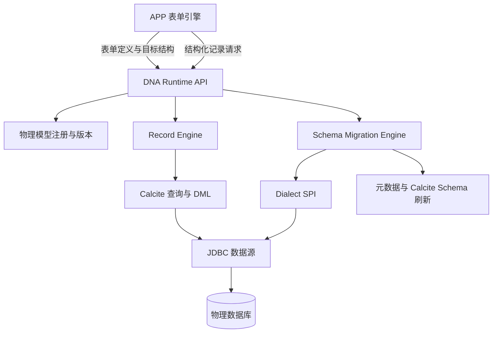

# DNA 表单引擎数据底座实施计划

> 状态：阶段 1 至阶段 5 已完成
> 基线日期：2026-09-29
> 适用范围：`simplepoint-data-calcite`、`simplepoint-plugin-dna-*`、`simplepoint-service-dna`、`simplepoint-service-app` 及对应前端模块

## 1. 目标与已确认决策

DNA 将作为 APP 表单引擎的数据与元数据底座。APP 负责表单定义、页面、业务校验和发布编排；DNA 负责物理模型、结构迁移、记录读写、方言适配、权限、审计和元数据一致性。

已确认的存储方式是“每个已发布表单对应一张物理表”，以支持直接 SQL 查询。表单版本演进同一张物理表，不为每个版本重复建表。页面不等同于表单，主页面和附属页面与表单之间的绑定由 APP 领域维护。

统一执行边界如下：

- 查询以及标准 `INSERT`、`UPDATE`、`DELETE` 由 Calcite 负责解析、校验、规划和下推。
- 表单发布通过 DNA 结构化元数据接口提交目标结构，不由 APP 拼接 DDL。
- DNA 根据当前结构和目标结构生成迁移计划，由数据库方言生成原生 DDL，最终通过目标数据源 JDBC 执行。
- SQL 控制台可以保留 DDL 扩展解析入口，但不能作为表单发布接口。
- 跨数据源写入、分片路由、分批写入和分布式事务属于后续规划，不进入当前基础增删改查范围。



## 2. 当前基础与明确缺口

截至基线日期，仓库已经具备 Calcite 联邦查询、单数据源标准增删改、JDBC 元数据浏览、单项结构化 DDL、数据库方言、SQL 审计和数据源级操作授权。

现有能力仍以 SQL 控制台和数据库对象管理为中心，缺少表单引擎可以稳定依赖的运行时契约：

1. 没有物理模型、模型版本和表单到物理表的受控绑定。
2. 没有面向模型的结构化 Record CRUD API。
3. 没有返回主键、乐观锁和多步骤单数据源事务契约。
4. 没有结构快照、差异计算、迁移计划、发布状态机和失败恢复。
5. 结构化 DDL 缺少表重命名、清空、索引和注释等能力。
6. DDL 后没有按数据源、Schema 和表精确刷新 JDBC 元数据及 Calcite Schema。
7. 当前权限主要停留在数据源与操作类型，缺少模型绑定、租户、行和字段约束。
8. DNA JDBC 驱动的写操作与“只读、自动提交、无事务”连接契约不一致。

## 3. 强制架构边界

以下要求是实施门禁，不是建议。

### 3.1 领域边界

- APP 只能使用 DNA 的版本化 Runtime API，禁止直接访问 DNA 元数据表、数据源凭据或物理连接。
- APP 请求只能携带 `physicalModelId`、表单版本和业务数据，禁止由客户端指定任意数据源、Schema、表名或原生 SQL。
- DNA 服务端必须根据当前租户、应用、表单和模型绑定解析物理位置，不能信任客户端传入的租户或物理对象标识。
- 现有 `DnaDataModel` 继续表示 DNA SQL/Native SQL 查询模型；物理表模型使用独立领域对象，禁止复用查询模型实体承载发布状态。
- SQL 控制台、外发 DNA JDBC 驱动和表单 Runtime API 是三个不同入口，共享底层执行能力，但不得共享未经约束的上层授权语义。

### 3.2 模块与依赖

新增能力采用 API 与实现分离，建议新增：

- `simplepoint-plugin-dna-runtime-api`：领域命令、响应、服务接口、错误码和扩展 SPI，不依赖 Spring MVC、JPA 实现或具体数据库驱动。
- `simplepoint-plugin-dna-runtime-implementation`：物理模型、记录运行时、迁移编排、权限审计和缓存协调实现。
- `simplepoint-service-dna`：只负责暴露服务接口、服务间认证和装配，不堆放数据库方言或迁移算法。

`simplepoint-data-calcite` 保持通用查询/DML 引擎定位；数据库差异必须进入 DNA 方言 SPI。禁止在 Controller、APP 服务或迁移编排中散落 `if mysql`、`switch oracle` 等厂商判断。

### 3.3 数据访问

- Record API 必须使用结构化查询和写入请求，并使用参数绑定；禁止拼接业务值生成 SQL。
- 查询必须复用平台服务端分页、筛选、排序、字段投影和复杂度限制契约。
- 所有查询、计数、详情和写入校验必须使用同一租户、数据和字段权限口径。
- 更新和删除默认要求记录主键及 `expectedVersion`，版本不匹配返回稳定的冲突错误。
- 新增必须返回平台记录 ID、记录版本和服务端生成字段。平台优先生成稳定 UUID，数据库自增作为方言能力而非默认依赖。
- 基础事务只保证一个物理数据源内的原子性。事务 API 必须显式声明提交、回滚、超时和隔离能力，不得用空实现伪装支持。
- 事务以一次服务调用内的原子命令组执行，禁止通过 HTTP、RPC 或 JDBC Socket 暴露跨请求的长事务会话。
- 默认软删除；物理清理、`TRUNCATE` 和 `DROP` 属于受控管理操作，不能由普通表单提交触发。

### 3.4 元数据与 DDL

- 表单发布固定经过“校验 → 加锁 → 读取实际结构 → 计算差异 → 生成计划 → 执行 → 复核 → 刷新缓存 → 激活版本 → 审计”。缓存刷新必须在激活前成功，避免已经可见的新版本继续读取旧元数据。
- APP 提交目标结构，DNA 决定迁移步骤；禁止 APP 按数据库方言提交多条 DDL。
- 迁移步骤必须持久化、可重试、可审计和幂等，不能假设数据库 DDL 可以统一回滚。
- 字段删除、类型收窄、非空变更、表/字段重命名等操作必须标记风险并执行兼容性检查。破坏性变更采用延迟删除或两阶段迁移。
- 发布成功后必须重新读取实际结构并比对目标结构。执行成功但复核失败时不得激活新版本。
- 结构变更后必须精确失效对应物理模型、数据源、Schema 和表的缓存；全量清理只能作为管理员恢复手段。
- 原始 DDL SQL 路由不得使用正则结果作为安全边界。表单发布只允许结构化操作和服务端绑定目标。

### 3.5 多租户、权限与审计

- 物理模型必须绑定租户、应用、表单和目标数据源，绑定关系由服务端维护。
- 共享数据库中的表必须包含平台租户字段；采用独立 Schema 或独立数据源时也必须记录隔离策略并在服务端验证。
- 运行时权限必须与平台资源、数据权限和字段权限取交集，不能仅检查 `DML` 或 `DDL` 操作权限。
- 审计记录至少包含请求主体、租户、模型、表单版本、目标数据源、操作类型、影响行数、迁移版本、耗时和结果；业务字段值、密码和连接凭据不得进入日志。
- 服务间调用必须使用平台现有服务认证与授权上下文，禁止通过内部接口绕过租户和资源授权。

### 3.6 平台 UI 强制标准

- 资源 CRUD 列表必须使用 `SimpleTable`、服务端 `/schema`、服务端分页/筛选/排序及权限过滤按钮。
- 复合、内存或专用结果表使用平台 `DataTable`；禁止直接使用 Ant Design `Table` 重建平台能力。
- 工具栏、记录和详情动作必须通过 `SimpleTable` 或共享 `TableActions` 渲染，权限判断保留在服务端。
- 表单与实体选择优先使用 `SForm`、`EntitySelect` 等平台组件。平台已有能力覆盖时，禁止使用 Ant Design 原生表格、按钮、表单、选择器或分页组件。
- 只有平台组件确实无法覆盖的专用编辑器或对话框确认控件可以例外；不明显的例外必须在代码中说明原因。
- 新增页面前必须先检查 `simplepoint-react/libs/components`，禁止建立平行的本地表格、按钮栏、筛选或选择实现。

### 3.7 代码质量与可扩展性

- 公共契约使用明确的 command/result 类型和稳定错误码；禁止以无约束 `Map<String, Object>` 代替元数据定义。动态记录值可以使用 Map，但必须由模型字段元数据逐项校验和转换。
- 方言 SPI 必须声明能力，再生成 SQL。未声明支持的操作在计划阶段拒绝，禁止执行到数据库后才发现不支持。
- 逻辑字段类型与数据库原生类型分离。表单只使用平台逻辑类型，方言负责类型映射、默认值、Identity 和表达式渲染。
- Runtime API 必须携带明确的契约版本；兼容性变更先增加新版本并提供迁移期，禁止原地改变既有字段语义。
- 每个迁移步骤、Record 命令和缓存失效操作必须有单一职责；禁止在 Controller 中编排事务、权限、SQL 和缓存。
- 新增公共能力前先检查现有 core、query、permission、schema 和组件实现，禁止复制已有协议形成第二套标准。
- 不允许静默降级：权限上下文缺失、方言能力未知、结构漂移、缓存刷新失败或事务能力不足时必须返回明确状态。
- 支持某数据库必须有该数据库真实集成测试证据；仅通过 H2 测试不能声明完成厂商兼容。

## 4. 核心领域模型

建议的最小领域对象如下，具体表名在阶段 1 设计评审时确定：

| 对象 | 职责 | 关键字段 |
| --- | --- | --- |
| `PhysicalModelDefinition` | 表单物理模型身份与绑定 | tenant、app、form、dataSource、catalog、schema、table、status、activeVersion、lockVersion |
| `PhysicalModelVersion` | 一次不可变目标结构快照 | modelId、version、schemaJson、checksum、createdBy、createdAt |
| `SchemaMigration` | 一次发布迁移及状态 | modelId、fromVersion、toVersion、status、risk、startedAt、finishedAt、errorCode |
| `SchemaMigrationStep` | 可恢复的有序迁移步骤 | migrationId、sequence、operation、payload、status、attempt、checksum |
| `DialectCapability` | 数据库能力快照 | dialect、databaseVersion、operation、supportLevel、notes |
| `RecordAudit` | 模型级数据操作审计 | modelId、operation、recordId、expectedVersion、affectedRows、principal、tenant、result |

物理表标准系统字段：

| 字段 | 要求 |
| --- | --- |
| `id` | 必须；平台生成稳定 UUID，类型由方言映射 |
| `tenant_id` | 共享数据库必须；由服务端写入且禁止客户端覆盖 |
| `record_version` | 必须；用于乐观锁 |
| `created_by` / `created_at` | 必须；服务端生成 |
| `created_org_dept_id` | 必须；服务端写入当前组织，用于部门数据范围 |
| `updated_by` / `updated_at` | 必须；服务端维护 |
| `deleted_at` | 默认启用软删除；物理清理走管理任务 |

物理表名使用不可变平台标识生成，不能直接使用用户可修改的表单名称。表单改名不触发物理表重命名；只有显式管理迁移才允许修改物理名称。

## 5. Runtime API 基线

上层只面向模型，不面向物理表。第一阶段至少提供以下服务能力：

| 服务 | 操作 | 约束 |
| --- | --- | --- |
| `PhysicalModelService` | 创建草稿、读取、生成版本、查看状态 | 维护服务端物理绑定 |
| `SchemaPlanService` | 预检、生成差异、生成迁移计划 | 不执行任意 SQL |
| `SchemaPublicationService` | 发布、查询进度、失败重试 | 加锁、幂等、复核和审计 |
| `RecordQueryService` | 分页、详情、计数、字段投影 | 复用平台查询和权限契约 |
| `RecordCommandService` | 新增、修改、软删除 | 参数绑定、乐观锁、返回记录身份 |
| `RecordTransactionService` | 单次请求内执行原子命令组 | 显式能力和超时；不暴露跨请求事务；首期不跨源 |

查询请求必须包含模型 ID、分页、排序、平台条件树和请求字段；写入请求必须包含模型 ID、字段值，更新/删除还要包含记录 ID 与期望版本。物理目标、租户字段、审计字段和权限条件均由服务端补充。

## 6. 方言 SPI 能力矩阵

方言必须以能力描述器公开以下信息，并由迁移规划器在执行前校验：

1. 命名空间、表和视图的创建/删除。
2. 表重命名和 `TRUNCATE`。
3. 字段增加、删除、重命名、类型/长度/精度、默认值、可空性和 Identity 变更。
4. 主键、唯一、外键、检查约束及级联行为。
5. 普通、唯一、组合索引的创建和删除。
6. 表及字段注释。
7. DDL 事务性、原子 DDL、在线变更和锁表风险。
8. DML 返回主键/`RETURNING`、参数上限、批量能力和事务隔离级别。
9. 标识符长度、保留字、大小写、引用规则和类型映射。

能力支持级别统一为 `SUPPORTED`、`SUPPORTED_WITH_LIMITS`、`UNSUPPORTED`。`SUPPORTED_WITH_LIMITS` 必须携带机器可判定的限制，不能只写自然语言备注。

首批正式支持 MySQL 和 PostgreSQL。Oracle、SQL Server、达梦、ClickHouse、Hive、Presto、Trino 在完成对应能力矩阵和真实集成验证前只能标记为实验性或只读能力。

## 7. 迁移状态与安全规则

迁移状态固定为：

```text
DRAFT → VALIDATING → READY → MIGRATING → VERIFYING → ACTIVE
             │                    │           │
             └──────────────→ FAILED ←────────┘
```

迁移风险分级：

| 等级 | 示例 | 默认处理 |
| --- | --- | --- |
| `SAFE` | 新增可空字段、新增索引 | 可自动执行 |
| `CONDITIONAL` | 新增非空字段、扩大/转换类型、重命名 | 必须完成预检和数据处理计划 |
| `DESTRUCTIVE` | 删除字段、缩短长度、清空或删除表 | 禁止普通发布直接执行，要求延迟清理或独立管理操作 |

同一物理模型同一时间只允许一个迁移。重复提交相同目标版本返回已有迁移结果；不同目标版本并发提交必须冲突失败，不能排队后静默覆盖。

## 8. 分阶段实施路线

状态使用 `NOT_STARTED`、`IN_PROGRESS`、`BLOCKED`、`DONE`。只有实现、测试、文档和迁移证据齐全才能标记 `DONE`。

### 阶段 1：领域契约与物理模型注册

目标：建立后续能力不可绕过的标准入口。

| 编号 | 工作项 | 状态 | 验收条件 |
| --- | --- | --- | --- |
| FND-001 | 新增 Runtime API/Implementation 模块与依赖边界 | DONE | API 无实现层依赖；服务装配通过 |
| FND-002 | 建立物理模型、版本和绑定实体 | DONE | 租户、APP、表单、数据源和物理位置可追溯；唯一约束完整 |
| FND-003 | 定义平台逻辑字段类型与值转换协议 | DONE | 不暴露厂商类型给 APP；空值、日期、数值和 JSON 语义明确 |
| FND-004 | 建立方言能力描述器 | DONE | 未支持能力可在执行前拒绝 |
| FND-005 | 定义稳定错误码、状态机和审计事件 | DONE | Controller 不解析数据库异常文本决定业务状态 |

阶段 1 实际落地如下：

- `simplepoint-plugin-dna-runtime-api` 只包含版本化命令、结果、逻辑类型、服务接口、方言 SPI、错误码、状态机和审计协议，不引用 Runtime 实现层。
- `simplepoint-plugin-dna-runtime-implementation` 持有 JPA 实体、仓储、租户上下文读取、服务端放置解析、不可变表名生成、Schema 编解码、严格值转换和注册事务。
- 注册事务同时写入物理模型、服务端绑定、初始 Schema 版本和脱敏审计事件；表单重复注册和版本追加并发分别由数据库唯一约束与乐观锁兜底。
- 物理表名由模型 UUID 生成 30 位可移植标识，表单名称和客户端值不参与命名。客户端只能提交逻辑 `placementKey`，不能提交数据源、Catalog、Schema 或表名；模型响应也不返回服务端物理位置。
- 控制面升级脚本为 `doc/deployment/sql/20260929-dna-form-runtime-foundation.sql`。脚本只创建 Runtime 元数据表，不创建表单物理表。

服务端必须配置至少一个逻辑放置目标；缺失配置时注册操作返回稳定错误码 `PLACEMENT_UNAVAILABLE`，不会回退到任意默认连接：

```yaml
simplepoint:
  dna:
    runtime:
      placement:
        targets:
          default:
            data-source-id: forms-primary
            catalog-name: ""
            schema-name: forms
            isolation-mode: SHARED_DATABASE
```

生产环境的 `data-source-id` 必须引用 DNA 已管理的数据源。共享数据库使用 `SHARED_DATABASE`；独立 Schema 和独立数据源分别使用 `DEDICATED_SCHEMA`、`DEDICATED_DATA_SOURCE`。按租户或 APP 动态放置时，应替换 `PhysicalBindingTargetResolver`，调用方仍只传逻辑策略键。

阶段 1 只建立方言能力声明和前置拒绝机制。阶段 2 已补充 MySQL/PostgreSQL 的真实能力矩阵、建表与复核；数据库支持范围及证据以阶段 2 记录为准。

阶段 1 验证记录（2026-09-29）：

- Runtime API 与 Implementation 执行 Gradle `check` 通过，共 20 个测试，失败、错误和跳过均为 0；包含 Checkstyle、状态机、逻辑类型、方言前置拒绝、审计契约、Spring 装配和 H2 关系模型测试。
- `simplepoint-service-dna` 在跳过前端构建后编译通过，现有 30 个服务测试全部通过，证明新增模块可以进入 DNA 服务运行时类路径。
- PostgreSQL 控制面升级脚本已使用 H2 PostgreSQL 兼容模式完成语法和约束装载检查；该检查不替代阶段 2 的真实 PostgreSQL 目标库集成测试。
- 服务模块全量 Checkstyle 仍被当前工作区既有的 `DnaDataModelController`、`DnaDataModelCatalog` 及对应测试阻断；新增 Runtime 两个模块的 Checkstyle 已通过。本阶段没有改写这些并行开发文件。

### 阶段 2：首次发布与建表闭环

目标：从表单目标结构安全创建一张可查询的物理表。

| 编号 | 工作项 | 状态 | 验收条件 |
| --- | --- | --- | --- |
| DDL-001 | 实际结构快照和规范化 checksum | DONE | 相同语义结构跨读取顺序得到相同 checksum |
| DDL-002 | 初始 Schema 计划与标准系统字段注入 | DONE | APP 不能覆盖租户、审计和版本字段 |
| DDL-003 | MySQL/PostgreSQL 建表、主键、索引和注释适配 | DONE | 两种真实数据库集成测试通过 |
| DDL-004 | 发布锁、幂等执行、步骤记录和失败状态 | DONE | 重试不重复创建；并发发布可预测冲突 |
| DDL-005 | 执行后复核及精确缓存失效 | DONE | 新表可立即被元数据和 Calcite 查询发现 |

阶段 2 实际落地如下：

- Runtime API 新增 `SchemaPlanService`、`SchemaPublicationService`、发布命令/视图、迁移状态与步骤状态、物理结构快照和 `RuntimeMetadataCacheInvalidator`。公共响应不返回原生 DDL、数据源凭据或物理绑定。
- Runtime Implementation 新增 `SchemaMigrationEntity`、`SchemaMigrationStepEntity` 和租户范围仓储。迁移、步骤与模型状态分别持久化，模型和迁移使用悲观锁串行推进，同一模型版本使用数据库唯一约束保证幂等。
- 首次发布按“声明目标 → 读取实际结构 → 生成确定性计划 → 持久化带 checksum 的步骤 → 逐步执行 → 重新读取并比对 checksum → 缓存失效 → 激活”执行。重复提交已经存在的目标版本直接返回原迁移，即使调用方仍持有发布前的模型锁版本。
- 控制面状态推进使用短 `REQUIRES_NEW` 事务，目标库 DDL 不占用控制面长事务。每条 DDL 在目标连接自动提交模式下独立执行，适配 MySQL 隐式提交，也不虚构跨控制面与目标库的原子事务。
- 重试会重新生成计划并校验已持久化步骤 checksum；数据库中已满足的步骤标记为 `SKIPPED`，已完成步骤发生漂移时返回 `SCHEMA_DRIFT_DETECTED`。执行异常、复核异常和缓存失效异常均持久化为 `FAILED`，不会激活目标版本。
- 初始计划固定注入 `id`、`tenant_id`、`record_version`、`created_org_dept_id`、创建/更新审计字段及 `deleted_at`，并创建主键、逻辑索引、表注释和字段注释。系统字段不能由 APP 目标结构覆盖。
- 可执行方言与现有 DNA Core JDBC 方言同时解析且必须一致。当前正式声明 MySQL 8+、PostgreSQL 13+；其他数据库在提供能力实现和真实数据库证据前会在计划阶段拒绝。
- `FederationMetadataCacheService` 使用数据源版本隔离 JDBC 元数据 L1/L2 键；发布成功复核后先推进目标数据源版本，再关闭所有包含该数据源的本机 Calcite Schema 组装。失效范围限定在目标数据源，不执行平台全量清理。当前 Calcite Schema 的缓存所有者是数据源组装，因此数据源是可安全关闭的最小单元；失效接口仍携带 Catalog、Schema 和表标识，后续缓存拆分时无需修改发布 API。
- Redis 已配置但版本读取失败时强制产生新缓存 token 并回源，不继续使用旧会话元数据；版本推进失败时发布返回 `METADATA_INVALIDATION_FAILED` 并保持失败状态。未配置 Redis 的单实例部署使用本地版本。
- 控制面升级脚本为 `doc/deployment/sql/20260929-dna-form-runtime-publication.sql`，新增迁移和步骤表、外键、唯一约束、状态约束与查询索引；目标物理表仍由托管数据源上的发布流程创建。

阶段 2 的数据库与类型边界：

- PostgreSQL 使用 `JSONB`、`BYTEA` 和带时区时间戳；MySQL JSON 和二进制分别使用 `JSON`、`LONGBLOB`。平台记录 ID 与逻辑 UUID 在两个数据库统一使用 `VARCHAR(36)`，保证 Calcite JDBC DML 参数下推可移植。
- MySQL 为 utf8mb4 行大小、标准系统字段和行开销保留安全边界，单表业务 `VARCHAR` 总字符数最多 14685；MySQL 的 `TEXT`、`JSON`、`BINARY` 默认值在计划阶段拒绝。
- 阶段 2 交付时仅支持首次发布；阶段 4 已在相同发布状态机上补齐字段、索引、唯一约束和注释演进。
- 阶段 2 已提交步骤可被识别，阶段 4 进一步加入管理员恢复入口、无活动阈值和执行令牌隔离。显式重试仍只接受 `FAILED` 迁移，避免两个实例同时推进控制面状态。

阶段 2 验证记录（2026-09-29）：

- Runtime API 与 Implementation 的 Gradle `check` 通过；包含规范化 checksum、发布顺序、失败不激活、步骤跳过、缓存失败、重复发布幂等和控制面关系模型测试。
- Federation Implementation 主源码 Checkstyle 与全量测试通过；覆盖数据源范围版本隔离、缓存桥接顺序及 Redis 版本读取失败时的强制 miss。
- `simplepoint-service-dna` 在跳过前端构建后全部现有测试通过，证明 Runtime 发布实现、Federation 缓存桥和仓储查询可以共同装配。
- PostgreSQL 17 与 MySQL 8.4 在同一次强制集成测试中各完成真实建表、主键、唯一/组合索引、Unicode 表/字段注释、全部逻辑类型/default 映射、JDBC 元数据回读、目标 checksum 比对和重复规划，2 个用例失败、错误、跳过均为 0。
- 阶段 1 与阶段 2 的控制面升级脚本已在真实 PostgreSQL 17 空库顺序装载，6 张 Runtime 表以及迁移/步骤外键、唯一约束、检查约束和索引均已核对。
- Federation 模块全量 `checkstyleTest` 仍被当前工作区 8 个既有/并行修改测试文件的 42 条导入顺序和命名告警阻断；阶段 2 新增的缓存测试不在违规清单中。本阶段未改写这些无关测试文件。

真实数据库回归通过环境变量启用，默认单元测试执行时会跳过外部数据库用例：

```bash
DNA_RUNTIME_TEST_POSTGRES_URL='jdbc:postgresql://127.0.0.1:5432/dna_runtime' \
DNA_RUNTIME_TEST_POSTGRES_USER='postgres' \
DNA_RUNTIME_TEST_POSTGRES_PASSWORD='postgres' \
DNA_RUNTIME_TEST_MYSQL_URL='jdbc:mysql://127.0.0.1:3306/dna_runtime?useSSL=false&serverTimezone=UTC' \
DNA_RUNTIME_TEST_MYSQL_USER='root' \
DNA_RUNTIME_TEST_MYSQL_PASSWORD='root' \
JAVA_HOME=/path/to/jdk-21 PATH=/path/to/jdk-21/bin:$PATH \
./gradlew \
  :simplepoint-plugins:simplepoint-plugin-dna:simplepoint-plugin-dna-runtime-implementation:test \
  --tests '*RuntimeSchemaDialectIntegrationTest' --rerun-tasks \
  -Psimplepoint.frontend.skip=true
```

### 阶段 3：基础 Record CRUD

目标：提供表单运行时可直接使用的基础增删改查。

| 编号 | 工作项 | 状态 | 验收条件 |
| --- | --- | --- | --- |
| DATA-001 | 结构化分页/详情/计数查询 | DONE | 使用平台条件语义、稳定排序和字段投影；查询与 count 同口径 |
| DATA-002 | 结构化新增并返回记录身份 | DONE | 参数绑定；返回 ID、版本和服务端字段 |
| DATA-003 | 结构化更新和软删除 | DONE | 强制 `expectedVersion`；冲突不覆盖数据 |
| DATA-004 | Calcite DML 执行与物理 SQL 观测 | DONE | 标准增删改经 Calcite；审计不记录敏感值 |
| DATA-005 | 单数据源事务契约 | DONE | 提交、回滚、超时和连接释放有真实集成测试 |
| DATA-006 | 模型级租户、数据和字段权限 | DONE | 列表、count、详情、写入和删除无法绕过相同范围 |

### 阶段 4：结构演进与迁移恢复

目标：支持已发布表单的安全字段演进。

| 编号 | 工作项 | 状态 | 验收条件 |
| --- | --- | --- | --- |
| EVOL-001 | 当前/目标 Schema diff | DONE | 新增、修改、字段重命名、删除、索引和唯一约束差异稳定可复现 |
| EVOL-002 | 风险分级和兼容性预检 | DONE | 数据截断、非空和类型转换风险在执行前发现 |
| EVOL-003 | 字段重命名、索引、唯一约束和注释适配 | DONE | 能力矩阵与生成 SQL 一致；物理表名按设计保持不可变 |
| EVOL-004 | 两阶段破坏性迁移门禁 | DONE | 普通发布不能直接删除字段、清空或删表 |
| EVOL-005 | 漂移检测、失败重试和人工恢复入口 | DONE | 外部改表可识别；恢复过程保留完整审计 |

### 阶段 5：平台化管理与质量收口

目标：完成标准页面、运维治理和正式支持矩阵。

| 编号 | 工作项 | 状态 | 验收条件 |
| --- | --- | --- | --- |
| GOV-001 | 物理模型、版本、迁移和审计标准列表 | DONE | 使用 `SimpleTable`、真实 `/schema` 和服务端分页权限按钮 |
| GOV-002 | 迁移计划与结构差异复合视图 | DONE | 使用平台 `DataTable`/共享动作；无原生表格和业务按钮重复实现 |
| GOV-003 | 指标、限流、超时和慢操作观测 | DONE | 可按租户、模型、数据源和操作定位失败与耗时 |
| GOV-004 | DNA JDBC 驱动写入/事务契约统一 | DONE | 明确拒绝并引导 Runtime API |
| GOV-005 | 支持矩阵、升级与恢复文档 | DONE | 每个正式支持数据库有版本范围和真实测试证据 |

### 阶段 3 实际落地

- Runtime API 提供分页、count、详情、新增、更新、软删除及一次请求内的原子命令组。查询条件、投影、排序和事务大小均有明确预算；事务 mutation 使用稳定的 `type` 判别字段。
- `RecordSqlCompiler` 只从受信模型元数据生成标识符，租户、业务条件、行权限和全部业务值均使用参数绑定。分页固定追加记录 ID 排序，分页和 count 复用同一谓词生成路径。
- `RuntimeCalciteRecordBackend` 为单次命令组复用一个物理连接并关闭自动提交，每个 DML 都调用 `CalciteQueryEngine.executeUpdate`；影响行数异常时回滚，成功后统一提交。
- 更新和软删除同时校验记录 ID、租户、软删除状态、行权限和 `expectedVersion`。零影响行数在回滚后进行权限范围内的版本探测，区分不存在与版本冲突。
- 新增由服务端生成 UUID、租户、组织、版本和审计字段，并在执行前检查当前行权限。活动数据范围表达式使用的字段不能由同一次更新改写，避免把记录移出授权范围。
- 模型页面绑定由服务端持久化；页面资源、模型绑定、行权限和动态字段权限取交集。隐藏或掩码字段不能筛选或排序，掩码读取返回固定脱敏值。
- 控制面升级脚本为 `doc/deployment/sql/20260930-dna-record-runtime.sql`。

阶段 3 验证记录（2026-09-30）：

- H2 真实数据库测试覆盖服务级新增、查询、分页、count、更新、软删除、乐观锁冲突和多命令回滚，不以 mock 调用代替事务结果。
- PostgreSQL 17 与 MySQL 8.4 真实测试均覆盖 Calcite 新增/更新/软删除、时间参数、提交和失败回滚。
- HTTP 绑定测试覆盖结构化查询和 `CREATE`/`UPDATE`/`DELETE` 多态事务命令。

### 阶段 4 实际落地

- 演进规划器先用活动逻辑版本重建预期快照，并与数据库实际结构比对；不一致立即返回 `SCHEMA_DRIFT_DETECTED`。
- 稳定 `fieldId` 用于识别字段重命名；规划顺序为删除受影响索引、字段演进、重建索引，并支持字段增删、重命名、类型/长度/精度/默认值/可空性调整以及表/字段注释。
- 新增必填字段、现有 NULL、长度/精度收窄和不兼容类型转换在执行前完成预检与风险分类。每一步保留其精确方言能力，规划返回前逐项校验能力描述器。
- `DESTRUCTIVE` 计划可展示但普通发布在持久化或执行步骤前强制拒绝。`TRUNCATE`、`DROP TABLE` 和物理表重命名不开放给 APP；物理表名保持不可变，生命周期清理由独立受控管理流程承接。
- 平台治理页提供迁移详情、权限过滤的中断恢复与失败重试入口。人工恢复要求迁移超过服务端无活动阈值，并轮换持久化执行令牌隔离旧工作线程；重试生成新令牌、重新规划、校验持久化 checksum，并跳过数据库已经满足的步骤。

阶段 4 验证记录（2026-09-30）：

- PostgreSQL 17 与 MySQL 8.4 真实演进测试完成字段重命名、新增字段、索引重建、最终 checksum 复核，并验证字段删除计划被识别为 `DESTRUCTIVE`。
- 服务单元测试证明破坏性计划在 `ready` 和物理执行前失败并持久化稳定错误码。
- 状态机测试覆盖无活动阈值、人工恢复、旧执行令牌隔离和模型失败状态；恢复操作写入稳定错误码及审计事件。

### 阶段 5 实际落地

- 新增“表单数据底座”平台页面。物理模型、版本、迁移和审计均使用 `SimpleTable`、真实 `/schema`、服务端分页/筛选/排序和服务端权限动作；计划和迁移步骤使用 `DataTable`。
- 页面没有直接使用 Ant Design 原生 `Table` 或业务 `Button` 重建平台能力；仅使用 Drawer、Descriptions、Tag 和确认对话框承载专用详情交互。
- Runtime HTTP 适配层只委托版本化服务接口。稳定错误码按类别映射到 400/403/404/409/422/500，租户并发超限单独映射 429。
- 每租户并发预算默认 16，慢操作阈值默认 2000 毫秒。Micrometer 以操作和结果作为低基数标签；持久化审计和脱敏结构化日志提供租户、模型、数据源、操作和耗时维度。
- Federation 与 Runtime 共享唯一的 `CalciteQueryEngine` Bean。外发 DNA JDBC 明确保持只读、自动提交和无事务，所有 DML、DDL 与事务调用均返回引导到对应 Runtime API 的错误。
- 支持矩阵、配置、升级、回滚和漂移恢复见 [DNA 表单 Runtime 支持矩阵与运维指南](../architecture/dna_form_runtime_operations.md)。

阶段 5 验证记录（2026-09-30）：

- Runtime API、Implementation、JDBC Driver 和 DNA Service 的相关 Gradle 测试与 Checkstyle 通过。
- DNA 前端 TypeScript 检查、模块构建、国际化同步检查和平台组件守卫通过。
- 治理目录测试覆盖租户/软删除强制谓词、分页上限、查询能力 Schema 和权限过滤动作；配置装配测试证明只有一个 Calcite 引擎实例。
- PostgreSQL 17 与 MySQL 8.4 的真实回归同时覆盖 Schema 演进、Calcite Record 增删改、UTC 时间查询、事务提交和失败回滚。
- 完整生产构建产物浏览器冒烟通过，57 个微前端暴露模块全部可解析；四个 Runtime 标准列表、迁移详情/恢复、共享动作和对象存储配额选择器均无意外浏览器异常、告警或 HTTP 失败。
- 阶段 1 至阶段 3 的 PostgreSQL 控制面升级脚本已在 PostgreSQL 17 空库顺序执行，7 张 Runtime 表、外键、检查约束、索引以及非空迁移执行令牌均通过实库校验。

## 9. 测试与质量门禁

### 9.1 后端门禁

- 新增或修改的模块必须通过对应 Gradle 测试和静态检查。
- Schema diff、风险分类、类型转换、权限合并和幂等键需要纯单元测试。
- Record API 需要 Controller → Service → 数据库的真实契约测试，覆盖分页、count、详情、增删改、并发冲突和字段权限。
- DDL 需要真实 MySQL/PostgreSQL 集成测试，覆盖成功、部分失败、重复执行、并发执行、缓存刷新和漂移。
- 事务测试必须验证数据库真实提交/回滚结果，禁止仅验证 mock 调用次数。
- 安全测试至少覆盖跨租户模型 ID、伪造物理表名、隐藏字段筛选/排序、越权写入和服务间上下文缺失。
- 数据库支持声明必须记录测试版本、执行命令和结果；未验证数据库保持实验性。

### 9.2 前端门禁

- 最低运行 `pnpm typecheck`；涉及生产页面时运行对应构建和平台组件守卫。
- 真实 `/schema` 与前端列、筛选、排序和按钮契约必须一致。
- 权限撤销、错误重试、分页状态、迁移中状态和危险操作确认需要交互验证。
- 不为可逆、低风险展示修改堆叠无意义测试；权限、数据覆盖、迁移和并发风险必须有回归测试。

### 9.3 文档与数据库门禁

- 新增实体必须提供新建库定义和已有库升级脚本，并说明回滚与数据影响。
- 新增配置必须记录默认值、生产建议和兼容行为。
- 每个阶段完成后更新本计划状态、实际实现路径、验证命令和遗留限制。
- 未完成的步骤必须明确保留 `NOT_STARTED`、`IN_PROGRESS` 或 `BLOCKED`，禁止以“基本完成”替代验收证据。

## 10. 每个工作项的完成定义

一个工作项只有同时满足以下条件才能标记 `DONE`：

1. 实现遵守本文架构边界，没有新增旁路 SQL、旁路权限或重复平台组件。
2. API、实体、数据库迁移、权限资源、国际化和前端契约同步完成。
3. 关键成功、失败、权限、并发及恢复路径经过与风险匹配的测试。
4. 对外行为、配置、数据库兼容性和已知限制已更新文档。
5. 代码中没有临时厂商判断、空事务实现、静默降级或仅靠前端约束的安全逻辑。
6. 相关构建和测试命令通过，并在交付记录中列出实际结果。

计划中的强制边界如需调整，必须先更新本文，记录调整原因、兼容性影响和迁移办法，再修改实现；不能以临时代码绕过计划后补文档。

## 11. 后续规划边界

完成阶段 1 至阶段 5 后，再单独规划以下能力：

- 大批量写入、分片和分批提交。
- 跨数据源 `INSERT ... SELECT` 和写入路由。
- 多数据源事务、Saga 或补偿任务。
- 在线大表迁移、影子表和 CDC 回填。
- 归档、冷热分层和物理表生命周期配额。

这些能力必须复用本计划建立的物理模型、迁移状态、方言能力、权限和审计，不得建立第二套写入通道。

## 12. 关联文档

- [DNA 联邦查询平台设计](dna_federated_query_platform.md)
- [Schema API](../api/schema_api.md)
- [数据权限接入](../api/data-permission-integration.md)
- [服务间认证](../architecture/service_to_service_auth.md)
- [平台 Schema 驱动 UI](../architecture/schema_driven_ui.md)
