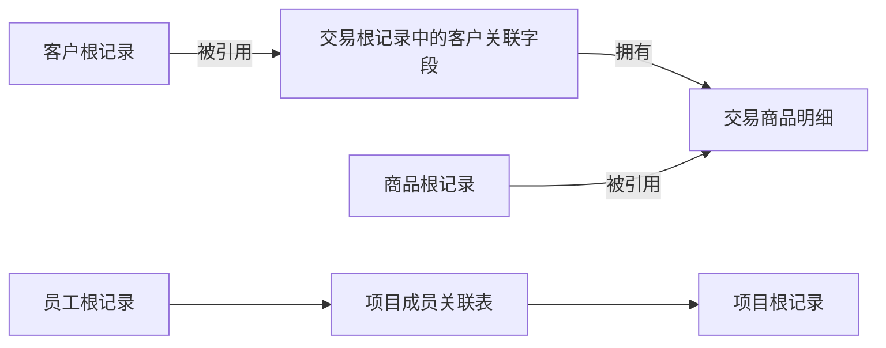

# 表单关联与数据穿透详细设计及实施计划

更新日期：2026-10-20。

状态：设计基线，待逐阶段实施。本文中的新增组件、契约、接口和关系能力均为拟实现设计；现有主从明细、平台实体选择及审批入口继续保留。当前任务只交付设计文档，不修改业务代码、不执行数据库迁移或部署。

## 1. 目标与范围

为表单引擎补齐五类能力，并支持一对一、多对一、一对多、多对多四种业务关系：

1. 关联记录字段：目标业务资源、展示字段、候选筛选、搜索选择，主表和明细行均可使用。
2. 关联穿透：从关联值打开目标详情，支持导航、返回及权限变化后的安全处理。
3. 关联带出：选中后复制业务快照，或按当前权限实时读取，明确两种语义。
4. 反向关联列表：从当前记录查看关联记录，按权限创建、修改、删除记录或添加、移除关联。
5. 跨表单计算与业务操作：受控读取、汇总、重算，以及明确事务边界的业务命令。

质量优先，遵循根目录 [AGENTS.md](../../AGENTS.md) 的平台 UI、表单扩展、权限、事件和部署强制标准。实施必须复用现有能力，通过公共契约扩展；不能在每张业务表单中复制查询、权限、CRUD 或事务控制器。

### 1.1 已确认的业务要求

- 客户信息与客户交易是一对多关系；交易选择所属客户，客户详情展示交易列表。
- 客户详情内的交易列表需要新增、修改、删除和查看；与独立交易页面使用相同的业务规则。
- 明细行内部也需要关联字段，例如交易的商品明细每行选择一个商品。
- 四种关系统一建模，避免先为一对多写死实现，再为其他关系重建体系。
- 先形成详细设计，后续按本文逐项实现。阶段测试通过不等于五项全部交付。

### 1.2 首版边界与扩展方向

| 范围 | 本计划决定 |
| --- | --- |
| 租户 | 所有业务关联限定在同一租户；客户端不能传入另一租户作为关联目标 |
| 数据源 | 强关联首版限定为同一已登记数据源、同一数据库及命名空间，且可使用同一个 JDBC 事务；不以 URL 字符串相同推定可共用事务 |
| 应用 | 允许同租户不同应用之间关联，但必须满足数据源能力与双方资源授权 |
| 目标记录 | 目标是独立业务表单的根记录；所属明细不能脱离父记录作为独立目标 |
| 关系字段位置 | 单值关联字段支持主表和一级所属明细；多对多关联集合首版挂在独立根记录上 |
| 一对一 | 支持可选／必选的单值引用加唯一性；“两侧在所有时刻都必须存在”需专用原子创建命令，普通表单创建不开放这种配置 |
| 多对多 | 支持平台管理的纯关联表；关系有业务属性时使用显式中间业务表单 |
| 嵌套界面 | 首版关联列表放在根记录详情区域；不在每个明细单元格内嵌套可编辑关联列表 |
| 任意跨库写入 | 继续沿用已延期的规划，不通过前端多次保存、XA 或 MQ 把它伪装成本轮原子事务能力 |
| 自引用 | 允许关联同表单的其他已保存根记录；首版禁止关联自身。两端角色有方向，A→B 与 B→A 是不同边；无向好友关系需另行设计规范化边键。组织树等无环业务规则需独立声明 |
| 关系环 | 普通 A→B→A 引用可以存在；计算依赖环、同步级联写入环必须拒绝 |

同数据源约束是本轮完整性保证的前提。后续跨数据源引用需单独定义弱引用、目标删除和补偿协议，不能静默降级本轮强关联契约。

## 2. 现状与需要扩展的位置

截至本次代码核对：

| 已有能力 | 当前事实 | 本轮扩展 |
| --- | --- | --- |
| 字段定义 | `FormFieldDefinition` 有 `REFERENCE` 存储模式，但没有通用关联目标和关系策略 | 增加可选、版本化关联字段契约 |
| 主从数据 | `FormDetailDefinition` 与 DNA `OwnedModelRelation` 描述所属明细 | 保持聚合语义，新增独立业务引用语义 |
| 组件注册 | `FormRuntime/componentRegistry.ts` 有用户、组织、角色、租户选择及 `data.detail` | 注册业务记录选择与关联列表组件 |
| 选择控件 | `EntitySelect` 已有分页搜索、选中项回读和作用域隔离 | 扩展业务关系数据源适配，复用回读与取消机制 |
| 数据列表 | `SimpleTable` 拥有资源 schema、查询、分页、操作和表单生命周期 | 增加关联上下文适配，保持单个 CRUD 控制器 |
| 计算 | `calculationModel.ts` 的字段作用域为本表单、父记录及所属明细 | 宿主解析外部依赖，保持计算库独立 |
| 事务 | `RecordTransactionCommand` 当前限定单个物理模型；所属主从另有聚合能力 | R1 增加跨独立模型引用校验；R5 再建设受限多模型业务命令 |
| 物理约束 | 方言能力有外键操作标识；`PhysicalSchemaDefinition` 当前只有字段、索引、owner | 补齐关系存储投影、迁移、校验与恢复，不能把枚举存在算作外键功能已贯通 |
| 发布与事件 | 已有不可变版本、治理版本、回填／恢复、资源代际及 outbox/inbox | 关系依赖、关联操作和重算事件接入原生命周期 |

关键源码入口见文末。既有计算交付的通过状态仍以 [计算交付计划](form_calculation_delivery_plan.md) 为准，本计划不重置已完成目标。

## 3. 统一关系模型

### 3.1 一个关系定义与两个访问方向

每个关系具有稳定 `relationId` 和版本。关系定义只由一个权威拥有方发布；另一侧的组件只引用此关系及方向，不复制一份可独立修改的规则。

- 多对一与一对多是同一关系的两个方向。
- 一对一由一个单值引用及唯一性约束实现，另一端反向查询。
- 多对多由关联表的唯一边实现，两个方向都查询同一张表。
- 关系字段保存稳定记录 ID；名称、物理列名、菜单 URL 均不是关联键。
- 独立关系与 `OwnedModelRelation` 分开建模。独立客户、交易、商品各有自己的生命周期；商品明细属于交易聚合。



### 3.2 四种关系的约束

| 关系 | 持久化位置 | 默认设计器表现 | 强制约束 |
| --- | --- | --- | --- |
| 多对一 N:1 | 多的一侧保存目标记录 ID | 单选关联字段 | 同租户、目标有效、写入准入、引用完整性 |
| 一对多 1:N | 复用 N:1 的引用字段，反向查询 | 关联列表 | 不在一的一侧另存 ID 数组 |
| 一对一 1:1 | 选定的一侧保存目标记录 ID | 单选关联字段＋反向详情入口 | 同租户目标唯一；空值不占用唯一关系 |
| 多对多 M:N | 平台管理关联表，保存两侧记录 ID | 多选关联集合或关联列表 | `(tenant, relation, leftRecord, rightRecord)` 唯一，边操作幂等 |

`required` 与基数分别表达。1:1 的唯一约束表示“至多一个”，源字段必填表示源记录必须关联目标，不能推出每条目标记录必定有一个源记录。集合最小数量等业务约束在声明的保存／提交时点检查；普通创建不能要求尚不存在的两侧同时满足双向必填。

一对一首版按全部保留引用实施唯一性，包括源软删除后尚未解除的引用；软删除不能让旧关系在恢复时碰撞。需要释放占用时使用显式解除／归档流程，必填或已提交记录不允许直接解除。

一对一字段位于所属明细时，唯一性覆盖该关系下同租户的全部明细行，不能限定在单张父单据内；设计器需明确提示这一范围。一个父记录内的行去重属于独立的明细唯一规则，不等同于一对一。

### 3.3 多对多的两种业务形态

**纯关联示例：项目成员。**平台管理关联表，仅保存关系、两端 ID、边 ID、版本、租户和审计字段。添加成员不复制员工记录；移除成员只删除／退役关联边。关联表不作为普通资源暴露给客户端直接编辑。

**有属性的关系示例：员工参与项目的角色、起止日期、投入比例。**建立“项目参与”业务表单，分别以 N:1 关联项目和员工，其业务字段、审批和版本独立管理。可配置两侧唯一组合；若允许同一员工多次参与同一项目，则使用带期间／角色的明确业务唯一键。

“交易—商品”有数量、单价时，通常使用交易所属明细，每行 N:1 关联商品。库存或价格历史不能塞进一个仅保存商品 ID 的多选控件。

## 4. 身份与元数据契约

### 4.1 关系身份和页面入口分离

逻辑目标由 `applicationId + formId` 固定，租户来自服务端上下文。目标页面资源是访问和展示入口，不是数据模型身份。

设计者选择“客户管理”后，服务端解析其当前发布表单、资源 ID、绑定代际和稳定字段 ID。发布时固化逻辑关系身份及兼容要求；每次运行重新校验入口状态、当前绑定和权限。

- 同一表单有多个页面时，关系配置选择一个明确入口；不可遍历其他页面寻找更宽权限。
- 目标入口被改绑到另一张表单时，旧关系进入不可用状态，不能跟随页面自动指向新表单。
- 目标重新上线或兼容版本发布时，服务端核验身份和契约后推进执行投影；沿用原逻辑关系，但不得恢复旧授权。
- 更改目标表单属于关系替换／数据迁移，禁止复用原关系 ID 改变含义。
- 明细中的字段身份为 `(formId, detailId, fieldId)`，不能仅按 `fieldId` 拼接。

### 4.2 拟新增契约

以下名称为实施契约建议，最终以 R0 评审后的代码为准；职责和语义必须保留。

| 契约 | 内容与拥有方 |
| --- | --- |
| `FormRelationDefinition` | 源表单发布的关系定义：稳定 ID、版本、两端逻辑身份、基数、权威存储侧、删除和解除策略 |
| `FormFieldReference` | 主表／明细字段引用 `relationId` 与方向；仅单值引用字段声明 |
| `FormReferenceView` | 展示、搜索、候选过滤、绑定上下文和穿透入口配置，按场景允许收窄 |
| `FormReferenceFill` | 源目标字段映射、复制／实时模式、刷新规则与类型转换 |
| `FormRelatedListDefinition` | 关系 ID、方向、展示列、排序和允许操作的配置上限 |
| `RecordRelationPolicy` | DNA 中立执行契约：物理映射、租户字段、约束、当前治理版本和资源代际；不携带 UI 或 JPA 类型 |
| `ReferenceResolution` | 有界解析结果：ID、可读标签、目标版本、受权限过滤的展示值和能力；不替代保存时复核 |
| `RelationContext` | 服务端可验证的父记录、关系、方向和版本上下文，用于关联列表查询及操作 |

关系目录由服务端持久化的发布投影维护，支持按入向／出向关系查询和依赖评审。不能临时扫描所有租户的表单 JSON，也不能让反向页面自行注册第二份关系。

目标表单可先发布，存储侧随后发布关系，最后目标页面添加反向组件。反向组件只消费已激活关系，不拥有关系 DDL；安装反向视图不应造成双方必须同时发布的循环依赖。

### 4.3 单值关联定义示意

以下为语义示例，示例 ID 是文档别名；实现中由服务端分配稳定 ID。浏览器不提交物理表名、连接信息或信任后的授权描述。

```json
{
  "contractVersion": "1",
  "relationId": "trade-customer",
  "cardinality": "MANY_TO_ONE",
  "source": {
    "applicationId": "sales-app",
    "formId": "trade-form",
    "scope": "parent",
    "fieldId": "customer"
  },
  "target": {
    "applicationId": "sales-app",
    "formId": "customer-form",
    "accessResourceId": "customer-page"
  },
  "integrity": {
    "targetDelete": "RESTRICT",
    "allowUnlink": false
  },
  "view": {
    "labelFieldId": "customer-name",
    "searchFieldIds": ["customer-code", "customer-name"],
    "columnFieldIds": ["customer-code", "customer-name", "contact"],
    "candidateFilter": {
      "op": "EQ",
      "fieldId": "status",
      "value": {"kind": "STRING", "value": "ACTIVE"}
    }
  }
}
```

正式契约将“关系语义”与“场景展示”分别保存，上述示例放在一起仅用于说明设计项。可写请求只提交记录 ID 与必要的版本信息，不接受客户端标签作为可信业务值。

## 5. 四种关系的设计器操作

### 5.1 客户与交易

1. 设计并发布客户表单，具备编号、名称、联系人、电话和状态，注册客户资源。
2. 在交易主表添加“关联记录”字段，选择客户资源，关系为 N:1，字段名称为“所属客户”。
3. 设置必填、展示／搜索字段、候选条件、是否允许穿透；“只能选择启用客户”若为业务约束，另外启用保存时关联资格规则。
4. 发布交易表单。服务端安装关系、索引和写入校验，再激活页面。
5. 返回客户设计器，添加“关联列表”，选择入向关系“交易 → 所属客户”，配置交易编号、日期、金额、状态及操作。
6. 发布客户新版本。客户记录页面可查询自己的交易；客户和交易拥有独立保存与审批生命周期。

### 5.2 交易商品明细

1. 在交易添加所属“商品明细”，在明细“字段”页签新增关联记录字段。
2. 选择商品资源，配置 N:1、展示名称、商品编码搜索和启用筛选。
3. 增加数量、成交单价、金额字段；单价可通过 R3 复制规则带入，金额使用现有本聚合公式。
4. 每行独立选择商品。关联修改进入现有主从表单状态，跟随交易主表一次保存，不建立第二个行级未提交缓冲。
5. 商品反向查看使用情况时，返回交易根记录和命中的明细行标识；不开放所属明细绕过交易根权限的 CRUD。

### 5.3 员工与档案

1. 选择档案为存储侧，添加“所属员工”关联字段，配置 1:1。
2. 发布时验证现存重复数据，并创建租户范围唯一约束；并发选择同一员工只能有一个成功。
3. 员工侧添加反向档案入口。创建档案与编辑档案由档案资源授权决定。
4. 是否允许未建档员工、档案是否必填员工分别配置；双向强制存在不作为默认选项。

### 5.4 项目与员工

1. 在项目定义 M:N“项目成员”关系，以项目为关系定义拥有方，选择员工资源。
2. 平台发布并管理关联表；项目和员工页面均可引用这个关系，分别按正向和反向展示。
3. 项目侧“添加关联”打开员工选择器，“移除关联”只解除成员关系。
4. 若需要投入比例、项目角色等属性，改用“项目参与”业务表单，关系迁移经评审后完成；不能直接向既有纯关联边偷偷增加业务字段。

### 5.5 属性面板与展示标准

- 关联组件注册稳定且带图标的“基础”“关联”“筛选”“带出”“交互”页签；仅显示当前阶段支持的配置。
- 一对一／多对一字段使用共享 SForm 关联控件，搜索复用 EntitySelect；大列表选择器通过共享组件扩展，禁止业务页面复制原生 Table。
- 一对多／多对多列表使用 SimpleTable 的资源契约；可读的无 CRUD 关系概览使用 DataTable。
- 多对多的大集合使用分页列表。少量标签仅作有界预览，不能加载所有 ID 到表单数组并全量覆盖关系。
- 关联列表与复杂选择器限定宽高、保留最小列宽；手机、平板和桌面均有内滚动及键盘操作。
- 行操作统一图标＋文字；工具栏图标、帮助提示、状态色、时间和个人列偏好沿用平台标准。

## 6. 能力一 关联记录选择与关系写入

### 6.1 候选查询

候选查询条件为：当前租户 ∩ 目标资源可读范围 ∩ 关联选择权限 ∩ 已发布候选条件 ∩ 用户搜索条件。按服务端投影生成查询，不接受任意 URL、SQL、表名或未声明字段。

筛选采用版本化、有类型且有预算的条件 AST，字段绑定稳定 ID，复用平台条件编辑器／查询编译器。隐藏或脱敏字段不能作为搜索、筛选、排序、分组或计数推断入口。

首版支持常量、主表已声明标量、当前明细行已声明标量，以及服务端组织上下文。依赖字段未填写时提示先填写，不把过滤缺省成全量。浏览器传入的未保存上下文只能用于临时选择预览，保存时从真实聚合重新计算。

区分两种条件：

- **候选条件**：决定列表中推荐哪些值；依赖变化后清空旧请求结果，要求重新确认已选值。
- **关联资格规则**：决定当前业务是否可以新建／更换这条关联；由服务端在写事务中校验，禁止靠候选过滤实现业务约束。

资格默认在新建／换绑时验证。已有关系的无关字段修改不因目标后来停用而自动失败；“每次修改都必须满足资格”的业务可显式配置，提交时要求以当前规则独立复核。

### 6.2 搜索和标签回读

- 默认每页 20 条，上限 100 条；沿用平台稳定排序和分页，用户排序优先，默认创建时间倒序加唯一 ID。
- ID 回读独立于候选搜索，支持已有值不在第一页、目标停用后的历史值；仍执行当前读取权限。
- 标签按资源、租户、授权版本、关系治理版本、目标 ID 与目标版本缓存。不得只按 ID 建全局缓存。
- 搜索、防抖、翻页、选中项回读都支持取消；切换当前行／关联依赖／页面／工作空间后禁止旧结果回填。
- 目标不存在、不可见或入口离线时，普通用户统一看到“关联记录不可用”，不通过状态差异、计数或原始 ID 泄漏目标存在性。

### 6.3 保存与并发

新建／换绑时，客户端提交目标 ID、当前源记录版本和幂等键。服务端解析当前活动定义，并在源业务事务内验证目标租户、存在性、资格、关联权限和治理版本。

无关字段修改时，服务端从已保存聚合确认关联未变化，保留原引用；目标撤权／离线不应让源记录自动失去全部编辑能力。字段省略不代表解除，客户端不能借“未变化”标记绕过真实值比对。此路径不返回目标标签、不重新带出值，也不授予目标访问权；明确配置为每次保存／提交复核的资格或计算依赖仍须执行，无法满足时阻断对应操作。

选择器预检通过不保证随后保存成功；目标可能已停用、删除、换绑或撤权。保存失败保留用户输入并返回可翻译的稳定错误，不自动替换另一条记录。

单值字段在明细中复用同一校验路径，先批量收集并去重目标 ID，再有界读取，不能每个单元格单独 RPC。任一行失败，主表、明细、关联和幂等回执全部回滚。

### 6.4 多对多操作

采用带 `relationId`、两端身份、边版本、集合修订及幂等键的增量 `LINK/UNLINK` 操作，不用“提交当前页面所有选中 ID”覆盖全集。

首版关系编辑要求源根记录已保存；未保存时显示先保存提示。边操作独立提交，成功后推进关联集合修订；若改变业务语义，还必须推进源聚合版本，以阻止旧记录版本继续提交审批。不能让一侧的集合变化对另一侧的并发校验不可见。

同一边重复添加是幂等成功或稳定已存在结果；相同幂等键不同请求拒绝。删除后迟到的旧添加不能复活已退役边，使用边代次和集合修订控制。

## 7. 关系完整性与事务设计

### 7.1 首版必须具备的数据库保证

- 单值引用使用与目标记录 ID 一致的 UUID 逻辑类型和方言存储映射，不能保存标签或 JSON ID 数组；目标使用租户＋记录 ID 唯一键。发布安装复合外键时必须包含租户，不能只靠前端租户过滤。
- 1:1 在引用侧增加租户＋目标 ID 唯一约束；nullable、NULL 唯一性和历史保留行为在 PostgreSQL/MySQL 分别验证。
- M:N 关联表有两侧复合外键及租户／关系／两端唯一键、两个方向的索引、边 ID、版本及平台审计字段。
- 索引按查询模式评估，至少支持租户＋关联 ID＋创建时间＋记录 ID；不为每种可选展示字段盲目建索引。
- 不支持所需约束的方言必须报告能力缺口并拒绝激活，不能只做应用预查后宣称完整性受保护。

### 7.2 并发协议

源写入、换绑、目标删除和资格状态变更必须遵循同一 DNA 关系写入协议：

1. 读取候选引用集合，收集源聚合与目标身份。
2. 按稳定的模型／租户／记录顺序获取治理准入与目标行锁；重新读取源版本及引用集合，若集合已变化则回滚并有界重试，禁止临时无序追加锁。
3. 验证当前发布／权限／资格、引用有效性与唯一性，在同一连接中完成业务写入、关系写入和回执提交。
4. 删除目标先锁定同一目标，检查全部保留引用；检查不能按当前用户可见源记录过滤。只返回“存在关联，不能删除”，不泄漏隐藏来源明细。
5. 外键提供物理存在性保护；逻辑删除、停用和业务资格由受控写入协议保护。死锁／超时返回可重试冲突，重试保持原操作 ID。

APP 中的远程查询后另开事务写入不满足上述要求。关系目录在控制面保存，DNA 执行面安装可信关系策略；策略更新、数据写入、维护和资源下线沿用现有治理锁、代际和发布状态机。

### 7.3 所有受控写入入口一致

普通 CRUD、主从写入、批量业务命令、流程提交／重提、旧页面、发布回填和直接 DNA Record API 都必须执行当前关系约束。回执重放不能恢复已失效授权下的新操作。

SQL 控制台对关系治理模型的写入必须纳入准入限制：受保护模型的任意 DML、逻辑删除和 DDL 不能绕过关系协议。首版默认禁止通过控制台直接变更这些模型；维护任务需专门受审计的迁移通道。数据库 DBA 绕过平台的写入不承诺业务资格规则，运维规范必须禁止此类日常业务操作。

## 8. 能力二 关联穿透

关联值展示标签及可用的详情入口。用户点击后通过服务端解析目标访问资源、表单和记录，执行当前入口、记录及字段权限校验，再打开共享详情抽屉／页签。

- 查看源记录不等于有权查看目标。无目标权限时隐藏穿透动作并清理旧标签／详情缓存；服务端依然拒绝直接请求。
- 目标详情复用目标表单当前发布布局、标准详情动作和字段策略。关联字段本身的读取权限与目标展示字段权限取交集。
- 源页面关闭、切换记录、工作空间或授权版本变化时取消读取并清理展示；回到旧页签重新校验。
- 支持从交易到客户再返回交易；使用平台导航身份，不拼接可伪造的原始 URL。
- 首版限制连续抽屉深度为 2，超出时打开独立页签；禁止无限递归挂载。
- 深链只带可验证的业务身份，刷新与首次进入必须重新授权，不能依赖已打开页签的缓存。
- 历史审批展示当次快照；“查看当前关联记录”是另一个明确动作，不能用当前名称覆盖历史内容。

## 9. 能力三 关联带出与快照

### 9.1 两种模式

| 模式 | 保存方式 | 目标变化后 | 典型用途 |
| --- | --- | --- | --- |
| 实时展示 | 不保存目标值，只保存关系；每次读取按权限解析 | 显示当前可读值 | 客户当前联系电话、商品当前分类 |
| 复制快照 | 写入源表单明确字段，记录来源版本与复制规则版本 | 保持原值；显式刷新才变化 | 合同签约地址、交易成交时规格、默认价格 |

实时字段为只读，不得伪装成可信提交参数；若被计算、筛选、排序或审批条件使用，必须进入 R5 的计算／查询契约，R3 不开放浏览器自行联算。

### 9.2 映射和编辑策略

设计者配置稳定的“目标字段 → 源字段”映射，声明直接复制或受限类型转换、空值处理、覆盖方式和刷新时点。只允许确定性、有界、已注册转换，不允许任意 JavaScript 或 SQL。

- 一对一／多对一可复制单值字段到本行／本主表；多对多不允许用“第一项”隐式覆盖一个标量字段。
- `SERVER_SNAPSHOT`：服务端管理，客户端不能伪造带出值；在保存时按已确认目标版本读取并写入。
- `EDITABLE_DEFAULT`：只作为普通字段的初始建议，后续用户修改受源字段写权限和业务校验控制；不宣称该值仍等于目标原值。
- 目标字段读权限和源字段写权限都必须满足。隐藏／脱敏目标不能通过复制变为可见普通字段；来源敏感性进入字段权限描述和历史读取策略。
- 目标选择变化时使旧复制结果失效；对用户已修改字段提示覆盖选择，不能静默抹掉输入。
- 同一源字段首版只允许一个写入提供方，不能同时由公式、多个关联带出和后台默认值竞争覆盖。

### 9.3 保存与审批一致性

预览回传目标版本及映射修订。保存时目标已变化则返回关联来源冲突并要求刷新确认，不能静默存入不同于用户看到的地址或价格。

快照值、来源记录／版本、主从记录和源记录版本一起提交；来源元数据为平台保护字段，不得由业务 payload 覆盖。已提交单据不随目标变化重算或重抄；修订通过既有新版本／重提流程。

因法律、审计或业务要求允许独立保留的来源快照，需要单独的数据分类和源业务读取策略；默认策略沿用来源敏感性，不能以“复制过了”为由绕过撤权。

## 10. 能力四 反向关联列表与操作语义

### 10.1 查询与平台列表

列表通过 `relationId + direction + 当前记录身份` 解析固定关系条件，和目标资源权限、用户筛选取交集。固定条件由服务端绑定，浏览器修改字段值、请求参数或 URL 不能跳出当前关系。

SimpleTable 仍管理 schema、查询、排序、分页、选择、刷新和新增／编辑生命周期。关联适配只提供受验证上下文和目标资源适配，不建立第二套 CRUD 控制器。

- 分页与计数必须在完整关系过滤后执行，禁止浏览器筛选一页目标数据。
- M:N 先限定关联边并去重目标，再执行目标数据授权；边计数不能泄漏不可见目标。
- 主表和明细都引用同一目标时，反向查询通过不同关系 ID 区分；明细来源列表默认以根记录去重，并提供受控的命中明细查看。
- 列表／卡片切换、个人偏好、日期、状态和行操作遵循平台标准；偏好身份包含拥有页面、关系和方向。

### 10.2 不同关系的操作

| 操作 | 1:N／N:1 | 1:1 | M:N |
| --- | --- | --- | --- |
| 新建关联业务记录 | 如客户中新建交易，服务端固定客户 ID | 新建尚不存在的档案；并发唯一检查 | 首版分为先创建目标、再添加关联；若需一步完成，走 R5 原子命令 |
| 关联已有记录 | 交易换绑客户，需显式业务操作 | 已占用目标拒绝 | 添加关联边，不复制目标 |
| 修改目标记录 | 复用目标编辑权限、版本和业务规则 | 同左 | 修改共享目标会影响其他关联方，必须明确操作对象 |
| 解除关系 | 仅可空、允许解除且状态允许时开放 | 同左，并释放唯一占用 | 删除／退役当前关联边 |
| 删除目标记录 | 执行目标删除权限及全局引用保护 | 同左 | 默认不在关联工具栏开放；若单独授权，也必须执行全局引用保护 |

按钮文本必须区分“新建交易”“添加关联”“移除关联”“删除交易”“变更所属客户”。普通客户编辑权不隐含交易编辑权，项目成员维护权也不隐含员工删除权。

### 10.3 表单状态与独立提交

- 未保存的父记录没有真实 ID，关联列表新增／关联操作保持禁用并提示先保存。
- 已保存客户的交易操作独立提交。客户抽屉取消只撤销客户未保存编辑，不能承诺撤销已创建交易。
- 父记录存在未保存编辑时，独立操作默认先要求保存或放弃；不得擅自保存父记录，也不得把未保存父字段当作可信筛选条件。
- 编辑／删除目标必须使用目标的版本和操作锁；如果目标已被改绑，原列表操作重新校验关系并返回冲突。
- 操作成功刷新当前关系列表、授权范围内的计数和相关缓存；失败保留原输入和幂等键。
- M:N 相关集合进入审批快照时，冻结集合修订及有权读取的必要值；审批中是否允许增删关系由当前生命周期策略决定。

## 11. 能力五 跨表单计算与业务操作

### 11.1 保持独立计算器纯计算

独立 ANTLR 计算模块不直接访问数据库、RPC、权限或事件。APP/DNA 宿主按已发布关系解析外部依赖，把可信、有类型、有大小限制的数据提供给计算器。

新增外部绑定描述，包含稳定绑定 ID、关系 ID、方向、目标字段 ID、聚合方式和一致性模式。表达式引用稳定绑定 ID，前端显示业务名称；语法版本升级前保持既有表达式行为不变。禁止把用户输入的任意表名／SQL 作为函数参数执行。

### 11.2 三种执行模式

| 模式 | 计算时点与一致性 | 用途与边界 |
| --- | --- | --- |
| 按需只读查询 | 同数据源授权查询，一次请求固定读取快照；不落业务值 | 当前用户可见交易合计、客户概览 |
| 保存时快照计算 | 与源记录保存同一事务解析目标及计算，保存来源版本 | 订单确认时固定客户折扣、合同签约时汇率 |
| 异步持久化重算 | 事务事件驱动，有版本、状态、失败恢复和对账 | 客户长期汇总指标、大扇出关系的派生值 |

按需汇总必须标识其统计范围；“当前用户可见交易总额”不能作为全公司应收余额。持久化业务总额使用受信业务范围计算，结果读取仍受所有来源依赖的授权／分类约束；不能因重算服务有全量权限就把结果暴露给所有人。

涉及审批分支、额度占用或资金／库存决策时，拒绝使用 `PENDING/FAILED/STALE` 的异步结果；改用同事务权威核算或明确阻断等待。不能显示旧值却标成最新。

### 11.3 跨表单依赖与发布

- 依赖图节点包含表单／关系／字段和计算定义版本；检测直接、间接、跨表单及明细聚合环。
- 普通引用环允许存在；计算环即使当前没有数据也必须在发布时拒绝。
- 目标字段改名只影响标签；删除、类型变化、脱敏规则变化或目标换绑必须触发入向依赖评审。
- 初次增加持久化跨表单计算需受控回填、计数检查、取消恢复和原子激活。不能把浏览器预览当作迁移结果。
- 多跳查询首版限定 2 跳；集合汇总必须由服务端聚合、分页／分批执行，并设置读取量、时间和输出预算。超限失败不能返回截断后的错误总额。

### 11.4 重算事件与可靠性

事件使用 `simplepoint-events-api`、事务 outbox/inbox 和 RabbitMQ 适配，显式版本化 JSON。事件携带租户、关系／记录身份、旧新目标身份、源版本、操作 ID、资源代际和依赖定义版本，不带业务敏感值或用户授权快照。

关联换绑必须同时使旧目标和新目标的派生结果失效；明细增删、关系边变化、目标逻辑删除、规则版本变化均产生对应失效事实。消费者按最新有效数据重算，重复和乱序事件不得降低已确认的源版本或复活旧代次。

业务事实在 DNA 目标库提交时，同事务写出 outbox；不能等 APP 收到成功 RPC 后另开事务补发。如果目标业务数据源尚无 outbox 支持，这是 R5 的硬前置，缺失时禁止启用异步持久化重算。

提供 `PENDING/RUNNING/CURRENT/STALE/FAILED` 状态、待处理量、最老事件年龄、失败原因、受审计重试和周期性对账。`STALE` 表示已知依赖变化后保留的旧结果，不能以该值驱动权威操作。恢复期间沿用事件标准，不跨模块直接读写他方持久化表。

### 11.5 跨表单业务命令

增量扩展中立命令 SPI，声明输入、所需资源能力、读写模型集合、期望版本、关系约束、幂等键、计算和输出。目标是“业务操作一次提交”，不是让普通表单按钮自行拼接多个写请求。

首版原子多模型命令仅限同租户、同目标数据库的有界模型集合；明确模型和记录锁顺序、超时、授权、失败全回滚、审计及幂等回执。现有单模型 `RecordTransactionCommand` 保持兼容，不通过放宽原参数悄悄变成任意跨模型事务。

跨服务外部效果用事件／独立操作协调，并展示部分完成、待补偿及人工处理状态。付款、库存预占、冲销等仍由领域服务定义，不能把“字段计算＋审批通过”解释为这些业务已经完成。

## 12. 发布 变更 下线与删除

### 12.1 关系发布状态机

关系投影建议状态：`DRAFT → VALIDATING → PREPARING → READY → ACTIVE`，失败进入可恢复 `FAILED`，替换或解除后的旧投影进入 `RETIRED`。这些是内部状态，UI 使用平台语义状态及简洁文案。

发布顺序为：权限及依赖校验 → 固定目标兼容指纹 → 扫描孤立／重复数据 → 准备列、索引和关系约束 → 安装 DNA 治理策略与关系目录投影 → 参与方持久化确认 → 激活页面。结构迁移和失败恢复复用现有发布协调器，不另建一套无幂等 DDL 执行器。

目标与源发布竞争时，通过稳定模型排序的治理锁和目标修订检查避免 TOCTOU；失败保持旧活动版本。不可在目标字段已删除后继续激活依赖旧字段的新源页面。

### 12.2 变更规则

| 变更 | 处理 |
| --- | --- |
| 标签／展示列调整 | 发布新 UI 定义，仍检查字段读取权限 |
| N:1 改 1:1 | 扫描重复引用，评审唯一约束迁移，冲突时阻止发布 |
| 1:1 改 N:1 | 受控解除唯一约束，保留引用完整性及旧版本治理 |
| N:1 改 M:N | 显式迁移到关联表，核对边数与记录数，保留回退；不能改个枚举立即生效 |
| 可选改必选 | 存量空值处理完成后收紧约束，复用两阶段迁移 |
| 目标表单／字段类型变化 | 依赖评审；不兼容时阻止，不能按新字段名称猜映射 |
| 删除关联字段／关系 | 检查反向组件、带出、计算、历史和保留引用；数据清理另走受审计生命周期 |

### 12.3 资源下线与授权撤销

资源下线保留数据、关系定义及历史引用；相关入口、候选搜索、新关联写入和穿透按当前状态关闭。源记录自身可否读取由其资源与字段策略决定，目标不可用时不回显缓存敏感标签。

下线不能直接删除关联边，也不能在重新上线时恢复普通授权。关系消费者通过现有可靠生命周期事件完成本地准入和缓存失效，并按协议报告持久化完成。Broker 确认不等于下线业务完成。

### 12.4 删除与解除

默认 `RESTRICT`，不自动级联删除独立客户、交易、项目或员工。引用检查包含其他应用、不可见数据、软删除但仍保留的引用；源离线也不能绕过目标删除保护。

所属明细仍按父聚合规则删除。纯 M:N 边解除是独立操作，保留审计；业务中间表按普通业务记录管理。历史引用是否允许清理、何时解除外键及归档保存，由明确的保留策略决定，本轮不自动执行破坏性清理。

## 13. 权限与安全契约

涉及目标访问或关系变更时，有效操作权限为：源入口能力 ∩ 关系操作能力 ∩ 目标入口能力 ∩ 双方记录范围 ∩ 所涉及字段权限 ∩ 当前生命周期规则。仅修改源记录其他字段、保留服务端确认未变的引用时，适用第 6.3 节，不隐含访问目标。配置面板勾选只设置操作上限，不能授予权限。

| 操作 | 必须检查 |
| --- | --- |
| 查候选／回读标签 | 源关系可使用、目标可选择／可读、目标行和展示／搜索字段权限 |
| 建立／更换关联 | 源记录及关系字段可写、目标可关联、资格和当前版本；不要求目标普通编辑权 |
| 穿透 | 目标当前详情权限及字段权限，不能继承源页面的更宽权限 |
| 复制快照 | 目标字段可读、源字段可写、来源敏感性和快照策略 |
| 关联列表编辑／删除 | 目标独立操作权限、当前关联成员资格、目标版本和状态 |
| M:N 边操作 | 当前方向维护关系的能力、两端准入和集合修订；不能将边操作当作目标 CRUD |
| 汇总／过滤 | 来源字段及行范围均受保护，包含输出、计数、排序和错误侧信道 |

客户端路由参数、隐藏字段、列表筛选、缓存标签和预检 token 均不是授权凭据。短时上下文凭证若采用，须绑定用户、租户、关系、记录、代际和过期时间；写入仍重新核对当前权限。

公开错误使用稳定错误码与 `app.relation.*`／`dna.relation.*` 翻译键。建议错误集合：`TARGET_UNAVAILABLE`、`LINK_NOT_ALLOWED`、`REFERENCE_CONFLICT`、`REFERENCE_IN_USE`、`SOURCE_VERSION_CONFLICT`、`RELATION_STALE`、`DEPENDENCY_CYCLE`、`RECALCULATION_PENDING`。对无权用户不区分目标不存在与存在但不可读；日志不回显候选搜索值、复制内容或认证信息。

## 14. 模块拆分与扩展约束

### 14.1 后端

| 模块 | 职责 |
| --- | --- |
| APP form API | 版本化关联定义、展示、带出、列表和宿主 SPI；不依赖 MVC/JPA |
| APP form implementation | 发布编译、关系目录、资源入口解析、权限描述和业务界面投影；按 reference／relation／fill／dependency 职责分包 |
| APP service | HTTP 参数校验、认证与响应适配，不承载事务算法 |
| DNA runtime API | 中立关系策略、约束、查询与业务命令契约，不识别设计器组件 |
| DNA runtime implementation | 物理投影、同库锁、引用完整性、原子保存、查询、回填和 outbox |
| calculation API／implementation | 纯表达式及类型计算，宿主注入外部绑定值，保留独立使用能力 |
| workflow | 通过表单提供方消费版本固定的表单／关系快照，不直接访问关系持久表 |
| events | 可靠传输、outbox/inbox、重试和死信管理，业务消费者负责本模块效果 |

优先在已有 API／实现模块内按职责扩展；只有实际出现独立复用边界时才新增公共模块。避免建立一个包含查询、权限、迁移、UI 元数据及重算的巨大 `RelationService`。

### 14.2 前端

拟增加 `FormComponents/Reference`、`FormComponents/RelatedList` 的组件、属性、预览与行为适配；关联搜索、标签回读、上下文和导航放到可复用共享逻辑。

- 泛型设计器只管理画布、历史与属性页签，不硬编码客户、交易、商品或关系请求。
- 主表及明细关联使用同一 SForm widget 和注册路径；明细行状态仍归属原表单。
- SimpleTable 扩展受控关联上下文与表单适配，继续使用 `loadEditingRecord` 和共享写操作锁。
- retained-page 关闭、拥有记录变化和授权变化时取消／隔离所有读取；多层抽屉避免复用错误记录缓冲。
- 设计预览没有真实记录时，只提供明确的模拟配置预览；不能冒用系统权限查询真实目标。

## 15. 接口与查询契约草案

接口命名是 R0 设计输入，实施前与现有路由规范统一；能力语义必须保持。

| 能力 | 请求内容 | 响应／约束 |
| --- | --- | --- |
| 可关联资源目录 | 当前设计权限与作用域 | 仅当前租户有权设计的已发布资源；不枚举其他租户 |
| 目标字段契约 | 关系草稿中的目标资源身份 | 可展示／可搜索／可带出字段及能力，发布时再次验证 |
| 候选查询 | 源资源、关系／字段身份、允许的临时上下文、搜索、分页 | 权限过滤的候选页与稳定游标／页信息 |
| 批量标签解析 | 有界目标 ID 集合和源上下文 | 逐项可用标签或统一不可用结果，不能跳过权限 |
| 关联详情解析 | 源记录、关系、目标 ID | 受验证的目标详情契约／导航身份 |
| 带出预览 | 目标 ID、映射版本、临时源上下文 | 类型化值、来源版本、不可伪造的刷新状态；不落业务记录 |
| 关联列表 schema／query | 当前根记录、关系方向、筛选排序分页 | 兼容标准 SimpleTable，关系过滤不可覆盖 |
| 关联 CRUD | 原目标资源命令＋验证后的关系上下文 | 复用标准版本、幂等、权限和错误协议 |
| 关联边增删 | 关系、两端身份、期望集合／边版本、操作 ID | 当前边状态、集合修订与受权限过滤的刷新提示 |
| 计算／业务命令 | 已发布命令 ID、输入、期望版本、幂等键 | 权威结果或持久化操作状态 |

凡无副作用的解析接口，即使用 POST 传递复杂上下文，也不得产生业务写入、回执或审计中的“修改成功”。关系配置和业务写入分别审计；错误参数不能导致服务端回退为无过滤查询。

初始预算：搜索每页 ≤100、单次标签解析 ≤100、单次关系边变更 ≤100、条件 AST 深度 ≤8／节点 ≤100、复制映射 ≤32、依赖路径 ≤2 跳。预算集中到服务端契约并向前端发布；可调上限必须通过测试评审，不能只在浏览器限制。

## 16. 兼容 发布顺序与回退

- 新关联元数据缺省时保持旧 JSON 序列化和校验和，不向旧不可变快照补默认空对象。
- 新字段组件、关系策略、外部计算绑定各有契约版本；旧服务遇到未知能力拒绝发布／执行，不静默当普通字符串保存。
- 先部署兼容读取与 DNA 准入，再部署 APP 编译和前端入口，最后按能力开关开放。M:N 在约束、边事务及版本回执未通过前不显示为可用。
- 存量字符串转引用必须验证 ID 映射、孤立记录、重复与跨租户引用。先扫描／回填／核对，再收紧外键或唯一约束。
- 回退镜像之前检查已激活契约是否可读。旧版本不兼容时先停止生产入口并执行受审计的策略恢复；禁止直接降级造成约束绕过。
- 历史表单／流程固定旧布局、标签快照和关系版本，读取仍应用当前安全策略。普通新写入同时满足当前治理规则。
- 每次部署包含正常前端打包及 `verifyFrontendDistribution`，验证线上 federation manifest、入口和声明资源，以及服务与 Consul 健康。

## 17. 分阶段实施计划

当前所有阶段均为待实施。按五项能力顺序推进；R0 是公共前置，R1 分步交付但必须全部完成才算关联能力完成。

| 阶段 | 主要工作 | 退出条件 | 状态 |
| --- | --- | --- | --- |
| R0 统一契约与技术基线 | 四种关系、权限描述、主表／明细身份、迁移与锁协议、组件扩展点；验证数据库能力 | 契约评审完成；旧快照兼容、锁顺序及方言验证通过；验收目录落地 | 待实施 |
| R1a 单值关联 | N:1／反向 1:N 元数据、1:1、搜索选择、主表与明细字段、保存校验、删除保护 | 客户交易／商品明细／员工档案真实保存；并发、越权和直接 DNA 绕过测试通过 | 待实施 |
| R1b 多对多 | 关联表投影、边增删、集合版本、双向关系目录和有界选择界面 | 重复、乱序、并发边操作与两端权限通过；不能全量覆盖遗漏分页数据 | 待实施 |
| R2 关联穿透 | 目标详情、双向导航、深链、返回、保留页签与撤权处理 | 多入口、刷新、关闭／切换／撤权、历史入口及三种宽度通过 | 待实施 |
| R3 关联带出 | 实时展示、复制快照、类型映射、来源版本、换绑与刷新策略 | 明细商品带出、历史不变、伪造拒绝、来源变化冲突及敏感字段保护通过 | 待实施 |
| R4 关联列表与操作 | 四种关系的标准列表／卡片、独立 CRUD、关系增删、关联上下文 | 客户内交易完整 CRUD；项目成员边操作；分页、权限、幂等及审批锁通过 | 待实施 |
| R5a 跨表单读取与计算 | 外部绑定契约、按需查询、同库快照计算、依赖图及权限传播 | 无环计算、精确值、快照一致性、汇总范围和越权测试通过 | 待实施 |
| R5b 业务命令与可靠重算 | 同库受限多模型命令、目标事务 outbox、异步重算、恢复和对账 | 原子回滚、重复／乱序消息、失败恢复、过期结果阻断及正式迁移通过 | 待实施 |
| R6 综合部署验收 | 全功能业务、升级回退、真实权限、多端浏览器和运维验证 | 验收目录所有必测项通过并有证据，文档状态更新后交付 | 待实施 |

阶段进入规则：前置阶段的强制门禁未通过，不开放依赖它的新能力。阶段完成要更新实际实现、命令、测试账号角色、构建身份和证据链接；不能仅因页面出现控件就标记完成。

## 18. 验收数据与场景目录

### 18.1 真实业务样例

使用独立验收应用，遵循平台资源上线与权限流程，不污染既有人力办公数据。账号通过平台创建，凭据只存私有运行目录。

| 样例 | 数据与角色 | 验证目标 |
| --- | --- | --- |
| 客户与交易 | 两个部门客户、启用／停用客户、销售／负责人／财务／无关人员 | N:1／1:N、关联列表 CRUD、部门范围、改绑、快照及审批 |
| 交易商品明细 | 不同状态商品、精确小数单价、多行与重复商品 | 明细关联、带出、行内编辑、主从原子性与跨表单只读穿透 |
| 员工档案 | 未建档、已建档、停用员工，两名并发操作人 | 1:1 唯一、空值、解除／恢复与冲突 |
| 项目成员 | 多项目、多员工、超过两页成员、双向维护人 | M:N 增量边操作、重复、反向查询、权限与分页 |
| 项目参与 | 带角色、日期及投入比例的中间业务表单 | 有业务属性的关系、独立审批与唯一组合 |
| 派生客户指标 | 多笔交易、撤回／删除／换绑、受限金额字段 | 汇总范围、依赖权限、异步失效、重算恢复和对账 |

至少准备两个租户、两个部门、不同资源／字段权限的账号。列表分页样例至少 61 条；多对多至少跨 3 页；明细至少 40 行。金额含高精度边界，名称含中文、日语、emoji、重名和改名。负例不得只用管理员验证。

### 18.2 必测场景

实施 R0 时将下列稳定用例编号转为机器可审计目录，每项绑定步骤、预期、实际结果、证据、版本及清理状态。新增子用例不得替代原要求。

| 编号 | 场景与通过标准 |
| --- | --- |
| REL-01 | N:1 正向选择和反向查询一致；改名不改变引用身份 |
| REL-02 | 1:N 不维护第二份 ID 清单；交易换绑后旧、新客户列表及计数一致 |
| REL-03 | 1:1 并发关联相同目标只有一方成功；可空、多租户、软删恢复和跨父单据明细符合唯一策略 |
| REL-04 | M:N 双向查询一致、重复添加幂等、同键不同内容拒绝；自引用方向明确且禁止自身边 |
| REL-05 | M:N 超过三页，局部解除不误删未加载关联；迟到旧添加不能复活旧边 |
| REL-06 | 中间业务模型的属性、审批和唯一键保持独立；不混入纯关联表 |
| REL-07 | 明细关联共用字段注册和校验；第 N 行失败全部回滚 |
| REL-08 | 同字段 ID 出现在不同明细作用域时身份不混淆 |
| REL-09 | 搜索、排序、分页和总数在完整权限／关系过滤后执行 |
| REL-10 | 候选外已有值可回读；不可读／不存在不泄漏区别；标签不跨工作空间缓存；撤权后无关修改保留未变引用且不回填敏感值 |
| REL-11 | 主表／当前行联动过滤、缺省上下文、迟到请求和切换行不串值 |
| REL-12 | 修改客户端过滤、目标 ID、资源、relationId 或上下文均不能越权 |
| REL-13 | 字段隐藏／脱敏后无法通过搜索、排序、总数、带出或汇总推断值 |
| REL-14 | 目标删除与建立关联并发、停用与换绑并发，满足事务及资格协议 |
| REL-15 | 隐藏源记录仍阻止目标删除，但错误不暴露源记录信息 |
| REL-16 | 直接 DNA、旧页面、批量／主从／流程写入及 SQL 控制台受同一治理保护 |
| REL-17 | 目标页面改绑不同表单后旧关系不可用；同表单兼容升级保留关系 |
| REL-18 | 穿透详情、深链刷新、返回、关闭与多层导航正确，不能继承源宽权限 |
| REL-19 | 保留详情或选择器期间撤权、下线、切换租户，旧响应与缓存立即失效 |
| REL-20 | 实时展示按当前值读取，复制快照在目标改名／改价后保持原值 |
| REL-21 | 来源版本变化使快照保存冲突；客户端伪造带出值和来源版本被拒绝 |
| REL-22 | 用户修改默认值后的换绑／刷新不静默覆盖；只读快照与可编辑默认区分 |
| REL-23 | 复制映射类型错误、空值、高精度、Unicode、必填和规则冲突服务端拒绝 |
| REL-24 | 客户关联列表新增／编辑／删除与独立交易页规则一致，关系上下文不可篡改 |
| REL-25 | 未保存父记录、父记录有未保存修改、子操作独立提交的交互符合约定 |
| REL-26 | 移除关联与删除目标明确区分；必填关系无法解除；目标删除执行全局引用保护 |
| REL-27 | 列表／卡片、默认顺序、个人偏好、内滚动及键盘操作符合平台标准 |
| REL-28 | 同一交易多行引用商品的反向列表按根记录去重，明细访问遵循父权限 |
| REL-29 | 外部公式绑定使用稳定 ID，独立计算库可不依赖平台运行 |
| REL-30 | 普通引用环允许，跨表单计算环／多跳超限在发布时被拒绝 |
| REL-31 | 同库快照计算与业务保存使用一致输入；外部变化不混入历史审批 |
| REL-32 | 当前用户可见汇总与全业务汇总严格区分；源权限变化不泄漏派生结果 |
| REL-33 | 异步结果未就绪不能用于权威审批／额度决策；界面显示状态与更新时间 |
| REL-34 | 目标事务提交与 outbox 原子；进程终止、MQ 停机后无丢失失效事实 |
| REL-35 | 重复／乱序／过期事件、旧新目标改绑重算、失败重放与对账保持收敛 |
| REL-36 | 同库业务命令中途失败全部回滚；响应丢失后重试无重复记录／关系 |
| REL-37 | 关系发布部分失败保持旧版本；回填、取消、重启恢复与目标并发发布通过；添加反向组件不产生发布循环 |
| REL-38 | N:1→1:1、N:1→M:N、可空→必选迁移核对数据及约束，失败可恢复 |
| REL-39 | 旧 JSON／校验和／不可变快照兼容；未知能力失败关闭，不降级为普通字符串 |
| REL-40 | 正式下线完成所有必要参与方；重新上线不恢复授权或删除历史关系 |
| REL-41 | 1440／768／390 宽度下选择器、关联列表、明细及详情可用，内容不挤出页面 |
| REL-42 | API 批量解析／搜索预算、查询计划及大扇出重算有界，无每行 RPC 的 N+1 |
| REL-43 | 升级与受控回退、目标数据库结构、线上 JS/CSS、服务和 Consul 一致 |
| REL-44 | 测试结束无孤立记录／边、遗留待办、异常死信和临时授权；保留验收数据可查看 |

### 18.3 门禁与证据

- 后端按受影响模块运行单元／契约／集成测试；强一致场景使用真实 PostgreSQL 和 MySQL，不用 mock 宣称事务完整性。
- 前端至少 `pnpm typecheck`、相关模型测试、i18n 和 `node scripts/ui-standards/audit.mjs --strict`；所有新增组件走平台注册与属性扩展。
- 浏览器验证标准列表、主表／明细编辑、权限变化、页签隔离、响应丢失和三种视口；接口固定输出仅证明交互，不证明真实计算／事务。
- 真实环境用不同角色完成样例业务与审批，记录查询数量、主从／边数、版本、幂等和权限断言。
- 性能先记录硬件、数据量、并发量和现有基线，确定 p95／错误率／查询预算后执行；不能在无规模依据时承诺支持人数。
- 部署必须启用前端打包，核对容器实际 JAR、线上 federation manifest／入口／声明资源及健康；保留迁移备份和可执行回退路径。
- 公开证据放入 `doc/verification/`，详细日志和账号凭据在私有运行目录。必测项不允许跳过；全仓既有无关问题与本次范围门禁分别记录。

## 19. 实施前需固化的技术决策

以下已有默认方向，无需逐项打断用户确认；R0 用源码和实库验证后固化。若验证改变用户交互或一致性承诺，再说明差异并对齐。

1. 方言复合外键、唯一空值、DDL 回滚能力及现有迁移器的实现差异；不支持事务 DDL 时使用可恢复步骤和校验和。
2. 关系目录／DNA 策略的版本模型与控制锁顺序，如何与现有维护准入和页面改绑共存。
3. 平台“可选择／可关联”资源能力的 schema 表达，以及 SimpleTable 可验证关系上下文扩展。
4. 纯 M:N 边、集合修订与两端业务版本的原子更新方式，尤其是两个方向同时维护。
5. 旧快照敏感字段的当前权限策略、快照来源元数据存储及可审计保留机制。
6. 目标数据库事务 outbox 的可用性与 R5 接入位置；不允许 APP 事务替代目标业务事务。
7. 外部计算绑定的语法／契约版本、查询预算和持久化结果授权传播方式。

## 20. 相关文档与代码入口

- [平台强制要求](../../AGENTS.md)
- [表单引擎总体设计与历史实施记录](application_form_engine_plan.md)
- [表单计算完整交付计划](form_calculation_delivery_plan.md)
- [DNA 表单数据底座计划](dna_form_engine_data_foundation_plan.md)
- [平台事件标准](../../simplepoint-events/README.md)
- [表单字段契约](../../simplepoint-plugins/simplepoint-plugin-app/simplepoint-plugin-app-form-api/src/main/java/org/simplepoint/plugin/app/form/api/model/FormFieldDefinition.java)
- [所属明细契约](../../simplepoint-plugins/simplepoint-plugin-app/simplepoint-plugin-app-form-api/src/main/java/org/simplepoint/plugin/app/form/api/model/FormDetailDefinition.java)
- [DNA 物理 Schema](../../simplepoint-plugins/simplepoint-plugin-dna/simplepoint-plugin-dna-runtime-api/src/main/java/org/simplepoint/plugin/dna/runtime/api/schema/PhysicalSchemaDefinition.java)
- [现有单模型事务命令](../../simplepoint-plugins/simplepoint-plugin-dna/simplepoint-plugin-dna-runtime-api/src/main/java/org/simplepoint/plugin/dna/runtime/api/record/RecordTransactionCommand.java)
- [运行时组件注册](../../simplepoint-react/libs/components/FormRuntime/componentRegistry.ts)
- [组件属性扩展](../../simplepoint-react/libs/components/FormDesigner/extensions/index.ts)
- [明细字段属性适配](../../simplepoint-react/libs/components/FormComponents/Detail/Properties.tsx)
- [实体选择组件](../../simplepoint-react/libs/components/EntitySelect/index.tsx)
- [现有公式作用域](../../simplepoint-react/libs/components/FormDesigner/calculationModel.ts)
