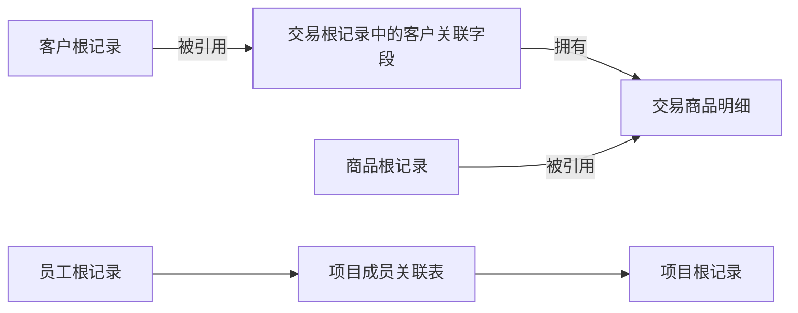

# 表单关联与数据穿透详细设计及实施计划

更新日期为 2026-11-19。

本轮表单关联交付验收通过。2026-10-27 用户授权按本设计补齐基础关联能力，搭建真实业务、部署并验证后交付。本轮范围、阶段顺序和验收范围以第 0 节为准。

## 0. 本轮交付基线（2026-10-27）

### 0.1 授权目标与范围

本轮必须完成关系定义、设计器配置、不可变发布、DNA 物理约束与统一写入准入、运行时选择、双向查询与维护、穿透、带出、权限及真实部署验收。不是只交付文档、接口、组件或单元测试。

- 完整支持 1:1、N:1／1:N、M:N；稳定关系身份只有一个权威拥有方。
- 单值关联覆盖根字段及一级所属明细；M:N 挂在已保存根记录上。关联目标是独立根记录。
- 同租户可跨应用；强关联限定同一登记数据源、数据库、命名空间且可以共享目标 JDBC 事务。
- 原始引用、关联边、数据权限及字段权限不能因新入口绕过；单体与微服务复用同一实现。
- 实时只读展示、服务端复制快照和可编辑默认值均在本轮；现有本表／所属明细计算保持正常。
- 本轮不包含任意跨表公式、跨表汇总、持久化自动重算、通用多模型业务命令、跨库写入，也不扩展报表或商业运营功能。这些原 R5 规划保留，标记为后续，不宣称已完成。

### 0.2 交付阶段与进入条件

| 阶段 | 工作 | 必须提供的证据 | 当前状态 |
| --- | --- | --- | --- |
| A 统一关系与单值闭环 | R0、R1a、R2：类型契约、数据库能力、关系目录、发布、N:1／1:1、主表／明细选择、穿透、删除保护 | 旧快照兼容、数据库约束、直接 API 绕过、并发及真实选择／保存／详情 | 已部署单值能力，两个拓扑通过当前样例的并发、明细回滚与穿透验收。其余场景见验收矩阵 |
| B 双向操作与带出 | R3、R4 的单值关系：反向列表 CRUD、实时与快照／默认值、审批历史和状态 | 客户下交易完整 CRUD、服务端固定关系、带出伪造／来源版本冲突、历史不变 | 两个拓扑通过反向 CRUD、带出、权限过滤和真实审批样例验收。其余场景见验收矩阵 |
| C 多对多与交付验收 | R1b、R4 的集合关系、R6：增量边操作、双向分页、并发、发布生命周期、两个部署拓扑 | 项目成员多页维护、关联和删除区分、撤权／下线／改绑、构建及真实浏览器证据 | 两个拓扑均通过 175 条项目成员的双向分页、增量操作、浏览器及独立审批样例。正式退役和其余生命周期验证见验收矩阵 |

R1b 的实现顺序调整到单值闭环之后，但 R0 必须同时定义四种基数与稳定身份，禁止以单值控件数组临时替代 M:N 关系。

所有阶段采用现有平台发布、迁移、授权、表单状态和组件注册机制；新能力只有在端到端门禁通过后才向设计器开放。中间兼容部署阶段遇到尚不支持的关系定义必须拒绝执行，不得静默丢弃关系后保存为普通字段。

### 0.3 具体设计约束

1. **模型与入口分离**：关系指向应用／表单稳定身份，访问资源是明确授权入口。改名不改身份，页面改绑不得自动换目标。
2. **存储与约束**：单值保存逻辑 UUID；租户＋记录 ID 复合外键；1:1 租户内唯一；M:N 双端外键、唯一边及双向索引。物理列类型、长度和字符语义必须取自 DNA 方言的最终映射；当前 Calcite 兼容映射会把逻辑 UUID 转为 VARCHAR(36)，不能直接假定原生 UUID／CHAR。数据库约束不替代软删除、权限和业务资格校验。
3. **事务边界**：源记录和所属明细在同一聚合提交，引用检查与写入处于同一目标库事务。独立关联记录单独保存，不与父抽屉取消混淆。未保存父记录不允许维护关联列表。
4. **两类过滤**：候选过滤用于选择体验；强制关联资格由服务端在新建／换绑／指定提交时机验证。未变化的旧引用可以保留，不返回已撤权目标的敏感标签或带出值。
5. **带出**：实时值不作为客户端可信写入；复制快照保存来源与规则版本；可编辑默认值遵守普通字段权限与校验。换绑／刷新不能静默覆盖用户编辑。
6. **CRUD 与边操作**：客户下新增交易由服务端固定客户；编辑／删除采用交易的授权、版本和审批锁。项目“移除成员”仅退役边，不能删除员工。M:N 分页编辑只提交增量。
7. **删除与发布**：默认 RESTRICT；全局引用检查不受当前操作者可见范围裁剪，也不得暴露隐藏来源。删除字段、修改类型、下线、软删恢复和关系替换遵守依赖校验及治理锁。
8. **前端复用**：选择复用 EntitySelect/SForm，关联列表复用 SimpleTable，属性页签带图标；保留页签、抽屉、作用域取消、内滚动、国际化和标准分页必须一致。
9. **数据库证明**：PostgreSQL/MySQL 分别验证实际约束及事务，未通过的方言不得宣称支持。新增关系物理能力接入 DNA 现有方言、计划、执行、检查与恢复；不从 APP 执行原生 DDL。

### 0.4 验收清单与范围映射

机器可读交付清单：[form-relation-acceptance-matrix.json](../verification/form-relation-acceptance-matrix.json)。所有条目初始为 pending，只有附带可核验代码／测试／实际运行证据才能改为 passed。

- 旧 REL-01–28、REL-37–44 属于本轮，依照第 18 节执行；REL-29–36 属于明确后置的 R5，不作为本轮已完成能力。
- REL-38 要核验关系／必填／唯一变更的数据检查和恢复协议；不兼容目标变更必须显式迁移或拒绝，不能偷偷重解释原关系。
- 为客户—交易、交易明细—商品、员工—档案、项目—成员及有属性的项目参与搭建独立真实验收应用；不更改既有人力办公业务数据。
- 至少两个租户、两个部门、不同可读／可写／字段受限账号；列表至少 61 条、M:N 至少 3 页、明细至少 40 行。
- 两个正式拓扑均验证登录、资源授权、发布、CRUD、流程状态、关系及前端资产；后端测试／typecheck／UI 审核／完整前端打包是发布门禁，不替代真实运行。
- 验收后保留可查看业务样例和匿名化证据；移除临时授权、待办、孤立边和异常事件，凭据不入库、不入文档。

### 0.5 实施记录与当前限制

**2026-11-19 本轮正式验收**

- 36 项本轮必验全部通过，8 项 R5 场景按第 0 节后置。独立单体与微服务发行包均通过真实登录、记录与关联操作、权限、审批、事件、升级回退和中英文浏览器验收。两种原生数据库通过关系约束、迁移恢复及 SQL 控制台治理验证。逐项结果见[验收清单](../verification/form-relation-acceptance-matrix.json)和[脱敏验收证据](../verification/20261119-form-relation-delivery.json)。

**2026-11-18 单值关联部署验收**

- 此轮完成 11 月 17 日选定的第一项。单体与微服务共用现有领域实现，在独立的合成应用中完成五张表单发布，验证 63 条客户候选按 50／13 分页、Unicode 名称回读、40 行交易明细整笔写入及末行失败回滚。两个工作空间通过真实登录验证租户隔离。
- 反向新增、编辑、删除、解除关联及正向改绑均经真实接口验证。反向新增用共享表单确认已经固定的客户及带出值。客户改名／改址后，实时读取得到新值，旧复制快照和审批记录保留原值。两个入口均验证了旧目标版本冲突、快照伪造、默认值确认冲突、被引用目标删除限制，以及一对一并发只成功一笔。
- 两个拓扑均完成真实审批与幂等重放。不同账号承担申请和审批，审批人只有来源页面授权时可以查看审批，关联目标标签和复制值按当前权限过滤。验收后回读确认临时授权已撤销，流程已归档到历史，验收待办已清理。
- 两个真实浏览器分别在 1440／768／390 像素下完成固定客户的反向新增，验证穿透抽屉、关闭返回及深链刷新。自动化读回了浏览器写入并清理临时记录。两个入口各核对六个远程模块的 414 项前端资产，包含 manifest、入口和声明的 JS／CSS，均与各自部署包校验和一致。
- 修复反向创建和删除的请求接线，隔离可缺省关联目标读取引起的事务回滚，并为带关联的单记录创建复用目标库持久回执。原有成功回执重放通过，两端采用稳定业务错误码返回约束拒绝。后端覆盖 PostgreSQL 和 MySQL，前端通过八模块类型检查及严格 UI 审计。
- 逐项证据见[单值关联验收记录](../verification/20261118-form-relation-single-value.json)。完整矩阵中超出本轮证据的场景保持待验收，多对多继续处于实施阶段。

**2026-10-30 历史检查点**：单值关联发布、上下文候选筛选、穿透、历史标签、反向列表／增删改／解除及只读审批已接入。快照带出、可编辑默认值和 LIVE 显示已完成真实 APP→DNA 隔离库联调，映射临时发布阻断已移除；最近完整 APP 503、HTTP 64 项通过。多对多的独立关联表、增量协议、两端版本与边状态、Calcite 原子变更、授权双向三页查询及批量边观察已隔离验证（API 103、运行时 56 项，含两种原生数据库）。DNA 集合发布治理、完整回执协议、持久账本、批量变更规划和事务内资格读取已补充隔离验证（见 9.31–9.32）；公开集合事务协调与权限投影、APP 发布与界面、退役模型安装采纳、双部署和真实业务／审批验收尚未完成，M:N 发布门禁仍保留。所有正式 REL 验收仍待执行；本轮未部署，不能交付为已验收功能。

阶段验证记录：[20261027-form-relation-foundation.json](../verification/20261027-form-relation-foundation.json)。该记录仅证明下面的基础能力；不得替代真实业务验收。

- 已补充 `FormRelationDefinition`、基数、源字段作用域和目标身份的类型契约，作为文档可选 `relations` 字段。N:1 与 1:1 声明源字段；M:N 不接受字段 ID 数组；1:N 通过原关系的反向视图表示，不重复注册拥有方。
- 草稿校验支持根字段与一级所属明细中的 UUID 引用，限制重复关系、重复源字段、未知作用域和未经验证的固定目标默认值。旧文档无关联时保持原 JSON 与校验值；关系元数据参与新校验值和当前治理投影。
- 目标解析复用当前页面解析与授权入口，以租户、应用、表单、资源及 ACTIVE 绑定精确查找，拒绝入口改绑、退役、重复生效和替代入口回退。这只是元数据解析；字段／记录权限与共享目标事务仍需后续执行链路完成。
- DNA 物理快照已记录外键的有序列对、目标命名空间、动作和可延迟性，检查被移除／修改的约束；旧无外键快照保持兼容。实库检查测试使用独立 PostgreSQL/MySQL 容器，不修改线上表。
- DNA 结构定义新增可选 `tenantRecordIdentity`，由现有方言计划、执行、检查和重试机制创建租户＋记录 ID 唯一索引；历史定义缺省时保留原序列化，普通版本演进不允许移除已启用的身份键。该开关仅声明物理身份约束，不授予关联目标权限，APP 关联发布接入仍待完成。
- **结构恢复实现已推进，完整故障演练仍待完成**：新增版本化原始计划及逐条 DDL 结构校验值；控制表 V2 迁移保存计划 JSON／校验值，并绑定租户、迁移、物理目标及版本。重试复用原计划，只接受已完成前缀或唯一已尝试步骤的回执丢失状态；同名索引先删后建不再逐个要求旧步骤在最终结构上仍然可见。发布使用同一 JDBC 会话完成排他锁、计划、DDL 和检查；获取／释放锁回执不确定时终止连接，避免带锁返回连接池。修复了重命名与必填同时变更时检查不存在的新列名的问题。
- 当前证据包括 PostgreSQL/MySQL 逐条 DDL 检查、锁竞争及连接终止后的释放、计划与编排测试，以及 PostgreSQL V1→V2 控制表升级。真实 PostgreSQL 控制库事务与 PostgreSQL/MySQL 目标库联测已通过：在首条演进 DDL 成功后模拟回执丢失，重建服务实例后从原计划继续；再模拟缓存刷新失败，重试不再执行 DDL，并保持计划内容不变及最终版本激活。控制库安装通过现有模块迁移引擎执行并通过 Hibernate 映射校验。
- **剩余恢复验收与部署仍未完成**：上述故障注入不等于操作系统级进程终止，也未覆盖每个语句边界、并发旧执行者和控制事务提交故障。仍须完成这些场景及关联实际发布，不得把底层恢复测试视为本轮业务交付。
- 升级边界：旧版本未保存完整原计划；已有执行尝试但无原计划的历史迁移会拒绝自动重建，不能从未知中间结构推断原始意图。部署前须核查此类历史迁移，明确处理后再升级；新会话锁不能保护仍在运行的旧二进制，旧发布执行者必须停止。
- DNA 新增可选 `LogicalReferenceDefinition`：关系 ID、稳定字段 ID、目标物理模型 ID 与单值唯一性；旧快照无引用时保持原 JSON。服务端按当前租户解析目标的生效版本，只接受独立模型、已启用租户身份键且位于同一登记数据源／命名空间的目标。解析结果随原始发布计划绑定，不能由浏览器提供物理表名。
- PostgreSQL/MySQL 方言现已通过既有计划生成 `ADD_FOREIGN_KEY`／`DROP_FOREIGN_KEY`、显式引用索引与 `(tenant_id, reference_id) → (tenant_id, id)` 约束，默认更新／删除 RESTRICT。一对一使用租户内唯一索引；源字段改名按“移除受影响外键→列／索引演进→重建外键”执行并逐条验证结构。发布前检查已有孤立／跨租户／已软删目标及唯一性冲突；普通演进拒绝直接移除或替换已声明的关系。
- 该物理能力已完成 N:1／1:1 的两种数据库实测及相关回归；**不等于运行时引用授权、软删除竞争保护、关联目录或 APP 发布已完成**。DNA 的公开结构发布与 APP 发布都保留显式门禁，避免只安装外键就把业务关联视为可用。后续优先补充治理目录及同事务写入准入，再接入 APP 存储投影和组件。
- **事务内物理引用完整性已接入，完整关联准入尚未接通**：普通记录编译器和发布回填／恢复编译器标记可信模型与租户；Calcite 成功执行业务变更后，在同一 JDBC 事务中检查外键映射与保留引用。引用目标取得共享行锁并检查未软删除；软删除目标持有写锁后检查所有来源，包含已软删除、隐藏及离线来源，不以当前用户权限过滤。错误只返回统一冲突，不泄露来源记录。主从及批量语句沿用同一事务，后续失败整体回滚。
- 当前逻辑版本而非旧页面声明决定物理引用约束；解析保留目标存储身份并核对实际外键，拒绝缺失／改变的映射。保留存储解析不授予目标读取、创建引用或发布权限；目标退役后不能据此新增关系。禁止记录直接引用自身，允许不同已保存记录之间的普通引用环。
- JDBC 反向外键读取按来源命名空间、表和约束分组。当前 Connector/J 9.5 的 `getExportedKeys` 会因为目标多个唯一键而重复返回相同列映射；仅合并完全一致的反向映射，列对、动作或序号冲突仍拒绝。元数据只在目标事务内、取得表锁之后缓存，不使用全局缓存承担删除保护。
- 发布激活前新增最终引用数据复查，覆盖预检查之后、外键安装之前目标发生软删除的窗口。引用完整性 SQL 仅用于有界检查和原生事务锁，与 `RecordWriteFence` 同属执行基础设施；业务 CRUD 仍通过 Calcite。
- 关联冲突接入原幂等回执：有操作 ID 的失败先等待既有写入结束，再保存 `version=2 / outcome=REJECTED / code=RECORD_REFERENCE_CONFLICT`；旧 v1 约束拒绝回执保持兼容。后续目标恢复也不能使同一失败操作自动变为成功，修正请求使用新操作 ID。PostgreSQL/MySQL 原生外键失败按 SQLSTATE／厂商错误码识别，使用相同拒绝码，不匹配英文错误文本。APP 审批的 PREPARED 阶段收到已持久化的关联拒绝后终止后台重试，保留诊断码；已提交数据或已启动流程不能通过拒绝处理抹除。旧二进制不识别 v2 回执，必须与关系治理能力协调升级，不允许混用未受控写入者。
- 本轮验证已完成：完整 DNA Runtime 264、DNA API 59、DNA HTTP 55、APP Form 343、APP HTTP 40 项均通过，无跳过；包含 12 个 PostgreSQL/MySQL 物理引用场景。随后补充拒绝回执与旧引用兼容补丁，最终针对性 DNA 10 项（含 2 个实库拒绝回执场景）、APP Form 全量 344 项通过，无跳过。前端 8 个项目类型检查通过；完整范围与局限以验证记录为准，未据此标记业务 REL 验收通过。
- **持久关系目录与控制事务屏障已接入**：V3 新增租户目录行、不可变版本依赖及迁移参与方。普通数据读写、计算回填在现有控制事务内取得共享目录锁并核验当前版本／存储映射，保持到目标事务结束；注册、版本变更和结构发布先取得排他目录锁。READY 在保存原始计划的同一事务保存目录与迁移保护，失败不释放，验证激活与释放同事务提交。根模型、所属明细的根及引用目标均受保护；完整机制见 7.2.2。
- 本轮目录验证：26 项针对性回归全部通过，包含 PostgreSQL 控制事务及 PostgreSQL/MySQL 发布维护、DDL 回执丢失／缓存失败恢复；随后补充明细根保护和目录根身份核对，最终 12 项目录／升级实库测试全部通过。4 项模块迁移实库验证通过，包含共享／拆分存储、全部 DNA 实体映射和不可变 V1 与历史结构对照。无跳过；未执行新的前端变更、线上迁移或业务 REL 验收。
- 剩余门禁包含 APP 关联发布整链路、批量／发布回填组合的完整业务验收与可重试冲突分类、SQL 控制台的受保护模型准入，以及设计器／运行时的剩余交互能力。普通批次、多步骤和发布回填的行锁进展见 7.2.8／7.2.9。目录屏障和物理保护不能单独作为移除发布门禁的依据；实际移除／重建外键期间使用真实业务 API 并发删除的整链路验证仍须补齐。
- **按资源隔离的关联授权传递与多资源控制锁已补充**：DNA 调用上下文可携带有界、版本化的额外资源策略，旧单资源 JSON 保持原形；APP 审批恢复和 DNA RPC 恢复分别保留源／目标的行及字段策略。显式目标授权不再依赖线程内当前页面，所属明细使用其父资源策略，目标计算字段继承自身依赖的读取限制。身份服务标记完整角色默认策略；局部 RPC／审批上下文不携带此标记，缺少目标完整策略时不能借用源页面的顶层范围，管理员局部上下文亦然。普通租户负责人的完整默认权限保持原语义。
- 资源控制锁支持按稳定顺序锁定多个明确入口，并在打开目标事务前核对模型绑定、代际及下线状态。真实 PostgreSQL 测试观察下线事务的数据库锁等待，确认实际 Calcite 写入提交后才完成下线，重新上线后的旧代际及入口改绑均拒绝。该测试使用同一模型的两个独立资源入口，证明的是资源生命周期隔离，**不代表跨独立业务模型的关联资格检查已完成**。随后 7.2.3 已把关联写入解析到的可用目标接入该控制锁，二者联用的真实控制面／业务 API 场景仍须补齐。
- **单值关联写入资格链路已接入 DNA，APP 发布仍未开放**：既有不可变记录治理定义新增可选 `RecordReferenceRule`，由独立关联校验器执行，通用公式库不依赖此契约。普通单模型及所属聚合准备路径根据数据库旧值与最终合并值生成检查；新建／换绑强制校验，未变化引用可保留，`recheckWhen` 可在提交等源状态下要求重验。进入源物理事务前解析目标参与方及其策略，执行时把可用目标加入控制资源锁和同连接 Calcite 目录，按稳定顺序持有模型策略锁、源写锁及目标共享行锁后查询目标行权限与资格。详细边界见 7.2.3。
- 新增 8 个 PostgreSQL/MySQL 场景通过：真实策略安装及普通 `RecordTransactionService` 写入，覆盖目标停用后的保留／提交复核、撤权后无关字段编辑与禁止换绑、目标行／隐藏／脱敏字段限制、批量回滚、持久拒绝回执及目标状态变更锁等待。另有 3 个稳定身份／规则编译测试通过。该组使用模拟控制面模型解析与代际捕获，不能替代真实目录、APP、所属明细及双部署端到端验证；后续全量回归记录另列。
- **尚未开放关联发布与运行时组件。**当前 APP 发布校验仍显式拒绝含关联的草稿；DNA 单值结构发布的后续进展见 7.2.19，真实端到端验证完成前不开放业务发布。已有普通表单发布保持原行为。
- **发布前目标声明校验已接入**：前向治理发布把关联目标加入控制模型锁，核对稳定身份、独立根、租户记录身份键、物理绑定、明确托管入口及资格条件的字段／类型／操作符；目标不进入源聚合回填范围。取消恢复和失败诊断不依赖候选目标仍可用。声明检查与业务授权共用类型编译能力、分别执行，不能以发布检查替代运行时权限。细节与剩余门禁见 7.2.4。
- **本阶段回归证据**：DNA API 全量 64 项、APP Form 全量 350 项通过，无跳过。DNA Runtime 全量 300 项出现 1 处隔离装配测试遗漏新目录依赖，修复后包含该用例的 26 项针对性回归通过；随后最终 31 项回归通过，含 10 个 PostgreSQL/MySQL 关联写入场景、6 个发布目标元数据单测和普通条件查询回归。各轮独立记录，不将针对性补测称为第二次全量通过；新跨模型关联发布／取消的控制面与物理面联合实测仍未完成。
- 上述进展不代表 REL 验收用例已通过，也不代表业务关联已可投入使用；选择、带出、反向列表、多对多、审批历史、部署与真实业务验收仍须逐项完成。
- **APP 不可变绑定与写入授权接线已推进**：版本保存关联目标的明确页面、资源及物理模型身份；根／明细结构与记录治理从同一快照投影，不重查并替换目标。新根版本启用租户记录身份键，旧版本保持原内容；缺少该键的历史版本需产生新版本。写入与接受提交意图按目标入口分别捕获策略；目标不可用时只省略其授权，是否允许保留旧引用由 DNA 判定。见 7.2.5。
- **资格配置已进入契约与服务端投影，尚未开放设计器配置**：复用 `FormCondition` 定义目标根字段条件，支持 `ON_CHANGE`、`ON_SUBMIT`、`ALWAYS`；草稿往返与校验和保留规则，冻结时检查目标字段／类型，DNA 治理执行资格与复核条件。候选过滤、联动上下文和可视化属性页仍待实现，不能以该投影替代选择功能。见 7.2.6。
- 本轮 APP V3 PostgreSQL 迁移／升级等 5 项测试通过；APP 全量初次写入接线 361 项中一项异常桩重设失败，修正测试后加入快照边界用例的 364 项全量通过，随后资格契约版本 369 项全量通过，均无跳过。前端 `pnpm typecheck` 与两项关联草稿测试通过；API／HTTP 回归结果单列于证据 JSON。仍未完成 APP→真实 DNA 的关联业务联测或部署。
- **固定候选目录与编辑态选择器已接线，完整交互仍待验收**：新增默认 `FormReferenceView`、关系拥有方搜索／批量回显接口、主表／明细运行时字段能力，以及 `EntitySelect` 的域查询适配。搜索使用目标权限与有类型条件；回显不套用候选过滤；隐藏／脱敏源字段不触发目标解析。编辑态复用 SForm，详情／历史标签、穿透、可视化配置和上下文联动仍待完成。明细回显请求按同一关系和授权上下文合并，单次不超过 100 个 ID。详见 6.5。
- **实时只读显示与有界穿透继续推进**：主表详情、非编辑明细格、业务列表／卡片接入共享关联名称组件；保留页面、授权空间变化及失败回读不继续显示旧标签。穿透复用精确目标的记录读取与运行时投影，目录返回独立的有效动作能力，前端接入两层共享详情抽屉。隔离浏览器覆盖实际表单／40 行明细和穿透的取消、重入、返回及作用域切换；深层独立页签已完成隔离验证，目标标准操作和真实发布验收仍未完成。历史仍不查询实时名称，历史名称捕获另行补齐。详见 6.6、8.1、8.2。
- 本次目录验证：APP 全量 375 项、HTTP 全量 43 项、DNA API 全量 65 项及 DNA 查询针对性 14 项通过，无跳过；后续加入运行时字段投影后的 APP 全量 376 项和 HTTP 43 项通过。DNA 场景包括 H2 多页计数／空值否定，以及 PostgreSQL/MySQL 时间类型候选条件与脱敏推断拒绝。前端类型检查、32 项组件模型／查询／批处理测试和严格 UI 审核通过。新增明细权限补测单列证据；以上不替代真实关联表单发布、浏览器操作或两种拓扑验收。
- 目录收尾复核又补齐显式 `pageConditionedRecords` RPC 和请求的源表单版本检查：相关 APP 7 项、DNA RPC 10 项针对性测试通过；最终 APP 全量 378 项和 HTTP 43 项通过，无跳过，前端完整类型检查再次通过。没有把中间针对性测试重复计入一次全量，也没有将这些结果标记为 REL 业务验收完成。

## 1. 目标与范围

为表单引擎补齐五类能力，并支持一对一、多对一、一对多、多对多四种业务关系：

1. 关联记录字段：目标业务资源、展示字段、候选筛选、搜索选择，主表和明细行均可使用。
2. 关联穿透：从关联值打开目标详情，支持导航、返回及权限变化后的安全处理。
3. 关联带出：选中后复制业务快照，或按当前权限实时读取，明确两种语义。
4. 反向关联列表：从当前记录查看关联记录，按权限创建、修改、删除记录或添加、移除关联。
5. 跨表单计算与业务操作：受控读取、汇总、重算，以及明确事务边界的业务命令。

质量优先，遵循根目录 [AGENTS.md](../../AGENTS.md) 的平台 UI、表单扩展、权限、事件和部署强制标准。实施必须复用现有能力，通过公共契约扩展；不能在每张业务表单中复制查询、权限、CRUD 或事务控制器。

### 1.1 已确认的业务要求

- 客户信息与客户交易是一对多关系；交易选择所属客户，客户详情展示交易列表。
- 客户详情内的交易列表需要新增、修改、删除和查看；与独立交易页面使用相同的业务规则。
- 明细行内部也需要关联字段，例如交易的商品明细每行选择一个商品。
- 四种关系统一建模，避免先为一对多写死实现，再为其他关系重建体系。
- 已授权先完善设计并逐项实现，搭建真实业务、部署验证通过后交付；阶段测试通过不等于本轮全部交付。

### 1.2 首版边界与扩展方向

| 范围 | 本计划决定 |
| --- | --- |
| 租户 | 所有业务关联限定在同一租户；客户端不能传入另一租户作为关联目标 |
| 数据源 | 强关联首版限定为同一已登记数据源、同一数据库及命名空间，且可使用同一个 JDBC 事务；不以 URL 字符串相同推定可共用事务 |
| 应用 | 允许同租户不同应用之间关联，但必须满足数据源能力与双方资源授权 |
| 目标记录 | 目标是独立业务表单的根记录；所属明细不能脱离父记录作为独立目标 |
| 关系字段位置 | 单值关联字段支持主表和一级所属明细；多对多关联集合首版挂在独立根记录上 |
| 一对一 | 支持可选／必选的单值引用加唯一性；“两侧在所有时刻都必须存在”需专用原子创建命令，普通表单创建不开放这种配置 |
| 多对多 | 支持平台管理的纯关联表；关系有业务属性时使用显式中间业务表单 |
| 嵌套界面 | 首版关联列表放在根记录详情区域；不在每个明细单元格内嵌套可编辑关联列表 |
| 任意跨库写入 | 继续沿用已延期的规划，不通过前端多次保存、XA 或 MQ 把它伪装成本轮原子事务能力 |
| 自引用 | 允许关联同表单的其他已保存根记录；首版禁止关联自身。两端角色有方向，A→B 与 B→A 是不同边；无向好友关系需另行设计规范化边键。组织树等无环业务规则需独立声明 |
| 关系环 | 普通 A→B→A 引用可以存在；计算依赖环、同步级联写入环必须拒绝 |

同数据源约束是本轮完整性保证的前提。后续跨数据源引用需单独定义弱引用、目标删除和补偿协议，不能静默降级本轮强关联契约。

## 2. 现状与需要扩展的位置

本轮实施前的源码基线如下；已落地进展和尚未开放的边界见第 0.5 节：

| 已有能力 | 当前事实 | 本轮扩展 |
| --- | --- | --- |
| 字段定义 | `FormFieldDefinition` 有 `REFERENCE` 存储模式，但没有通用关联目标和关系策略 | 增加可选、版本化关联字段契约 |
| 主从数据 | `FormDetailDefinition` 与 DNA `OwnedModelRelation` 描述所属明细 | 保持聚合语义，新增独立业务引用语义 |
| 组件注册 | `FormRuntime/componentRegistry.ts` 有用户、组织、角色、租户选择及 `data.detail` | 注册业务记录选择与关联列表组件 |
| 选择控件 | `EntitySelect` 已有分页搜索、选中项回读和作用域隔离 | 扩展业务关系数据源适配，复用回读与取消机制 |
| 数据列表 | `SimpleTable` 拥有资源 schema、查询、分页、操作和表单生命周期 | 增加关联上下文适配，保持单个 CRUD 控制器 |
| 计算 | `calculationModel.ts` 的字段作用域为本表单、父记录及所属明细 | 宿主解析外部依赖，保持计算库独立 |
| 事务 | `RecordTransactionCommand` 当前限定单个物理模型；所属主从另有聚合能力 | R1 增加跨独立模型引用校验；R5 再建设受限多模型业务命令 |
| 物理约束 | 方言能力有外键操作标识；`PhysicalSchemaDefinition` 当前只有字段、索引、owner | 补齐关系存储投影、迁移、校验与恢复，不能把枚举存在算作外键功能已贯通 |
| 发布与事件 | 已有不可变版本、治理版本、回填／恢复、资源代际及 outbox/inbox | 关系依赖、关联操作和重算事件接入原生命周期 |

关键源码入口见文末。既有计算交付的通过状态仍以 [计算交付计划](form_calculation_delivery_plan.md) 为准，本计划不重置已完成目标。

## 3. 统一关系模型

### 3.1 一个关系定义与两个访问方向

每个关系具有稳定 `relationId` 和版本。关系定义只由一个权威拥有方发布；另一侧的组件只引用此关系及方向，不复制一份可独立修改的规则。

- 多对一与一对多是同一关系的两个方向。
- 一对一由一个单值引用及唯一性约束实现，另一端反向查询。
- 多对多由关联表的唯一边实现，两个方向都查询同一张表。
- 关系字段保存稳定记录 ID；名称、物理列名、菜单 URL 均不是关联键。
- 独立关系与 `OwnedModelRelation` 分开建模。独立客户、交易、商品各有自己的生命周期；商品明细属于交易聚合。



### 3.2 四种关系的约束

| 关系 | 持久化位置 | 默认设计器表现 | 强制约束 |
| --- | --- | --- | --- |
| 多对一 N:1 | 多的一侧保存目标记录 ID | 单选关联字段 | 同租户、目标有效、写入准入、引用完整性 |
| 一对多 1:N | 复用 N:1 的引用字段，反向查询 | 关联列表 | 不在一的一侧另存 ID 数组 |
| 一对一 1:1 | 选定的一侧保存目标记录 ID | 单选关联字段＋反向详情入口 | 同租户目标唯一；空值不占用唯一关系 |
| 多对多 M:N | 平台管理关联表，保存两侧记录 ID | 多选关联集合或关联列表 | `(tenant, relation, leftRecord, rightRecord)` 唯一，边操作幂等 |

`required` 与基数分别表达。1:1 的唯一约束表示“至多一个”，源字段必填表示源记录必须关联目标，不能推出每条目标记录必定有一个源记录。集合最小数量等业务约束在声明的保存／提交时点检查；普通创建不能要求尚不存在的两侧同时满足双向必填。

一对一首版按全部保留引用实施唯一性，包括源软删除后尚未解除的引用；软删除不能让旧关系在恢复时碰撞。需要释放占用时使用显式解除／归档流程，必填或已提交记录不允许直接解除。

一对一字段位于所属明细时，唯一性覆盖该关系下同租户的全部明细行，不能限定在单张父单据内；设计器需明确提示这一范围。一个父记录内的行去重属于独立的明细唯一规则，不等同于一对一。

### 3.3 多对多的两种业务形态

**纯关联示例：项目成员。**平台管理关联表，仅保存关系、两端 ID、边 ID、版本、租户和审计字段。添加成员不复制员工记录；移除成员只删除／退役关联边。关联表不作为普通资源暴露给客户端直接编辑。

**有属性的关系示例：员工参与项目的角色、起止日期、投入比例。**建立“项目参与”业务表单，分别以 N:1 关联项目和员工，其业务字段、审批和版本独立管理。可配置两侧唯一组合；若允许同一员工多次参与同一项目，则使用带期间／角色的明确业务唯一键。

“交易—商品”有数量、单价时，通常使用交易所属明细，每行 N:1 关联商品。库存或价格历史不能塞进一个仅保存商品 ID 的多选控件。

## 4. 身份与元数据契约

### 4.1 关系身份和页面入口分离

逻辑目标由 `applicationId + formId` 固定，租户来自服务端上下文。目标页面资源是访问和展示入口，不是数据模型身份。

设计者选择“客户管理”后，服务端解析其当前发布表单、资源 ID、绑定代际和稳定字段 ID。发布时固化逻辑关系身份及兼容要求；每次运行重新校验入口状态、当前绑定和权限。

- 同一表单有多个页面时，关系配置选择一个明确入口；不可遍历其他页面寻找更宽权限。
- 目标入口被改绑到另一张表单时，旧关系进入不可用状态，不能跟随页面自动指向新表单。
- 目标重新上线或兼容版本发布时，服务端核验身份和契约后推进执行投影；沿用原逻辑关系，但不得恢复旧授权。
- 更改目标表单属于关系替换／数据迁移，禁止复用原关系 ID 改变含义。
- 明细中的字段身份为 `(formId, detailId, fieldId)`，不能仅按 `fieldId` 拼接。

### 4.2 拟新增契约

以下名称为实施契约建议，最终以 R0 评审后的代码为准；职责和语义必须保留。

| 契约 | 内容与拥有方 |
| --- | --- |
| `FormRelationDefinition` | 源表单发布的关系定义：稳定 ID、版本、两端逻辑身份、基数、权威存储侧、删除和解除策略 |
| `FormRelationField` | 拥有方关系中的主表／明细字段定位（`detailId + fieldId`）；避免在字段与关系中重复保存绑定；反向组件仅引用关系 ID 与方向 |
| `FormReferenceView` | 展示、搜索、候选过滤、绑定上下文和穿透入口配置，按场景允许收窄 |
| `FormReferenceFill` | 源目标字段映射、复制／实时模式、刷新规则与类型转换 |
| `FormRelatedListDefinition` | 关系 ID、方向、展示列、排序和允许操作的配置上限 |
| `RecordRelationPolicy` | DNA 中立执行契约：物理映射、租户字段、约束、当前治理版本和资源代际；不携带 UI 或 JPA 类型 |
| `ReferenceResolution` | 有界解析结果：ID、可读标签、目标版本、受权限过滤的展示值和能力；不替代保存时复核 |
| `RelationContext` | 服务端可验证的父记录、关系、方向和版本上下文，用于关联列表查询及操作 |

关系目录由服务端持久化的发布投影维护，支持按入向／出向关系查询和依赖评审。不能临时扫描所有租户的表单 JSON，也不能让反向页面自行注册第二份关系。

目标表单可先发布，存储侧随后发布关系，最后目标页面添加反向组件。反向组件只消费已激活关系，不拥有关系 DDL；安装反向视图不应造成双方必须同时发布的循环依赖。

### 4.3 单值关联定义示意

以下为语义示例，示例 ID 是文档别名；实现中由服务端分配稳定 ID。浏览器不提交物理表名、连接信息或信任后的授权描述。

```json
{
  "contractVersion": "1",
  "relationId": "trade-customer",
  "cardinality": "MANY_TO_ONE",
  "source": {
    "applicationId": "sales-app",
    "formId": "trade-form",
    "scope": "parent",
    "fieldId": "customer"
  },
  "target": {
    "applicationId": "sales-app",
    "formId": "customer-form",
    "accessResourceId": "customer-page"
  },
  "integrity": {
    "targetDelete": "RESTRICT",
    "allowUnlink": false
  },
  "view": {
    "labelFieldId": "customer-name",
    "searchFieldIds": ["customer-code", "customer-name"],
    "columnFieldIds": ["customer-code", "customer-name", "contact"],
    "candidateFilter": {
      "op": "EQ",
      "fieldId": "status",
      "value": {"kind": "STRING", "value": "ACTIVE"}
    }
  }
}
```

正式契约将“关系语义”与“场景展示”分别保存，上述示例放在一起仅用于说明设计项。可写请求只提交记录 ID 与必要的版本信息，不接受客户端标签作为可信业务值。

## 5. 四种关系的设计器操作

### 5.1 客户与交易

1. 设计并发布客户表单，具备编号、名称、联系人、电话和状态，注册客户资源。
2. 在交易主表添加“关联记录”字段，选择客户资源，关系为 N:1，字段名称为“所属客户”。
3. 设置必填、展示／搜索字段、候选条件、是否允许穿透；“只能选择启用客户”若为业务约束，另外启用保存时关联资格规则。
4. 发布交易表单。服务端安装关系、索引和写入校验，再激活页面。
5. 返回客户设计器，添加“关联列表”，选择入向关系“交易 → 所属客户”，配置交易编号、日期、金额、状态及操作。
6. 发布客户新版本。客户记录页面可查询自己的交易；客户和交易拥有独立保存与审批生命周期。

### 5.2 交易商品明细

1. 在交易添加所属“商品明细”，在明细“字段”页签新增关联记录字段。
2. 选择商品资源，配置 N:1、展示名称、商品编码搜索和启用筛选。
3. 增加数量、成交单价、金额字段；单价可通过 R3 复制规则带入，金额使用现有本聚合公式。
4. 每行独立选择商品。关联修改进入现有主从表单状态，跟随交易主表一次保存，不建立第二个行级未提交缓冲。
5. 商品反向查看使用情况时，返回交易根记录和命中的明细行标识；不开放所属明细绕过交易根权限的 CRUD。

### 5.3 员工与档案

1. 选择档案为存储侧，添加“所属员工”关联字段，配置 1:1。
2. 发布时验证现存重复数据，并创建租户范围唯一约束；并发选择同一员工只能有一个成功。
3. 员工侧添加反向档案入口。创建档案与编辑档案由档案资源授权决定。
4. 是否允许未建档员工、档案是否必填员工分别配置；双向强制存在不作为默认选项。

### 5.4 项目与员工

1. 在项目定义 M:N“项目成员”关系，以项目为关系定义拥有方，选择员工资源。
2. 平台发布并管理关联表；项目和员工页面均可引用这个关系，分别按正向和反向展示。
3. 项目侧“添加关联”打开员工选择器，“移除关联”只解除成员关系。
4. 若需要投入比例、项目角色等属性，改用“项目参与”业务表单，关系迁移经评审后完成；不能直接向既有纯关联边偷偷增加业务字段。

### 5.5 属性面板与展示标准

- 关联组件注册稳定且带图标的“基础”“关联”“筛选”“带出”“交互”页签；仅显示当前阶段支持的配置。
- 一对一／多对一字段使用共享 SForm 关联控件，搜索复用 EntitySelect；大列表选择器通过共享组件扩展，禁止业务页面复制原生 Table。
- 一对多／多对多列表使用 SimpleTable 的资源契约；可读的无 CRUD 关系概览使用 DataTable。
- 多对多的大集合使用分页列表。少量标签仅作有界预览，不能加载所有 ID 到表单数组并全量覆盖关系。
- 关联列表与复杂选择器限定宽高、保留最小列宽；手机、平板和桌面均有内滚动及键盘操作。
- 行操作统一图标＋文字；工具栏图标、帮助提示、状态色、时间和个人列偏好沿用平台标准。

### 5.6 当前设计器目标发现契约

已接入源表单作用域下的 `GET /applications/{applicationId}/forms/{formId}/relation-targets`、`POST /resolve` 和 `POST /describe`，通过 APP HTTP 挂载前缀访问。

- 发现接口要求工作台访问权并验证源表单归属；管理员同样不能绕过租户和源表单边界。候选资源权限、当前租户、页面 PUBLISHED、精确 ACTIVE 绑定、未归档表单及已准备的物理版本共同进入数据库查询，分页与计数使用同一条件。源应用不限制目标应用，允许同租户跨应用选择。
- 这是有界选择目录，默认 50、最多 100 条；关键字最多 200 个 Unicode 码点，`%`、`_`、`!` 按文字搜索。应用按创建时间及稳定 ID 排序，应用内保留页面序号。按已选资源 ID 回显最多 100 个，去重后按请求顺序返回，不回显无权、离线或缺失资源；异常重复入口拒绝，不任取一个。
- 选项提供稳定目标身份、页面身份及 APP 自有的国际化名称；选中后提交完整目标身份请求元数据。描述接口先复查目录准入，再复用关系目标解析器的精确入口和当前资源授权，不能通过旧缓存将一个入口重新解释成另一张表单。
- 字段描述只包含当前可读的持久化根标量字段身份、名称／翻译、类型及是否可文本搜索。隐藏、脱敏、临时和 JSON 字段不返回；计算字段沿用其依赖权限。不给浏览器物理模型、列名、默认值、目标布局或业务数据。
- 目录选项不证明存储兼容，也不授予发布或运行时访问权。完整 DNA 同库／事务校验和冻结关系发布仍按第 7 节执行；本接口不能替代这些校验。
- 前端通过独立 `DesignerRelationDirectory` 适配共享 EntitySelect，按空间、源表单和语言隔离；APP 宿主提供 HTTP 读取器，通用设计器只接收注入契约。回显按 100 个 ID 分批，取消后不继续返回旧结果；目标描述身份不匹配时拒绝采用。目录接线后的属性配置进展见 5.7；仍不能据此宣称关联功能已经上线。
- 本阶段 APP 全量 390 项、HTTP 全量 47 项通过，无跳过；新目录数据库查询验证使用 H2，既有 PostgreSQL APP 回归通过，尚不等于该新目录在两个正式拓扑的验收。4 项前端目录适配测试通过；真实配置、发布及业务浏览器验证仍需继续完成。

### 5.7 主表与明细的单值关联编辑器（2026-10-27）

- 增加独立 `field.reference@1` 组件贡献、前端运行时及属性注册。组件行为扩展负责初始化 UUID／REFERENCE 字段，通用设计器只调用注册行为，不包含目标发现或关联业务逻辑。根字段在带图标的“关联配置”属性页进入编辑器；数据设计及所属明细字段列表复用同一个关联配置命令。明细当前从无静态默认值／选项的 UUID 字段进入，应用配置时将字段和完整关系一起提交。
- 编辑器使用 EntitySelect、SForm、ConditionEditor 和 TableActions；“关联配置”“候选筛选”“关联校验”页签均有图标。可设置精确目标资源、多对一／一对一、显示名称、最多 8 个搜索字段、最多 12 个展示字段、穿透上限，以及独立的候选条件和强制资格／重新校验时机。不开放未实现的动态上下文条件或带出配置。
- 目标变化原子清空旧目标的显示／搜索／展示字段和条件，但保留关系身份；当前目标元数据缺失、加载失败或尚未重新授权时不能应用。条件使用目标标量字段及有类型字面量，保留 DECIMAL／INT64 精度；条件预算与后端一致。保存时仍须由发布及运行时服务重新验证，不信任浏览器目录结果。
- 编辑缓冲仅归当前配置弹窗所有。取消恢复打开前状态，应用产生一个设计器历史命令；字段或关系在弹窗打开后已变更则拒绝覆盖。页面隐藏、关闭和授权作用域变化取消／隔离元数据读取；隐藏时不渲染旧字段描述，恢复后重新授权，错误可通过共享动作重试。
- 复制使用复制时的关系快照，为新拥有方分配新关系 ID，只改写源主表／明细字段，不改写外部目标字段及条件。多个复制视图共享同一个克隆明细；重复使用同一字段仍只有一个关系拥有方。移除画布控件保留物理字段与关系；普通字段编辑不能把业务引用改成自由文本、静态选项或静态目标默认值。旧文档缺少 relations 时保持缺省；没有业务关系或专用控件绑定的旧 UUID 引用字段保留原编辑语义，所属明细编辑器只投影自己拥有的关系，不借用主表或其他明细的同名字段。
- **发布状态未变**：内部注册支持草稿和隔离验证，但正式设计器能力目录暂不公告该组件；APP 同时拒绝包含关系定义或未配置关联控件的发布，DNA 门禁保留。取消目录过滤和发布限制必须与真实关联发布、受控写入及本计划剩余验收一并完成，不能把此次 UI 接线当作正式开放。
- 本次 APP 393 项、HTTP 47 项全量测试通过，无跳过；设计器模型及目录测试 66 项通过（含 13 项新关联编辑／生命周期测试）。八模块类型检查、三个隔离浏览器夹具的类型检查、严格 UI 审计、国际化检查及完整前端构建通过。
- 额外执行 APP 实现模块完整 Checkstyle：关联开发修改文件中的 123 项违规已清理，当前改动文件零违规；完整模块检查仍失败于未修改文件中的 234 项既有违规（主代码 96、测试 138）。已逐文件核验这些文件与 Git HEAD 内容相同，未把完整检查记为通过。整理涉及的 25 个关联改动文件经 Java AST 字面量比较保持内容不变，随后 APP／HTTP 440 项回归再次通过。报告及哈希纳入同一证据记录。
- 新隔离浏览器使用真实 FormDesigner、主表属性、明细字段列表和共享选择／条件控件，17 个场景覆盖有类型 Unicode 候选条件、布尔资格与重检、空条件拒绝、取消、单命令提交、撤销重做、失效请求、过期编辑、失败重试、目标切换和作用域切换。截图检查后统一了标签／输入对齐及页内滚动。此处目录为受控夹具，不是已发布真实业务，也未部署。证据见 `checks.relationAuthoringEditor`。

## 6. 能力一 关联记录选择与关系写入

### 6.1 候选查询

候选查询条件为：当前租户 ∩ 目标资源可读范围 ∩ 关联选择权限 ∩ 已发布候选条件 ∩ 用户搜索条件。按服务端投影生成查询，不接受任意 URL、SQL、表名或未声明字段。

筛选采用版本化、有类型且有预算的条件 AST，字段绑定稳定 ID，复用平台条件编辑器／查询编译器。隐藏或脱敏字段不能作为搜索、筛选、排序、分组或计数推断入口。

首版支持常量、主表已声明标量、当前明细行已声明标量，以及服务端组织上下文。依赖字段未填写时提示先填写，不把过滤缺省成全量。浏览器传入的未保存上下文只能用于临时选择预览，保存时从真实聚合重新计算。

区分两种条件：

- **候选条件**：决定列表中推荐哪些值；依赖变化后清空旧请求结果，要求重新确认已选值。
- **关联资格规则**：决定当前业务是否可以新建／更换这条关联；由服务端在写事务中校验，禁止靠候选过滤实现业务约束。

资格默认在新建／换绑时验证。已有关系的无关字段修改不因目标后来停用而自动失败；“每次修改都必须满足资格”的业务可显式配置，提交时要求以当前规则独立复核。

### 6.2 搜索和标签回读

- 默认每页 50 条，上限 100 条；沿用平台稳定排序和分页，用户排序优先，默认创建时间倒序加唯一 ID。选择目录保持独立有界预算，业务关联列表仍采用平台 50/100/200/500 分页。
- ID 回读独立于候选搜索，支持已有值不在第一页、目标停用后的历史值；仍执行当前读取权限。
- 标签按资源、租户、授权版本、关系治理版本、目标 ID 与目标版本缓存。不得只按 ID 建全局缓存。
- 搜索、防抖、翻页、选中项回读都支持取消；切换当前行／关联依赖／页面／工作空间后禁止旧结果回填。
- 目标不存在、不可见或入口离线时，普通用户统一看到“关联记录不可用”，不通过状态差异、计数或原始 ID 泄漏目标存在性。

### 6.3 保存与并发

新建／换绑时，客户端提交目标 ID、当前源记录版本和幂等键。服务端解析当前活动定义，并在源业务事务内验证目标租户、存在性、资格、关联权限和治理版本。

无关字段修改时，服务端从已保存聚合确认关联未变化，保留原引用；目标撤权／离线不应让源记录自动失去全部编辑能力。字段省略不代表解除，客户端不能借“未变化”标记绕过真实值比对。此路径不返回目标标签、不重新带出值，也不授予目标访问权；明确配置为每次保存／提交复核的资格或计算依赖仍须执行，无法满足时阻断对应操作。

选择器预检通过不保证随后保存成功；目标可能已停用、删除、换绑或撤权。保存失败保留用户输入并返回可翻译的稳定错误，不自动替换另一条记录。

单值字段在明细中复用同一校验路径，先批量收集并去重目标 ID，再有界读取，不能每个单元格单独 RPC。任一行失败，主表、明细、关联和幂等回执全部回滚。

### 6.4 多对多操作

采用带 `relationId`、两端身份、边版本、集合修订及幂等键的增量 `LINK/UNLINK` 操作，不用“提交当前页面所有选中 ID”覆盖全集。

首版关系编辑要求源根记录已保存；未保存时显示先保存提示。边操作独立提交，成功后推进关联集合修订；若改变业务语义，还必须推进源聚合版本，以阻止旧记录版本继续提交审批。不能让一侧的集合变化对另一侧的并发校验不可见。

同一边重复添加是幂等成功或稳定已存在结果；相同幂等键不同请求拒绝。删除后迟到的旧添加不能复活已退役边，使用边代次和集合修订控制。

### 6.4.1 关联表与增量协议的实现约束（2026-10-30）

- 每个关系使用独立的纯关联模型。可选 `PhysicalSchemaDefinition.collection` 保存稳定关系身份和两个引用的角色，旧快照保持属性缺省；两列必须是无默认值的可空 UUID，各自使用租户限定外键，唯一组合限制活动边重复。现有引用索引同时为两个方向生成 `(tenant_id, endpoint_id)` 索引。关联模型不能作为普通 CRUD、计算根或单值引用目标，普通迁移不能添加、移除或交换其关系身份。
- DNA 每个 `(applicationId, formId)` 只登记一个模型。关联模型使用 `CollectionModelRelation.modelFormId(sourceFormId)` 派生独立合成表单身份（独立域、长度分段与关系 ID）；绑定时核对同一应用、派生身份及源端外键，不能复用根表身份。该身份规则与边 ID 分开，均不依赖部署和显示名称。
- `CollectionRecordCommand` 只提交源模型／不可变源 schema、关系 ID、已保存源记录、明确观察的源版本，以及最多 100 个不同目标的增量 `LINK/UNLINK`。目标模型、关联表、资源和权限由已安装的关系定义解析，不能由浏览器选择。排序选中项不改变请求含义；同一键重试不得改变成员、操作或观察版本。
- 首版以两端根记录的 `record_version` 兼任集合修订，避免另建可与聚合版本分离的计数器。关系变更在同一物理事务推进两端根版本及边版本；因此普通编辑也会使旧集合命令过期。这是保守并发策略，不能只更新发起端；自关联同一根记录只推进一次。公开命令协调器在完整授权和事务锁内校验版本、应用增量并恢复回执。同表关联保留方向，禁止连接同一条记录。
- 边 ID 以版本化域、租户、关联模型、关系、两端模型和记录身份逐段长度编码后派生 UUIDv8；物理表名、列名及显示名称不参与身份。首次创建版本为 `0`，`-1` 仅表示“从未存在”，缺失 JSON 版本不能默认为 `0`。解除时同时清空两个引用，保留边 ID、版本和审计字段；重新关联必须观察当前退役版本。两列只清一列、错误租户／端点以及版本溢出都拒绝。
- SQL 编译器只生成参数化 Calcite 语句；两端修订使用同一条授权数据范围和版本谓词，清空／恢复边使用精确 ID、租户、边版本及旧端点状态谓词。任何一条语句未命中必须回滚整个事务。底层 SQL 编译通过不等于拥有业务操作权限：公开入口仍需当前资源代次、关系权限、生命周期及目标资格的事务准入。
- 双向分页查询复用平台记录投影、排序、条件和计数编译器，统一对关联表作半连接；固定端的精确记录授权也参加查询。数据库必须完成关系过滤、计数和分页，禁止用小结果页掩盖服务端内存联接或无界扫描。

### 6.4.2 公开治理与发布接线边界

- 集合治理需要在不可变根写策略内单独声明关系、关联模型／schema、精确目标应用／表单／资源及资格条件。不可把关联表放入 `details` 冒充所属明细，也不能直接根据浏览器传入的边模型执行。主表和最多五个明细的现有发布绑定／回填集合保持原语义；集合物理参与者使用独立的可选冻结映射，更新持久发布意图版本并保持旧意图 JSON 缺省兼容。
- 发布锁集合必须包含根、明细、关联模型与目标模型，继续使用现有关系目录／控制模型／物理事务的锁序。关联表不参与公式回填和 owned rows 替换扫描。提交前校验派生归属、两个独立根端点、同一事务存储、目标入口身份／代次以及已冻结字段依赖；取消恢复不因目标离线而失去还原原根策略的能力。
- 集合选择器本身没有一个可持久化 ID 数组字段。其读写授权使用关系身份派生的专有权限字段，与普通字段身份保持独立；该字段不成为 SQL 筛选列。隐藏／掩码关系不能触发目标目录、分页、计数或边版本观察。两端当前资源和行权限仍独立检查。
- 关联动作与修改目标业务字段分开：源端的关联写能力和状态决定能否维护，目标的当前可见性及已发布资格决定能否被选择；不得因为版本推进而借用或扩大目标字段编辑权。反向入口始终解析为同一拥有侧关系，不能绕过拥有侧的维护权限。两端根版本的推进只服务于事务并发；原业务值、必填、字段写规则和历史快照不可被关系命令改写。
- 操作协调器先获得稳定模型／资源／治理版本，再在同一目标事务按稳定顺序锁定全部根及边；每批只读一次有界边版本集合，验证全部观察后执行增量变更。源端一次推进、不同目标各一次；同模型同记录去重且要求版本观察一致。持久回执必须覆盖完整命令、执行人和返回的两端／边版本；已提交未知回执先查原结果，不能用重试重新发现目标或把旧添加解释为新添加。
- 回执必须使用独立、版本化的集合结果协议。当前普通 `RecordOperationJournal` 仅接受最多 100 条、且不带模型身份的语句结果；100 条关系变更可能涉及 201 次根／边写入，不能直接套用该回执或仅截取前 100 条。新协议应明确源根版本、每个目标根版本、边版本／关联状态及是否变更，保留旧回执解码并严格限定完整序列化预算。已处于期望状态的无变化操作也必须有可精确重放的持久结果，不能凭空制造业务更新或让重试重新判断。
- 所有记录都在过滤后服务端分页。关联列表与候选目录复用平台 `SimpleTable`／`EntitySelect`；新增／解除只发送明确增量，不能全量覆盖分页外成员。边版本观察一次最多 100 条，返回保留版本与从未存在的区别；截断、重复、错误租户／身份、半边或异常版本必须失败，不能当作“未关联”。

### 6.5 当前目录契约、编辑态接线与未完成边界

关系定义可选 `referenceView` 保存默认展示配置：一个文本标签字段、最多 8 个文本搜索字段、12 个标量展示字段、有类型候选条件及穿透配置上限。身份、资格与展示分别使用独立契约；标签和物理列名不能成为关系键。配置参加不可变文档校验值，字段均绑定稳定 ID；旧定义没有配置时保持原 JSON，不自动猜测姓名字段。

- 搜索入口：`GET /app/runtime/applications/{applicationId}/pages/{pageId}/references/{relationId}`，接收关键词、分页及浏览器观察到的 `formId/formVersion`。身份参数只用于旧页面校验，不能选择目标；资源、表单、物理模型、展示字段和过滤规则仍由服务端解析。
- 回显入口：同一路径下 `POST /resolve`，查询参数同样携带源表单版本，请求体一次最多 100 个 UUID。按 ID 一次有界查询，保留请求顺序并去重；不可读／不存在均不返回相应选项，不做逐记录 get。回显不应用候选条件，也不把当前资格当作历史可读性的依据。两个入口在读取目标前通过 `ApplicationFormRuntimeIdentity.requireCurrent` 检查页面身份，换绑或更新不能让保留页签偷偷使用新关系。
- 先检查源引用字段权限，再解析目标。一级明细使用其真实所属模型权限，不借用父表同名字段授权。目标上下文独立捕获；标签／搜索字段必须可读且未脱敏，附加展示字段按权限删减。条件查询还由 DNA 再检查字段和数据权限。
- `RecordPageQuery` 新增可选有类型 `condition`，复用已有条件编译器的精确文本、NULL 否定、Unicode 空白和结构化 JSON 语义。分页与总数共享同一条件；旧请求缺省保持原 JSON。不能把表单条件降级为语义不同的普通 SQL 筛选树。关键词搜索沿用平台现有 LIKE 查询语义。
- APP 目录使用独立 RPC 操作 `pageConditionedRecords`；旧 `pageRecords` 不接受有类型条件。这样旧提供方会因操作不存在而失败，不能忽略新 DTO 字段后返回未过滤结果，也不得回退到旧分页操作。新操作仍沿用同一调用方校验和授权上下文恢复路径。
- 运行时字段只下发 `FormRuntimeReference`（关系 ID 与穿透配置上限），不下发绑定模型、目标资源或可执行 URL；隐藏字段移除，脱敏字段不携带关联能力。主表和一级明细分别投影。
- `PublishedFormRuntime` 注入域数据适配，通用 `FormRuntime` 与 SForm 控件本身不绑定 HTTP 服务。编辑态复用 `EntitySelect` 的防抖、分页、取消、授权作用域和既有值回读；每个关系／表单版本／授权作用域拥有独立适配实例。
- 同批明细回显合并去重后每 100 个 ID 一次请求。一个使用者取消不影响其他使用者；所有使用者取消则终止共享请求，迟到数据不回填。此批处理不引入跨授权上下文的全局标签缓存。

**尚未完成，仍属本轮必交付范围：**主表／当前行／组织上下文联动筛选及按场景收窄、带出及其属性配置、历史快照名称捕获、穿透目标标准操作、反向 CRUD、多对多，以及完整关联发布。单值关联属性接线见 5.7；实时显示、双层抽屉及独立页签进展见 6.6、8.2、8.3。`allowDrillThrough` 是配置上限，前端按钮还必须取得目录返回的有效能力。上述接线没有解除 APP/DNA 发布门禁，必须继续完成真实业务及部署验证。

### 6.6 实时名称显示与历史隔离

- 共享 `FormReferenceValue` 仅在拥有方显式注入关系目录适配器时发起读取。源值为空、脱敏或不是完整 UUID 时不读取；普通静态表单和审批快照不因关系元数据存在而自动查询。
- 只读 SForm 投影保留安全的关系能力标记；主表详情与明细非编辑单元格复用同一呈现。业务 `SimpleTable` 通过列呈现扩展接入，列表／卡片继续共用授权列、服务端分页和排序；名称显示不把 ID 查询自动解释为跨表标签查询。
- 查询键包含授权作用域、源运行时／关系与目标 ID；复用已有每关系 100 ID 的合并回显。页面隐藏停止读取并取消无其他拥有方使用的请求；重新进入重新读取，不使用旧名称掩盖权限变化或失败。加载、失败／重试、不可用分别展示，原字段值不改变。
- 当前不可用目标显示统一名称不可用，不根据是否存在、已删除或已撤权展示不同业务身份信息。标签过长只在显示层按 Unicode 码点截断为最多 256 字符，目录原值不变。
- 静态 `x-reference-label` 投影优先于实时适配；`FormRuntime` 显式隔离外层实时目录，审批快照不会继承业务列表的适配器。当前尚未捕获关联历史标签，旧快照保留原 ID，不能用实时名称冒充当时名称。
- 验证：33 项前端模型／批处理回归、完整 `pnpm typecheck`、严格 UI 审计及 `pnpm build` 通过；`node scripts/smoke-reference-display.mjs` 使用实际 React／SForm／明细组件与隔离目录完成 10 类浏览器场景，并接入统一 `check:frontend` 流程。本次未执行该完整流程的其他全部浏览器场景；此证据不替代正式业务 API、真实权限矩阵、列表／卡片端到端和部署验收。

### 6.7 主表／当前明细行／组织联动候选（2026-10-29，隔离验证通过）

`FormReferenceView.contextFilters` 是可选、最多 16 项的有类型声明，只保存稳定字段 ID、比较运算和 FORM／ROW／ORGANIZATION 取值源。旧不可变文档缺省保持原 JSON。主表和当前明细行同名字段分别解析；不能读取另一明细、任意对象或附件。组织取值只能来自服务端授权上下文。字段类型须兼容，排序比较只支持数值和时间类型；目标字段类型依赖随版本冻结。

新增 `POST .../references/{relationId}/search`：浏览器仅在有界请求体提交已声明的标量，不将表单、明细整行或组织值放入 URL。服务端重新解析当前源版本、固定目标、数据／字段权限，将联动条件与原候选条件、搜索条件取交集；缺失或空值返回空候选，不能退化为无条件查询。隐藏或脱敏的条件字段不得参与推断。此入口提供候选预览，不授予访问权，也不替代事务内的关联资格检查；已选值回显与穿透仍独立于候选条件。

设计器增加有图标的独立“联动筛选”页签，使用 SForm、DataTable 和 TableActions。类型不匹配、重复、预算超限及缺失源字段均拒绝应用；目标切换一并清空条件。复制组件会重映射被复制的主表／明细输入，保留外部目标字段 ID。明细字段编辑的临时投影只映射本明细的输入，不修改整个关系定义。

运行时只投影可读输入；依赖字段不可读时禁用搜索且不下发隐藏输入身份。主表与明细单元格复用同一聚合值，不建立第二个表单缓冲。无效／未填依赖禁用选择并通过帮助图标说明；条件变化使用新查询身份，重置候选分页、取消旧请求并隔离迟到结果。各明细行候选相互隔离，已选值批量回显继续共享每关系的有界请求。依赖变更后，已有选择以警告状态提示核对，并提供图标操作显式保留原关联；重新选择会清除该提示。此确认仅属交互，不放宽服务端保存校验，也不静默清空或改变已选 ID。

验证包含 APP 416 项、HTTP 48 项、前端关联模型与回显 39 项、两个真实浏览器夹具，以及五个 APP／DNA 组合场景。其中新增 PostgreSQL／MySQL 场景各创建 65 条候选数据，验证 61 条匹配记录按 50／11 分页、静态／主表／明细／组织条件取交集、SELF 数据范围、跨租户及隐藏／脱敏字段限制。实库场景直接连接上下文编译与真实 DNA 查询，浏览器目录使用隔离夹具，不是完整上线业务验收。八模块类型检查、严格 UI 审计和 19 个 Java 文件风格检查通过。证据单独记录为 `checks.contextualReferenceCandidates`；本轮尚未部署，REL 条目保持待验收。

## 7. 关系完整性与事务设计

### 7.1 首版必须具备的数据库保证

- 单值引用使用与目标记录 ID 一致的 UUID 逻辑类型和方言存储映射，不能保存标签或 JSON ID 数组；目标使用租户＋记录 ID 唯一键。发布安装复合外键时必须包含租户，不能只靠前端租户过滤。
- 1:1 在引用侧增加租户＋目标 ID 唯一约束；nullable、NULL 唯一性和历史保留行为在 PostgreSQL/MySQL 分别验证。
- M:N 关联表有两侧复合外键及租户／关系／两端唯一键、两个方向的索引、边 ID、版本及平台审计字段。
- 索引按查询模式评估，至少支持租户＋关联 ID＋创建时间＋记录 ID；不为每种可选展示字段盲目建索引。
- 不支持所需约束的方言必须报告能力缺口并拒绝激活，不能只做应用预查后宣称完整性受保护。

### 7.2 并发协议

源写入、换绑、目标删除和资格状态变更必须遵循同一 DNA 关系写入协议：

1. 读取候选引用集合，收集源聚合与目标身份。
2. 按稳定的模型／租户／记录顺序获取治理准入与目标行锁；重新读取源版本及引用集合，若集合已变化则回滚并有界重试，禁止临时无序追加锁。
3. 验证当前发布／权限／资格、引用有效性与唯一性，在同一连接中完成业务写入、关系写入和回执提交。
4. 删除目标先锁定同一目标，检查全部保留引用；检查不能按当前用户可见源记录过滤。只返回“存在关联，不能删除”，不泄漏隐藏来源明细。
5. 外键提供物理存在性保护；逻辑删除、停用和业务资格由受控写入协议保护。死锁／超时返回可重试冲突，重试保持原操作 ID。

重试只能重做已确认整体回滚的瞬态竞争，必须保留请求指纹、调用者提交的预期版本、已分配的记录身份及发布意图／时钟。重新发现引用不允许自动提高业务记录的预期版本；真实的用户版本冲突仍要求调用方重新读取处理。提交回执不确定时先按原操作身份回读，不能把通用 HTTP 5xx、连接中断或回滚失败当作允许重复写入的依据。

APP 中的远程查询后另开事务写入不满足上述要求。关系目录在控制面保存，DNA 执行面安装可信关系策略；策略更新、数据写入、维护和资源下线沿用现有治理锁、代际和发布状态机。

### 7.2.1 物理引用完整性的事务内防线

该防线已接入记录执行与发布回填／恢复，属于 7.2 完整准入协议的底层组成部分，不承载资源权限、业务资格或关系目录。

- 每条业务语句携带服务端编译的模型和租户身份；不从 SQL 文本猜测业务归属。内部快照／回执语句无业务身份，不重复执行关系检查。
- 成功 DML 取得源／目标的表锁、行锁后，才读取 imported/exported FK 元数据；同事务内缓存此时的结构，防止在事务提交前接受未参与检查的新外键。所有 SQL、检查、回执与提交借用同一物理连接和 READ COMMITTED 事务。
- 新增／修改源记录后，对非空目标取得 `FOR SHARE` 并检查未软删除；软删除目标后，查询租户限定的全部保留引用。若写入先完成检查，删除等待后发现引用并回滚；若删除先占有目标，写入等待后发现目标软删除并回滚。发生数据库死锁时整笔事务回滚；完整的准入锁序及错误重试语义仍按 7.2 补齐。
- 删除校验不依赖来源应用是否上线或操作者能否看到来源；软删除来源保留引用，不能借软删除释放一对一占用或删除目标。显式解除与历史清理属于独立业务操作。
- DDL 预检查不能覆盖安装前所有并发数据变化，必须在外键安装和结构检查后再执行一次引用数据校验，成功后才允许激活。此后受控写入能够从已安装外键发现关系。普通 DBA 原生写入、旧未受控二进制不在该保护内，升级与控制台准入必须另行落实。
- **约束重建窗口不能仅靠物理元数据保护**：字段改名等演进会先移除再重建外键，期间 `exportedKeys` 暂时为空。关系治理目录必须保留有效／迁移中的依赖，并以源发布和目标删除共用的治理锁保护该窗口；最终数据复查只能阻止错误激活，不能撤销另一事务已经完成的软删除。因此该底层防线不得独立作为开放关联发布的条件。
- 元数据查询预算上限为 8192 行，超限拒绝操作，不截断引用。运行时查询只读取身份、删除标记或存在性，不把原生检查结果作为业务展示数据或授权证据。

### 7.2.2 持久关系目录与迁移参与方

该控制面机制已接入，仍不承担目标业务授权。

- `simpoint_dna_relation_catalogs` 保存每租户目录锁与单调修订号。修订号不等于资源代际或发布版本。模型注册初始化目录；V3 为旧模型所在租户初始化目录；运行时缺失目录拒绝操作，不临时建表或自动补装。
- `simpoint_dna_relation_definitions` 按源模型／不可变版本／稳定关系保存字段、目标模型及具体存储映射。当前模型 `activeVersion` 选择有效目录；新版本暂存不覆盖旧版本，字段改名保留历史映射。
- `simpoint_dna_relation_guards` 绑定原迁移及参与模型，覆盖源、所属根、原／新引用目标。未释放参与方具有数据库唯一约束，重叠迁移不能抢占；失败或进程重启不释放，原迁移重试核验同一完整快照。禁止通过软删除隐藏目录或保护记录。
- 锁顺序为目录→资源投影（需要时）→模型→目标事务。不能在已持有资源／模型锁的通用维护帮助类里追加目录锁；普通访问与计算发布在各自控制事务入口取得共享锁。拒绝同一事务从共享升级为排他锁。
- READY 持久化原始计划和参与方后才执行目标 DDL。目标库 MySQL 的 DDL 隐式提交不影响控制库的持久保护；迁移失败后关联参与方的受控访问仍被拒绝，须完成受验证重试。只有结构／引用验证、缓存处理及正式版本激活成功，才在同一控制事务释放保护。
- 新建版本、注册所属明细和其他迁移不能绕过未完成参与方。计算发布核验当前目录后取得原有模型维护锁；普通数据访问核验预先解析的版本、源／目标存储和所属根，拒绝过时或缺失目录。
- 控制库 V3 允许缺省／null／空引用及尚未发布的关联草稿，拒绝已经生效或已有持久执行计划但未受目录治理的引用；不能仅凭元数据自动认领未知的物理关系。旧发布执行者和旧写入者必须在协调升级中停止。
- 当前证据覆盖真实 PostgreSQL 锁等待（从 `pg_stat_activity` 观察）、独立租户不互阻、失败／重试／激活回滚、旧版本、明细根、跨租户外键及升级拒绝。完整关系发布和控制台保护尚未开放，实际业务 API 与外键重建空档的联测不以这些控制面测试替代。

### 7.2.3 单值写入资格与保留引用

当前执行机制已落地，仍需完成 APP 发布编译及下述完整验收，不是新的公开发布通道。

- `RecordReferenceRule` 是既有 `RecordCalculationDefinition` 记录治理信封中的可选元数据，历史名称和 JSON 属性保留；该信封原本已包含业务约束、状态转移及写规则。关联编译／准入独立实现，不能将跨表查询引入通用公式库。省略新属性时保持旧序列化，只有受信所有者的版本化策略发布能安装规则，普通写请求不能携带或覆盖规则。
- 规则绑定稳定关系、源作用域／字段、目标模型／应用／表单及明确访问资源；与当前物理引用逐项核对，缺失、改绑、重复或把关联 ID 作为计算输出均拒绝。目标资格使用有预算的稳定字段条件；源 `recheckWhen` 复用现有有类型条件语义，可以在最终提交状态下复核旧引用。当前目标资格为目标标量与类型化常量的条件；选择候选对主表／明细／组织上下文的绑定仍需后续实现，不能声称已支持任意跨表计算或跨模型表达式。
- 在目标物理事务中读取完整旧聚合、合并真实写入并计算后产生 `RecordReferenceCheck`。客户端没有“未变化”标志；省略字段、重送相同规范化 UUID、换绑和清空分别按实际值判定。未变引用可以保留且不查询目标业务字段；新建／换绑和满足 `recheckWhen` 的非空引用要求目标当前准入。直接自引用拒绝，清空仍受原字段必填与写策略限制。
- 目标策略与模型解析先于源物理事务。不可访问或离线的目标保留为不可授权参与方，不借用源权限、不寻找其他入口；只有需要重新授权的引用才据此拒绝。可用目标的明确资源加入控制共享锁，模型版本／映射加入目录核验；所有参与根模型按稳定顺序取得物理治理共享锁，再核对预读的目标治理修订与不可变策略。版本／代际在准备期间变化会拒绝本次旧准备结果，调用方需按原幂等意图重新解析，不能静默使用旧策略。
- 每个准备好的聚合步骤将源记录写锁和所有保留／新引用的目标共享行锁合并，按同一命名空间内物理表及记录身份排序，避免先取得全部目标共享锁再升级源写锁。资格查询通过同连接 Calcite 执行，包含目标租户、软删、行范围、字段策略及依赖字段权限，每批最多 100 个去重 ID；不使用远程预查结果代替保存时判断。
- 资格失败整体回滚，使用 `RECORD_REFERENCE_CONFLICT` 及既有持久拒绝回执，目标后来重新有效也不能让同一失败操作自动成功。目标隐藏／脱敏资格字段产生统一关联拒绝，不泄漏字段或记录是否存在；连接、存储和协议错误不伪装成业务拒绝。
- 每次实际资格判断先做声明类型检查，再用目标当前授权编译查询。目标字段／类型已不兼容属于 `RECORD_SCHEMA_INCOMPATIBLE`，不能误保存为业务引用拒绝回执；有效条件下的权限或资格不满足才属于引用冲突。
- **剩余门禁**：普通目标批次及多步骤命令的共享行锁见 7.2.8，发布回填／恢复见 7.2.9；所有组合的整链路验收及有界重试分类仍待补齐。源版本冲突使整笔事务回滚，尚未宣称自动重规划完整。还需真实控制面与执行面联合验证、明细引用、跨租户／跨部门、旧页面、目标治理变更、APP 审批／回执及完整故障演练；这些都仍是开放关联发布的前置条件。

### 7.2.4 关联治理策略的发布前目标校验

记录治理发布的前向步骤在现有目录屏障之后，把单值规则的目标模型加入稳定排序的控制模型锁集合；每个有界批次重新核对当前目标声明，锁保持到本批物理事务提交。目标只是校验参与方，不加入源聚合的回填模型、回填 SQL 或持久化写入范围。

- 校验源关系／字段／目标身份与已激活物理定义一致，目标必须是独立根模型、已启用租户记录身份键，并保持已解析的同库物理绑定。
- 仅查询规则明确选择的目标入口。入口必须具有有效托管投影和模型绑定；不以同一模型的其他页面替代，不因一个无关入口下线而拒绝所选有效入口。
- 目标资格条件从稳定字段 ID 映射到当前列，复用普通查询条件编译器检查字段、类型、操作符与字面值。声明校验不执行查询、不构造执行授权；运行时仍单独执行目标数据及字段授权。
- 取消／恢复和失败诊断仅锁定原源聚合，不重新验证失败候选的目标资格，防止目标后来不可用使未完成发布无法撤回。该分支只属于现有受信发布协调器，不增加浏览器可设置的跳过校验选项。
- 该机制不是完整关联发布验收：APP 关系投影与安装整链路、存量数据的资格迁移策略、实际关联发布／取消故障演练仍需完成。目标字段依赖保护见 7.2.7，发布回填锁序的阶段实现与证据见 7.2.9。公开 APP／DNA 结构发布门禁保持关闭。

### 7.2.5 APP 不可变目标绑定与运行时策略接线

- `FormRelationBinding` 保存关系 ID、逻辑目标、明确页面／资源码与物理模型 ID，不保存权限、凭据或连接信息。版本表 V3 增加只写一次的 `relation_bindings_json`；版本化信封校验自身与所属表单文档的校验值。旧无关联版本保持 NULL 和原 JSON。
- 创建版本时冻结目标一次；相同文档且已启用租户身份键的版本直接复用，不因后来目标改绑而改变历史内容。旧无身份键版本只能通过新版本增加索引，禁止改写旧不可变定义。
- 根存储、一级所属明细与无公式情况下的记录治理均读取同一绑定。执行 DNA 结构准备前必须核对文档校验值、重编译结构、保存的结构及结构校验值；不允许 DDL 执行后才发现绑定与结构冲突。此检查不替代 DNA 当前目标／事务／代际检查。
- 当前页面、旧页面治理投影与接受提交意图携带相应的服务端冻结绑定。目标解析仍通过当前授权入口；页面／资源码／物理模型身份任一改变都不能自动跳转到新目标。
- `DnaInvocationContextFactory.forWrite` 为创建、修改和接受提交意图解析可用目标，逐资源捕获数据和字段策略。显式撤权、下线或入口失效可省略目标策略，以支持 DNA 保留未改变引用；源权限拒绝、损坏快照、存储等基础设施错误必须原样失败，不能当成目标撤权吞掉。
- 普通列表读取不预取所有关系目标。候选查询、标签回读、穿透与带出仍须实现各自的源字段、目标行和字段权限约束，不能仅凭该写入上下文访问数据。
- 验证边界：已有真实 PostgreSQL V1/V2→V3 升级、H2 不可变版本／发布状态测试和 APP 全量回归；部分版本冻结测试在公开发布门禁下方使用模拟验证器，不能据此宣称关联表单已可发布。两个公开门禁继续保留。

### 7.2.6 关联资格的配置语义与投影

`FormRelationDefinition.qualification` 为可选元数据；缺省保持历史序列化和“新建／换绑检查目标授权与有效性”的基础语义。有配置时包含：

| 字段 | 语义 |
| --- | --- |
| `condition` | 已有 `FormCondition` 有类型条件树，字段 ID 指向目标根记录的持久字段。最多 4 层、32 节点、集合操作 100 个值及单值 2000 字符。冻结时复用表单条件字段／类型校验，DNA 安装时再次核对当前模型 |
| `recheck=ON_CHANGE` | 新建与关联 ID 改变时检查；是否改变由数据库旧值与最终合并值决定，客户端不能声明“未变” |
| `recheck=ON_SUBMIT` | 在上述基础上，当源主记录最终状态是 SUBMITTED 时重新检查，一级明细引用同样使用主记录状态 |
| `recheck=ALWAYS` | 每次相关聚合写入均重新检查非空引用，包括引用 ID 未变化的情况 |

- 条件只描述关联业务资格，不携带目标授权；运行时仍相交目标行／字段权限，隐藏或脱敏字段不得成为推断通道。
- 目标资格条件与源提交状态必须使用不同的模型上下文，不能把目标 `active` 字段当作源字段，也不能把明细的提交状态当作主记录状态。
- 配置变更参与表单不可变校验值和绑定信封校验；旧绑定不能无声复用到另一份业务规则文档。前端草稿比较识别规则及复核时机变化。
- 当前实现覆盖固定目标字段条件；候选筛选及其主表／当前行／组织联动仍按 6.1 实施，不以本规则冒充。规则相关目标字段后续演进的依赖检查见 7.2.7；联合业务实测仍属于开放关联发布的前置条件。

### 7.2.7 目标字段依赖与结构演进保护（2026-10-27）

- APP 冻结关系时，收集默认标签、搜索、展示列、嵌套候选条件和资格条件中的目标持久字段，以稳定字段 ID 和逻辑类型记录在 `FormRelationBinding.targetFields` 中。同一依赖只保存一次，不冻结显示名称、物理列名或用户权限；根表与所属明细的 DNA `LogicalReferenceDefinition` 从同一不可变绑定投影，不重新读取当前目标来改变历史含义。
- 每条关系最多 128 个唯一依赖，排序后序列化。缺省／空依赖省略 JSON 属性，旧版本与旧校验值保持原样。绑定信封收发统一限制为 1 MiB，覆盖 50 条关系的完整有界依赖；既有文档校验值与信封校验值仍独立核验。
- DNA 解析出向目标时逐关系检查字段仍存在且类型一致；多个关系指向同一模型时复用目标元数据，但不能跳过后续关系的依赖检查。自身关联使用本次计划的目标结构；保留存储解析同样校验依赖，不因此授予目标权限。
- 创建目标结构版本及准备执行其 DDL 时，都在租户关系目录写锁下读取持久反向目录和来源不可变结构。检查包含旧版本、已下线来源及尚未完成的已暂存关系，不以当前操作者可见来源或来源最新版本裁剪。来源新版本不再展示某字段，不会自动解除旧页面依赖；依赖释放需要后续显式退役协议。单次最多检查 4096 条目录记录，超限拒绝操作，不截断后继续发布。
- 删除被引用字段、改变其逻辑类型会拒绝；同一稳定字段 ID 的显示名称／物理列名变更允许继续交给现有结构规划器。字段长度、精度、必填及数据兼容仍由既有演进／预检查负责，依赖检查不能绕过它们。关系物理身份与目标字段依赖分别比较，新增依赖元数据不会错误地使旧页面失去兼容性；移除关系、换目标、改唯一性仍不能通过普通演进偷偷完成。
- 直接 DNA 治理发布同样要求资格条件引用的字段已在来源当前不可变结构中声明依赖，且类型与当前目标一致；不能只安装一条资格规则而绕过目标演进保护。取消／恢复不重新验证失败候选的目标依赖，保留故障撤回通道。
- 沿用 V3 关系目录及已有不可变结构 JSON，无新增跨模块表访问或业务迁移。目录准备再次检查依赖，堵住“目标草稿验证后，另一个来源才发布新依赖”的窗口；暂存迁移守卫继续约束竞争发布和写入。
- 实库测试发现 Hibernate 自动刷新可能改变实体报告的锁模式，但数据库行锁仍持有到提交。目录边界改为在成功取得数据库锁后，使用当前事务同步上下文记录拥有关系；独立事务暂停／恢复及事务结束不共享此状态。该记录不代替数据库锁，也不允许读锁升级写锁。
- 验证结果与 XML 摘要记录于阶段证据 `relationTargetDependencies`：DNA API 全量 68 项、DNA Runtime 全量 314 项、APP Form 全量 397 项、APP HTTP 全量 47 项通过，均无失败、错误或跳过。随后补充直接治理发布的依赖声明检查，最终相关 14 项回归通过；该补测不称为第二次全量运行。实库覆盖 PostgreSQL/MySQL，控制目录验证包含自动刷新、独立事务、来源旧版本／下线、列改名和晚到依赖。公开关联发布门禁仍保留，不能据此标记真实业务或双部署验收完成。

### 7.2.8 普通批次与关联检查共享行锁（普通批次及多步骤已验证）

- 仅有入向关联的目标模型也参与并发保护。普通批次不能因为自身没有出向关系，就按用户提交顺序逐条获取写锁；`RecordRowLocks` 在已准备好的整个写入组中，先按受信命名空间内的物理表名及记录 ID 排序，再执行各条业务 DML。用户提交的变更顺序与结果顺序保持不变。
- 关联资格检查复用同一锁集合，将源 UPDATE 锁和目标 SHARE 锁去重合并。相同目标同时被引用和修改时，一次获取 UPDATE 锁，并保留“目标必须存在且未软删”的要求。普通修改缺失／已软删记录的版本诊断仍由既有条件 DML 负责，不误报成关联冲突。
- 行锁只能通过当前 READ_COMMITTED 物理事务获取，租户与模型来自受信执行元数据，拒绝跨命名空间和未知来源。使用既有方言的参数化锁 SQL、统一超时和事务回滚；没有新增业务原生 SQL 或绕过 Calcite 的 CRUD 通道。幂等回执仍在行锁之前识别，已完成操作不重新执行业务变更。
- 单个已准备写入组最多沿用 401 条物理变更及 10050 条关联检查的边界；锁定之后不能向同一锁集合追加行。没有主体的基础设施语句不冒充业务记录。
- **多步骤计算事务已接入统一发现／加锁／复核**（2026-10-28）：`RecordSequenceLockDiscovery` 从完整命令及当前根／所属明细提取源行、原有引用与每一步提交的新引用，按稳定字段身份把历史列名转换为当前列名，不提前计算公式。`RecordRowLocks` 一次获取有序锁集合，再复核初次读取的记录 ID／版本及明细成员；读取发生变化时返回版本冲突并回滚。随后每一步仍重新读取前一步的事务内结果，执行原有资格检查、计算和 DML。实际写入及关联检查必须被已取得的锁集合覆盖，不能执行到一半再补未知行锁。
- 预发现中未被实际使用的旧目标不要求仍然可用；实际使用的目标必须在统一加锁时存在且未软删。这样允许解除失效引用，同时拒绝在发现时缺失、执行中才出现的目标，避免补锁破坏顺序。源／目标重叠时提前提升为 UPDATE。新建 ID 仍由服务端生成，本次没有新增“在批次内引用另一个刚创建记录”的协议。
- 发现阶段最多 100 个逻辑步骤、10451 个源候选及 10050 个引用候选，实际去重锁集合最多 10451；每个根的所属明细读取继续沿用既有有界查询，整批最多 401 条物理变更，超限整体回滚。单步骤与已完成幂等重放不新增全事务发现开销。发布回填的独立实现与证据见 7.2.9，有界数据库冲突重试仍待补齐；不能用租户级串行锁、跳过资格检查或改变批次顺序替代这些工作。
- 新增 PostgreSQL/MySQL 场景在第一条业务 UPDATE 前暂停，已验证批次另一条尚未修改的目标行被锁住，竞争事务等待后正常完成，两条变更均只增加一次版本。最终 10 项行锁／普通 Calcite 后端测试通过，原有 24 项关联完整性／资格场景通过，均无跳过。首轮新用例的空 UPDATE 与错误测试契约版本已修正；两轮范围和 XML 摘要记录在 `ordinaryBatchRowLocks`，不称为一次全量运行。此前 314 项 Runtime 全量回归早于本次提取，不作为本次新代码的全量证明；关联发布门禁仍保留。
- 多步骤增量验证 23 项全部通过、无跳过：发现／覆盖单元测试 9 项，真实 PostgreSQL/MySQL 多步骤竞争 2 项，原有资格校验 10 项及所属聚合 2 项。竞争场景通过真实安装策略和 `RecordTransactionService`，首次 UPDATE 前两个竞争事务分别等待后续源记录及新引用目标；提交后连续更新版本为 1／1／2，幂等重放不再写入。所属聚合测试明确读取到第一步未提交数据后，才触发总物理预算拒绝并验证回滚，防止缺少锁计划导致测试提前失败而假通过。见 `checks.calculatedSequenceRowLocks`；该组不是全量发布回归，尚未替代真实 APP 业务及双部署验收。
- 该次 12 个修改文件已清理并通过 Checkstyle 文件级复核；当次模块级任务仍失败，主代码 181 项、测试 480 项告警在该次文件之外。后续检查见 7.2.9；尚未全部区分基线与其他增量，最终交付前仍须处理。文件级零告警不代表模块级检查通过。

### 7.2.9 发布应用与取消恢复的整批行锁（实现与发布相关回归通过，整链路验收待完成）

- 发布暂存只保存计算字段补丁与精确撤销元数据，不把历史补丁当成当前关联值。`RecordPublicationLockDiscovery` 在原维护事务中，经既有 Calcite 查询编译器只读取将被修改行的当前引用及版本，使用当前列名和租户条件；不借用业务用户的权限快照，不重新计算暂存公式，也不把这些临时读值写入发布日志。
- 应用和取消恢复共用同一流程：先准备完整聚合前缀、收集所有源 UPDATE 与目标 SHARE 锁，再按受信物理表／记录 ID 统一取得锁，并复核引用投影及版本；随后按原顺序应用不可变补丁、阶段标记和检查点，三者仍在同一事务提交。任意失败全部回滚，未处理聚合留在下一批；旧序列重放只返回已提交检查点。
- `RecordPublicationSession` 只允许执行本批锁计划中的完整业务语句，拒绝提前写入、执行途中追加计划、替换同一行的补丁及锁失败后继续推进检查点。基础设施语句沿用原发布状态机。补丁编译器在应用／恢复两个方向都禁止把引用字段作为计算输出，防止改变引用后临时获取未计划的目标锁。
- 沿用每次最多 10 个完整聚合，每个聚合最多 201 个将修改的主从行。整批最多 2010 个源语句、10050 个引用候选，候选合计不超过 10451；达到上限时缩小完整聚合前缀。准备阶段的暂存序列化载荷总额不超过现有单聚合的 64 MiB 上限，避免同时保留十个最大载荷；这不是 JVM 堆占用的精确上限。游标只推进实际写入的最后一个完整聚合，不能按原请求的页长跳过未处理记录。
- 定向 8 项测试已通过、无跳过：真实 PostgreSQL/MySQL 回填和恢复在首条 UPDATE 前暂停，后续源行及引用目标的竞争写锁均等待；注入首条写入后的异常时，补丁与检查点整体回滚，原批次重试成功，取消恢复还原版本及原值；另有当前列投影／变更复核和会话准入单元测试。原 PostgreSQL 删除竞争用例已修正观测方式：提前 FOR UPDATE 后，外键 INSERT 本身开始等待，不能继续仅匹配后续目标 SELECT 的文本。没有放宽等待成功、冲突及回滚断言。
- 最终发布相关回归 52 项全部通过、无跳过，包含原有发布协调／应用／恢复、引用完整性及新增场景；前述定向 8 项不重复累加。新增补丁编译测试还验证应用和恢复均拒绝把引用字段作为公式输出。此次 12 个修改文件规范复核零告警；模块级检查仍有本次文件以外的 181 项主代码、405 项测试告警，未宣称模块级检查通过。
- 测试范围、首轮观测失败的修正、XML／日志与源文件摘要见 `checks.publicationBatchRowLocks`。这不是全量 Runtime 或 APP 关联发布验收，不开放原有关联发布门禁；失败分类与有限重试的后续进展见 7.2.10；真实控制面组合、所属明细引用、业务数据及两种部署验收仍须继续。

### 7.2.10 已回滚锁冲突的有限重试（2026-10-28，Runtime 全量回归通过，业务验收待完成）

- 重试仅在物理事务拥有方执行。普通／所属／多步骤记录写入及发布应用／恢复显式接入；不把任意读回调、RPC 或远程业务调用默认标记为可重试。每次使用新连接、重新读取与检查，最多三次尝试，共用该物理执行边界的原单调超时预算，间隔为有上限的短随机退避；最终回执查询沿用独立恢复预算，不据此重新执行业务写入。
- 必须同时满足：失败发生在首次调用 `commit` 之前、明确识别为当前已验证方言的锁竞争、整笔 `rollback` 已成功返回、连接已关闭。提交阶段的任何错误、回滚失败、关闭失败、取消、网络故障及不确定结果均不自动重做。已有操作回执与发布检查点仍负责结果恢复；不能把查不到回执当成已知未提交。
- PostgreSQL 仅接受 `40001`、`40P01`、`55P03`；MySQL 要求错误号与 SQLState 精确对应，死锁为 `1213/40001`，锁超时为 `1205/40001`（Connector/J）或 `1205/HY000`（服务端形式）。有界遍历 cause/nextException，拒绝同时存在其他具体诊断的异常链，不根据消息文字推断，也不以 suppressed 清理异常反转主错误分类。版本、权限、引用资格和唯一性等业务拒绝不会触发重试。
- 诊断来源：[PostgreSQL 错误码](https://www.postgresql.org/docs/current/errcodes-appendix.html)、[MySQL 服务端错误码](https://dev.mysql.com/doc/mysql-errors/8.4/en/server-error-reference.html)、[Connector/J SQLState 映射](https://dev.mysql.com/doc/connector-j/en/connector-j-reference-error-sqlstates.html)。实际驱动返回值必须由实库用例证明，不能只按服务端文档假定 JDBC 行为。
- 业务意图在重试外保持不变：操作键／指纹、预分配记录 ID、用户 expectedVersion、发布意图和计算时间均保留。重新发现数据不允许提高用户版本条件；审批状态与引用资格仍在每次事务内检查。`RecordBatchExecutionResult` 只返回成功尝试的结果，计算／主从服务不再向事务外追加预备回执，避免失败尝试污染最终返回值和审计。
- 最终 DNA Runtime 全量 **367 项通过，失败／错误／跳过均为 0**（91 个测试类，19 分 40 秒）。新增实库场景包含原生死锁、原生锁等待超时及前置写入整体回滚；实际 Calcite 多步骤写入和发布 APPLY／RESTORE 在首条成功写入后注入驱动冲突，验证 ID／计算时间／原补丁不变、结果及检查点只提交一次。单元测试覆盖三次上限、超时、中断、回滚失败及提交阶段不重做；原有真实丢失提交回执与主从快照回归也包含在本轮全量内。
- 验证过程没有隐去失败：首轮 MySQL 原生超时暴露 Connector/J SQLState 映射差异，按官方映射和真实驱动结果补齐；扩大回归的五个 H2 主从测试暴露测试方言缺少行锁 SQL，补齐其明确的测试专用排他锁后由全量回归证明通过，没有绕过生产锁。另修正初次分类对 H2 缺失 core dialect 的依赖，以及新测试的上下文清理辅助方法调用。分轮结果不重复累加。
- 本轮 14 个修改文件 Checkstyle 零告警，源文件摘要在全量测试期间保持不变。模块级检查仍失败：本轮文件之外有主代码 179 项、测试 405 项规范问题，尚未全部区分原基线与其他增量，最终交付前须处理。
- 证据见 `checks.contentionRetries`，保留各轮测试、日志及源码摘要。该基础修复不替代 APP 关联发布、双向业务操作、多对多、真实业务数据及两种部署验收；所有 REL 业务验收状态与关联发布门禁保持不变。

### 7.2.11 SQL 写入语法准入（2026-10-28，受保护模型执行边界仍待完成）

已收尾控制台的 DML 解析前提，尚未完成第 7.3 节的模型保护，不能据此移除 APP／DNA 关联发布门禁。

- 原始写入语句先做长度、单语句、括号深度和引用闭合检查，再进入 Calcite AST 分析。解析失败不再回退到原生 JDBC；拒绝堆叠语句、数据库可执行注释、方言解释有歧义的嵌套／行注释和反斜杠字面量。特殊值可通过参数绑定传入。检查发生在标识符归一化、前导注释移除和打开连接之前。
- `FederationDmlPlan` 从同一个 AST 收集语法中的表引用并定位原生前缀替换；覆盖 UPDATE／DELETE 子查询、INSERT SELECT、MERGE 来源与子句，以及有作用域的 CTE。动态表函数等无法明确分析的 FROM 语法拒绝。数据源编码冲突和跨数据源写入返回独立拒绝码。
- 标准 INSERT／UPDATE／DELETE 继续经 Calcite；已成功解析的 MERGE／UPSERT 保留原生路径。原生路径只移除准确识别的数据源前缀，保留数据库原本的标识符／别名大小写、引号、Unicode 字面量与注释；不复用 Calcite 的标识符归一化。
- 本节初始增量中 DDL 仅有原始语句边界检查；后续有界 DDL 语法和对象分析见 7.2.12。SQL 语法中的对象引用仍不代表已证明所有数据库侧间接效果。
- 写入拒绝沿用查询审计，使用稳定诊断码；审计失败保留内部诊断，不能放行写入或替换安全的公开错误。控制台 HTTP 返回带命名空间 messageKey 的中英文错误，不带提交 SQL、解析片段或审计异常。
- 最终回归：Federation API 24、Federation Implementation 354、DNA HTTP 57 项均通过，无失败、错误或跳过。包含真实 H2＋Calcite CRUD、真实 H2 原生 MERGE 新增／更新、双 HTTP 挂载错误映射，以及解析边界、CTE 作用域、大小写和跨源拒绝测试。H2 回归不替代 PostgreSQL/MySQL 的最终业务验收。
- 本次 10 个 Java 文件的 Checkstyle 告警为 0；相关生产模块及 HTTP 测试检查通过。Federation 其余 6 个测试文件仍有 34 条告警，逐文件确认与 HEAD 相同；模块级 Test Checkstyle 因此仍失败，不能标记完整质量门禁通过。未部署、未修改正式业务数据、未标记任何 REL 场景通过。
- 下一步仍是受保护物理模型的执行准入及 APP→DNA 关联发布：必须覆盖保留／下线／软删绑定、并发注册／发布和 SQL 执行之间的窗口。不能用一次远程“是否受保护”查询、可缺省放行的本地插件或默认表名前缀替代完整的所有权与并发边界。

### 7.2.12 DDL 对象分析与原生重写（2026-10-28，物理所有权保护仍待完成）

原来的首对象正则已移除。`FederationSqlTokens` 保留原始位置及引号信息，`FederationDdlParser` 消费完整的有界语法，`FederationDdlPlan` 保存不可变对象清单并执行前缀重写，数据源路由与实际执行复用同一个计划。正则仅保留顶层操作分类，不再用于安全准入或对象替换。

- 支持基础建表、列／约束变更、清空、重命名和删除，以及基础索引、注释、视图与建表查询。识别目标、重命名目标、索引所属表、外键／LIKE 依赖及查询来源；多对象 DROP／TRUNCATE／RENAME 不遗漏后续对象。列注释明确关联到所属表，不把列名当成表或数据源。
- 所有对象中的显式数据源必须一致。未限定写目标继续属于当前选中数据源，不能被一个外键、视图查询或重命名目标的前缀偷偷迁移；索引以所属表决定执行连接。未限定的索引名、重命名目标和依赖使用已确定连接。未登记的限定符保留为原生 schema／catalog，不据此声称跨库事务安全。
- 重写只删除已识别对象的数据源前缀，保留大小写、双引号／反引号／方括号、引号转义、带点名称、Unicode、原生字面量与其他注释。查询位置与 DML 复用同一定位器。对象清单保留每段名称的引用状态，供后续方言规范化使用。
- 嵌入查询及 CHECK／括号表达式由 Calcite 解析，共享有作用域的表引用收集器；额外拒绝查询位置的 DML／DDL。不能仅以 `parseQuery` 成功认定是读取。补齐 `TABLE name` 查询的物理依赖，且 `TABLE cte` 不被误记为物理表。
- 未覆盖的原生语法返回 `SQL_WRITE_UNSUPPORTED`，不会退回无分析 JDBC 执行。当前拒绝函数／触发器定义、自定义类型、继承／分区、schema 迁移、未知 ALTER 变体和动态表函数；没有宣称覆盖所有数据库 DDL。基础列类型与默认值采用明确的语法集合，非括号的任意函数默认值不做宽松跳过。
- 该扩展不改变表单发布边界：APP 仍提交结构化模型，由 DNA 方言执行迁移。控制台有界原生 DDL 不伪称全部由 Calcite 标准 DDL 解析器处理；Calcite 官方说明 core 不提供 DDL，server 扩展也不覆盖全部原生变体，见 [Calcite Server 说明](https://calcite.apache.org/docs/adapter.html#server)。

验证：Federation API 24、Implementation 428、DNA HTTP 57 项通过，无失败、错误或跳过。包括 H2 控制台 DDL 生命周期，以及独立 PostgreSQL／MySQL 数据库上通过控制台建表、外键、索引、改列、重命名、视图、TRUNCATE、多表 DROP；实库断言无效引用与删除被引用目标均失败，Unicode 值保持不变。真实数据库仅用于隔离测试，控制面依赖使用测试替身，不等于正式 APP 发布／授权／部署验收。

本次修改的 13 个 Java 文件 Checkstyle 告警为 0，生产代码检查通过；模块测试目录另有 6 个与 HEAD 一致的文件共 34 条既有告警，完整 Test Checkstyle 仍未通过，不将本增量称为完整质量门禁通过。

实库测试使用 `DNA_FEDERATION_TEST_POSTGRES_URL/USER/PASSWORD` 与 `DNA_FEDERATION_TEST_MYSQL_URL/USER/PASSWORD`，仅配置专用可清理测试数据库。存在这些配置时禁止复用 Gradle 缓存／UP-TO-DATE 结果；未配置时明确跳过实库测试，不能将跳过作为交付证据。本次两种数据库均实际运行。源码、测试摘要与日志见 `checks.ddlWriteSyntaxAdmission`。

仍须完成：物理模型所有权识别和同一执行连接上的并发隔离；数据源别名指向同一物理库的识别；视图、触发器、函数、外键级联及其他数据库依赖的执行准入。语法对象清单不能替代这些检查。APP／DNA 关联发布门禁和所有 REL 业务验收状态保持不变，未部署本增量。

### 7.2.13 Calcite 写入的固定会话（2026-10-28，所有权准入仍待接入）

控制台标准 DML 已改用 `assembleForWrite`，不再复用查询目录缓存。普通查询仍使用原缓存。写入必须声明单个数据源和明确的 catalog 范围；基础库及必要的 catalog 重映射各自只借取一次物理连接，目录、Calcite 元数据和实际 JDBC 写入共享这些连接，最多 32 个物理会话。重复编码的多份输入不能被去重后冒充单个来源。

- 公共 Calcite 模块新增 `ScopedJdbcDataSource`：物理连接由执行拥有方控制，JDBC 使用方只获得借用连接。关闭借用连接不释放物理连接；禁止借用方提交／回滚、切换自动提交／隔离／只读状态、schema／catalog、凭据和连接管理属性，也不能通过 unwrap 获得原生连接。
- Statement、PreparedStatement、元数据、ResultSet、数组结果集与嵌套结果集的 JDBC 反向引用保持在借用边界内。借用连接或整个目录结束后，旧句柄不能继续执行／读取。Calcite 的二进制包装值在参数绑定时转换为 JDBC 字节值，不让驱动进行 Java 序列化。
- 目录暴露准确的 `writeConnections()` 给可信执行拥有方，供后续所有权检查和物理锁使用；返回的不是重新获取的连接。写入目录不进入任何缓存，缓存清理也不能关闭进行中的写入会话。
- 目录组装失败会关闭已取得的会话。普通数据源仅归还连接，不关闭平台连接池；重映射产生的临时数据源由该次操作关闭。关闭物理会话回执异常时尝试 abort，保留清理异常，不重试写入。具体事务提交／回滚和锁释放仍由执行拥有方负责，此组件不引入跨库原子事务。

最终相关回归：Calcite Core 11、Federation Implementation 434 项通过，无失败、错误或跳过。其中 PostgreSQL/MySQL 使用真实方言和真实 Calcite 写入：拥有方先取得数据库会话锁并开启事务，INSERT 及 INSERT SELECT 使用同一连接，竞争连接仍取锁失败、看不到未提交记录；拥有方回滚后无记录，显式释放锁并结束目录后会话关闭。H2 另覆盖 catalog 重映射、事务可见性、缓存隔离、失败清理、旧句柄失效及二进制值。控制面服务使用测试替身，不等于正式模块组合和业务验收。

本次 8 个 Java 文件 Checkstyle 告警为 0，Calcite Core 主／测试及 Federation 主代码检查通过；Federation 其余 6 个与 HEAD 一致的测试文件仍有 34 条既有告警，完整模块质量门禁未通过。日志、摘要与源码指纹见 `checks.calciteWriteSessions`。

**尚未完成的保护**：本节仅修正“检查连接必须就是实际执行连接”的前提，没有安装所有权目录、增加模型保护判断或建立注册／发布与 SQL 的共同锁协议。现有模型注册仍按数据源 ID 记录绑定，现有发布锁仍以模型表为粒度；别名指向同一物理库、保留／下线绑定、历史模型采纳、数据库间接写入均需继续处理。不得用这些连接测试代替受保护模型越权与并发验收。关联发布门禁保持，未部署本增量。

### 7.2.14 物理命名空间所有权基础（2026-10-28，入口集成与历史采纳待完成）

新增 `simplepoint-data-ownership`，仅依赖 JDK/JDBC，不加载 Spring、JPA、业务实现或消息客户端。所有权目录显式安装在目标命名空间；安装操作必须先持久化命名空间 UUID。数据源 ID、URL 和宿主不作为物理身份，不同连接访问同一目录会读取同一身份并竞争同一会话锁。

运行时不自动安装，目录缺失／结构不兼容／版本或身份不符均拒绝。注册可以先在目录中持久保留尚未建表的目标；同拥有方重试幂等，不同拥有方冲突。已有未登记的表、视图等不能通过普通注册自动采纳。记录不按租户授权、资源上下线或表是否还存在裁剪，也没有普通释放操作。

PostgreSQL 标识符由服务器解析，并按服务器编码的实际字节长度拒绝会被数据库截断的名称，避免 Java 大小写处理产生另一份物理身份。MySQL 检查名称长度／字符范围并按 `lower_case_table_names` 处理；本轮实库运行覆盖当前容器配置，其他大小写部署配置仍须单独验证。目录检查覆盖列、主键、外键、触发器；PostgreSQL 还拒绝继承、分区、规则、RLS 及非持久普通表。

锁绑定调用者提供的实际 JDBC 连接，写入前验证仍持锁而非重新获取。连接关闭时尚有事务、持锁丢失或获取／释放回执不确定，均终止连接；回滚及终止同时失败时不能恢复自动提交，避免意外提交部分安装。客户端终止不等于服务端即时释放，实库验证观察实际释放和回滚。PostgreSQL 安装目录、标记、头记录原子提交；MySQL 仅允许同一预持久 UUID 恢复已创建、带正确标记且为空的目录头。

证据：新模块 23 项 PostgreSQL/MySQL 实库及故障注入测试全部通过、无跳过；主代码和测试 Checkstyle 通过；生产 runtimeClasspath 无外部依赖。测试包括独立连接竞争、保留占位、已有对象拒绝、Unicode／长度、目录损坏、安装中断、事务未结束关闭、锁回执丢失、回滚与终止同时失败，以及搜索路径下的同名函数无法替代系统锁。详见验证记录 `checks.physicalNamespaceOwnership`。

**仍未完成，不能据此开放关联发布或宣称 SQL 已受保护**：后续注册与模型发布接线见 7.2.15–7.2.16；SQL 执行、共享运行时基础表、命名空间 UUID 的安装计划持久化、历史绑定完整采纳、激活与旧执行者退出仍待完成。目录新建不能证明历史业务表未被管理。还须覆盖视图／触发器／函数／级联外键等间接执行及临时对象遮蔽。当前命名空间锁为排他锁，正式接入后需验证争用预算与实际吞吐；它不提供跨库或跨 MySQL 实例分布式锁。本增量未部署，REL 业务验收状态保持待验证。

### 7.2.15 模型注册接入物理所有权（2026-10-28，发布与 SQL 执行接线待完成）

`PhysicalModelServiceImpl.register` 在逻辑结构校验之后、控制表持久化之前，调用 DNA 自有 `PhysicalModelOwnershipRegistry`。该适配器沿用托管数据源及运行时方言解析，以当前可信租户和新模型 ID 持久保留物理表；目录必须已显式安装，不允许自动建目录或接管已有未登记的表。数据源别名不能避开相同物理命名空间中的占用，锁忙返回注册冲突。

控制绑定新增可选 `physical_namespace_id`，值来自目标库目录而非浏览器输入。V4 版本迁移只新增列；已有活动／保留绑定保持空值，原模型状态、物理目标、软删除和版本信息不变。空值表示尚待历史归属采纳，不能据此授予普通 SQL 写权限，也不能仅用数据源 ID 推断一个命名空间 UUID。

控制库与目标库的提交不构成分布式原子事务。先完成目标库保留再写控制表，目标侧保留失败不生成模型／版本／绑定及成功审计；控制侧回滚则留下不可被其他拥有方抢占的保留记录。这个顺序保护物理对象，但不能代替后续的登记意图恢复、孤立保留对账和历史采纳。禁止用删除保留记录作为普通失败补偿。

公开错误新增 `PHYSICAL_OWNERSHIP_CONFLICT`／`PHYSICAL_OWNERSHIP_UNAVAILABLE`，沿用 DNA 错误分类和 `dna.runtime.error.*` 语言键，补齐中英文平台词条及 mock 词条；错误正文不暴露冲突拥有方、租户或物理对象名。

新增验证覆盖目标 PostgreSQL/MySQL 的别名占用、未安装目录、已有表和锁竞争；控制 PostgreSQL 加两种目标库的注册／回滚场景核对控制绑定与持久保留。另有 V1–V4 升级保留旧数据及服务装配测试。该注册增量的完整回归为 Runtime 408、API 72、HTTP 57 项全部通过，无跳过；修改的 12 个 Java 文件规范检查及前端类型检查通过。结果记录于 `checks.physicalModelOwnershipRegistration`；这组全量结果先于下一节的发布接线，不能替代后续代码回归或已发布表单验收。

**剩余边界**：模型发布复核见 7.2.16；SQL 控制台、共享运行时基础表及间接 SQL 作用仍未完成统一保护。安装计划持久身份、完整历史采纳、激活、旧执行者退出及登记恢复仍须补齐。本版本新增注册要求已安装目录，因此完成上述协调安装前不能部署。关联发布门禁及 REL 验收状态保持。

### 7.2.16 模型发布复核物理所有权（2026-10-28，Runtime 全量回归通过）

`PhysicalSchemaTarget` 新增可选 `PhysicalModelOwnership(namespaceId, tenantId)`，来自控制表绑定和可信租户上下文。旧目标缺省时不输出新字段，原 JSON 与持久计划校验值保持不变。新发布计划绑定期望身份；命名空间被替换或身份被移除后，原计划不能按另一身份继续执行。关联目标解析保留源身份，并要求目标控制绑定已经采纳同一物理命名空间。

`JdbcPhysicalSchemaBackend.withExclusivePublication` 在实际 DDL 连接上取得命名空间锁，核对源模型及全部已解析引用目标的模块／租户／模型归属，再取得原表级发布锁。计划、检查、每条 DDL 和最终引用数据复核都验证仍持有同一会话锁；失锁不重新获取后继续执行。无身份的历史模型、错误身份、错误拥有方和跨登记命名空间的引用均不能进入发布回调。

发布入口不再通过 `setAutoCommit(true)` 接管状态未知的借用连接。借用连接已有事务时直接拒绝，让连接关闭回滚，不能意外提交遗留写入。注册和发布同时校验 PostgreSQL 实际连接所在数据库与已解析目标一致。模型读取和维护路径携带控制绑定的期望身份；关系目录在核对发布快照时也核对该身份。

已通过 57 项相关回归，无失败或跳过，包括 PostgreSQL/MySQL 的正常建表、注册与发布锁竞争、错误／缺失身份、关联目标未登记或归属错误、执行前失锁、遗留事务不能被提交，以及真实控制库与目标库的 DDL 回执丢失后恢复。旧目标 JSON、持久计划改绑拒绝、关联目标身份保留也有独立验证。本次修改的 21 个 Java 文件规范检查无告警；整个 Runtime 模块仍有其他文件的规范告警，完整质量门禁尚未通过。随后 Runtime 全量 422 项通过，无失败或跳过；该轮编译早于 7.2.17 共享基础表改动，已分别保存源码快照、摘要和 XML，不能替代后续增量的回归。详见 `checks.physicalPublicationOwnership`。

**升级及剩余边界**：当前保护接入的是模型发布会话，不等于 SQL 控制台、共享基础表 DDL 或所有数据库间接作用已受保护。历史采纳必须核查尚未终结的发布计划，不能直接给原计划补写 UUID、重新计算校验值或把未知中间状态当作新计划。独立安装／激活、旧执行者退出、SQL 准入和登记恢复仍待完成。APP/DNA 关联发布门禁保持，未部署，REL 业务验收不据此改为通过。

### 7.2.17 共享运行时基础表归属（2026-10-28，相关及完整 Runtime 回归通过）

共享幂等回执、历史快照、写入准入、计算定义、发布日志、发布聚合暂存及分块表也必须进入物理归属协议。仅保护业务表不能防止其他入口误改这些表，进而破坏重放、审批历史或发布恢复。

- `RuntimeInfrastructureTable` 汇集七张现有版本化基础表的精确身份、定义及说明。拥有方统一为逻辑模块 `dna-runtime`，不附着第一个创建它的租户、模型或部署宿主。
- 独立准备基础表先验证调用模型的持久命名空间和物理拥有方；在同一实际 JDBC 会话中持有命名空间锁、持久预留基础表归属、执行既有方言计划并验证最终结构。失败后保留归属；已有但未登记的同名表即使结构一致，也不能自动采纳。
- 模型发布已持有命名空间锁，不能再由基础表准备器另开连接争用自身锁。发布会话新增完整基础表准备能力，复用当前连接和锁；随后初始化模型的事务准入行，保持它与基础表 DDL 的职责分离。旧发布会话实现缺少该能力时明确拒绝。
- 基础表单独准备与发布内准备共用同一结构核验实现；不新增另一套 DDL、任意表名入口或运行时安装目录的捷径。现有模型缺少经过采纳的身份时拒绝执行，部署仍须协调安装与历史采纳。
- 新增 PostgreSQL/MySQL 回归用例覆盖两租户／模型／数据源别名共享归属、已有表与异主表拒绝、模型身份缺失／不符、中断后恢复、并发排他及发布复用同一连接；编译及包含真实发布恢复和原有 CRUD 的 12 个测试类、71 项回归全部通过，无跳过；本次 20 个修改 Java 文件的规范检查无告警，源码摘要在回归期间保持一致。测试夹具使用独立命名空间并显式安装、预留；这些测试安装不成为生产自动安装逻辑。

本节相关回归通过。随后 Runtime 全量执行 434 项，4 项失败、无跳过：两项注册负例仍假定测试目录未安装，两项完整性检查未准备模型归属；已修正夹具，包含这四项的 5 项针对性测试全部通过；随后补齐测试中一处既有条件语句括号，22 个本阶段 Java 文件规范检查无告警，随后 Runtime 全量重跑 434 项通过，无失败或跳过；初次失败与修正后的全量结果分别保存。尚未部署；证据见 `checks.runtimeInfrastructureOwnership`。模块级规范检查仍有本次 20 个文件之外的主代码 114 项、测试 313 项告警，完整质量门禁尚未通过。SQL 控制台准入、数据库间接作用、完整安装／采纳／激活和真实业务交付仍待完成，不据此解除关联发布门禁。


### 7.2.18 SQL 对象原始身份与读写角色（2026-10-28，完整联邦回归通过）

物理所有权检查不能直接使用 Calcite 归一化后的标识符。实库已确认 PostgreSQL 中 `straße` 与 `strasse` 是不同的对象，而默认 Calcite 解析会把两者都折叠成 `STRASSE`；在 CTE 作用域内，仅按折叠名称判断可能遗漏真正的物理输入。

- 新增共享原始标识符捕获器，使用同一 SQL 的词法令牌和 AST 位置保存原始名称、每段引号及精确前缀位置。引用状态来自原始令牌；Calcite 重建的部分 CTE 名称会丢失组件引号标记，不能把该标记当成原文。
- DML 计划新增不可变目标／读取对象清单，保留同一张表在不同位置的读写角色，并去重 MERGE 生成的重复目标节点。旧数据源路由摘要仍保留原语义；物理准入必须使用完整对象清单。
- DDL 内嵌查询与普通 DML 共用原始身份捕获，避免 CREATE AS／视图查询的依赖被大小写归一化成另一张表。原生重写继续只移除精确的数据源前缀，不重写对象名称。
- CTE 仅在原始引用具有明确绑定时才从物理输入中排除。未验证的引号混用或 Unicode 大小写碰撞明确拒绝，不把可能的真实表当成 CTE 略过。普通 ASCII 大小写、相同引用方式、递归／嵌套作用域继续使用原有有界遍历。
- 联邦名称规范化器的定位解析改为保留原始未引用大小写，避免 Unicode 大写扩展导致限定名称无法被引用。补充真实 Calcite 查询与 INSERT SELECT 的双数据库验证，检查实际读写结果而不只检查字符串。原语法不接受的裸标识符仍需合法引用，不通过解析失败回退扩大写入语法。

初始解析测试 103 项通过；随后联邦全量 456 项通过，无失败或跳过，包含 PostgreSQL/MySQL 原始表名验证。加入规范化器及实际 Calcite 执行补测后，最终联邦全量 457 项通过，无失败或跳过；9 个本次 Java 文件规范检查无告警，源码摘要在测试期间保持一致；联邦模块全部 48 个主代码文件规范检查通过，31 个测试文件中仍有 34 条告警，逐个确认发生在与 HEAD 一致的既有文件，模块测试规范门禁没有因此标记为通过。这些结果与编译早于本增量、随后通过的 Runtime 434 项回归分别记录。为避免覆盖正在执行的类文件，本增量使用独立 Gradle 构建目录，所有依赖及执行逻辑仍来自同一工作树，没有复制业务实现。

**仍未完成物理执行准入**：上述清单不等于已证明实际执行对象。必须继续将其与执行连接、数据库默认命名空间、Calcite 最终目录解析及物理拥有方对齐，检查直接及间接写入并持有共同锁。不能只按原始拼写、大小写不敏感匹配或路由摘要查询拥有方。SQL 控制台保护与关联发布门禁保持未完成；证据目录 `.simplepoint/form-relations-20261027/sql-physical-footprint/`。

下一步执行接线采用两次核对：先在实际固定连接上解析原始对象并取得命名空间保护，再在 Calcite 的已绑定关系计划中核对最终 JDBC 表与同一数据源实例。已核对本项目固定 Calcite 1.40.0 源码：`Prepare.prepareSql` 的 `Hook.CONVERTED` 位于 SQL 到关系转换之后、优化之前；`JdbcTable` 暴露实际 catalog／schema／表名及所属 `JdbcSchema` 的数据源。计划使用仅由可信 schema 配置提供的执行检查扩展，不允许浏览器参数选择或关闭；未获得唯一计划、未知表适配器、绑定目标变化均须在执行前拒绝。公共执行检查扩展见 7.3.2；控制台标准 DML 的已绑定目标归属及共同锁已接入，见 7.3.3。原生直接对象路径及原始／Calcite 对应的后续接线见 7.3.4／7.3.5，间接作用策略仍待完成，不能将扩展点或直接目标检查视为完整准入。

### 7.2.19 DNA 单值关联实际发布闭环（2026-10-29，专项及失败组复测通过）

DNA 已用已落地的物理归属、目录参与方、原始计划恢复和激活前引用复查替代临时的“拒绝全部引用”门禁；本节验证时 APP 版本发布门禁仍保留，后续 APP 接线见 7.2.20。以下为当前分支验证，尚未部署：

- 通过真实模型注册、控制库事务及 PostgreSQL/MySQL 目标库发布 N:1 与 1:1，确认租户复合外键与唯一性；字段改名在移除外键后模拟 DDL 回执丢失，新服务实例继续原计划，不重复执行已生效步骤。
- 未完成迁移保留源／目标保护，目标无法修改结构。普通记录服务使用真实模型仓储、资源与目录锁以及 Calcite 创建目标，并在外键暂时缺失时拒绝删除；恢复后，已被引用目标的普通软删除仍拒绝。
- 不支持最终引用数据检查的发布会话不能激活版本。测试包装器转发该检查，不借默认空实现绕过验证。
- 第一轮结构发布与相关专项 33 项通过；随后普通记录准入组合 18 项通过，均无失败或跳过。新增明细关联恢复场景已通过。Runtime 全量 493 项执行完毕，无跳过，只有一项 MySQL 夹具安装 DDL 超过 10 秒；将测试安装／清理预算调整为 120 秒后，所属 12 项全部通过，生产执行与竞争锁预算不变。原失败 XML 与独立复测证据均保留，结果见 `checks.referencePublication`，不合并伪造一次零失败全量运行。

这些证据不包含 APP 完整版本冻结／治理策略发布、页面授权、审批、来源记录 CRUD 或两种部署拓扑验收。APP 存储投影与真实 DNA 契约的组合测试已另行补充，必须在实际运行后记录结果；不能以手工构造绑定替代目标发现与发布权限验证。

### 7.2.20 APP 单值关联发布接线（2026-10-29，组合及 APP 全量验证通过）

发布前的本地完整性检查独立为 `FormRelationPublicationValidator`：配置完整的 N:1／1:1 不再无条件拒绝；关联选择组件缺少关系声明时拒绝发布，M:N 仍要求尚未完成的边关系运行能力。目标授权、生命周期及物理绑定继续由正式版本创建流程冻结，存储编译不得接受缺失绑定。此变更尚未部署，也未标记业务验收通过。

新增组合验证覆盖 APP 真实草稿／不可变版本事务、目标权限拒绝后的版本回滚、冻结绑定及存储投影回读、目标入口退役后拒绝新版本、旧版本保持不变，以及 APP 存储／明细投影到真实 DNA 发布和记录治理的链路。目录数据与读取／激活端口使用真实 APP 实现；资源激活事实在夹具中准备，仍不能代替完整资源上下线事件、页面授权及工作流验收。最终三个组合场景通过：真实 APP 版本冻结与回读，以及 PostgreSQL／MySQL 的主表和明细关联、治理策略发布、无目标权限写入拒绝、幂等重放及引用删除保护。第一轮夹具缺少应用目录外键父行，已修正，保留失败证据。

APP 全量 406 项通过、无跳过；首轮缺少专用环境变量而跳过的两项 PostgreSQL 测试，已通过配置隔离数据库后的完整重跑补齐。九个本轮 Java 文件 Checkstyle 无告警，测试前后的源码摘要一致。前端八个模块类型检查通过，UI 严格审计检查 168 个文件，39 个原生控件例外均已逐项登记，无未审项。结果独立记录于 `checks.appReferencePublication`。本轮未部署，所有 REL 业务条目继续保持待验收。

### 7.2.21 当前环境只读预检（2026-10-29）

安装发行包已按正常打包设置构建，模块计划包含 35 个模块。只读 `verify` 发现 APP V3 尚未应用；本轮没有执行迁移、停机或业务数据修改。当前控制库有 17 个有效模型／绑定及 29 个无绑定的软删除退役模型，后者没有结构版本、迁移或审计行，也未被现有 APP 表单引用，但仍保留下线资源投影记录。

已核对 `20261016-workspace-app-cleanup.json`：当时按用户要求移除了 22 个测试应用及 29 张物理表，并明确保留代数 tombstone。不能将这些记录当作可随意删除的垃圾，也不能仅因状态为 RETIRED 就放宽完整绑定检查。正式升级前须明确区分已验证永久清理的代数记录与仍有物理数据的退役模型，并保留防止旧事件恢复资源的证据；尚未执行该处理。人力办公与当前有效模型保持原状。此预检不是部署完成或 REL 验收证据。

### 7.3 所有受控写入入口一致

普通 CRUD、主从写入、批量业务命令、流程提交／重提、旧页面、发布回填和直接 DNA Record API 都必须执行当前关系约束。回执重放不能恢复已失效授权下的新操作。

SQL 控制台对关系治理模型的写入必须纳入准入限制：受保护模型的任意 DML、逻辑删除和 DDL 不能绕过关系协议。首版默认禁止通过控制台直接变更这些模型；维护任务需专门受审计的迁移通道。数据库 DBA 绕过平台的写入不承诺业务资格规则，运维规范必须禁止此类日常业务操作。

间接作用检查也包括查询入口：不能仅凭语句根节点为 SELECT、接口命名为 read-only 或 JDBC 的只读提示，就证明视图、函数、类型转换及数据库策略没有写入副作用。需验证实际查询执行连接的数据库只读保证、连接回收和失败行为；写入语句中的读取依赖仍属于同一准入范围。已开始接入实际 JDBC 只读事务，当前新增实现已通过 PostgreSQL/MySQL 实测及相关回归；对应版本完整模块回归已通过，其余写入准入仍未完成。接线与验收边界见 7.3.1。

### 7.3.0 归属目录安装计划与运行时激活分离（2026-10-28，相关实库回归通过）

安装器新增 `ownership-review/install/verify`，复用平台安装日志，不引入另一套恢复状态机。
审核先保存精确的原生数据库身份、固定命名空间 UUID、不可变协议指纹、发行与控制库绑定；私有文件及父目录同步完成后才允许 DDL。
适配模块 `simplepoint-platform-installation-ownership` 只依赖 JDK/JDBC 与安装/归属契约，元数据发现不连接数据库。
完整目标预检在日志及 DDL 写入前完成；执行阶段在同一命名空间锁内再次核对目标。
MySQL 带标记的空目录与缺失头记录被识别为未完成，只能按原持久身份恢复；PostgreSQL 目录与头记录仍原子提交。
安装回执可以核销已完成但日志未确认的动作，未知 RUNNING 且无回执仍须遵循原恢复协议。
即使日志已完成，也须回读物理目录，不能将被删除或替换的目录报告为成功。

目录结构完成与运行时激活现在明确分离。`PhysicalOwnershipSession.open` 要求独立激活回执，未激活时模型注册、发布和控制台写入均拒绝，
防止刚安装的空归属目录将尚未采纳的历史业务表误判为普通表。新增可信安装器的 `activateFresh` 仅接受没有旧表/视图/保留归属的命名空间；
MySQL 必须证明全命名空间的元数据可见性，只有目录表权限不足以确认空库。可信调用方还必须证明没有旧控制绑定及旧执行者，不能用此方法绕过历史采纳。
现有安装命令仅报告结构安装，不提供历史激活捷径。完整历史绑定/共享基础表采纳、协调激活、旧执行者退出与真实关联发布仍未完成。

最终相关验证：归属库全量 45 项、安装适配模块全量 9 项、安装宿主相关 8 项、Runtime 注册/发布/基础表相关 28 项、联邦 SQL 相关 36 项全部通过，无失败或跳过。
包含 PostgreSQL/MySQL 原生目标、审核文件持久身份、目录部分安装及回执恢复、未激活目录拒绝运行时/控制台写入；安装适配器依赖边界检查通过，25 个相关 Java 文件规范检查无告警。
首轮发现根构建注入平台依赖、DDL 测试误用 DML 接口及默认构建目录残留不兼容内部测试类；前两项已修正，最终验证在独立构建目录执行。失败证据与最终结果分别保留。
Runtime 全量 434 项通过；Federation 首轮 543 项中两项为测试建库/清理超时，修正维护超时和清理后，最终完整回归 543 项全部通过，无失败或跳过。中间新增 MySQL 驱动只读断言曾失败，已按驱动 S1009 与服务端 25006 分别核验；失败记录保留。Runtime 全量对应归属安装增量，不含后加离线盘点。证据位于 `.simplepoint/form-relations-20261027/ownership-installation/` 与 `ownership-inventory/`，见 `checks.physicalNamespaceInstallation`。
这些隔离实库测试不替代旧进程退出证明、历史数据采纳和真实业务验收；不改变任何 REL 业务验收状态或部署环境。

#### 7.3.0.1 历史绑定的领域归属盘点（2026-10-28，相关验证通过）

历史采纳必须从 DNA 自己维护的控制绑定开始，不能让安装宿主直接拼 SQL 读取或修改领域表。
新增本地 `PhysicalOwnershipMaintenance` 契约及显式构造的 `PhysicalOwnershipInstallationAdapter`；不注册组件、HTTP 资源或 RPC 服务。
适配器只接收所选 `dna-runtime` 控制库，拒绝 HTTP 请求、用户/租户/授权上下文、认证身份及已有事务，不借用当前用户权限执行全局盘点。

`inventory` 用单条有界 PostgreSQL 查询读取全租户的模型和绑定，包含 RETIRED、软删除模型及软删除绑定；
使用完整连接同时发现缺失模型、缺失绑定及租户不一致，不因业务查询的软删除过滤器遗漏物理归属。
盘点在原生只读事务内设置 `SET LOCAL row_security = off`：当调用账号会受到 PostgreSQL 行级策略过滤时，数据库明确拒绝查询；此设置不授予绕过权限。成功读取后回滚只读事务并恢复自动提交，失败则废弃连接，不能把经过行级过滤的子集当作全局盘点。
最多 10000 条，读取第 10001 条即失败，不输出截断清单。返回后不持有数据库事务，后续目标库检查必须在控制库连接释放后执行。
完整清单包含原始数据源/库/schema/表名、两端删除时间、模型与绑定修订、模型生命周期及当前/最新版本号，
保留未采纳 namespace ID 的 null；不裁剪或补齐历史空命名空间，不把数据源别名当作同一物理目标。

契约按稳定绑定身份排序，对每个带长度边界的精确值生成指纹；模型显示名称不参与物理归属身份。
重复绑定、重复模型或相同声明目标拒绝。不同数据源别名对应的实际物理冲突仍须在下一步原生目标审核发现，不能仅靠控制清单认定安全。
这一步仅完成**控制绑定盘点**，不认证模型结构、发布日志或共享运行时表，不证明旧执行者已退出，也不写入归属、回填 namespace ID 或激活运行时。
后续采纳须固定此清单及物理结构证据，证明旧执行者退出，依次提交精确归属与领域控制回执，再执行完整复核及协调激活。

安装宿主已接入 `ownership-inventory-review/verify`，从所选模块存储绑定获取 DNA 自己的控制库，调用本地领域接口而不直接查询领域表。审核文件独占创建、仅拥有者可读写，绑定安装操作、发行及控制存储；复核必须同时匹配已审核指纹与当前完整清单。清单上限为 32 MiB，不写安装回执、归属或激活状态。

该增量 API 全量 76 项、Runtime 相关 10 项、宿主相关 3 项通过；包含真实受限账号的 RLS 拒绝验证。10 个相关 Java 文件规范检查无告警。失败测试留下的两个独立空数据库已核查后清理，回读确认相关数据库/schema/角色残留为零。证据位于 `.simplepoint/form-relations-20261027/ownership-inventory/`；这些结果不替代真实关联业务验收。

#### 7.3.0.2 原生目标身份与别名冲突审核（2026-10-28）

新增 DNA 显式离线 `PhysicalBindingTargetResolver`，输入完整控制盘点及精确 `(dataSourceId, catalogName)` 连接映射。
映射缺失、多余或重复必须失败；控制盘点已经释放连接后才连接物理库，不开启领域运行时或跨库事务。
通过原生数据库查询核对当前 catalog，空 schema 按受支持数据库的连接默认语义解析；
表名复用公共 `PhysicalIdentifierRules` 的引号、大小写、Unicode 与长度限制，不能截断或偷偷换库。

使用 `PhysicalOwnershipInstaller.inspect` 回读原生命名空间身份与目录状态，每个源读取结束再复核命名空间。
完整结果按稳定 binding ID 排序；不同数据源/默认命名空间声明最终落到同一物理表时拒绝。
同一原生位置出现不同目录身份、同一目录 UUID 被复制到不同原生位置、已有绑定的 namespace ID 与实际目录不匹配也拒绝。
结果包含控制清单指纹和全部原生位置的有界指纹，不包含凭据；跨命名空间的同名表不被误认为冲突。

安装宿主新增 `ownership-target-review/verify`，依赖原控制清单审核，前后重新复核控制盘点，
将结果按私有独占文件持久化；复核核对操作、发行、控制审核和最新目标指纹，不覆盖旧审核文件。
此增量只核验**物理位置**，不认证表存在性、列/索引/约束、发布状态或共享运行时表；
仍未写归属/控制回执、回填 namespace ID、证明旧执行者退出或激活。无目录的 MySQL 同名重建不能仅靠原生库名识别，
正式采纳必须在安装固定目录身份后重新审核，不能使用这份坐标审核跳过结构或历史验证。

最终 Runtime 相关 25 项、安装宿主相关 14 项通过，无失败或跳过；9 个相关 Java 文件规范检查无告警。包含 PostgreSQL/MySQL 别名冲突、Unicode/引号名、默认命名空间变化、目录身份冲突、缺失命名空间和超长表名，以及私有文件复核。补充异常用例发现通用 SQL 包装丢失归属诊断码，已修正并重跑；初始失败记录保留。回读确认相关测试命名空间残留为零。证据归档于 `.simplepoint/form-relations-20261027/ownership-targets/`，见 `checks.physicalBindingTargets`。
该增量不改变任何 REL 验收状态、关联发布门禁或部署环境。

#### 7.3.0.3 不可变模型、发布与物理结构审核（2026-10-28）

`PhysicalOwnershipModelReview` 将完整控制清单与所有保留的模型版本、完成发布绑定。
领域适配器使用同一个可重复读只读快照，验证模型/版本/租户一致、版本序列连续、原始 JSON 校验和、契约及大小上限。
活动版本与后续草稿分别保留；退役/软删除历史不被过滤。迁移未完成、发布结构校验不一致及未释放关系保护均拒绝。
读取单条定义最多 1 MiB、总定义最多 16 MiB；读取前用数据库长度检查避免将超大正文先装入客户端内存。

`PhysicalOwnershipSchemaInspector` 复用实际发布方言和唯一共享基础表注册表。
已发布业务表必须存在并与完成发布的物理校验和一致；未发布表必须不存在。
拒绝视图、分区/继承、临时或不支持的原生存储结构；既有共享表须与方言目标结构相符，缺失共享表只记录，不创建或修复。
JDBC 元数据读取同时转义 schema/table 模式并核对精确 catalog/schema/table，避免下划线/百分号匹配到相邻命名空间。

安装命令 `ownership-schema-review/verify` 将模型、结构及原生目标审核指纹写入私有文件，前后复核完整控制和物理位置。
审核仍不修改业务表、归属或激活状态。当前 48 项 Runtime 相关测试、15 项宿主相关测试的首次集成通过，
证据位于 `.simplepoint/form-relations-20261027/ownership-models/`；随后该版 Runtime 全量 481 项通过；同轮宿主因新增源码与先前编译的旧依赖混用而编译失败，宿主未执行测试。后续统一构建结果见下一节，不能把该轮总体命令称为成功。

#### 7.3.0.4 历史归属事务、恢复与协调激活（2026-10-28，实现及针对性回归通过，部署待验收）

公共 JDK/JDBC 归属库新增不可变 `PhysicalAdoptionManifest`：精确原生位置、固定 namespace UUID、操作、审核指纹、全部规范对象及逻辑 owner、存在性和结构校验和。
同一命名空间锁下复核结构，事务提交全部归属及目标库回执；失败回滚，提交响应丢失时用原 manifest 的只读回执核对。
保留归属、不改业务数据，写归属后仍拒绝运行时访问。后续激活使用单独的 adopted 回执，绑定原采纳指纹；`activateFresh` 不得绕过历史采纳。

DNA 自己的 `PhysicalOwnershipControlAdopter` 接收完整计划，锁定自身控制表后再次验证模型与清单，
在一个事务内回填所有 legacy 绑定的 namespace ID、递增绑定修订，并写入 V5 `simpoint_dna_ownership_adoptions` 控制回执。
保留模型状态、软删除、业务数据和权限；安装宿主不直接修改领域表。
精确重复操作不推进第二次修订；回执后的损坏拒绝修复。目标库工作在控制事务之外完成，不宣称跨数据库原子事务。

`DnaOwnershipAdoptionCoordinator` 将“目标库归属 → 控制库更新 → 各命名空间激活”接入已有 `InstallationRunner`。
缺失 ACK 先查持久回执；无回执的运行中/失败操作使用显式退出与重试授权协议。
安装命令 `ownership-adoption-review`、`ownership-adopt`、`ownership-adoption-verify` 固定私有完整计划，恢复时不要求已经回填的控制库再次匹配采纳前的实时清单。
激活前复核所有回执与已采纳模型清单，并在同一锁定目标连接复核结构。

退出审核明确选择 systemd 或本机 Docker 适配器。systemd 检查宿主 machine ID、审核单元 masked 且不活动、主进程为零及控制组无残留进程。
当前实际环境为 Docker：审核固定 daemon、容器名/完整 ID/镜像 ID，执行前与各写步骤检查同一容器已 exited、PID 为零、未运行/重启/暂停且 restart policy 为 no；同名重建也拒绝。
退出清单必须来自完整部署盘点，包含微服务与单体等全部旧写入实例。本机检查不证明远程、手工进程或其他调度器退出。
审核与检查不自动停服务、不修改容器/服务配置；正式维护窗口由部署流程停止并禁止旧执行者自动重启，完整复核后恢复新二进制。

最终统一构建：公共归属库 63 项、Runtime 相关 55 项、安装宿主相关 20 项通过，失败/错误/跳过均为零。
加入 Docker 适配后宿主 22 项通过，其中真实临时容器验证运行中、仍可自动重启、同名替换的拒绝和正常退出的接受。
包含 PostgreSQL/MySQL 归属原子回滚、提交响应丢失、最终结构漂移拒绝；控制事务覆盖多租户/退役软删除、整体回滚、改变意图拒绝；
真实安装日志验证控制步骤成功但 ACK 未记入日志后的恢复，以及持久计划在控制清单变化后仍可精确复核。
此前两项 MySQL 夹具 DDL 超时发生在高 I/O 等待期间；保留失败记录并串行复测，最终上述相关测试全过，未放宽生产超时或跳过断言。
新增激活测试曾漏填 owner 查询参数，已修复并重跑。27 个本轮 Java 文件规范检查零告警；测试数据库回读无相关遗留命名空间，临时 Docker 容器已清理。
证据目录 `.simplepoint/form-relations-20261027/ownership-adoption/`，对应 `checks.physicalOwnershipAdoption`。
本节不改变 REL 验收状态、业务发布门禁或线上环境；尚需实际历史数据、旧执行者退出、运行时注册/发布与双拓扑业务验收。

### 7.3.1 查询连接的数据库只读事务（2026-10-28，实库及相关回归通过）

查询入口虽然不直接执行 DML，但视图内部调用函数可能写入业务表。为避免该入口绕过关联写入规则，公共 Calcite JDBC 层新增 `ReadOnlyJdbcDataSource`，联邦目录通过独立适配器挂载，业务模块不自行管理查询事务。

- PostgreSQL 在实际借用连接开启事务并执行 `SET TRANSACTION READ ONLY`，读取服务端事务状态确认生效；不依赖 JDBC 的可忽略提示。
- MySQL 保存原 JDBC 提示及独立的服务端会话只读状态，显式设置 `SET SESSION TRANSACTION READ ONLY` 并确认，再开启事务；归还时恢复两个状态，避免未使用的连接遗留下个事务的单次设置。
- 查询连接通过既有 `ScopedJdbcDataSource` 限制提交、回滚、切换会话与解包；关闭拥有连接的租约先回滚，再恢复状态和归还。回滚或清理状态不确定时终止物理连接，不能切换自动提交造成意外提交。
- 普通目录、缓存命中以及需要临时连接池的跨数据库目录均使用相同保护。临时连接池随目录释放；原共享连接池仍由数据源模块管理。写目录继续使用独立的固定连接协议。
- 查询执行持有作用域锁时，取消必须能到达驱动；取消调用不再等待执行持有的同一个监视器，不因此开放事务变更。
- 实库验证须关闭／忽略驱动只读提示，直接执行带持久写入的视图，确认原生数据库以 `25006` 拒绝；同时检查无写入、失败后同一连接可复用、后续合法写入及临时连接池释放。仅解析失败不能算保护验证通过。

该协议只覆盖 PostgreSQL/MySQL 的已准入查询；其他查询方言保留原适配，不宣称提供此保证。数据库只读事务也不是任意扩展、网络副作用或临时表的通用沙箱，不能替代 SQL 语法准入、会话命令约束、透明重连限制，以及写入语句读取依赖的检查。当前仍保留关联发布门禁。

本轮编译通过；公共 Calcite 连接测试 11 项、联邦目录／控制台／读写会话回归 54 项全部通过，无跳过。包括 7 项 PostgreSQL/MySQL 原生只读场景与 2 项原生写会话回归，确认数据库实际拒绝写入副作用而非仅解析拒绝；两个数据库的普通与跨目录查询、缓存命中、连接池恢复均有证据。6 个本次 Java 文件规范检查无告警。随后公共 Calcite 全量 17 项、联邦全量 441 项通过，无失败或跳过；Runtime 完整回归随后 434 项通过，无失败或跳过；该轮编译早于后续 SQL 对象身份与执行前扩展，不能用于证明后续改动。实现及验证工作目录：`.simplepoint/form-relations-20261027/query-read-transactions/`，对应 `checks.queryReadTransactions`；尚未据此标记任何 REL 业务验收通过。

### 7.3.2 Calcite 已绑定写计划的执行检查（2026-10-28，公共模块及联邦全量回归通过）

公共 Calcite 模块新增可信 `CalciteWriteAdmission` 扩展，由 `CalciteSchemaConfigurer` 提供，不放入浏览器 SQL 请求。配置扩展时，含参及无参 DML 都先准备语句；线程局部的 `Hook.CONVERTED` 在优化前提取已绑定 JDBC 目标及读取来源，检查通过后才绑定参数和执行。不同线程互不共享检查状态，成功／异常结束都会移除钩子；没有转换计划、重复转换、未知表适配器、动态表函数或超限计划均在执行前拒绝。

- `CalciteWritePlan` 保留 INSERT／UPDATE／DELETE 类型、目标／读取角色、实际 JDBC 数据源实例及 catalog／schema／表名，并保留逻辑目录路径供对应检查。数据源必须按对象身份与拥有方连接对应，不能按 URL、`equals` 或目录别名替代。目标还作为读取输入出现时保留两个角色。
- 关系输入和表达式子查询都参与有界遍历；关系节点、表达式操作数、深度及表引用数量有限制。不可变计划不作为远程 DTO，也不把 JDBC 表元数据当作触发器／函数安全证明。
- 可信检查抛出的固定诊断即使被 Calcite 包装，仍保留原拒绝；未执行的拒绝不会被通用 SQL 异常替代。库层诊断由后续领域适配器映射成平台错误信封，不直接输出 SQL 或物理身份。
- 写目录新增 `writeConnection(boundSource)`，把计划中的实际数据源实例准确对应到拥有方连接，不获取新连接，也不调用不可信实例的 `equals`／元数据／借用方法。完整目录必须全部由固定写会话构成；未知来源、混入读取来源、缓存读目录及已关闭目录均拒绝。多连接目录按对象身份分别保留事务状态，真实 PostgreSQL/MySQL 检查同时断言返回的正是原拥有方连接。
- 未配置扩展时保持现有引擎行为，供已在自身领域完成治理的调用方兼容。控制台标准 DML 的强制接线已补充到 7.3.3；完整原始对象解析、原生 DDL／DML 与间接作用策略仍待完成。不能把公共引擎的可缺省扩展当作完整授权边界。

验证：公共 Calcite 全量 26 项、初轮联邦全量 457 项通过；补齐执行连接对应后，联邦全量 460 项通过，均无失败、错误或跳过。最终 11 个本次 Java 文件 Checkstyle 告警为 0。真实 H2／Calcite 覆盖基础增删改、拒绝前无写入、钩子异常清理、并发隔离、缺失／重复计划、未知表适配器及表达式深度上限。包含相关子查询的复杂 UPDATE 用于检查绑定后主动拒绝，当前 Calcite 的该执行形态未能完成物理实现，不能据此声称复杂 UPDATE 已支持。

PostgreSQL/MySQL 实测使用真实写目录及 Calcite：检查读取到的 JDBC 来源借用同一拥有方物理会话，保持会话锁和未提交事务；INSERT 和 INSERT SELECT 成功，随后拒绝的 INSERT 无新增数据，观察连接看不到未提交记录，拥有方回滚清空变更。该证据不替代原始 SQL 对象与最终绑定的核对、数据库间接作用检查、控制台强制接线或关联业务验收。

证据目录 `.simplepoint/form-relations-20261027/prepared-write-admission/`，对应 `checks.preparedWriteAdmission`。已保存最终源码、XML 与完整执行日志。首次复杂 UPDATE 测试遇到 Calcite 物理实现限制，保留失败记录并明确分离“绑定验证”与“实际 DML 执行”测试。关联发布门禁及 REL 业务验收保持，未部署本增量。

### 7.3.3 控制台标准 DML 的物理归属边界（2026-10-28，直接目标已接入，完整保护仍待完成）

`FederationSqlConsoleServiceImpl` 的标准 INSERT／UPDATE／DELETE 路径必须取得 `FederationSqlWriteOwnership` 作用域；依赖不可缺省，没有运行时开关或自动放行。实际引擎接收该作用域的 schema 配置，完成后核验准入证据，再释放命名空间锁，最后关闭固定写目录。公共引擎接口仍可被其他领域复用，不把控制台的对象归属规则放入通用 Calcite 库。

- 使用已绑定 JDBC 表的数据源实例取得本次拥有方连接，按该连接上的实际 catalog／schema 收集命名空间；不会凭数据源 ID、URL、资源名称或权限过滤结果判定归属。当前适配 PostgreSQL/MySQL；未知方言、PostgreSQL 的未知默认 schema／跨数据库绑定、无安装目录、错误目录和锁竞争均明确拒绝，不能自动安装或把未知状态当作普通表。
- 在实际会话上按稳定目录顺序取得共同命名空间锁。所有读取来源保留锁，但不因为其有归属就禁止读取；任何已登记拥有方的直接写目标及归属目录本身均拒绝。不同逻辑数据源别名、不同租户的持久保留不会逃过检查。模型业务写入仍从 DNA 的受控入口执行。
- 不接管已经存在的物理事务，也不会切换自动提交来提交遗留数据。未知来源、关闭目录及非写目录沿用固定连接协议拒绝。普通无归属表仍支持基础 CRUD 和 INSERT SELECT。
- 公共 `CalciteWriteAdmission` 增加执行前复核：准备及参数绑定后、JDBC 写入前再次核对锁仍持有，不重新获取丢失的锁。完成后再次核验；关闭逆序释放已取得的锁，继续清理其余会话，并保留清理异常。故障回执不证明写入未发生，当前接口不据此自动重试；状态不明的公开提示要求核对安装与执行记录，不提示盲目重试。
- 新增 `SQL_WRITE_PROTECTED` 和 `SQL_WRITE_OWNERSHIP_UNAVAILABLE` 固定诊断，补齐中英文平台和 mock 词条。HTTP 保留 code／messageKey；JDBC Socket 的单条及批量结果同样保留 code／messageKey／SQLState，不把归属检查的底层异常或审计异常文本返回客户端。

本轮初始完整回归：Calcite Core 27、Federation 474、Federation API 24、DNA HTTP 59 项通过，无失败、错误或跳过。14 项 PostgreSQL/MySQL 实库用例经过真实控制台、目录组装器、Calcite 和归属目录；控制面元数据及审计服务为测试替身，因此不等于真实权限、模块组合和业务验收。覆盖普通 CRUD、读取管理表后写普通表、直接修改管理表／归属目录拒绝、别名、缺失安装、注册竞争、实际行锁等待期间仍持有命名空间锁、唯一键失败后的锁释放，以及准备后主动释放锁／遗留事务的故障注入。后两类确认拒绝后没有测试数据落库。

Socket 补充后的最终 Federation 全量 478 项通过，无失败、错误或跳过；13 个本次 Java 文件 Checkstyle 告警为 0，前端类型检查通过。Socket 首轮新增测试缺少成功 CONNECT 的 ping 测试数据，已修正前置会话并保留该轮失败记录；最终全量包含单条／批量错误及原有身份认证测试。结果见 `checks.consoleWriteOwnership`。工作目录 `.simplepoint/form-relations-20261027/console-write-ownership/` 保存各轮源码指纹、原始 XML、日志及失败修正记录。H2 控制台测试明确使用测试归属适配器，只证明路由与参数行为，不作为生产物理保护证据。

**本节不构成开放关联发布的条件**：原始 SQL 对象与最终绑定／默认命名空间的核对见 7.3.5；原生 MERGE／UPSERT 和 DDL 的直接对象归属接线见 7.3.4；视图、触发器、函数、自定义类型／默认值／索引表达式、继承分区、外键级联、临时对象遮蔽及透明重连的完整准入仍待落实。必须补齐这些路径，再完成安装计划持久身份、历史绑定／共享基础表采纳、激活和旧执行者退出。当前改动未部署，APP／DNA 关联发布门禁及所有 REL 业务验收保持。

### 7.3.4 原生 DML／DDL 的直接对象归属保护（2026-10-28）

原生 MERGE／UPSERT 与 DDL 复用控制台强制归属边界。在实际执行连接上解析原始标识符，取得全部参与命名空间的共同锁，重新解析并核对对象，准备／绑定后再次检查，再执行 JDBC。执行完成后核验持锁，逆序清理；只有清理成功才记录成功结果。不接管遗留事务，不自动安装目录，不使用另一连接代替执行连接检查。

- 通用 `PhysicalIdentifierRules` 从原有归属库提取，复用 PostgreSQL 原生标识符解析与 MySQL 大小写配置。PostgreSQL 读取实际对象 OID／类别；MySQL 检查真实表元数据，并以有界 `SHOW CREATE TABLE` 前缀检查排除临时表遮蔽。名称校验不代表业务授权。
- DDL 保留操作类别、TEMP／TEMPORARY、CASCADE 和外键引用语义；查询／LIKE 依赖允许读取管理表，外键引用、索引所属表、直接变更目标与重命名目的名均检查写归属。不存在但已有保留拥有方的目的名同样拒绝。MySQL 索引按所属表检查，PostgreSQL 独立索引解析到真正所属表。
- 重命名及外键使用原生规则：MySQL 未限定重命名目的名属于当前数据库，未限定外键目标相对于子表数据库；PostgreSQL ALTER RENAME 保持源 schema，外键目标采用搜索路径。规则通过两个命名空间中存在不同归属的同名对象验证；不能按开发者推测共用一个默认空间。
- PostgreSQL 未限定对象读取并锁定所有可登记的有效搜索路径候选 schema，防止前置 schema 在检查后注册同名管理表而遮蔽后置对象；候选数最多 64，整体对象数最多 512。显式限定对象不额外锁定默认路径。临时 DDL、显式级联 DDL 和 PostgreSQL 不支持的独立 RENAME TABLE 明确拒绝，不近似处理。
- 原生 DML 的受保护目标在执行前拒绝；PostgreSQL 原生 MERGE 的插入、更新正例通过。MySQL 仅证明目标保护，不能据此声称 MySQL 支持 MERGE。

初轮针对性验证：归属模块 23 项、联邦 142 项通过。随后增加多表 DROP／TRUNCATE、多对重命名的整体拒绝及 PostgreSQL 搜索路径并发锁场景，最终归属模块全量 23 项、联邦全量 499 项通过，均无失败、错误或跳过。其中新增原生保护实库测试 20 项，既有 Calcite 归属实库 14 项、DDL 生命周期 2 项仍通过。本次 14 个 Java 文件 Checkstyle 0 告警。测试连接到隔离 PostgreSQL/MySQL，控制面配置及审计仍使用测试替身。

证据目录 `.simplepoint/form-relations-20261027/native-write-ownership/` 保存命令、完整日志、原始 XML、源码快照／指纹和规范结果，记录见 `checks.nativeWriteOwnership`。该增量未部署。仍须补齐原始 SQL 与 Calcite 绑定的精确核对、触发器／函数／视图等间接作用、透明重连、其他 MySQL 大小写配置实测，以及安装计划、历史采纳与协调激活；APP／DNA 关联发布门禁及真实业务验收状态保持。

### 7.3.5 原始名称、Calcite 绑定与执行前物理对象复核（2026-10-28）

控制台向强制写入作用域传递原始 DML 计划和确切数据源编码。独立 `FederationCalciteObjectBindings` 在实际准备计划进入优化前核对全部原始表引用及已绑定 JDBC 表：平台数据源代码仍按逻辑路由身份比较，其余物理路径与表名按执行连接的原生标识符规则比较；检查路径对应实际 catalog／schema／表名，拒绝大小写不敏感目录误选出的另一张原生表。写目标和读取来源都参与双向对应，UPDATE／DELETE 的目标扫描作为明确的额外读取保留。缺少对应项直接拒绝，不回退到原生执行。

- 原生名称解析缓存限于同一语句、同一实际连接，以名称和引号状态为键。数据库往返随不同名称数量增长，不在每对原始／已绑定对象比较时重复查询；不共享可过期的全局身份缓存。
- 每个实际绑定表在执行连接上重新解析确切限定名称，保存类别及可用原生身份。锁取得后、准备／绑定完成后的执行前、执行结束时重新读取并比较，同时验证锁未丢失。PostgreSQL 同名对象被重建导致 OID 改变时拒绝；MySQL 执行前出现临时同名表时拒绝。MySQL 没有在此使用不存在的稳定表 OID，不宣称能识别同名同结构普通表的所有重建历史。
- 实库验证发现 Calcite 1.40 JDBC `setSchema` 只接受单个根目录名，不解释点分多级路径。DML 适配层现在根据已有物理引用清单为未限定表名补全选定默认目录，再执行既有 Calcite 名称规范化；不会给 CTE 引用补物理目录，不替换字符串值。目录通过有界标识符语法解析，拒绝表达式、多语句、通配符和超过三段的目录。保留显式目标／读取目录，支持默认目录下写入、另一个明确目录读取。
- 该默认目录修复仅覆盖本次控制台标准 DML；查询入口的多级默认目录尚需单独核对，不将此证据扩大为所有查询路径已修正。原有语句审计保留提交语义，实际下推结果使用准备后的 SQL。

初轮 61 项选定回归中，2 项多级默认目录实库测试暴露上述现存解析问题；保留失败 XML 和源码。修正后 101 项针对性回归通过，随后 Federation 全量 512 项通过，无失败、错误或跳过。新增 8 项 PostgreSQL/MySQL 实库测试覆盖 Unicode 不同表、引号大小写误匹配的读／写拒绝、显式读取目录与默认写目录分离、准备后物理对象替换／临时遮蔽；既有普通 CRUD、保留归属保护、原生 DDL／MERGE、Socket 和解析回归仍通过。本次 8 个 Java 文件 Checkstyle 0 告警，最终测试源码指纹无漂移。

证据目录 `.simplepoint/form-relations-20261027/calcite-object-bindings/`，记录见 `checks.calciteObjectBindings`。没有修改公共 Calcite 引擎或部署线上服务。已证明的是直接引用对应与受控会话复核；视图、触发器、函数、类型／默认表达式、分区继承和外键级联等间接作用仍须治理。特别是 MySQL 的触发器元数据可能受调用者权限过滤，不能把 `information_schema.TRIGGERS` 无记录当作“没有触发器”；该风险已在隔离 MySQL 实测：只授予普通表 SELECT／INSERT 的新账号能 SHOW CREATE TABLE，看到的触发器数为 0；拥有方看到 1 个触发器，受限账号 INSERT 仍由触发器写入另一张未授权表 1 行。验证后删除并回读确认临时账号、数据库均不存在；证据 `.simplepoint/form-relations-20261027/native-effect-visibility/`，`checks.nativeEffectMetadataVisibility`。此项证明风险存在，不证明控制台已阻止它；下一阶段须证明元数据可见性或拒绝未知状态。完整安装／采纳／激活、透明重连约束和真实业务交付仍未完成，关联发布门禁保持。

### 7.3.6 DML 表路由与触发器元数据可见性（2026-10-28）

控制台的 Calcite 标准 DML 和原生 MERGE／UPSERT 在实际对象解析及执行前复核中加入 `FederationNativeTableEffects`，不使用可选配置绕过检查。该适配器属于联邦领域，不向通用 Calcite 库引入平台依赖。

- PostgreSQL 拒绝 DML 中未经验证的视图／外部表／分区及继承路由、规则或 RLS；普通表写入还拒绝自定义触发器。仅作为读取来源的普通表不会因为存在 DML 触发器而被拒绝。MySQL 的 DML 目标及查询依赖必须是普通表；目标触发器在证明元数据完整可见后检查。临时表、直接归属和对象复核继续沿用前述规则。
- 这是一组明确的准入限制，不是任意触发器／视图分析器；不尝试通过解析触发器正文推断全部作用，也不宣称已覆盖函数、默认值、外键级联或 DDL 事件触发器。普通只读 SELECT 继续使用数据库只读事务，不受本次 DML 视图限制扩大影响。
- 公共 JDK/JDBC 归属库新增 `MysqlTriggerMetadataAccess`，目录的安装／打开和控制台普通写目标共用该证明。读取当前执行连接的启用角色及 `SHOW GRANTS FOR CURRENT_USER USING ...`，检查全局、数据库、表级授权及局部撤权；不借用管理员连接，不授予权限，不自动激活角色，不跨操作缓存授权结论。缺失／不明确的证明返回 `METADATA_UNAVAILABLE`，领域适配器映射为原有安全错误信封。
- 授权文本解析只接受数据库返回的有界结果：最多 64 个启用角色、512 行授权，每行最多 65536 字符／4096 令牌；角色和数据库标识符保持独立语义。列名、角色名包含 TRIGGER 不构成触发器权限；保留原生通配转义，依据 `partial_revokes` 区分数据库名的通配与字面语义。
- MySQL 的匹配数据库授权不能按集合并集计算。原生验证证实，一条 SELECT 授权可以使另一条匹配的 TRIGGER 授权不成为有效权限；遇到相互冲突的匹配数据库授权，不猜测原生排序，要求明确的表级授权或未被撤回的全局授权。表级授权可独立满足条件；不会因看到某条 TRIGGER 文本而把隐藏元数据当作完整结果。
- 新权限前提只作用于后端数据源检查账号，不替代终端用户的业务授权。安装／升级须为归属目录及允许控制台写入的普通目标提供必要的元数据权限；本增量不自动修改现有环境账号。配置与原生文档链接已补充到 `simplepoint-data-ownership/README.md`。

初轮联邦选定 60 项中有 1 项失败：测试账号新增的转义数据库授权改变了其原目录 SELECT 权限。修正授权夹具并把目录可见性接入公共库后，归属模块 31、联邦选定 53 项通过；补齐冲突通配授权、全局撤权后，归属模块 32、联邦选定 55 项通过，均无跳过。独立 MySQL 8.4.11 实例以 `partial_revokes=ON` 运行 6 项实库测试全部通过；原测试库的全局配置没有修改。新增继承角色场景后的归属模块全量 32 项、联邦全量 526 项及 DNA Runtime 全量 434 项全部通过，无失败或跳过。该轮源码已归档，后续存储／级联增量的回归分别记录在 7.3.7／7.3.8，不把旧轮全量计为后续版本的全量。

实库覆盖：普通表触发器写管理表被拒绝、可更新视图及 INSERT SELECT 视图依赖拒绝、准备后新增触发器在执行前被发现、PostgreSQL 继承父表不能更新管理子表；无 TRIGGER 权限／撤权后的隐藏元数据拒绝；角色启用、继承和撤权；全局权限及数据库局部撤销、表级权限恢复；归属目录触发器不可见时拒绝，完整可见但有触发器时仍拒绝。验证保留无业务写入的数据库断言，未把解析失败当成触发器保护成功。

证据目录 `.simplepoint/form-relations-20261027/native-table-effects/`，对应 `checks.nativeTableEffects`。独立局部撤权测试库已回读确认没有临时账号／角色／命名空间，然后删除容器、匿名卷和本地临时凭据文件。最终 10 个 Java 文件规范检查 0 告警。尚未部署；函数／表达式／默认值、原生 DDL 间接作用、级联外键、完整元数据覆盖、连接重连及安装／采纳／激活仍是后续门禁，APP／DNA 关联发布和 REL 业务验收状态保持。

### 7.3.7 DML 原生存储引擎准入（2026-10-28）

普通表类型本身不能证明物理写入范围。MySQL 的 MERGE／FEDERATED 等引擎可以把本地表名转发到其他表／服务器，非事务引擎也不提供当前写入协议要求的回滚保证；PostgreSQL 的普通表可使用扩展访问方法。因此在现有执行连接复核中加入明确的存储准入，不在通用 Calcite 引擎或业务表单中复制检查逻辑。

- MySQL 的 DML 目标及读取依赖检查精确命名空间／表的 `information_schema.TABLES.ENGINE`，当前只接受 InnoDB。元数据缺失返回归属不可用；未知或未经验证的引擎返回原有不支持错误，不回退原生执行。
- PostgreSQL 根据实际表 OID 的 `relam` 关联 `pg_catalog.pg_am`，当前只接受 heap 表访问方法。即使扩展访问方法复用 heap handler，也不自动获得平台准入；后续支持其他引擎须新增明确的原生行为验证和策略。
- 检查覆盖 Calcite DML、原生 MERGE 以及执行前复核。仅更改存储引擎而表名／OID 保持不变，也必须重新检查，不能只比较原对象身份快照。
- 物理归属目录同样拒绝未经验证的存储引擎。目录改变为 MyISAM 或自定义 PostgreSQL 访问方法后，打开和重复安装均拒绝，不自动恢复或重建；测试恢复原生存储后才允许继续使用原身份。
- 普通 SELECT 仍采用原有数据库只读事务，本次没有扩大为第三方引擎沙箱；DDL 间接作用、函数／默认表达式、外键级联、透明重连和协调安装仍须补齐。相关原生语义参考 [MySQL MERGE](https://dev.mysql.com/doc/refman/8.4/en/merge-storage-engine.html)、[MySQL FEDERATED](https://dev.mysql.com/doc/refman/8.4/en/federated-storage-engine.html) 和 [PostgreSQL 表访问方法目录](https://www.postgresql.org/docs/17/catalog-pg-am.html)。

首轮联邦针对性 61 项实库回归通过，无失败或跳过，包含非事务表拒绝、MERGE 表确实可以转发写入的原生对照、控制台拒绝该路由及 MySQL 准备后更换引擎。随后补充归属目录存储变更和 PostgreSQL 准备后更换访问方法，最终归属模块全量 34 项、联邦全量 532 项、Runtime 注册／归属／发布／基础表相关 30 项全部通过，无失败或跳过。4 个修改 Java 文件规范检查 0 告警；测试源码与摘要分别归档，该轮结果不包含后续级联外键策略。证据目录 `.simplepoint/form-relations-20261027/native-storage-engines/`。没有部署、移除关联发布门禁或标记业务验收通过。

### 7.3.8 DML 级联外键准入（2026-10-28）

MySQL 隔离实测确认：只获父表权限的账号看到 `REFERENTIAL_CONSTRAINTS` 中外键数为 0，但删除父记录仍能级联删除另一数据库中没有权限的子记录。因此不能用权限过滤后的 JDBC `getExportedKeys` 或普通信息目录的空结果，证明不存在间接写入。探测还核对 PROCESS 授权／撤权、跨数据库隐藏子表、中文及 `@` 表名的原生字面身份；账号与两个测试数据库均已删除并回读确认。证据 `.simplepoint/form-relations-20261027/native-fk-visibility/`、`checks.nativeForeignKeyMetadataVisibility`。

联邦适配器新增独立 `FederationNativeForeignKeyEffects`，复用已有实际对象解析与执行前复核，不在业务组件中增加删除逻辑：

- PostgreSQL 按实际父表 OID 查询 `pg_catalog.pg_constraint`，只允许 RESTRICT／NO ACTION；CASCADE、SET NULL、SET DEFAULT 和未知动作拒绝。
- MySQL 使用 `information_schema.INNODB_FOREIGN` 的原生父表身份及 TYPE 位标记，只接受 RESTRICT／NO ACTION 组合。服务器要求的 PROCESS 权限缺失时返回归属不可用，不能降级到受权限过滤的目录。该策略只适用于前一步已经验证的 InnoDB 表。
- 当前是明确、保守的写目标准入：有可变级联动作的目标整体不接受控制台 DML，不以本次 WHERE 条件或列集猜测不会触发；仅作为 DML 读取来源不因外键动作被拒绝。没有级联写动作的普通表继续支持基础增删改。
- 后端数据源账号须具备该元数据权限，终端用户授权仍由平台负责；不在运行时授予 PROCESS 或激活角色。既有触发器权限测试夹具抽为共用临时元数据账号，分别验证 TRIGGER 和 PROCESS，不让一项权限失败掩盖另一项检查。
- 本检查尚不证明自定义比较运算／类型、表达式、默认值或 DDL 事件无间接作用，也不移除关联发布门禁。原生依据见 [MySQL InnoDB 外键目录](https://dev.mysql.com/doc/refman/8.4/en/information-schema-innodb-foreign-table.html) 与 [PostgreSQL 约束动作目录](https://www.postgresql.org/docs/17/catalog-pg-constraint.html)。

控制台针对性 71 项实库回归通过，无失败或跳过，包括级联删除／更新、SET NULL／DEFAULT、允许 RESTRICT／NO ACTION、中文身份、跨库隐藏子表、PROCESS 撤权与角色授权，以及准备后新增外键的执行前拒绝。最终联邦全量 541 项通过，无失败或跳过；合并本轮触发器、存储、级联相关 15 个 Java 文件规范检查 0 告警。证据目录 `.simplepoint/form-relations-20261027/native-foreign-key-effects/`。两种数据库回读确认本轮临时命名空间、账号／角色及 PostgreSQL 临时访问方法均无残留；源码摘要无漂移。未部署。

### 7.3.9 原生表达式、DDL 事件和默认值语义（2026-10-29）

普通表本身没有归属，不代表它不会通过已有数据库定义写入受管对象。本轮把检查拆为独立适配器，仍由原有执行连接与命名空间锁负责调用和执行前复核：

- PostgreSQL DDL 拒绝启用的数据库级 DDL 事件触发器，TRUNCATE 等操作同时检查实际表触发器。测试先用原生语句证明触发器确实能够改动另一张受管表，再验证控制台拒绝且数据不变。
- `FederationWriteExpressionPolicy` 限定写入中的函数、类型转换、节点数和深度。`FederationCatalogExpression` 使用与核心相同版本的 Calcite Babel 解析数据库反编译表达式；不执行默认值或函数来判断它是否安全。普通独立 SELECT 保留原有数据库只读事务。
- PostgreSQL 检查列类型、默认值、CHECK、生成列、表达式／部分索引和索引操作符类，以及这些对象在 `pg_depend` 中的实际函数／操作符／类型依赖。自定义函数即使声明 IMMUTABLE 也不予信任；自定义域不因底层是整数就被视为内置类型。普通原生 Const 默认值不重新解释其字符串内容。
- PostgreSQL 自增默认值只有在表达式是单个 `nextval(常量::regclass)`、唯一序列依赖且序列归属同表同列时放行，不允许借普通表推进另一对象的序列。原生 identity／serial 的序列归属和业务表归属仍分别保留。
- MySQL 检查生成表达式、函数索引、CHECK 和 `DEFAULT_GENERATED` 默认值；普通字面默认值按数据处理。COLUMNS 的非空结果仍可能受列权限过滤，故复用共享授权解析器证明当前活动授权具有整表 SELECT；只授予部分列、未激活角色、撤权均不能证明完整目录。
- PostgreSQL 拒绝可见的内置函数同名重载、自定义操作符和内置类型之间的自定义函数转换。仅把 pg_catalog 放在 search_path 首位并不能阻止更精确参数类型的重载被选中。MySQL 原生写入拒绝受空格影响的函数调用拼写，避免 `COUNT (x)` 被解释为存储函数。此处是明确的保守准入范围，不承诺支持扩展类型／操作符／任意用户函数。
- 真实回归发现 Calcite JdbcTable 缺少原生默认值契约：INSERT 省略的列会变成 NULL，自增列可能在规划阶段被拒绝。因此 INSERT 与 MERGE 在完整 Calcite 解析、表依赖收集、来源限制和原生安全检查后进入既有 JDBC 原生执行通道，选择发生在规划前，不是异常回退。UPDATE／DELETE 继续使用关系规划器。原生 INSERT 保留选中的默认目录、数据库标识符引用规则和绑定参数；明确区分省略值、DEFAULT 和显式 NULL。

已有证据：DDL 针对性 53 项、语法／DDL 联合 182 项通过；随后新能力联邦全量 609 项通过，无失败、错误或跳过。首轮原生表达式测试暴露并修复了默认值丢失；旧规划路径假设已调整为 UPDATE／DELETE 的对应测试，执行前失锁／换表／触发器变化检查仍被覆盖。最终联邦全量 609 项、归属模块全量 65 项通过，均无失败、错误或跳过；26 个涉及 Java 文件规范检查 0 告警。最后一轮在高磁盘 I/O 等待下完成，用时 18 分钟；未跳过数据库场景。整表列权限／角色撤权已包括在最终结果，临时资源已在会话连接测试后统一回读确认无残留，见 `checks.nativeExpressionEffects`。证据目录 `.simplepoint/form-relations-20261027/native-ddl-effects/`、`.simplepoint/form-relations-20261027/native-expression-effects/`。本增量未部署，关联发布门禁和 REL 业务验收项仍未关闭；透明重连保护见下节；实际历史迁移安装及完整业务发布仍是后续工作。

### 7.3.10 命名空间锁的物理会话连续性（2026-10-29）

共享归属模块新增 `NativeSessionConnection`，通过实际驱动连接及数据库会话 ID 证明锁和后续语句仍位于同一物理会话。生产代码只依赖 JDK/JDBC；支持已验证的 PostgreSQL、MySQL 驱动及平台／Hikari 包装。MySQL 按实际连接属性拒绝自动重连、连接池重连、事务结束重连和多主机代理，而不是只检查 URL。获取锁后、执行前和释放时复核；会话变化、运行中开启重连及断连均终止租约，不自动重新连接或获取锁。

证据包括真实服务端终止连接、修改有效驱动属性、拒绝多主机代理、普通 Hikari 事务及新连接重新获取锁。共享模块全量 75 项通过；组合回归为连接专项 10、联邦全量 609、Runtime 归属专项 55、安装宿主专项 22 项，全部通过且无跳过。另行回归实际结构发布、发布恢复、关联约束及模型注册 19 项通过。4 个 Java 文件规范检查 0 告警。临时命名空间、账号／角色、DDL 触发器、访问方法与退役测试容器均回读为 0；证据见 `checks.nativeSessionAffinity`。

该保护覆盖命名空间锁消费者，不宣称适用于任意 JDBC 驱动或有权更改驱动／数据库内核的代码。外部数据库代理必须在整个租约期间保持物理会话，不支持事务／语句级连接复用。此增量未部署，也未代替关联业务验收。

### 7.3.11 本地旧清理记录的升级证据（2026-10-29，只读发现）

本地预检仍有 29 个已软删除的 RETIRED 模型缺少绑定及版本历史，不能跳过 `INCOMPLETE_BINDING` 检查。已找到 2026-10-16 获授权清理测试应用时的原始 manifest 与数据库备份；从备份只读提取了全部 29 条原始物理绑定，逐条核对模型、租户、数据源、schema 与表名，均与清理清单一致。私人证据目录保存原始绑定 ID、当时修订及来源文件校验和；没有恢复业务数据、权限或写入线上控制库。

已按原始数据源绑定连接真实 PostgreSQL，在显式只读、可重复读事务内对全部 29 个确切 schema／表名查询原生目录，29 个对象均不存在（包括同名视图／序列等对象），线上写入为 0。宿主机不能解析容器内部 DNS 的问题通过只读核对部署 endpoint 的精确别名解决，未更改解析或服务配置。

下一步仍须采用显式、可校验的退役清理记录采纳契约：比对当前模型／投影墓碑和清理范围，在安装维护边界重新核验确切物理对象已不存在，将保留身份纳入完整归属清单及安装指纹。原清理已删除的定义／发布历史不能被当作完整活动模型历史；不能凭名称推断、删除墓碑、修改版本计数或复活旧授权来通过预检。当前证据证明原始身份和本次只读检查时的物理缺失，不代表采纳实现或部署已经完成。

## 8. 能力二 关联穿透

关联值展示标签及可用的详情入口。用户点击后通过服务端解析目标访问资源、表单和记录，执行当前入口、记录及字段权限校验，再打开共享详情抽屉／页签。

- 查看源记录不等于有权查看目标。无目标权限时隐藏穿透动作并清理旧标签／详情缓存；服务端依然拒绝直接请求。
- 目标详情复用目标表单当前发布布局、标准详情动作和字段策略。关联字段本身的读取权限与目标展示字段权限取交集。
- 源页面关闭、切换记录、工作空间或授权版本变化时取消读取并清理展示；回到旧页签重新校验。
- 支持从交易到客户再返回交易；使用平台导航身份，不拼接可伪造的原始 URL。
- 首版限制连续抽屉深度为 2，超出时打开独立页签；禁止无限递归挂载。
- 深链只带可验证的业务身份，刷新与首次进入必须重新授权，不能依赖已打开页签的缓存。
- 历史审批展示当次快照；“查看当前关联记录”是另一个明确动作，不能用当前名称覆盖历史内容。

### 8.1 当前服务端穿透读取契约

`GET /app/runtime/applications/{applicationId}/pages/{pageId}/references/{relationId}/{recordId}` 要求源 `formId/formVersion`，返回 `FormReferenceDetail(form, record)`。客户端不提供目标资源、模型、表名、布局或执行 URL。

- 验证规范记录 ID、当前源表单版本与源引用字段可读性；关闭穿透的关系在目标解析前拒绝。
- 通过源发布版本的冻结绑定解析唯一目标；下线、撤权、页面改绑不得回退到另一入口。目标标签权限和正常记录读取的数据／字段权限仍必须满足。
- 在同一个已解析 `PublishedApplicationForm` 上获取授权记录和布局，不重新按页面查找可能已换绑的另一模型。目标行读取失败时不返回目标运行时信息；异常不转成其他入口查询。
- 已保存引用与尚未保存的候选项均可请求当前详情，但均只能读取操作者当前有权读取的目标。候选过滤／新建资格不替代目标读取授权，也不应阻止查看仍可读的旧引用。该接口不赋予修改权限，不承担历史快照读取。
- 服务端穿透测试使用模拟域依赖，证明精确入口委派、拒绝与投影顺序，不替代真实跨表权限和生命周期验收。当前前端和回归证据见 8.2。

### 8.2 有界穿透抽屉与当前交互边界

- 目录返回可选 `canDrillThrough`，只在配置允许且对应目标行已经通过当前授权查询后提供。旧四字段选项保持序列化兼容，缺省能力为 false；浏览器不把设计配置、字符串 `"true"` 或旧缓存当作动作授权。点击后仍调用 8.1 的完整校验入口。
- `FormReferenceValue` 复用平台动作渲染；业务列表／卡片、只读字段／明细、编辑态选择器共用动作与读取。编辑态标签也走当前有界回显，不直接用选择器的旧选项名称替代重新授权结果。加载和失败时不继续提供旧动作；忙碌／锁定编辑器不开放穿透动作。
- 通用 `ReferenceInspector` 只接收领域读取器、渲染器和可选页面导航器；HTTP 绑定与目标表单渲染留在 Published 适配层。每个拥有方／授权空间只有一个栈，嵌套表单复用该栈，不再创建独立无限嵌套的宿主。
- 使用共享 `ResourceDrawer`，最多两层。父场景在子场景中暂停读取，返回时重新授权，同时保留只读场景局部状态。双击不能重复入栈；关闭、拥有方隐藏、授权作用域变化会取消或隔离未完成读取。目标错误只显示统一加载反馈和平台重试动作，不继续展示旧目标正文。
- 源页面版本变化等导致入口不可用时清除关联栈，但不关闭或冻结拥有方已有草稿；用户仍能关闭原编辑器，避免因无法关闭草稿而无法加载新版本。目标详情当前只读，不启动第二套 CRUD 写入控制器。
- 验证：APP 383 项、HTTP 44 项回归通过，无跳过；33 项前端模型测试及扩展隔离浏览器 20 类场景通过。浏览器覆盖实际编辑器入口、双层穿透、动作能力、忙碌锁、返回重新授权／场景保留、关闭／隐藏／作用域变更的取消与迟到结果保护。
- 深层穿透已接入显式领域页面导航：两层之后转入平台独立页签。没有 Router 或领域深链能力的独立渲染器仍保持两层限制，不伪造目标 URL。最新页签验证见 8.3。
- **未完成边界**：目标标准操作、完整真实业务、列表／卡片及双部署拓扑验收仍待完成。上述隔离组件和模拟后端证据不等于本轮全部交付；发布门禁继续保留。

### 8.3 独立页签与可恢复深链

- 平台共享 `pageTabIdentity` 识别版本化 `sp-view` 参数；普通查询参数继续复用资源页签，显式视图独立保留。标签、菜单匹配与权限仍绑定原资源路由；工作流／AI 旧页签迁移保持完整视图身份，不能再按基础路径合并关联详情与未保存来源表单。
- 关联链接只包含源应用／页面、源表单及观察到的版本、关系 ID 和规范记录 ID。链接不包含目标物理模型、表名、布局、目标显示值或权限；重新打开时调用 8.1 精确关系入口，源版本不匹配不能自动换绑。重复参数、未知版本／类型、非法身份和不规范路径拒绝为错误视图，不退回普通列表覆盖草稿。
- 发布表单的 Router 适配器提供页面导航，通用关联组件只接收该能力。独立详情页只读；重新激活时隐藏旧正文、重新读取授权结果，并暂停其子表单读取／抽屉。读取失败后只保留错误反馈与平台重试动作。
- 宿主按每个保留页签的位置匹配刷新键，不使用当前全局位置重建其他同路由页面。关闭详情恢复相邻页签的完整位置，来源筛选及未保存输入保留；原草稿的关闭确认不失效。工作空间变化卸载旧详情，书签和本地页签恢复均重新读取，不把缓存当作授权。
- 已完成 24 项身份／深链／旧页签迁移模型测试；扩展相关导航、关联批处理和页签保留回归共 44 项通过。真实宿主导航栏、保留页面组件和关联详情组件的隔离浏览器覆盖 13 类场景，包括同路由独立详情、原草稿保留、选择性刷新、关闭恢复、拒绝／重试、后台取消、无缓存书签、持久恢复、非法视图及空间切换。通用抽屉浏览器扩展到 21 类场景，验证第三层交接不创建第三个抽屉。
- 上述浏览器使用隔离 HTTP 夹具，没有登录生产账号、执行真实关联发布或部署；第三层交接与宿主页签分别验证，完整已发布业务的连续穿透仍须纳入最终验收。目标标准操作、历史快照名称及其他本轮未完成能力不因此缩减。

## 9. 能力三 关联带出与快照

### 9.1 两种模式

| 模式 | 保存方式 | 目标变化后 | 典型用途 |
| --- | --- | --- | --- |
| 实时展示 | 不保存目标值，只保存关系；每次读取按权限解析 | 显示当前可读值 | 客户当前联系电话、商品当前分类 |
| 复制快照 | 写入源表单明确字段，记录来源版本与复制规则版本 | 保持原值；显式刷新才变化 | 合同签约地址、交易成交时规格、默认价格 |

实时字段为只读，不得伪装成可信提交参数；若被计算、筛选、排序或审批条件使用，必须进入 R5 的计算／查询契约，R3 不开放浏览器自行联算。

### 9.2 映射和编辑策略

设计者配置稳定的“目标字段 → 源字段”映射，声明直接复制或受限类型转换、空值处理、覆盖方式和刷新时点。只允许确定性、有界、已注册转换，不允许任意 JavaScript 或 SQL。

- 一对一／多对一可复制单值字段到本行／本主表；多对多不允许用“第一项”隐式覆盖一个标量字段。
- `SERVER_SNAPSHOT`：服务端管理，客户端不能伪造带出值；在保存时按已确认目标版本读取并写入。
- `EDITABLE_DEFAULT`：只作为普通字段的初始建议，后续用户修改受源字段写权限和业务校验控制；不宣称该值仍等于目标原值。
- 目标字段读权限和源字段写权限都必须满足。隐藏／脱敏目标不能通过复制变为可见普通字段；来源敏感性进入字段权限描述和历史读取策略。
- 目标选择变化时使旧复制结果失效；对用户已修改字段提示覆盖选择，不能静默抹掉输入。
- 同一源字段首版只允许一个写入提供方，不能同时由公式、多个关联带出和后台默认值竞争覆盖。

### 9.3 保存与审批一致性

预览回传目标版本及映射修订。保存时目标已变化则返回关联来源冲突并要求刷新确认，不能静默存入不同于用户看到的地址或价格。

快照值、来源记录／版本、主从记录和源记录版本一起提交；来源元数据为平台保护字段，不得由业务 payload 覆盖。已提交单据不随目标变化重算或重抄；修订通过既有新版本／重提流程。

因法律、审计或业务要求允许独立保留的来源快照，需要单独的数据分类和源业务读取策略；默认策略沿用来源敏感性，不能以“复制过了”为由绕过撤权。

### 9.4 关联显示名称的事务快照（实现进展，尚未开放）

DNA 写入契约新增可选的 `snapshotLabelFieldId`，绑定稳定目标字段 ID。标签字段必须是不可变关系依赖中已声明的字符串字段；未声明、类型不一致或来源身份不一致均拒绝安装。旧契约不补默认字段，旧快照序列化保持兼容。

保存主从数据时，在目标记录锁和资源代际校验之后，借用同一物理事务批量读取授权标签，保存关系、源模型／记录／字段、目标模型／应用／表单／资源／记录／版本和标签字段身份。名称与业务数据、操作回执原子提交；名称读取失败须回滚，幂等重放使用原快照。目标字段隐藏／脱敏、记录不可读或目标入口不可用时不保存标签。

名称查询复用目标行权限和字段权限，不把“当前允许新选”的筛选条件错误地套到已保留引用。源值以快照请求版本的稳定字段 ID 解析存储列名，不能用当前列名读取旧版投影；未出现在旧版投影中的字段不附加标签。共享目标按关系去重后分批读取，但每个明细行保留自己的来源身份。重复名称展开和完整序列化均受既有快照容量限制，不能用大量重复引用放大内存／存储。

**DNA 事务采集、授权历史读取与 APP／前端历史展示已接入实现，关联发布仍未开放。** 新发布的冻结关系绑定声明 `snapshotLabelFieldId`，仅从该不可变声明生成治理规则；旧绑定缺省保持空，不因已有展示字段而反推新规则，避免旧版校验和及恢复语义漂移。复制业务字段、可编辑默认值、来源版本确认及刷新交互仍按 9.1–9.3 独立实现。


### 9.5 历史关联名称读取的授权交集

DNA 的主从记录快照入口先验证原操作回执、不可变快照和治理版本校验和，再执行已有的历史／当前源字段授权投影。新增名称元数据必须与原治理规则中的关系、源模型／字段和目标应用／表单／模型／资源／名称字段完全匹配；不接受浏览器重新选择目标入口。源引用字段被隐藏／脱敏、旧版请求缺少字段或未请求该明细集合时，不读取目标，也不返回名称。

源物理事务结束后，按确切目标身份分组读取当前权限。目标资源需有独立的显式数据／字段策略和有效托管代际；不能借用源页面策略。目标名称字段的当前普通及计算依赖权限、目标记录的租户／软删除／数据范围限制均参与过滤。当前目标查询只选择记录 ID，不读取新名称，也不应用新建候选筛选。目标撤权、下线或记录不可见时隐藏名称；存储故障及非法返回身份不伪装成“无数据”。

同一组去重目标身份后每批最多 100 个，全部目标分组共用包含源读取在内的请求超时预算；不得每个关系重新获得完整超时。源和目标物理事务不嵌套占用连接。返回顺序沿用原快照，原标签内容／目标版本永不被当前查询替换。目标重新获得有效读取授权时可显示原标签；这不表示恢复先前已撤销的资源授权，授权授予仍由独立生命周期控制。

此边界已接入 `OwnedRecordService.snapshot`，不新增接受任意标签载荷的公开授权接口。APP 审批历史持有的是自身不可变投影，通过 9.6 的独立读取边界执行同等当前目标权限交集，不能仅在首次写入 APP 日志时检查一次权限。


### 9.6 APP 审批快照与静态展示

APP 从 DNA 主从快照转换为 `FormReferenceSnapshot`，只暴露稳定关系／明细／字段、源行、目标记录／版本及原名称，不暴露物理列。转换必须核对冻结绑定中的源模型、目标应用／表单／模型／入口／名称字段；由服务端捕获的元数据不能从业务写入载荷注入。主表与明细共用同一聚合属性，保持旧记录 JSON 中该可选属性缺省；身份名称装饰器也必须保留已授权的业务标签。

每次查看提交人历史、审批任务、流程实例或记录的审批历史，先执行现有工作流／源资源授权与字段投影，再按冻结关系解析当前目标入口。`forRelatedRead` 只使用目标自己的显式策略或已完整解析的平台默认策略；委托调用缺少目标策略时返回不可见，不能沿用源页面的宽数据范围。实时关联选择、名称解析和穿透也复用同一目标策略选择，缺少目标策略时拒绝读取。APP 通过独立 `visibleReferenceRecords` 操作检查当前可见 ID：每批最多 100 条，全部关联共享 30 秒预算，DNA 在资源／治理边界内同时检查名称字段的普通及计算依赖权限和记录数据范围，只查询 ID。查询故障仍报告故障，不伪装成空目录；撤权或入口下线只去掉对应标签，不修改存储快照。

前端 `referenceSnapshots` 属性是否存在决定是否为历史模式。历史模式使用独立静态标签上下文，明确覆盖外部实时适配器；空数组表示历史名称不可用，也不回退为实时查询或穿透操作。同一聚合内相同关系／目标的重复标签共用显示结果；不一致的版本／名称显示为不可用。主表、明细与子场景都复用既有字段渲染器和平台 `ReferenceLabel`，名称按 Unicode 有界展示。

当前证据包括：APP 全模块与真实 PostgreSQL 迁移回归、DNA PostgreSQL/MySQL 的身份可见性读取、APP 聚合 40 行明细转换与审批历史入口过滤、旧绑定序列化／治理缺省保持，以及真实浏览器的静态标签和撤权不回退场景。控制元数据与审批入口测试仍包含隔离夹具；尚未完成已发布真实业务、跨服务恢复和双部署拓扑验收，不据此关闭 REL 验收项。提交已落 DNA、APP 尚未确认日志期间发生权限变化的恢复场景，仍需纳入整链路验收，核对不可变证据保留与展示过滤的职责。

### 9.7 字段带出契约与转换基础（2026-10-29，尚未开放发布）

关系新增可选 `mappings`；每条绑定稳定映射 ID、目标字段 ID、本行目标字段 ID、模式、转换和空值策略。每关系最多 32 条、全表单最多 128 条。根字段与所属明细字段的提供方按不同作用域判断；同一字段不能同时由两个关系、公式、静态默认值或引用字段本身赋值。LIVE 必须使用非持久化、非必填字段；保存快照和可编辑建议使用普通存储字段。实时值和服务端快照不能采用保留上一目标值的空值策略。

复制组件只重映射一同复制的本地目标字段；单独复制引用不会接管原字段的映射。普通关系编辑保留已有映射；切换目标清除旧目标字段绑定；旧快照无映射时继续不序列化该属性。发布冻结所需目标字段类型，完整运行时未实现前显式拒绝发布带映射的表单。

DNA 的有限转换注册表支持相同类型、文本、整数、十进制转换。执行复用标准 Record 类型归一化，先检查源类型再检查目标精度、长度和可空性；金额和大整数不经浮点，缩窄、舍入和非整数转整数均拒绝。日历日期／民用时间不偏移，有偏移的时间戳沿用平台 UTC 存储语义。数值字符串、指数／小数位扩张和文本长度均有上限；转换异常不带输入值或原始解析异常。

证据：APP 448 项、HTTP 57 项（契约版本）、DNA API 78 项、转换专项 8 项、前端模型 18 项及类型检查／严格 UI 审计通过，12 个 Java 文件规范检查零告警。尚待接入保存确认版本、同事务快照值与来源记录、当前／历史权限继承及界面；不能据此声明 R3 完成或开放业务发布。后续事务集成必须保留现有确定性行锁顺序，可在准备阶段读取目标值，但锁定后必须复核来源版本再执行；不得先锁全部目标再锁来源造成双向关系升级死锁。

带出准备器进一步拆分了服务端写入值和可编辑建议，固定映射修订及目标记录／版本，提供锁后复核同一观察版本的校验。真实目标行的空值仍受目标字段权限控制；清除关联不读目标数据，只检查源字段写权限及可空性，解除动作自身仍由聚合入口授权。转换与准备器共 15 项定向测试通过。此处是尝试内的纯准备逻辑，尚未连接物理事务、持久来源记录或公共保存命令，不能表述为同事务带出已完成。

### 9.8 带出运行时接线约束（后续实施检查点）

- 已增加 `RecordReferenceCopySchema`／受管来源表，复用命名空间归属、安装、Calcite 目录和事务回执，不新增域外写表入口。来源集按本记录稳定字段 ID 唯一化，带目标入口／记录／版本／字段和映射修订，不复制授权快照或业务值。普通保存、详情及审批尚未接入该表；不得把受管表存在当作能力已交付。
- 已验证同事务提交、精确重放、清空来源、来源版本 CAS 失败回滚、插入来源后注入异常回滚，以及数据库约束拒绝的持久结果。后者保留拒绝回执，不能错误地要求任何失败都没有回执。Runtime 35 项、API 78 项、24 个 Java 文件零规范告警，证据见 `referenceMappingFoundation.originLedger`。
- 写入协议采用独立映射命令／RPC 操作，保留普通及关联作用域旧协议和旧指纹；不把未知可选字段交给旧提供方忽略。普通、反向关联和映射写入的指纹必须区分，并支持同一映射操作的精确回执与不可变快照恢复。
- 确认数据只包含关系、所属行身份、目标记录／版本和映射修订，不能包含可信业务复制值。新建明细的 UI 行身份与最终提交行位置须由所属集合控制器转换，新增前插、删除、切换编辑行不能把确认移到别的行。来源变化使原确认失效；异步预览须取消或屏蔽旧结果。
- 先装配来源聚合并检查原始用户 patch，再解析授权目标值和类型转换、注入服务端输出，最后运行既有计算与业务校验。保留原有确定性行锁顺序；锁后复核每一目标版本，变化则整笔失败。普通值、来源集、聚合版本、回执和审批快照在同一事务内提交。直接调用旧写入入口不能绕过已安装的管理字段策略。
- 可编辑建议与管理快照必须区分。保留用户改动不等于可以丢弃来源敏感性；来源记录需要保留赋值模式及相应历史策略。改变当前关联但保留已编辑建议时，不能把旧值的来源悄悄改记为新目标。
- 当前和历史读取都需按已保存来源重新取目标字段／记录授权；来源字段隐藏、脱敏、目标撤权或目标字段删除时不能泄露复制值。涉及多层带出时有界追踪依赖，循环或缺失证明按字段拒绝。R3 不开放 LIVE 字段或依赖动态目标行权限的复制字段参与筛选、排序、统计和审批条件，避免查询推断；后续能力进入 R5 的明确查询契约。
- LIVE 属于当前授权投影，不写入源业务列；历史界面不能把今天的实时值伪装为审批时的值。设计器、业务列表、详情与审批展示需明确区分实时展示和不可变保存值。映射保存与权限链未接通前，APP 发布门禁及 DNA 编译门禁均保留。

### 9.9 按行确认、覆盖意图与复制来源保留（2026-10-29）

新增独立 `MappedOwnedRecordCommand` 契约，将原主从命令、可选反向操作范围及逐行确认组成同一幂等意图。主表确认没有明细坐标；所属明细确认必须匹配本次完整集合中的物理模型、最终行位置和已保存行 ID，新行只使用最终请求位置。重复、越界、属于其他行的确认和删除携带复制效果均拒绝。客户端临时行键仍由前端控制器持有，不能直接成为服务端模型或数据库身份。

确认仅携带规则修订、目标 ID／版本和明确选中的默认值映射 ID，不携带可信复制值或授权。普通／反向／映射保存使用不同的语义指纹；规则、目标版本、目标字段默认值应用选择改变都会改变意图；确认列表／默认值集合重排和超时调整不改变意图，实际明细行顺序仍保留原语义。

`RecordReferenceCopyPlan` 仅为显式选中的可编辑默认值读取目标字段并生成效果，托管快照保持独立结果通道。`RecordReferenceCopyEffects` 同时生成字段值和来源元数据：没有选择覆盖的默认值保留原值及原始来源，即使用户编辑过值或换绑了目标，也不能自动给旧数据换一个授权来源；显式重新应用才替换来源。空值保留规则不生成虚构来源；清空托管值只移除当前来源，不修改已生成的旧结果。来源中增加模式，后续读取必须按其原始来源执行当前授权交集。

该阶段 API 85 项、DNA 定向 41 项通过，无失败／错误／跳过，包含 PostgreSQL/MySQL 来源台账原子提交／回滚／重放。证据位于 `.simplepoint/form-relations-20261027/reference-mapping/mapped-command/`。这些是内部准备及契约验证；映射 RPC、普通表单实际保存、当前／历史读取授权和 UI 仍未接通，APP/DNA 发布限制继续保留。

### 9.10 目标版本锁、来源事务效果与映射设计器（2026-10-29）

目标记录版本校验已进入已有的引用准入流程：按统一顺序取得源更新锁／目标共享锁之后，批量读取当前授权目标 ID 和版本。观察版本不符、权限收回、同一目标的冲突确认均拒绝；已提交意图仍优先从持久化回执恢复。PostgreSQL/MySQL 覆盖准备后并发修改目标的情形，定向 84 项通过。

来源台账写入已作为受保护的元数据效果接入 Calcite 主从事务。每个效果必须匹配实际业务语句的租户、模型、记录和结果版本，操作者来自同一幂等操作身份。元数据写入失败／CAS 失败会回滚业务效果，不能计入业务影响行数。台账读取按同租户／模型最多 100 行批量查询，拒绝跨范围、重复、截断或物理身份错误的结果。后续事务效果回归 DNA 107 项、APP 449 项、HTTP 57 项通过，22 个 Java 文件 Checkstyle 无问题。

设计器新增独立“字段带出”图标页签，复用 DataTable、SForm 和 TableActions。来源字段、同行目标、模式、转换和空值策略共用关系编辑草稿的应用／取消生命周期；切换模式不自动改变业务字段存储类型。表格保留局部高度和横向滚动。浏览器验证同时发现并修复 SForm 枚举下拉层在滚动单元格内裁切的问题：下拉层归属当前弹窗／抽屉，失去页面所有权、禁用及关闭后不会留下可操作的旧菜单。31 个隔离浏览器场景、全量类型检查、构建、国际化及 UI 标准审计通过。

上述证据均是隔离测试。映射的公共保存／预览、当前／历史来源授权、业务页面运行时与实际发布验收仍需接通；APP/DNA 映射发布门禁继续保留，不以设计器可配置代替完整功能已开放。详细日志及源码散列位于 `.simplepoint/form-relations-20261027/reference-mapping/`。

### 9.11 受保护的审批来源快照与权限传播投影（2026-10-29）

带出来源已加入内部 v3 快照封装，与业务值、公式修订／校验和及操作回执在同一物理事务提交。捕获阶段读取完整已捕获主表／明细的台账，不依赖本次是否修改该行、当前是否仍配置映射；同模型按 100 行分批，整个聚合最多 201 行。来源版本必须等于对应业务行版本，即使来源已清空也保留版本检查；不一致直接回滚。来源不是业务字段，不出现在公开主从数据 JSON。无来源的旧快照仍保持原 JSON，不凭空升级版本。

PostgreSQL/MySQL 验证来源随业务写入／审批快照原子提交、重放，以及后续清空不修改旧快照；漏推进台账版本的更新不能提交快照、业务更新或成功回执。初轮 111 项中仅旧 H2 测试夹具缺表失败，原生数据库场景通过。修复夹具并加入投影测试后，定向 DNA 83 项、API 85 项、APP 449 项、HTTP 57 项全部通过。失败记录与修复后证据分别保留在 `reference-mapping/snapshot-origins/`、`reference-mapping/snapshot-projection-fixed/`。

独立权限投影器按物理模型＋稳定字段身份处理行级复制来源；已隐藏／脱敏的源字段不触发目标读取。权限收回时，同一明细行的公式及跨模型汇总通过有界队列传播隐藏，合并历史和当前已编译依赖图；不解析表达式文本，不重新计算历史值。省略明细集合时也不能截断中间计算字段的权限传播。

该投影器尚未接入完整目标来源授权。公开 v3 历史读取暂时明确拒绝，APP/DNA 映射发布门禁仍保留；下一步是目标资源／行／字段及复制链的当前授权交集，再接通公共映射保存／预览和业务前端。不能将内部快照落库与纯投影测试视为带出功能正式开放。

### 9.12 复制链权限依赖与历史读取接线（2026-10-29）

来源元数据现在同时冻结权限依赖：资源、主记录、可选所属明细及稳定字段集合，绝不保存当时的授权结果或凭证。每份复制必须包含直接来源；再次复制已带出的字段时合并原始依赖，不能通过换绑、删除映射或多复制一层洗掉旧来源。计算字段沿已编译依赖图展开，所属明细保留原主记录和每个贡献行的身份；空明细集合也保留字段权限依赖。缺少完整依赖的准备结果不能生成复制效果。单值／行／聚合和序列化大小都有明确预算。

`OwnedRecordService.snapshot` 已接入来源授权，取代 9.11 阶段的临时全量拒绝。源事务关闭后再按原资源检查当前权限；目标只读取 ID，按最多 100 行分批，不用今天的值替换历史值。所属明细同时核对当前主记录可见性及原主从身份；隐藏、脱敏、下线、删除或缺少目标资源策略时，只隐藏消费该来源的字段及派生值，其余有权查看的历史数据保留。基础设施错误、截断或损坏的结果仍明确失败，不能当成授权成功。

依赖契约／准备阶段 API 88 项、DNA 88 项、APP 449 项、HTTP 57 项通过。后续真实 PostgreSQL/MySQL 和历史读取阶段 DNA 100 项通过；再补实际历史服务的“来源改名后保留旧值、来源脱敏／删除后隐藏带出值、无关字段仍可读”场景，最终定向 DNA 95 项、APP 449 项通过。API／HTTP 在后一阶段未改动、为 up-to-date。27 个 Java 文件 Checkstyle 无问题。证据分别为 `reference-mapping/copy-permission-footprint/`、`copy-history/`、`copy-history-final/`；最后阶段未重复未改动的原生 DDL 夹具。

当前列表／详情的来源授权、受保护字段及派生值的查询限制、公共映射保存／预览、LIVE 和前端运行时仍待接通。移除当前映射不代表已有复制值变成无来源数据，查询限制也不能仅检查当前映射列表。APP/DNA 映射发布门禁保持关闭；本节不代替真实表单发布／审批、两种拓扑部署和 REL 验收。

### 9.13 持久化查询保护与管理检查（2026-10-29，隔离验证通过）

- 回填值的动态授权不能只在返回结果时裁剪。查询保护按物理模型 ID＋稳定字段 ID 存入不可变治理策略与发布意图，并从上一版继承；移除映射、公式、明细作用域或重命名均不自动清除限制。
- 新映射的目的字段及可信编译图中的间接计算输出进入保护集合；无关字段保持原有查询能力。该集合不等同于读权限，值展示仍需逐行来源授权。R3 中保护字段不能用于筛选、排序、完整性统计、typed condition 或自定义数据范围；默认序号排序也需通过同一可查询检查。
- 新发布先冻结保护集合，再按原有维护准入、批次、激活和恢复协议推进。旧发布意图／策略没有该属性时保持原 JSON 和校验和。旧终态重放比较自身冻结策略，不借用最新策略。
- 管理完整性检查在根模型准入锁内读取治理策略，明细检查使用所属根模型的策略；读取与物理聚合在同一目标事务内完成。不能借管理员检查接口绕过动态字段限制，也不退回服务内聚合。
- `query-protection-fixed` 的 DNA 123／APP 449 项通过；补充 PostgreSQL／MySQL 持久化、重新发布、移除公式、终态重放、根表／明细检查的 2 项通过。`query-protection-final` 合并回归 DNA 125／APP 449 项通过，均无失败和跳过。首轮编译暴露反向查询 helper 的参数名错误，已修正并保留失败日志；后续仅补齐一处测试循环的大括号。
- 此项不开放映射发布。逐条当前值来源、计算派生值来源、公开映射保存／预览、实时值和真实审批验收仍按后续检查点实施。

### 9.14 派生值的原始依赖与受保护账本（2026-10-29，隔离验证通过）

- 计算结果不伪装为外键映射。`RecordDerivedCopyOrigin` 单独保存生成时的治理修订／校验和、本聚合输入的相对模型／行／字段，以及展平后的外部资源／记录／字段依赖；不保存字段值或授权快照。当前阶段仅为使用外部回填输入的派生值建立该证明。
- 本地依赖只用当前源表字段授权判断，历史所属行无需仍存在；被其他表复制时，将这些相对坐标转换为目标入口下的明确原始记录依赖。目标与源的权限边界不混用，删除公式后再次复制也保留原始依赖。
- 原有账本 v1 保持原 JSON；包含派生来源时使用 v2。来源、业务修订、快照、回执仍在同一事务内提交；普通编辑保留来源，实际重新计算才可以替换或清除对应输出的证明。映射字段改为公式时，重算移除旧映射提供者；移除公式而保留旧值则保留旧证明。
- 审批来源快照 v4 明确承载派生证明，旧 v2／v3 保持兼容。历史读先关闭源事务，再进行本地字段检查和外部依赖检查；复制字段与派生字段共享按目标资源／模型分组的外部身份查询。未授权或遮罩输出不触发目标读取，拒绝只传播到相应输出及其公式消费者。
- `RecordDerivedCopyRequirements` 纯捕获器按可信编译图处理同行、父字段和所属集合输入；同一模型内不同明细行不串用来源。保留输入中的旧派生证明继续向新结果传播，常量重算清除旧外部依赖。该捕获器尚未接入公开映射保存／预览或发布回填。
- `derived-origins-fixed`：DNA 135／APP 449 项通过，含 PostgreSQL／MySQL 来源、派生证明、快照与回执的原子性／回滚／重试，以及真实 `OwnedRecordService.snapshot` 的目标修改、遮罩、删除场景。随后 `derived-capture` 新增捕获／保留／替换逻辑的 11 项通过，合并 36 个 Java 文件 Checkstyle 0 问题。首轮单元测试缺失 ID 读取授权，已修正测试夹具并保留失败证据。
- APP 和 DNA 映射发布门禁仍关闭。当前列表／详情来源读取、映射保存／预览接线、发布批次对来源账本的同步推进、实时值、M:N、环境升级和正式 REL 验收仍未完成；上述结果不等同于整体交付。

### 9.15 当前列表／详情的来源授权（2026-10-29，隔离验证通过）

- 普通 `page/get`、主从详情和反向关联分页已接入受保护来源读取。源业务值与来源账本在同一读事务中捕获；关闭源事务后才检查外部目标的当前资源／行／字段授权，不占用源连接等待目标读取。
- 账本按模型每 100 行批量读取；500 行列表合并外部依赖检查，本地所属模型授权只解析一次。保留服务端分页、计数及排序，拒绝仅去除相应字段，不在浏览器删行或重排。请求超过来源／字节预算时明确失败。
- 派生字段使用生成时保存的原始依赖，单独查询计算输出无需把输入字段一并返回。字段隐藏或遮罩不触发额外目标读取，空账本也校验与业务行的版本一致性。普通旧表单没有持久化查询保护时不增加账本读取。
- `current-projection`：DNA 146／APP 449 项通过，包含 PostgreSQL／MySQL 主从事务、反向关联围栏及来源账本回归。`current-projection-final`：DNA 134／APP 449 项通过，补充派生输出单独投影和 501 行边界；未重复执行前一轮不变的原生数据库用例。最后 `current-projection-style` 重跑受影响的 10 项主从数据库测试通过，41 个 Java 文件 Checkstyle 0 问题。
- 上述真实服务读取测试使用特权夹具写入旧来源及已安装查询保护，不代表映射保存入口已经开放。映射写入／预览、发布重算同步来源、关联标签的原始依赖、LIVE、M:N、部署和正式验收仍待完成；APP／DNA 发布门禁保持关闭。

### 9.16 普通编辑、预览与发布重算的来源推进（2026-10-29，隔离回归通过）

- 普通写入在业务行锁之后批量读取旧来源账本，将原始来源推进到最终业务版本。一个事务多次修改同一行时只保留最终版本的账本效果；空账本也推进版本。明确的重算效果优先于普通保留，来源效果不得绑定中间版本或已删除的最终行。
- 计算写入与预览使用相同的完整聚合输入和来源捕获器。重算替换相应输出的依赖；删除公式不撤销旧数据的来源保护。预览生成的写计划不执行，源事务关闭后按当前外部授权裁剪预览值，不返回临时生成的行 ID。
- 无幂等键的兼容写入从可信业务 SQL 编译器获取审计身份；有持久操作身份时必须一致。不能从业务 payload、SQL 文本或另一模块身份推断审计人。
- 发布暂存格式 v2 在对应业务行上保存来源账本的旧／新镜像，v1 不增加可选字段。计算值不变而依赖修订变化时仍推进业务版本并更新来源。业务值、来源及批次检查点在同一物理事务提交；取消发布恢复旧来源，撤销本次新增来源账本，保留暂存日志作为恢复依据。普通业务写入不能使用反向推进版本的恢复入口。
- 提交前按整聚合校验来源数量、编码大小、外部目标分组和所属模型数量，使其不超过单条详情／预览读取边界。多条列表仍有自身的有界分页预算。
- 第一轮普通写入回归 `write-provenance-regression`：DNA 145／APP 449 项通过。后续 `publication-provenance`：DNA 185／APP 449 项通过，无失败或跳过，包含完整预览、PostgreSQL／MySQL 写入故障注入、发布恢复及取消。`publication-provenance-final` 的最终加固回归 DNA 178／APP 449 项通过；规范整理后相关 22 项再次通过，59 个 Java 文件规范检查 0 告警。本节为隔离回归通过，公共映射写入和正式业务验收仍未完成。原生测试纠正了对明细状态校验的误判，保留以主表旧状态控制明细写权限的原实现；另修正测试夹具的 PostgreSQL 原生时间参数绑定及模型关系声明。

### 9.17 映射写入接线的剩余边界

以下属于本轮 R3 必交付内容，不能用已经通过的底层来源回归替代：

1. **目标值与观察令牌**：已新增服务端观察身份绑定器，按安装的规则和字段稳定身份解析映射，绑定租户、源策略／结构、两侧物理绑定、目标入口及上线批次、目标结构／维护围栏／治理修订；令牌不包含字段值或调用人的授权快照。其单元回归及目标批量读取已通过，内部聚合服务接线见 9.20–9.21，尚未接公共保存／预览入口。目标所需字段及原始权限依赖按明确业务入口读取，关闭读取事务后再进行外部依赖授权。观察令牌绑定源规则、目标模型／治理修订和目标行版本，不承载字段值或授权快照。保存后再次按固定参与者顺序加锁并核对版本。
2. **可信输入合并**：普通用户 patch 与服务端回填结果保持独立，先验证用户字段写入策略，再把已确认带出值放入本次公式输入；禁止把服务端输出伪装为用户可写字段。生成的复制证明与由其产生的计算证明使用相同的前瞻聚合版本。
3. **保留与刷新语义**：未变化的旧引用且没有显式刷新意图时保留快照；新建／换绑和显式刷新需要重新确认。可编辑默认值只应用用户明确选择的映射，不能因保存或换绑静默覆盖已编辑内容。幂等、历史快照与审批接受意图绑定完整的映射命令。
4. **展示字段的原始依赖**：关联选择、实时展示和冻结标签均需处理目标字段本身来自复制／公式的情况。旧标签不能改用目标当前来源重新授权；内部依赖身份不能泄漏到公开表单响应。
5. **开放与验收**：公共 DNA／APP 保存和预览、历史审批、LIVE 前端及 API 绕过测试完成后再移除映射发布门禁；M:N 与双部署真实 REL 场景仍独立验收。

### 9.18 映射目标读取与原始依赖捕获（2026-10-29，内部适配器回归通过）

- 新增独立目标读取适配器，使用已授权的精确业务入口、上线批次及治理围栏，不借用源表单权限。一次目标分组最多 100 条根记录，整个目标输入批次最多 500 行；所需明细按父 ID 集合读取，每条根记录仍限制每个明细集合 40 行。超过 100 字段时按标准投影预算纵向分批，再核对行身份和版本。
- 计算字段需要的主表／明细输入通过已编译依赖图展开；所选字段的直接权限、原始复制依赖和计算依赖共同冻结。来源账本按模型分批读取并校验业务版本，空明细仍保留原字段权限要求。全部读取完成后再次核对根版本；外部来源授权在目标事务关闭后执行。
- 返回内部映射结果仅保留所选字段值，不携带计算所需的额外输入值。权限不足、模型／治理修订变化、数据变化、来源版本过期及查询预算超限均明确拒绝；没有调用公共写入，也没有开放发布门禁。
- `mapping-target-read-hardened` 47 项相关测试通过；此前广泛发布回归仍使用 PostgreSQL／MySQL。新增适配器使用编译后的真实 SQL 计划和模拟读会话验证分批、事务边界、过期与撤权，不宣称已经完成真实公共映射保存。最终只调整测试方法命名，61 个相关 Java 文件规范检查通过；独立 4 项观察身份回归通过。

### 9.19 已确认复制输入与清空关联（2026-10-29，内部回归通过）

- 已确认的复制来源在本次计算捕获前替换相应输入来源，核对实际前瞻字段值和业务版本。没有字段写入时禁止单独变更来源；替换旧计算输出只清除被替换字段的旧证明，不清除其他保留值的历史来源。绑定／治理不一致在读取账本前拒绝。
- 清空关联使用独立确认域，只绑定租户和源聚合的声明、结构、物理绑定；不读取目标值，也不借用已撤销的目标权限。仍执行目标列（本地写入列）的写授权、可空性及 CLEAR／PRESERVE／REJECT 语义，可编辑默认值只处理明确选择的映射。未选择任何默认值时，目标读取仅返回已授权记录身份／版本，不读取业务字段或来源账本。
- 修正内部映射绑定器对所属明细身份的假设：明细可有独立 formId，按声明的 parentModelId 核对根模型、应用、存储与所属关系；确认值也绑定根聚合的物理目标。主表和明细的表单标识不再被错误要求相同。
- `mapped-input-provenance-final` 62 项通过；加入清空和独立明细标识后 `mapped-clear-admission` 66 项通过；补充仅身份观察后 `mapped-clear-final` 67 项通过，均无失败或跳过。上述输入衔接测试验证内部写计划与来源捕获；公共映射命令尚未接线，不能将这些结果当成用户已可保存带出值。

### 9.20 已确认映射进入实际计算写入（2026-10-29，隔离真库通过）

- `RecordReferenceMappingWrite` 在源事务外按精确入口加载目标字段，按选择的字段集合及 100 个目标 ID 分批。根／明细确认使用最终请求行位置，已存在明细还核验原行 ID；未选择默认带出时只要求目标身份读取，不读取默认值。目标和源授权必须属于同一可信调用人、租户。
- 已确认值先进入本次完整聚合输入，再计算公式、检查写策略并生成 SQL。复制和计算来源使用同一次输入；业务 SQL、来源、回执共用物理事务。用户明确提交的可编辑值若与要求应用的默认值不一致则报冲突，不静默覆盖。清空关联不读取目标，只应用本地列授权及空值策略。
- 普通保存仍可保留未变的关联；新建非空关联、换绑、清空与显式刷新须带精确确认。服务端快照目的字段被标准意图验证器视为服务端管理字段；可编辑默认目的字段仍是普通可写字段。仅对确实选择的可编辑默认值延后创建必填检查，最终完整写计划仍执行物理类型／必填约束。
- 事务准入在参与者加锁与 SQL 执行前重新比较完整映射修订，在确定顺序的锁内核对目标记录版本。清空使用自身确认域。内部合法声明现在可以编译；DNA 公开门禁集中到 `RecordCalculationPublicationAdapter.publish`，APP 原门禁保留。旧测试因缺少物理目标依赖而误证门禁，已替换为合法声明＋发布副作用隔离测试；无计算声明的旧路径保留。
- `mapped-calculation-integration` 69 项通过；`mapped-calculation-native` 94 项通过；追加明细位置、跨修订、后置来源故障后 `mapped-calculation-boundaries` 77 项通过。均无失败／错误／跳过。后者覆盖 PostgreSQL、MySQL 的值／计算／来源原子提交、目标并发修改拒绝、回执重放、来源写入后故障回滚及同命令恢复；85 个相关 Java 文件规范检查 0 告警。不是浏览器或正式部署验收。

### 9.21 聚合服务映射入口（2026-10-29，内部服务回归通过）

- `OwnedRecordService` 内部映射保存、预览、回执与快照入口复用原有资源授权、源事务、审计、并发准入和聚合控制器；不新增第二套 CRUD。确认目标加载发生在源事务之前，提交时仍重新取目标准入计划。所有入口绑定完整 `MappedOwnedRecordCommand` 指纹，不能降级到普通／反向命令恢复回执。
- 内部服务初轮 `mapped-service-integration` 73 项通过，包含 PostgreSQL／MySQL 的真实服务预览、保存、精确恢复、普通协议指纹冲突和撤销目标权限后的行为。重复已提交请求在目标重新读取前恢复原回执；新的预览仍须具备当前目标权限。
- 不可变快照已在 PostgreSQL／MySQL 的服务入口验证：目标值变化后保留提交时的复制／计算结果，目标撤权后同时隐藏相关值。预览不写快照，保存使用独立快照意图；本轮测试一度错误地把保存快照参数传给纯预览，保留原拒绝规则并修正测试请求，未放宽接口。
- `mapped-service-final` 广泛回归 242 项，其中上述请求构造导致 2 项失败，其他 240 项通过。修正并补充调用人／租户隔离后，`mapped-service-verified` 定向 75 项、APP 449 项通过，无失败／错误／跳过；包括上述 2 项的重测。组合验证工程 `compileTestJava` 通过；API／HTTP 任务复用未变化的历史结果，不计作本轮新增通过。87 个相关 Java 文件规范检查 0 告警；测试前的源文件哈希与最终 Java 文件一致。未做正式环境部署。
- 尚未开放 RPC／HTTP／APP 映射调用和前端观察令牌获取；内部关联上下文的映射预览仍明确拒绝，待接入其独立锚点读取和资源围栏。APP 审批接受意图及审批参与者历史读取仍需完整接线，不能通过切换为原提交人身份来代替当前审批人的权限。
- 冻结标签仍须补原始依赖证明。标签取自目标公式／复制值时，必须在捕获时保存原依赖，当前目标绑定不能替代历史依赖；原始来源身份不进入公开表单 JSON。此问题完成前映射发布继续关闭。多对多、退役模型安装接管和两个部署入口的真实 REL 验收仍是独立未完项。

### 9.22 冻结标签与审批参与者历史权限（2026-10-30，服务链路已接线，部署验收待完成）

- 映射目标读取拆出 `RecordReferenceTargetRead`。目标计算图、所属明细模型、字段权限在源事务外准备；标签在源写入及来源账本写入后，借用同一物理事务读取值和原始权限依赖。所属明细加入实际 Calcite 目录，读取前后仍核对根版本。捕获阶段不调用其他服务、不替换当前查看人。
- `RecordStoredSnapshot` 增加显式 v5 标签来源，精确绑定关系／源模型／源行／目标版本；逐项验证直接标签依赖及完整覆盖，和复制／派生证明共用总量边界。v2–v4 保持可读且可选字段缺省形态不变。缺少原始证明的旧标签仅隐藏标签，保留普通历史业务值；不以目标当前公式或当前复制来源重建过去的权限。
- 新增 `OwnedRecordHistoryQuery` 及独立 `snapshotTargets`／`snapshotForParticipant` 可信 RPC 操作。APP 必须先验证精确流程参与、原提交人或当前业务记录读取权；原提交人 ID 仅匹配原回执，资源、字段、来源及标签权限全部使用实际查看人。普通快照入口仍不能跨提交人读取。原始命令、所属关系／映射指纹、记录 ID／版本和资源身份不匹配均拒绝；不新增浏览器可任意指定原提交人的接口。
- APP 从持久化接受意图重建原 DNA 命令，不执行写入、不切换为原提交人。先取得当前可见源字段所需的原始资源标识，再按精确租户／应用／表单／资源／模型解析当前入口并收集当前权限，最后获取过滤后的不可变值。已删除的关系声明不丢弃旧依赖；撤权、下线或改绑不选择其他入口。元数据发现与最终读取共享 30 秒预算；缺失或矛盾的 DNA 证据不回退到 APP 未过滤快照。
- `snapshot-participant-regression`：DNA 92、API 88、APP 453、HTTP 57 项通过，0 失败／错误／跳过；组合验证工程编译通过。包含 PostgreSQL／MySQL 的原复制来源删除后隐藏旧标签（即使当前目标已清除原来源）、当前查看人与原提交人不同、SELF 范围限制、隐藏源字段不暴露依赖、错配回执拒绝；新增可信服务调用边界及 APP 证据缺失不回退测试。此为隔离环境证据，不计作正式 REL 验收。
- 回归过程保留两次修正记录：提取读取器时一处私有方法引用造成编译失败；新真库测试的发布时刻未截断至微秒导致 2 项失败。修正测试时间精度后原生用例通过；随后 APP 测试局部变量重名修复，未放宽业务验证。最终协议复核 DNA 84／API 91／APP 453／HTTP 57 项通过；仅规范化顺序后定向 DNA 85／APP 453 项通过（其他任务无变化复用，不重复计数）。32 个本轮变更 Java 文件规范检查 0 告警，最终源快照哈希无漂移；完整证据见 verification 文件。
- 仍待：映射观察／保存／预览的公共协议及前端、APP 提交意图的映射确认、关联上下文映射预览、实时展示及默认带出交互、多对多、退役模型安装接管、微服务与单体部署及真实业务 REL 验收。映射发布门禁保持关闭。

### 9.23 映射公共协议与关联预览（2026-10-30，隔离回归通过，未部署）

- DNA 新增独立 `observeMapping`／`executeMapped`／`findMappedResult`／`previewMapped`／`snapshotMapped` 可信 RPC 操作，保持完整映射指纹；未授权浏览器或服务不能直达。观察请求明确区分空目标与缺失属性，返回规范值和规则／目标版本，不携带权限声明。
- 关联映射预览与反向列表共用当前锚点读取；进入源事务前核对目标资源、当前记录及字段权限，源事务内仍持有额外资源围栏，并复用正式写入的成员归属、最终外键和解除关系规则。清空关联不读取目标值，仍须具备关联锚点的读取权。预览无业务写入。
- `mapping-public-observation`：DNA 87／API 93／APP 453／HTTP 57 项通过。`mapping-related-preview-fixed`：DNA 100／APP 462／HTTP 60 项通过，0 失败／错误／跳过；API 任务未变化复用，不重复计数。组合验证工程编译通过。PostgreSQL／MySQL 覆盖新目标观察、目标版本变化、撤权、明确清空、固定关联锚点、解除关系预览与实际保存一致性；包含关联 CRUD／精确恢复和资源下线围栏回归。
- 初轮关联预览用例错误地预期 `UPPER(NULL)` 结果为 null，实际公共计算器契约是空字符串。修正 2 个数据库用例的断言，并验证解除关系后的计算值与预览一致；没有修改计算语义或放宽校验。
- APP 新增独立映射观察服务及 HTTP 适配器，使用服务器解析的表单／物理绑定／写入策略。观察前检查新增／编辑动作、页面版本、源记录版本、主表／明细字段操作策略；返回 `FormValue` 保持金额、大整数、Unicode 和时间值的精确表达。客户端不能指定目标资源、物理模型或任意字段。
- APP 确认协议使用稳定明细 ID，服务器映射为物理明细模型；保存行身份与最终请求位置必须同时匹配，调整行序不能转移其他行的确认。确认顺序规范化，保留原有关系上下文。上述观察／协议及行坐标隔离已纳入本节的 APP／HTTP 回归。
- APP 输入预检新增显式值提供方：复制／实时带出字段拒绝客户端赋值，选中的默认值只影响对应明细行；仅依赖最终服务端值的必填／聚合规则延至 DNA，普通必填、业务长度、附件、明细身份与版本及行数限制仍在 APP 校验。初轮 3 项测试发现必填目标字段本身也须延后（不能仅检查条件依赖），修正后又纠正 1 项测试中物理容量与业务最大长度的混用。最终 `app-mapping-admission-verified` APP 466／HTTP 60 项通过，其他未变化任务不重复计数；18 个 Java 文件规范检查 0 告警，源快照哈希无漂移。
- 后续仍须完成保存／预览／审批受理意图接线、实时展示／默认值交互及前端，再开放映射发布。多对多、退役模型安装接管和双部署正式 REL 验收仍待完成。本节测试证据不能替代上线验收。

### 9.24 APP 映射写入与审批意图（2026-10-30，隔离回归通过，未部署）

- 新增／修改／预览／提交命令携带独立可选 `referenceMappings`。缺省字段不序列化，旧构造器与历史不可变 JSON 保持原形；非空确认不混入业务值。服务器通过冻结表单关系和明细绑定重建 DNA 映射命令，客户端不得提供物理模型。
- 标准记录服务统一路由映射保存、预览、精确回执恢复和捕获快照；普通／反向命令不能代替映射命令重试。首次受理、写入响应丢失后的恢复及只读回执重放使用同一完整确认指纹。关联提交仍携带原锚点和解除／维护模式。
- 审批持久化受理命令保留映射确认，处理器原样传入捕获写入；参与者历史读取从原接受意图重建相同映射命令，不重新观察目标、不使用当前目标值替换过去。此处已验证服务接线，不等于实际 Flowable 部署验收。
- 当前页面、明细及其他活动历史页面的预检使用显式值提供方。需要 DNA 生成的复制值及逐行确认的默认值不由 APP 猜测；无关字段、附件、行身份／版本及生命周期仍受校验。其他活动页面预检只读取普通输入和记录状态，避免为了验证服务端输出而额外取得隐藏的复制字段；其最终约束由发布至 DNA 的完整活动页面规则执行。
- `app-mapping-write-path` APP 472／HTTP 60 项通过；补普通输入验证投影用例后 `app-mapping-write-verified` APP 473／HTTP 60 项通过，均 0 失败／错误／跳过。仅修正测试局部变量规范后定向 3 项通过，其他任务复用不重复计数。31 个 Java 文件规范检查 0 告警，最终源快照哈希无漂移；组合验证工程编译通过。
- 仍须完成运行时映射能力投影、前端观察／默认值确认／刷新／清空与提交、LIVE 只读展示、跨场景真实调用及公开发布门禁；多对多、退役模型安装接管和双部署正式验收仍未关闭。

### 9.25 运行时映射能力与共享值转换（2026-10-30，隔离回归通过，未部署）

- 运行时字段新增可选 `referenceValueMode`；关联描述仅公开本表单的映射 ID、目标本地字段 ID 和带出模式，不公开关联目标字段、物理表或授权上下文。隐藏／掩码目标本地字段不进入映射描述，必需的快照字段不可写时返回不可变更关联的能力标记；明细使用自己的权限模型。无映射的旧 JSON 保持可选字段缺省。
- 精确规范值转换抽至 DNA API 的纯 Java 合同实现，运行时原组件／辅助类继续委托同一实现。后续 LIVE 展示和持久复制复用相同转换，保留 Unicode 码点长度、数值精度、时间语义、受界限约束的输入及不回显敏感值的错误边界；APP 不依赖 DNA 实现模块。
- `mapping-runtime-capabilities`：DNA 定向 13／API 93／APP 476／HTTP 60 项通过，0 失败／错误／跳过；组合验证工程编译通过。43 个本轮 Java 文件规范检查 0 告警，测试源快照哈希无漂移。仍未部署。
- 后续接线核对发现：普通 APP 列表／详情使用单资源 `forForm` 上下文，无法满足复制值原始来源所需的独立资源策略；反向列表也必须携带独立锚点策略。仅已有服务单测不能证明 APP 到 DNA 的完整读链路。下一步补充针对实际可见行／字段的原始依赖发现，再由 APP 按精确原入口取得当前权限。必须覆盖关系移除后保留的复制来源、目标本身的复制／计算依赖、映射保存及回执快照；不得借用主资源策略，也不得把所有租户资源无界传给 DNA。公开发布仍保持关闭。

### 9.26 原始复制来源权限接线（2026-10-30，隔离回归通过，未部署）

- 新增仅供受信 APP 调用的 `currentTargets`：请求只能选择一个受界限约束的分页、聚合详情或反向分页查询，复用正常记录查询的字段权限、行范围、筛选保护与关系锚点检查。读取原始来源账本后只返回最多 50 个原模型／应用／表单／资源身份，不返回目标行 ID 或业务值；来源隐藏／掩码字段不触发目标授权读取。直接请求无权投影的字段仍拒绝，不能改成忽略权限。
- APP 的普通列表、详情及所属明细、反向列表、关联搜索与已选项回显先发现实际投影所需来源，再按精确原入口取得当前策略。原关系已移除不改变已保存的来源身份；找不到或失去授权的原入口不进入策略。正式值读取再次核对当前账本和目标权限，发现后并发变化不能获得授权。反向列表额外保留当前关系的唯一锚点策略。
- 映射观察与首次保存／预览按已发布映射选择目标字段，按关联分组和最多 100 个目标 ID 批量发现传递来源，累计策略上限仍为 50。所有所选本地来源／快照／默认值目标字段先检查写权限；缺少独立目标策略时拒绝，不借用主资源策略。显式清空不读取目标业务值。
- 精确回执查找先于上述可变输入发现。已提交重试与提交后快照根据原命令、操作者、记录及版本查询冻结来源，保留原映射确认与反向归属，不重新观察目标值。原始提交参与者历史继续使用已有冻结历史边界。
- 初轮 `current-read-authority` 原生数据库 24 项中 22 项通过；2 项新用例错误地预期直接查询隐藏字段返回空发现，实际按正常投影契约拒绝。测试已改为同时验证拒绝显式隐藏投影与仅查询可见字段时无来源发现；未放宽实现权限。修正后 `current-read-authority-complete`：DNA 定向 4（包含 PG／MySQL）／API 95／APP 483／HTTP 60 项通过，0 失败／错误／跳过；组合验证工程编译通过。23 个本轮 Java 文件规范检查 0 告警，测试源快照哈希无漂移。初轮其余 22 项实库回归通过；第二轮不重复执行未受变更影响的原生用例。这仍不构成双部署业务验收。
- 尚须完成 LIVE、前端映射控制与交互、多对多、退役模型安装接管，以及双部署真实业务和审批验收；公开映射发布门禁仍关闭。

### 9.27 LIVE 批量读取与运行时只读展示（2026-10-30，隔离回归通过，未部署）

- 新增 APP 独立只读 LIVE 查询及最多 100 个唯一目标的批量查询，全部目标／字段来自已发布关系。普通只读用户可读取，不要求编辑动作；来源隐藏／掩码先于目标发现拦截。目标字段和行权限独立检查，复制／计算值的原始权限通过 9.26 的发现链补齐，失去权限的输出保持缺省，不替换成旧值。
- 单条和批量使用同一查询与精确值转换实现；批量使用 ID 集合的服务器分页，保证请求顺序、屏蔽不可见记录并拒绝异常身份／重复输出，不为每行发起一次数据查询。显式清空只清空有权展示的本地字段，不查目标；数据库故障和有损转换仍报错，不伪装成空成功。LIVE 不生成保存确认、不持久化输出、不更新审批快照。
- 前端在当前场景声明的显示字段上叠加 LIVE 值，同关系的 40 行明细合并查询，浏览器最多 4 批并发。切换选择、页面隐藏、工作空间／角色／上下文或记录所有者变化取消并隔离旧结果；加载、撤权、清空和响应异常均清除旧展示值。关联实时值有共享平台图标刷新操作。冻结快照通过无实时适配器的上下文保持隔离，编辑缓存不会被展示结果替换。
- 运行时类型与字段写策略识别 LIVE／SERVER_SNAPSHOT／EDITABLE_DEFAULT：前两者只读并从主表／明细写入和计算预览输入中剔除，默认值仍遵循普通字段生命周期。可保存快照和默认值的观察／确认控制器仍须接入；公开映射发布门禁未打开。
- `live-batch-read`：DNA 转换回归 12／APP 492／HTTP 64 项通过，组合验证工程编译通过；11 个 Java 文件规范检查无告警、测试源快照无漂移。之前 `live-read-adapter` 的 1 项失败是同一 Mockito 方法先抛异常后用 `when` 重设导致的夹具调用，改为独立夹具后全量通过，保留失败证据。API 本轮无变更测试复用，不另记新执行数。
- 前端模型 11 项、隔离真实浏览器 Hook 11 个场景通过；全量类型检查、严格 UI 审计和中英文资源同步检查通过。浏览器首次夹具尚未挂载即访问 API，增加启动等待后通过，保留原失败日志。这些不是正式平台端到端业务验收，仍须按双部署、流程、权限及实际表单场景验收。


### 9.28 映射确认编辑、提交接线与明细身份（2026-10-30，隔离回归通过，未部署）

- `SERVER_SNAPSHOT`／`EDITABLE_DEFAULT` 共用运行时关联观察适配器。选择、刷新和清空都先观察，再通过平台 DataTable 与 TableActions 确认；已有输入默认不覆盖，仅空默认值预选。快照是单独的只读展示，不进入可编辑值；默认值经确认后进入拥有方 SForm，后续手动修改会移除相应默认值确认，保留普通业务输入。
- 确认元数据与场景草稿同步克隆、应用和取消；源表单、记录／版本、授权空间或快照拥有方变化会重建运行时会话，销毁旧弹窗、准备锁及确认。读取共用操作锁和 SForm preparation，支持显式取消，禁用尚未准备完成的保存；迟到、越权作用域或源行已变的响应不能应用。技术错误使用统一可翻译反馈，设计器说明与运行时覆盖确认使用独立国际化键。
- 新明细行在编辑缓存内携带 UUID `clientId`，已保存行使用实际 ID。前插、重排、跨场景和删除后，提交按稳定身份重新定位 `rowIndex/sourceRowId`；传输层剔除 `clientId`。观察协议可明确声明新明细行或已有行；新行使用新增策略，已有行必须属于当前授权聚合。旧协议仍保持缺省元数据及原保守生命周期策略。
- 普通新增／编辑、审批提交、预览和反向解除关联均接入独立 `referenceMappings`。未知提交结果保持原完整请求与幂等键，不能重新观察后覆盖原请求。快照字段即使没有计算公式也使用权威预览；同一目标的新版本确认会重新触发预览，旧响应不能替换新输入。正式审批只读确认仍不携带可编辑值。
- `PRESERVE` 默认值为空时可以没有建议值，运行时不清空原输入；服务端与浏览器只允许这种声明缺省输出，其他快照／默认值缺失则拒绝。LIVE 的异常查询计划不再回退到旧展示值；异常超限集合只从展示中撤下，不修改编辑缓存。
- `mapping-editor-verified`：APP 495／HTTP 64 项通过，组合验证工程编译通过；7 个 Java 文件规范检查无告警、测试源快照无漂移。前端模型 24 项、完整 FormRuntime／SForm 隔离浏览器 18 个场景、LIVE Hook 12 个场景通过；全量类型检查、严格 UI 审计及中英文国际化检查通过。浏览器暴露的 RJSF preparation 接线和本地错误反馈已修复，保留失败日志；驱动区分隐藏场景弹窗，并在同一帧核对遮挡后触发动作，避免动画坐标漂移造成误判。
- 以上是源码与隔离适配器验证，**尚未完成真实 APP→DNA 业务联调、正式映射发布、M:N、退役模型安装接管及双部署审批验收**。公开映射发布门禁保持关闭；不能据此交付或把正式 REL 验收项改为通过。

### 9.29 映射公开发布、真实数据链路与临时字段（2026-10-30，隔离实库通过，未部署）

- APP 映射发布的临时阻断已移除；发布仍执行完整文档校验、目标授权、类型兼容及不可变依赖冻结。DNA 映射治理发布复用既有持久发布协调器、来源证明准备、暂存与提交，不另开直接写策略的入口。M:N 发布阻断仍保留。
- 发布必填输入检查识别服务端快照输出：只读快照可以没有手工输入控件，其最终必填／类型约束由 DNA 聚合事务检查。可编辑默认值是用户可拒绝的建议，不能因此绕过普通必填输入要求；明细同名字段不能豁免主表要求。
- 新增真实 APP→DNA 组合测试：APP 校验、映射观察、预览、新增、聚合明细、提交快照和读取授权均接到实际 DNA 服务及原生 PostgreSQL/MySQL。验证 Unicode 与高精度数值、手工值保留、目标版本冲突、伪造输出拒绝、原请求精确重放、冻结快照不变及目标撤权后复制字段隐藏。身份和页面元数据发现使用受控夹具；该测试不是在线认证或 Flowable 全流程验收。
- 实际 APP 草稿／不可变版本事务另行验证映射目标的授权、稳定字段依赖冻结、重复创建版本、目标下线后新版本拒绝以及旧版本不变。目录激活仍是测试边界，不把它当作身份资源生命周期验收。
- 设计器数据设计和明细字段页新增平台动作“新增临时字段”。其字段身份稳定，不创建存储编码／物理列，不能拥有索引或持久化必填要求；可用于 LIVE 映射。已有明细新增／删除临时显示字段不触发持久列迁移，原持久字段的结构、行为与数据保护保持原审核。角色元数据包含临时字段的稳定只读权限，没有数据库筛选运算符或写授权。
- 真实临时字段没有存储编码，联调发现旧 LIVE 转换错误复用了物理列描述；已分离只用于值规范化的类型描述。真实库验证目标更名后 LIVE 更新，但普通数据读取和提交快照中没有临时值。明细存储及读取投影统一只处理持久字段。
- `mapping-publication-permissions`：APP 503、HTTP 64、DNA 专项 6、真实组合 3 项通过，无失败／错误／跳过。此前 `mapping-publication` 的完整关联组合 8 项通过；不同轮次不重复累加。前端相关模型 48 项、真实设计器隔离浏览器 33 场景通过，含临时明细字段创建与 LIVE 映射；全量类型检查、严格 UI 审计及国际化检查通过。
- 保留全部失败和修复证据：普通 CRUD 与捕获快照错误复用幂等键、缺少测试目标授权、临时字段夹具错误声明物理列、转换错误要求物理编码、临时字段授权应使用稳定 ID，以及浏览器表格尺寸需等待布局完成。修复没有放宽授权或精确请求重放约束。最后规范补充仅给既有条件语句加大括号；`mapping-publication-style` 定向回归 6 项通过，16 个 Java 文件规范检查无告警，最终后端与前端源码摘要无漂移。
- **尚未部署／交付**。剩余必交付项为 M:N 关联边运行时与界面、退役模型归属安装采纳、两种部署拓扑的发布和真实权限／业务／审批场景。正式 REL 验收清单不因这些隔离测试自动改为通过。

### 9.30 多对多存储与命令底座（2026-10-30，未开放发布）

- 已实现 6.4.1 的可选关联模型标记、普通访问／迁移边界、增量命令约束、确定性边身份、退役版本状态机及参数化 SQL。状态与 SQL 已在隔离 PostgreSQL/MySQL 验证，两端修订和边变更一起提交，任一端版本或数据范围冲突均回滚；旧创建不能覆盖退役边，旧解除不能影响重新建立的新代次，解除后业务记录可按原规则删除。
- API 全量 102 项通过；`collection-model/transaction-verified` 运行时相关 46 项通过，含 4 个真实库参数化用例；25 个 Java 文件规范检查无告警。测试隔离了身份资源代次和公开服务准入，仅证明存储、SQL及事务边界，不能视为真实业务验收。
- 保留首次失败证据：DDL 默认记录版本为 `0`，夹具误用了 `1`；事务夹具新增模型未先登记物理归属；底层 CAS 失败抛内部回滚信号，夹具原来误按公开异常断言。上述测试修正未放松生产权限／归属规则。双向分页测试检出了 Calcite 本地联接，已增加查询计划的物理关系执行标记及线程范围规划约束，无法下推时拒绝执行，禁止静默回退。首次补充的常量折叠规则名不匹配当前 Calcite，编译失败证据保留，已按当前依赖源码修正。
- `collection-model/paging-physical-compiled` 相关运行时 48 项通过，含 6 项 PostgreSQL/MySQL 实库用例。每库使用 125 个目标记录、两个源记录及 126 条边，验证 50/50/25 三页、双向共享、用户筛选和计数一致、两端数据范围、解除后保留另一源的关系。每个有效查询均断言无本地联接、只生成一条数据库 SQL；原失败断言未放宽。
- 最后 `query-boundary` 16 项通过（编译器 11、原后端 3、新物理执行边界 2）。不支持的内存表查询在读取前失败；线程规划约束在失败后恢复，常量空查询仍可安全返回零。最后生产源码变化仅将两个编译器方法移到重载组外以符合规范；全部 31 个 Java 文件规范检查及最终源码摘要回读见证据目录。公开 M:N 服务仍未开放。
- `collection-model/identity-verified` 最终 API 103、运行时 56 项全部通过，无失败／错误／跳过，33 个 Java 文件规范检查无告警，源码摘要回读无漂移。补齐独立合成表单身份检查，以及每次最多 100 条边的单次批量观察；实库验证 100＋25 条观察及解除后的退役版本，异常截断／重复／跨租户／半边／非整数版本均不降级成“未关联”。前述轮次是演进证据，不与本轮重复累加。
- 下一步按顺序完成：不可变集合治理与发布参与者；公开增量事务协调（两端资格／状态、稳定锁顺序、幂等回执、批量与自关联去重）；授权双向分页和边观察；APP 不可变发布与关联集合／反向组件；退役模型安装采纳；双拓扑部署及正式业务验收。M:N 公开发布门禁继续保留。

### 9.31 集合发布治理与回执协议（2026-10-30，隔离验证通过，未部署）

- 根治理新增独立可选 `collections`，声明稳定关系、边模型／schema、精确目标入口、目标资格、源端可修改条件及标签依赖。与单值关联共用 50 项及条件复杂度预算；重复关系／边模型、所属明细混用和非根条件均拒绝。旧不可变策略保留属性缺省。
- 新版持久发布意图使用 v3，单独冻结 `collectionBindings`；根与所属明细原有回填集合不变。旧 v1/v2 JSON 和构造方式保持兼容，v3 同样核对根资源快照，不能绕过现有资源代次校验。进行中的发布每批核对冻结边版本与位置；已完成命令保持原结果身份。
- 发布准入核对同租户完整模型锁、派生表单归属、独立根端点、同库存储、精确活动资源入口和双方有类型字段依赖。目标资格与展示标签依赖声明在目标外键，源端可修改条件依赖声明在源外键；沿用原有保留 schema 依赖保护，未增加业务载荷列。
- 已开始发布的取消／失败记录仅解析原根与所属明细，目标或关联模型不可用不阻止恢复。尚未开始的取消先释放原锁，再取得完整参与者集合并写入取消意图，不在持锁期间追加更早顺序的锁。
- 集合回执新增独立结果 DTO 与有界严格 JSON 编解码，完整记录源版本、每个目标／边版本及实际变更标记。无变化的解除保留 `-1`，自关联同根只计一次推进；重复 JSON 键、缺失／额外字段、不精确整数和与原命令不一致的结果均拒绝。回执冻结源／目标模型及关系身份，原命令校验不依赖当前目标模型重新解析。协议与校验测试已通过，尚未接入操作账本事务和公开协调器。
- 回归证据分轮保存，不叠加重复计数：`governance` API 106／运行时 118 项通过（包含原生发布批次、取消、回填、行锁和既有控制面协调）；`governance-native` API 108 项通过，新增测试首次因泛型断言编译失败，修正后 `governance-native-verified` 运行时 16 项通过，其中 PostgreSQL/MySQL 验证 v3 日志、策略安装／取消与已有关系数据不变；回执测试覆盖 100 条关系结果、严格 JSON、无变化和自关联。
- 新增协调器故障注入在两个原生库均复现了“未开始就取消”的内部异常被后端包装问题。改为事务返回后显式扩充参与者集合，两个尝试共用同一超时预算；`governance-coordinator-verified` 11 项通过，包含新协调器两个原生场景、v3 根资源围栏，以及既有真实控制面协调器和公共适配回归。53 个涉及 Java 文件规范检查 0 告警，最终冻结源码无漂移；失败轮次与修复后日志均保留。
- v3 故障用例的控制元数据为注入夹具，目标数据库事务、持久日志、取消恢复和策略安装为真实执行；不把它等同于完整 APP 权限或部署验收。已有维护的取消不需要目标；在任何日志建立前取消，仍先解析完整声明以冻结取消意图。
- 本节检查点之后的账本与批量规划进展见 9.32；公开集合命令、APP 发布编排、权限投影、设计器和业务组件仍待完成，M:N 发布门禁保持，正式 REL 验收状态不变。证据见 `checks.collectionGovernance`。

### 9.32 集合账本、批量规划与资格读取（2026-10-30，隔离验证，未部署）

- 普通记录与集合记录共用既有持久操作表的参数化 SQL 和身份信封，不另建业务表或迁移。读取先核对租户、执行人、源模型、操作键和请求指纹，再解析结果；截断、重复、计数不符及超出 65,535 UTF-8 字节预算均拒绝。旧普通成功回执和 v1/v2 拒绝回执保持原格式，集合结果使用自己的严格版本化编码。
- `RecordCollectionJournal` 将完整集合结果与操作身份绑定。无变化操作持久保存原结果，不能伪造业务更新；拒绝回执不能在重试时变成成功。共享信封的普通账本回归继续覆盖 PostgreSQL/MySQL 的提交确认丢失、失败回滚和并发重放。
- `RecordCollectionMutationPlan` 验证全部源／目标／边观察，生成完整业务语句和一个集合结果，最多 100 个不同目标／201 条业务写入。源端只推进一次，各变化目标推进一次；同模型同记录的自关联只推进一次，同记录 ID 位于不同模型时不能错误合并。无变化的自关联仍正确报告同批其他变化引起的源版本推进。锁候选包含全部源、目标及边身份，包括无变化操作与尚不存在的边。
- `RecordCollectionObservationReader` 复用平台行范围、字段及条件编译器，一次批量读取目标版本及边状态，不逐条 get。源端始终满足已发布的可修改条件；LINK 校验目标资格，UNLINK 保留目标当前读取权限但不要求新增资格。隐藏条件字段不能用于推断；不存在／被过滤、重复、外来、截断和非精确版本均失败。该适配器须由最终协调器在完整行锁内使用，不能以一次锁外读取替代事务验证。
- PostgreSQL/MySQL 已验证单边和满批次：两端根版本、关联边与回执一起提交；在回执插入后注入异常时，201 条业务写入和回执全部回滚。后续解除不改变旧结果；无变化解除保留原版本。资格读取使用真实 SQL 验证两端数据范围。这些物理测试借用内部事务夹具，不代表公开集合权限／状态／并发恢复已验收。
- 后端集合回执查询复用当前源资源和维护状态围栏，不重新发现当前目标模型／集合声明。公开协调器仍须在受权查询确认没有回执后，释放初始作用域、获取完整参与者锁并再次查重；必须复核已安装治理、源写入版本、两端资源代次与关系专有字段能力，处理确定失败和提交结果不明两种恢复情况。
- `ledger-replay` 最终运行时回归 43 项通过，无失败／错误／跳过，含两种数据库的满批次实测和普通账本兼容回归。随后仅修正 Mockito 泛型匹配器，专项 2 项再次通过；17 个 Java 文件规范检查 0 告警，最终源码回读无漂移。验证证据按轮次保留于 `collection-model/ledger*`，不同轮次不重复累加；完整结果与源码摘要见 `checks.collectionLedger`。M:N 发布门禁、真实 Flowable／APP 业务验证、退役模型安装采纳和双部署验收仍未完成，未修改任何正式 REL 条目的通过状态。

### 9.33 多对多公开发布与增量操作（2026-11-18）

- APP V4 按不可变表单版本保存独立关联模型绑定。设计器通过表单属性配置可本地化的关系名称、目标入口和新增资格，反向配置引用同一关系。
- 已保存记录的关系列表使用 SimpleTable 和服务端分页。两端共用拥有侧维护权限、关系字段权限和精确资源授权。解除保留两条业务记录和历史边版本。关联处于源记录可维护状态时可保存增量。
- PostgreSQL 和 MySQL 均通过真实 APP 投影、DNA 原生表结构及受控 RPC 联测。每库验证 125 条成员、50/50/25 分页、正向和反向计数、虚拟字段脱敏和对侧行范围、精确回执重放、并发同键、解除和迟到请求。MySQL 候选查询使用 NOT EXISTS，确保当前 Calcite 能把过滤下推到数据库。
- 单体和微服务各用 175 条合成员工验证四页分页、反向解除后剩余 174 条、同一表单两条记录的方向及禁止自身边。项目参与独立表单的属性、组合唯一键和审批快照在两个拓扑通过。浏览器覆盖 1440、768、390 像素的候选列表，并完成一次添加和解除。
- 已发布关系的标识和目标入口暂须保留。正式退役需要保护仍在使用的外键并保留历史和恢复路径。新增资格在发起关联时复核。
- 验证明细见[多对多关联验收记录](../verification/20261118-form-relation-many-to-many.json)。


### 9.34 关联退役与同一表单改绑

- 通过现有表单版本发布移除关系定义。APP 从已生效的写策略冻结原关联规则，DNA 按该规则锁定原关联表、端点和拥有侧策略。旧版本的发布意图保持原序列化形状，退役使用独立 v4 绑定快照。表内任一端仍有值时拒绝退役，包括异常的半边。检查在维护开始和切换前执行。
- 取消执行中的退役继续沿用原策略。完成后保留业务记录、边的退役版本和已接受操作回执，持久保留原关系身份以拦截重新使用。再次确认已经提交的退役可以通过拥有侧日志恢复。仍有活动关联的关系要完成解除或数据迁移后再退役。
- 保持目标应用、表单及物理模型身份时，可以选择同一目标表单的另一访问入口。发布后保留关联表、成员及各端版本。关联请求按新入口的当前授权执行。
- PostgreSQL 与 MySQL 验证了包含 125 条边的同表单改绑、活动边拦截、取消后原策略可用、重新发布退役、旧回执恢复、精确退役边保留和禁止重用关系身份。APP 状态测试另行验证了按已有策略冻结退役意图和重载回读。
- 单值转多对多和跨目标改绑使用显式存量迁移，见 9.37、9.38。普通表结构演进仍保护已有外键，历史版本和快照保持原绑定。

### 9.35 多对一转多对多的存量预检

- DNA 拥有侧预检在现有发布锁内核对当前写策略、已安装的主表多对一关系和准备好的多对多模型。保持同一目标物理模型，确认入口有效，拒绝已用的关系标识、已有数据的目标关联表、孤立引用和自指同一记录。
- 按租户统计存量引用。转换的候选按源记录标识分页，保留源版本和确定性关联边标识。预检覆盖软删除记录中仍受外键保护的引用，对外只返回数量。在原生 PostgreSQL/MySQL 验证了稳定续页、精确源版本、另一租户无数据、策略版本冲突和已有边拦截。
- 预检只返回数量。正式迁移在取得维护围栏后重新校验并冻结数据范围。

### 9.36 多对一转多对多的 DNA 批次执行

- 明确的转换命令要求旧外键可空，并使用不同标识的新关联模型。发布意图 v5 保存源策略指纹、目标模型和入口代数、关联表绑定及待转换行数。普通发布不能退役或重新启用已转换的旧单值关系。
- 每批保存旧值、记录版本及更新审计，并在同一事务内清空活动记录的旧引用、创建新关联边和推进发布检查点。新边沿用源记录的创建部门。仅已提交的批次进入取消流程，取消逐批还原旧值、原版本和审计，同时移除未曾发布的新边。状态重放和恢复只依赖已持久化的发布记录和实际存储。
- 生效前核对多对多边数与预检时的活动引用数，确认活动记录上的原字段全部清空。软删除记录的旧值及外键继续保留。新写策略保留原物理列，禁止活动记录填入旧引用，并关闭旧反向入口。原发布策略的历史快照保持原关系。
- PostgreSQL/MySQL 隔离验证覆盖 12 条活动引用的跨批转换、提交前故障回滚、同意图重试、目标入口暂停后的取消、成功提交和重复回读。真实库测试替换了控制目录解析，APP 表单发布事务另外回归，覆盖既有流程。DNA API 110 项、运行时定向 43 项和 APP 发布状态 35 项通过，无跳过。
- APP 表单版本与发布的接线见 9.37，跨目标模型改绑见 9.38。

### 9.37 表单设计器发布多对一转换

- 在新增多对多关系时，可选择迁移同一目标表单下已发布的主表多对一关系。设计器把新集合和旧关系的退役标记保存为一次草稿修改。移除尚未发布的转换会恢复源关联配置。发布摘要提示存量引用将迁移，旧输入将停用。
- 服务端从已发布版本冻结旧字段和目标绑定，从新版本冻结独立关联表和入口。从已生效策略判断是否首次转换。重试恢复同一发布意图，之后重新发布其他页面时不会再次迁移。旧页面使用现行关系与提交约束，已归档审批继续使用原快照。
- 必填旧字段的物理迁移仅放宽可空性，保持原列和外键。若涉及列名、类型、默认值等其他变更，原有规划和审核规则继续生效。切换前已安装的写策略继续要求原字段。发布完成后业务入口隐藏旧字段，旧版页面的新增命令使用生效策略，历史外键继续保护保留记录。
- PostgreSQL/MySQL 组合验证覆盖必填引用的 DDL、已保存记录转换、从新集合读取、切换前的必填验证、切换后旧版页面新增及填回旧字段拒绝。APP 发布状态验证覆盖意图重载、多页面继承及不重复执行。APP 表单和 HTTP 共 573 项通过，最后 DNA 定向与组合验证共 22 项通过。浏览器验证覆盖转换配置和撤销未发布草稿，前端类型、国际化及严格 UI 审计通过。

### 9.38 带存量记录迁移的跨目标表单改绑

- 在多对多关系的“更换目标表单”入口选择另一张已发布的表单，按行录入原记录 ID 和新记录 ID。每次发布可迁移一条关系，支持最多 16,000 对记录映射。同租户和同一物理命名空间的限制沿用普通关联。撤销未发布的改绑可恢复原已发布关系。
- APP 版本保存旧关系身份和显式映射，新关系拥有独立身份和关联表。首次发布通过原、新两端绑定的实际页面权限及数据范围验证记录身份，将映射和两个关联规则冻结到同一发布意图。主表或明细结构变更须单独发布。专用 DNA 发布和取消操作防止旧提供方将改绑解释成普通退役。
- DNA v6 发布意图冻结新旧端点、关联模型及待迁移边数。预检按已有活动边查找映射，拒绝缺失记录、资格不符及同一源记录的重复边。分批复制时旧外键保持有效。取消只移除未发布的新边。最终切换使用同一事务清空旧边的端点、推进墓碑版本、安装新策略并确认发布，保留两端业务记录和既有历史。
- PostgreSQL/MySQL 实库专项验证了 12 条边跨批迁移、缺失映射拒绝、目标入口暂停后取消、切换回滚与原意图重试。组合验证使用 APP 编译的版本、真实目标权限与 DNA 路由发布，验证新成员可读、旧关系停止使用和旧目标记录保留。设计器浏览器验证覆盖输入映射、生成新关系及撤销草稿。
- APP 表单和 HTTP 回归共 576 项通过，包含 PostgreSQL 控制库安装和启动校验。DNA 定向 29 项、APP/DNA 实库组合 4 项通过，均无跳过。前端类型检查、国际化及严格 UI 审计通过。此次实现和验证在工作区及隔离环境完成。


## 10. 能力四 反向关联列表与操作语义

### 10.1 查询与平台列表

列表通过 `relationId + direction + 当前记录身份` 解析固定关系条件，和目标资源权限、用户筛选取交集。固定条件由服务端绑定，浏览器修改字段值、请求参数或 URL 不能跳出当前关系。

SimpleTable 仍管理 schema、查询、排序、分页、选择、刷新和新增／编辑生命周期。关联适配只提供受验证上下文和目标资源适配，不建立第二套 CRUD 控制器。

- 分页与计数必须在完整关系过滤后执行，禁止浏览器筛选一页目标数据。
- M:N 先限定关联边并去重目标，再执行目标数据授权；边计数不能泄漏不可见目标。
- 主表和明细都引用同一目标时，反向查询通过不同关系 ID 区分；明细来源列表默认以根记录去重，并提供受控的命中明细查看。
- 列表／卡片切换、个人偏好、日期、状态和行操作遵循平台标准；偏好身份包含拥有页面、关系和方向。

### 10.2 不同关系的操作

| 操作 | 1:N／N:1 | 1:1 | M:N |
| --- | --- | --- | --- |
| 新建关联业务记录 | 如客户中新建交易，服务端固定客户 ID | 新建尚不存在的档案；并发唯一检查 | 首版分为先创建目标、再添加关联；若需一步完成，走 R5 原子命令 |
| 关联已有记录 | 交易换绑客户，需显式业务操作 | 已占用目标拒绝 | 添加关联边，不复制目标 |
| 修改目标记录 | 复用目标编辑权限、版本和业务规则 | 同左 | 修改共享目标会影响其他关联方，必须明确操作对象 |
| 解除关系 | 仅可空、允许解除且状态允许时开放 | 同左，并释放唯一占用 | 删除／退役当前关联边 |
| 删除目标记录 | 执行目标删除权限及全局引用保护 | 同左 | 默认不在关联工具栏开放；若单独授权，也必须执行全局引用保护 |

按钮文本必须区分“新建交易”“添加关联”“移除关联”“删除交易”“变更所属客户”。普通客户编辑权不隐含交易编辑权，项目成员维护权也不隐含员工删除权。

### 10.3 表单状态与独立提交

- 未保存的父记录没有真实 ID，关联列表新增／关联操作保持禁用并提示先保存。
- 已保存客户的交易操作独立提交。客户抽屉取消只撤销客户未保存编辑，不能承诺撤销已创建交易。
- 父记录存在未保存编辑时，独立操作默认先要求保存或放弃；不得擅自保存父记录，也不得把未保存父字段当作可信筛选条件。
- 编辑／删除目标必须使用目标的版本和操作锁；如果目标已被改绑，原列表操作重新校验关系并返回冲突。
- 操作成功刷新当前关系列表、授权范围内的计数和相关缓存；失败保留原输入和幂等键。
- M:N 相关集合进入审批快照时，冻结集合修订及有权读取的必要值；审批中是否允许增删关系由当前生命周期策略决定。

### 10.4 反向查询实现记录（2026-10-29，未部署验收）

- 配置放在可选 `presentation.inverseViews`，每个视图引用一个已有来源业务入口与存储侧关系 ID，不新增第二条物理关系。最多 20 个视图；名称复用 `LocalizedText`；新增、编辑、删除、解除配置只作为能力上限。旧文档没有该配置时保持原序列化形态。
- APP 解析保存后的父记录、来源页面及关系冻结的目标入口；父表单存在不同业务入口时，当前入口和关系目标入口的数据读取权限分别检查。来源关联字段为隐藏／脱敏时拒绝反向查询。
- DNA 的专用 `pageRelated` 合同只接收标准分页查询、固定关系及预期目标模型／记录身份，不接收 SQL、表名或可替换的联结字段。通过已安装治理策略解析主表／所属明细关系；读取参与者解析后，再在实际查询准入内复核策略，防止并发发布改变查询含义；已安装关系目标与预期模型不符时拒绝，不能按同名关系悄悄重定向。
- 主表引用追加固定关联条件；明细引用使用受授权明细的父 ID 子查询进行半联结。同一主记录有多行命中时只返回一次；分页、计数、用户筛选和稳定排序均由统一 SQL 编译器执行，不在浏览器去重、不先限制明细行数。
- 主记录权限与所属明细字段权限共同生效，继续校验所属关系、租户和物理存储范围。目标记录另按关系指定资源的当前读权限检查，已保留关系不因候选条件改变而消失；来源查询同时持有来源与目标入口的生命周期准入。
- APP 复用标准记录分页投影、系统字段名称装饰和详情读取；明细来源详情在授权聚合内确认至少一行仍属于当前目标，不开放独立明细 CRUD。
- 实库组合验证共 5 项通过、无跳过（其中两个原有发布场景增加了主表／明细反向查询断言，其余为既有版本及候选场景）。两种数据库均以 61 条真实聚合记录和重复明细验证 50／11 分页，覆盖 40 行明细、筛选计数、隐藏／脱敏、缺少目标授权、来源 SELF、目标 SELF、跨租户和预期目标模型不符；不能将其表述为 5 个业务验收用例。代码风格 17 个文件零告警；完整 DNA／APP 回归进行中，证据见 `checks.inverseRelationReads`。
- 以上为读取阶段证据；后续标准列表、写入和设计器发布实现见 10.5、10.6。M:N 仍独立阻断。不能将查询层测试当作 REL-28 或整体验收完成。

### 10.5 写入边界（协议实现中，尚未验收）

已接入独立 `RelatedRecordCommand`／`RelatedRecordScope`、单独的写入／结果恢复 RPC、域隔离幂等指纹及事务内原归属／最终归属检查。旧 `OwnedRecordCommand` 不增加字段、不改变旧指纹。所属明细解除必须明确行 ID，并保留完整有序的明细行身份及版本，禁止借解除操作删除／重排其他行或修改无关字段。目标当前读取检查与候选资格保持分离。最新真实 PostgreSQL/MySQL 根写入 6 项、所属明细及发布组合 5 项、独立事务并发改绑 2 项通过；组合 5 项包含多个断言，不等于 5 项正式业务验收。

APP 复用标准保存／删除流程接入带作用域命令，HTTP 分别携带父入口和源表单版本。关联目录版本应用域全量 432 项、HTTP 全量 54 项通过且无跳过；该全量结果早于后续解除关联操作栏改动。已接入授权后的关联视图发现、共享列表、标准编辑器、固定根关联字段及父子交互锁；该版本前端类型检查、严格 UI 审计、完整构建和 11 场景浏览器验证通过。解除关联确认界面、精确重试及所属明细完整行集合已通过浏览器验证。浏览器测试采用隔离 HTTP 桩，不能代替线上业务验收。

关联审批已接入独立作用域快照读取、受理日志中的不可变关联约束、重启恢复及只读确认。该版本 APP 436 项、HTTP 56 项全量通过；随后启用审批操作能力的解析器定向 12 项通过。PostgreSQL/MySQL 写入及快照 8 项通过，前端 15 场景浏览器验证、类型检查、严格 UI 审计及完整构建通过。恢复测试使用真实 H2 日志事务与故障注入的远程端口，尚不等于部署后的真实流程审批。该阶段后续已补设计器配置及发布校验（10.6）；字段映射、多对多及双部署业务验收仍未完成。读取基础版本 API 78 项、运行时 493 项通过；该轮后续 APP 因新协议与旧构建输出不一致而编译中断，已在一致版本隔离输出中补跑上述 APP／HTTP 回归。原始失败日志及不同阶段源码摘要继续保留。

反向入口不能只在 APP 中先读归属再调用普通删除／更新：这样既存在并发改绑窗口，也会使“删除已提交但应答丢失”的重试因记录已不存在而失败。实现时必须继续复用 `OwnedRecordCommand`、DNA 统一写入准入和持久回执，而不是新增独立 CRUD 引擎。

1. 将版本化关联操作上下文纳入原始命令指纹，至少包含关系 ID、预期目标模型／记录、维护或解除语义；明细解除还须明确所属行 ID。未声明上下文的旧命令保持原 JSON 和指纹。使用独立受信 RPC 操作，旧服务不能忽略新字段后按普通写入执行。
2. 只从已安装关系策略解析作用域、字段与目标入口，复核父记录读权限、来源资源操作权限及源关联字段读写策略；来源普通编辑／删除授权不由父页面权限代替。创建时的服务端关联注入也不能绕过字段写策略。
3. 在同一个源聚合物理事务中检查原归属与最终归属；父版本和行版本必须继续防止并发改绑。根字段和所属明细均不能依赖浏览器声称的归属。明细维护按最终完整聚合判断，不能只检查提交的局部行。
4. 更新／删除必须仍属于当前目标；正常创建／更新完成后必须保留当前关联。解除操作仅对可空字段开放，明细解除清空指定行关联而不隐式删除整行。删除业务记录与解除关系使用不同权限、语义和界面动作。
5. 关联入口操作始终验证目标当前可读，但不能为了检查旧关联而强制套用新选择资格。目标资格变化后保留关系的既有规则继续成立；换绑或新关联仍执行既有资格校验。
6. 成功、失败和重试使用相同上下文及幂等身份；精确重试先恢复持久结果，不能因为成功删除后的记录缺失而改判失败。同一操作 ID 换目标／换语义必须产生幂等冲突。不能把网络超时解释为未提交。
7. 补齐上述服务端边界、真实并发／回执故障测试后，再开放标准列表适配与对应发布能力。审批入口、只读详情及历史沿用源业务页面的状态和授权，不创建第二条审批链。

### 10.6 反向视图配置与发布（2026-10-29，隔离验证）

表单属性新增带图标的关联记录页签，使用共享表格、实体选择和本地化字段编辑。一个视图选择已发布来源业务入口及其指回当前表单的存储侧关系；动作开关仅为上限，可空性控制解除开关。元数据接口不返回物理表／字段代码，隐藏或脱敏的关联不进入选择目录。嵌套编辑持有父抽屉操作锁，切换表单、关闭或撤销编辑时取消旧读取；一次确认只提交一个设计器命令，保留稳定视图身份和旧文档缺省本地化元数据。

发布前重新解析来源及其冻结目标，验证目标表单和物理模型一致、源字段当前可读，以及允许解除时存储字段可空。拒绝发生在创建不可变版本之前；运行时每次操作仍重新授权。代码中反向视图的无条件门禁已替换为这些检查，不能据此宣称线上可用；M:N 门禁保持。

最新 APP 441 项、HTTP 57 项全量回归通过，无失败或跳过；配置浏览器 7 场景、配置模型与目录 7 项、前端类型检查、严格 UI 审计及完整构建通过。浏览器使用隔离目录，不是正式业务验收。59 个相关 Java 文件规范检查零告警；其后目录 SQL 仅换行和文档／测试风格清理另跑针对性验证。原始浏览器关闭动画断言及可空性测试夹具错误均保留失败日志与修正记录。证据见 `checks.inverseAppAdapter`。

## 11. 能力五 跨表单计算与业务操作

### 11.1 保持独立计算器纯计算

独立 ANTLR 计算模块不直接访问数据库、RPC、权限或事件。APP/DNA 宿主按已发布关系解析外部依赖，把可信、有类型、有大小限制的数据提供给计算器。

新增外部绑定描述，包含稳定绑定 ID、关系 ID、方向、目标字段 ID、聚合方式和一致性模式。表达式引用稳定绑定 ID，前端显示业务名称；语法版本升级前保持既有表达式行为不变。禁止把用户输入的任意表名／SQL 作为函数参数执行。

### 11.2 三种执行模式

| 模式 | 计算时点与一致性 | 用途与边界 |
| --- | --- | --- |
| 按需只读查询 | 同数据源授权查询，一次请求固定读取快照；不落业务值 | 当前用户可见交易合计、客户概览 |
| 保存时快照计算 | 与源记录保存同一事务解析目标及计算，保存来源版本 | 订单确认时固定客户折扣、合同签约时汇率 |
| 异步持久化重算 | 事务事件驱动，有版本、状态、失败恢复和对账 | 客户长期汇总指标、大扇出关系的派生值 |

按需汇总必须标识其统计范围；“当前用户可见交易总额”不能作为全公司应收余额。持久化业务总额使用受信业务范围计算，结果读取仍受所有来源依赖的授权／分类约束；不能因重算服务有全量权限就把结果暴露给所有人。

涉及审批分支、额度占用或资金／库存决策时，拒绝使用 `PENDING/FAILED/STALE` 的异步结果；改用同事务权威核算或明确阻断等待。不能显示旧值却标成最新。

### 11.3 跨表单依赖与发布

- 依赖图节点包含表单／关系／字段和计算定义版本；检测直接、间接、跨表单及明细聚合环。
- 普通引用环允许存在；计算环即使当前没有数据也必须在发布时拒绝。
- 目标字段改名只影响标签；删除、类型变化、脱敏规则变化或目标换绑必须触发入向依赖评审。
- 初次增加持久化跨表单计算需受控回填、计数检查、取消恢复和原子激活。不能把浏览器预览当作迁移结果。
- 多跳查询首版限定 2 跳；集合汇总必须由服务端聚合、分页／分批执行，并设置读取量、时间和输出预算。超限失败不能返回截断后的错误总额。

### 11.4 重算事件与可靠性

事件使用 `simplepoint-events-api`、事务 outbox/inbox 和 RabbitMQ 适配，显式版本化 JSON。事件携带租户、关系／记录身份、旧新目标身份、源版本、操作 ID、资源代际和依赖定义版本，不带业务敏感值或用户授权快照。

关联换绑必须同时使旧目标和新目标的派生结果失效；明细增删、关系边变化、目标逻辑删除、规则版本变化均产生对应失效事实。消费者按最新有效数据重算，重复和乱序事件不得降低已确认的源版本或复活旧代次。

业务事实在 DNA 目标库提交时，同事务写出 outbox；不能等 APP 收到成功 RPC 后另开事务补发。如果目标业务数据源尚无 outbox 支持，这是 R5 的硬前置，缺失时禁止启用异步持久化重算。

提供 `PENDING/RUNNING/CURRENT/STALE/FAILED` 状态、待处理量、最老事件年龄、失败原因、受审计重试和周期性对账。`STALE` 表示已知依赖变化后保留的旧结果，不能以该值驱动权威操作。恢复期间沿用事件标准，不跨模块直接读写他方持久化表。

### 11.5 跨表单业务命令

增量扩展中立命令 SPI，声明输入、所需资源能力、读写模型集合、期望版本、关系约束、幂等键、计算和输出。目标是“业务操作一次提交”，不是让普通表单按钮自行拼接多个写请求。

首版原子多模型命令仅限同租户、同目标数据库的有界模型集合；明确模型和记录锁顺序、超时、授权、失败全回滚、审计及幂等回执。现有单模型 `RecordTransactionCommand` 保持兼容，不通过放宽原参数悄悄变成任意跨模型事务。

跨服务外部效果用事件／独立操作协调，并展示部分完成、待补偿及人工处理状态。付款、库存预占、冲销等仍由领域服务定义，不能把“字段计算＋审批通过”解释为这些业务已经完成。

## 12. 发布 变更 下线与删除

### 12.1 关系发布状态机

关系投影建议状态：`DRAFT → VALIDATING → PREPARING → READY → ACTIVE`，失败进入可恢复 `FAILED`，替换或解除后的旧投影进入 `RETIRED`。这些是内部状态，UI 使用平台语义状态及简洁文案。

发布顺序为：权限及依赖校验 → 固定目标兼容指纹 → 扫描孤立／重复数据 → 准备列、索引和关系约束 → 安装 DNA 治理策略与关系目录投影 → 参与方持久化确认 → 激活页面。结构迁移和失败恢复复用现有发布协调器，不另建一套无幂等 DDL 执行器。

目标与源发布竞争时，通过稳定模型排序的治理锁和目标修订检查避免 TOCTOU；失败保持旧活动版本。不可在目标字段已删除后继续激活依赖旧字段的新源页面。

### 12.2 变更规则

| 变更 | 处理 |
| --- | --- |
| 标签／展示列调整 | 发布新 UI 定义，仍检查字段读取权限 |
| N:1 改 1:1 | 扫描重复引用，评审唯一约束迁移，冲突时阻止发布 |
| 1:1 改 N:1 | 受控解除唯一约束，保留引用完整性及旧版本治理 |
| N:1 改 M:N | 显式迁移到关联表，核对边数与记录数，保留回退；不能改个枚举立即生效 |
| 可选改必选 | 存量空值处理完成后收紧约束，复用两阶段迁移 |
| 目标表单／字段类型变化 | 依赖评审；不兼容时阻止，不能按新字段名称猜映射 |
| 删除关联字段／关系 | 检查反向组件、带出、计算、历史和保留引用；数据清理另走受审计生命周期 |

### 12.3 资源下线与授权撤销

资源下线保留数据、关系定义及历史引用；相关入口、候选搜索、新关联写入和穿透按当前状态关闭。源记录自身可否读取由其资源与字段策略决定，目标不可用时不回显缓存敏感标签。

下线不能直接删除关联边，也不能在重新上线时恢复普通授权。关系消费者通过现有可靠生命周期事件完成本地准入和缓存失效，并按协议报告持久化完成。Broker 确认不等于下线业务完成。

### 12.4 删除与解除

默认 `RESTRICT`，不自动级联删除独立客户、交易、项目或员工。引用检查包含其他应用、不可见数据、软删除但仍保留的引用；源离线也不能绕过目标删除保护。

所属明细仍按父聚合规则删除。纯 M:N 边解除是独立操作，保留审计；业务中间表按普通业务记录管理。历史引用是否允许清理、何时解除外键及归档保存，由明确的保留策略决定，本轮不自动执行破坏性清理。

## 13. 权限与安全契约

涉及目标访问或关系变更时，有效操作权限为：源入口能力 ∩ 关系操作能力 ∩ 目标入口能力 ∩ 双方记录范围 ∩ 所涉及字段权限 ∩ 当前生命周期规则。仅修改源记录其他字段、保留服务端确认未变的引用时，适用第 6.3 节，不隐含访问目标。配置面板勾选只设置操作上限，不能授予权限。

| 操作 | 必须检查 |
| --- | --- |
| 查候选／回读标签 | 源关系可使用、目标可选择／可读、目标行和展示／搜索字段权限 |
| 建立／更换关联 | 源记录及关系字段可写、目标可关联、资格和当前版本；不要求目标普通编辑权 |
| 穿透 | 目标当前详情权限及字段权限，不能继承源页面的更宽权限 |
| 复制快照 | 目标字段可读、源字段可写、来源敏感性和快照策略 |
| 关联列表编辑／删除 | 目标独立操作权限、当前关联成员资格、目标版本和状态 |
| M:N 边操作 | 当前方向维护关系的能力、两端准入和集合修订；不能将边操作当作目标 CRUD |
| 汇总／过滤 | 来源字段及行范围均受保护，包含输出、计数、排序和错误侧信道 |

客户端路由参数、隐藏字段、列表筛选、缓存标签和预检 token 均不是授权凭据。短时上下文凭证若采用，须绑定用户、租户、关系、记录、代际和过期时间；写入仍重新核对当前权限。

### 13.1 跨资源授权上下文

- 目标资源来自发布关系的明确入口；不得由请求头、当前路由或遍历其他入口选择。每个目标单独携带行范围、字段策略和当前绑定代际；不能把源页面权限应用到目标模型。
- `DnaInvocationContext.additionalResourcePolicies` 使用版本化 `DnaResourcePolicy`，最多 50 个额外资源，并对字段数量、表达式、部门及总文本施加合并预算。禁止覆盖源策略、重复规范化键及无资源授权的目标；旧请求缺省为空，不改变历史序列化。
- 只有身份服务完成当前用户完整授权计算后才标记 `AuthorizationContext.resourcePolicyDefaultsResolved`。这只是默认策略的来源证明，不是资源授权。未带标记的旧缓存／局部上下文不能推定缺失目标策略；局部上下文必须明确携带目标行和字段策略才能继续。部署关联入口前需刷新旧授权缓存或重新解析当前策略，不能通过赋予默认 ALL 兼容旧缓存。
- 同资源的不同表单版本可以共存，但必须保持应用、表单及物理模型身份一致；派生字段权限取较严格结果。无法解析目标策略不意味着删除源记录保留的引用；是否可新建／换绑由事务内准入另行判断。
- 多资源控制锁在关系目录共享锁之后按资源代码、模型 ID、代际排序取得，保持到物理事务结束；资源下线取得其写锁。此锁保护入口生命周期，不替代记录权限、当前关联成员校验、资格规则或稳定顺序的目标记录锁。

公开错误使用稳定错误码与 `app.relation.*`／`dna.relation.*` 翻译键。建议错误集合：`TARGET_UNAVAILABLE`、`LINK_NOT_ALLOWED`、`REFERENCE_CONFLICT`、`REFERENCE_IN_USE`、`SOURCE_VERSION_CONFLICT`、`RELATION_STALE`、`DEPENDENCY_CYCLE`、`RECALCULATION_PENDING`。对无权用户不区分目标不存在与存在但不可读；日志不回显候选搜索值、复制内容或认证信息。

## 14. 模块拆分与扩展约束

### 14.1 后端

| 模块 | 职责 |
| --- | --- |
| APP form API | 版本化关联定义、展示、带出、列表和宿主 SPI；不依赖 MVC/JPA |
| APP form implementation | 发布编译、关系目录、资源入口解析、权限描述和业务界面投影；按 reference／relation／fill／dependency 职责分包 |
| APP service | HTTP 参数校验、认证与响应适配，不承载事务算法 |
| DNA runtime API | 中立关系策略、约束、查询与业务命令契约，不识别设计器组件 |
| DNA runtime implementation | 物理投影、同库锁、引用完整性、原子保存、查询、回填和 outbox |
| calculation API／implementation | 纯表达式及类型计算，宿主注入外部绑定值，保留独立使用能力 |
| workflow | 通过表单提供方消费版本固定的表单／关系快照，不直接访问关系持久表 |
| events | 可靠传输、outbox/inbox、重试和死信管理，业务消费者负责本模块效果 |

优先在已有 API／实现模块内按职责扩展；只有实际出现独立复用边界时才新增公共模块。避免建立一个包含查询、权限、迁移、UI 元数据及重算的巨大 `RelationService`。

### 14.2 前端

拟增加 `FormComponents/Reference`、`FormComponents/RelatedList` 的组件、属性、预览与行为适配；关联搜索、标签回读、上下文和导航放到可复用共享逻辑。

- 泛型设计器只管理画布、历史与属性页签，不硬编码客户、交易、商品或关系请求。
- 主表及明细关联使用同一 SForm widget 和注册路径；明细行状态仍归属原表单。
- SimpleTable 扩展受控关联上下文与表单适配，继续使用 `loadEditingRecord` 和共享写操作锁。
- retained-page 关闭、拥有记录变化和授权变化时取消／隔离所有读取；多层抽屉避免复用错误记录缓冲。
- 设计预览没有真实记录时，只提供明确的模拟配置预览；不能冒用系统权限查询真实目标。

## 15. 接口与查询契约草案

接口命名是 R0 设计输入，实施前与现有路由规范统一；能力语义必须保持。

| 能力 | 请求内容 | 响应／约束 |
| --- | --- | --- |
| 可关联资源目录 | 当前设计权限与作用域 | 仅当前租户有权设计的已发布资源；不枚举其他租户 |
| 目标字段契约 | 关系草稿中的目标资源身份 | 可展示／可搜索／可带出字段及能力，发布时再次验证 |
| 候选查询 | 源资源、关系／字段身份、允许的临时上下文、搜索、分页 | 权限过滤的候选页与稳定游标／页信息 |
| 批量标签解析 | 有界目标 ID 集合和源上下文 | 逐项可用标签或统一不可用结果，不能跳过权限 |
| 关联详情解析 | 源记录、关系、目标 ID | 受验证的目标详情契约／导航身份 |
| 带出预览 | 目标 ID、映射版本、临时源上下文 | 类型化值、来源版本、不可伪造的刷新状态；不落业务记录 |
| 关联列表 schema／query | 当前根记录、关系方向、筛选排序分页 | 兼容标准 SimpleTable，关系过滤不可覆盖 |
| 关联 CRUD | 原目标资源命令＋验证后的关系上下文 | 复用标准版本、幂等、权限和错误协议 |
| 关联边增删 | 关系、两端身份、期望集合／边版本、操作 ID | 当前边状态、集合修订与受权限过滤的刷新提示 |
| 计算／业务命令 | 已发布命令 ID、输入、期望版本、幂等键 | 权威结果或持久化操作状态 |

凡无副作用的解析接口，即使用 POST 传递复杂上下文，也不得产生业务写入、回执或审计中的“修改成功”。关系配置和业务写入分别审计；错误参数不能导致服务端回退为无过滤查询。

初始预算：搜索每页 ≤100、单次标签解析 ≤100、单次关系边变更 ≤100、条件 AST 深度 ≤8／节点 ≤100、复制映射 ≤32、依赖路径 ≤2 跳。预算集中到服务端契约并向前端发布；可调上限必须通过测试评审，不能只在浏览器限制。

## 16. 兼容 发布顺序与回退

- 新关联元数据缺省时保持旧 JSON 序列化和校验和，不向旧不可变快照补默认空对象。
- 新字段组件、关系策略、外部计算绑定各有契约版本；旧服务遇到未知能力拒绝发布／执行，不静默当普通字符串保存。
- 先部署兼容读取与 DNA 准入，再部署 APP 编译和前端入口，最后按能力开关开放。M:N 在约束、边事务及版本回执未通过前不显示为可用。
- 存量字符串转引用必须验证 ID 映射、孤立记录、重复与跨租户引用。先扫描／回填／核对，再收紧外键或唯一约束。
- 回退镜像之前检查已激活契约是否可读。旧版本不兼容时先停止生产入口并执行受审计的策略恢复；禁止直接降级造成约束绕过。
- 历史表单／流程固定旧布局、标签快照和关系版本，读取仍应用当前安全策略。普通新写入同时满足当前治理规则。
- 每次部署包含正常前端打包及 `verifyFrontendDistribution`，验证线上 federation manifest、入口和声明资源，以及服务与 Consul 健康。

## 17. 分阶段实施计划

下表保留技术工作分解；本轮实际顺序与状态以第 0 节 A/B/C 为准，R5a/R5b 为后续规划。R0 是公共前置，R1a/R1b 均需完成才能声称四种关联能力完整。

| 阶段 | 主要工作 | 退出条件 | 状态 |
| --- | --- | --- | --- |
| R0 统一契约与技术基线 | 四种关系、权限描述、主表／明细身份、迁移与锁协议、组件扩展点；验证数据库能力 | 契约评审完成；旧快照兼容、锁顺序及方言验证通过；验收目录落地 | 进行中，详见 0.5；尚未满足全部门禁 |
| R1a 单值关联 | N:1／反向 1:N 元数据、1:1、搜索选择、主表与明细字段、保存校验、删除保护 | 客户交易／商品明细／员工档案真实保存；并发、越权和直接 DNA 绕过测试通过 | 待实施 |
| R1b 多对多 | 关联表投影、边增删、集合版本、双向关系目录和有界选择界面 | 重复、乱序、并发边操作与两端权限通过；不能全量覆盖遗漏分页数据 | REL-04～06 已验收 |
| R2 关联穿透 | 目标详情、双向导航、深链、返回、保留页签与撤权处理 | 多入口、刷新、关闭／切换／撤权、历史入口及三种宽度通过 | 待实施 |
| R3 关联带出 | 实时展示、复制快照、类型映射、来源版本、换绑与刷新策略 | 明细商品带出、历史不变、伪造拒绝、来源变化冲突及敏感字段保护通过 | 待实施 |
| R4 关联列表与操作 | 四种关系的标准列表／卡片、独立 CRUD、关系增删、关联上下文 | 客户内交易完整 CRUD；项目成员边操作；分页、权限、幂等及审批锁通过 | 待实施 |
| R5a 跨表单读取与计算 | 外部绑定契约、按需查询、同库快照计算、依赖图及权限传播 | 无环计算、精确值、快照一致性、汇总范围和越权测试通过 | 待实施 |
| R5b 业务命令与可靠重算 | 同库受限多模型命令、目标事务 outbox、异步重算、恢复和对账 | 原子回滚、重复／乱序消息、失败恢复、过期结果阻断及正式迁移通过 | 待实施 |
| R6 综合部署验收 | 全功能业务、升级回退、真实权限、多端浏览器和运维验证 | 验收目录所有必测项通过并有证据，文档状态更新后交付 | 36 项本轮必验通过，见 0.5 |

阶段进入规则：前置阶段的强制门禁未通过，不开放依赖它的新能力。阶段完成要更新实际实现、命令、测试账号角色、构建身份和证据链接；不能仅因页面出现控件就标记完成。

## 18. 验收数据与场景目录

### 18.1 真实业务样例

使用独立验收应用，遵循平台资源上线与权限流程，不污染既有人力办公数据。账号通过平台创建，凭据只存私有运行目录。

| 样例 | 数据与角色 | 验证目标 |
| --- | --- | --- |
| 客户与交易 | 两个部门客户、启用／停用客户、销售／负责人／财务／无关人员 | N:1／1:N、关联列表 CRUD、部门范围、改绑、快照及审批 |
| 交易商品明细 | 不同状态商品、精确小数单价、多行与重复商品 | 明细关联、带出、行内编辑、主从原子性与跨表单只读穿透 |
| 员工档案 | 未建档、已建档、停用员工，两名并发操作人 | 1:1 唯一、空值、解除／恢复与冲突 |
| 项目成员 | 多项目、多员工、超过两页成员、双向维护人 | M:N 增量边操作、重复、反向查询、权限与分页 |
| 项目参与 | 带角色、日期及投入比例的中间业务表单 | 有业务属性的关系、独立审批与唯一组合 |
| 派生客户指标 | 多笔交易、撤回／删除／换绑、受限金额字段 | 汇总范围、依赖权限、异步失效、重算恢复和对账 |

至少准备两个租户、两个部门、不同资源／字段权限的账号。列表分页样例至少 61 条；多对多至少跨 3 页；明细至少 40 行。金额含高精度边界，名称含中文、日语、emoji、重名和改名。负例不得只用管理员验证。

### 18.2 必测场景

实施 R0 时将下列稳定用例编号转为机器可审计目录，每项绑定步骤、预期、实际结果、证据、版本及清理状态。新增子用例不得替代原要求。

| 编号 | 场景与通过标准 |
| --- | --- |
| REL-01 | N:1 正向选择和反向查询一致；改名不改变引用身份 |
| REL-02 | 1:N 不维护第二份 ID 清单；交易换绑后旧、新客户列表及计数一致 |
| REL-03 | 1:1 并发关联相同目标只有一方成功；可空、多租户、软删恢复和跨父单据明细符合唯一策略 |
| REL-04 | M:N 双向查询一致、重复添加幂等、同键不同内容拒绝；自引用方向明确且禁止自身边 |
| REL-05 | M:N 超过三页，局部解除不误删未加载关联；迟到旧添加不能复活旧边 |
| REL-06 | 中间业务模型的属性、审批和唯一键保持独立；不混入纯关联表 |
| REL-07 | 明细关联共用字段注册和校验；第 N 行失败全部回滚 |
| REL-08 | 同字段 ID 出现在不同明细作用域时身份不混淆 |
| REL-09 | 搜索、排序、分页和总数在完整权限／关系过滤后执行 |
| REL-10 | 候选外已有值可回读；不可读／不存在不泄漏区别；标签不跨工作空间缓存；撤权后无关修改保留未变引用且不回填敏感值 |
| REL-11 | 主表／当前行联动过滤、缺省上下文、迟到请求和切换行不串值 |
| REL-12 | 修改客户端过滤、目标 ID、资源、relationId 或上下文均不能越权 |
| REL-13 | 字段隐藏／脱敏后无法通过搜索、排序、总数、带出或汇总推断值 |
| REL-14 | 目标删除与建立关联并发、停用与换绑并发，满足事务及资格协议 |
| REL-15 | 隐藏源记录仍阻止目标删除，但错误不暴露源记录信息 |
| REL-16 | 直接 DNA、旧页面、批量／主从／流程写入及 SQL 控制台受同一治理保护 |
| REL-17 | 目标页面改绑不同表单后旧关系不可用；同表单兼容升级保留关系 |
| REL-18 | 穿透详情、深链刷新、返回、关闭与多层导航正确，不能继承源宽权限 |
| REL-19 | 保留详情或选择器期间撤权、下线、切换租户，旧响应与缓存立即失效 |
| REL-20 | 实时展示按当前值读取，复制快照在目标改名／改价后保持原值 |
| REL-21 | 来源版本变化使快照保存冲突；客户端伪造带出值和来源版本被拒绝 |
| REL-22 | 用户修改默认值后的换绑／刷新不静默覆盖；只读快照与可编辑默认区分 |
| REL-23 | 复制映射类型错误、空值、高精度、Unicode、必填和规则冲突服务端拒绝 |
| REL-24 | 客户关联列表新增／编辑／删除与独立交易页规则一致，关系上下文不可篡改 |
| REL-25 | 未保存父记录、父记录有未保存修改、子操作独立提交的交互符合约定 |
| REL-26 | 移除关联与删除目标明确区分；必填关系无法解除；目标删除执行全局引用保护 |
| REL-27 | 列表／卡片、默认顺序、个人偏好、内滚动及键盘操作符合平台标准 |
| REL-28 | 同一交易多行引用商品的反向列表按根记录去重，明细访问遵循父权限 |
| REL-29 | 外部公式绑定使用稳定 ID，独立计算库可不依赖平台运行 |
| REL-30 | 普通引用环允许，跨表单计算环／多跳超限在发布时被拒绝 |
| REL-31 | 同库快照计算与业务保存使用一致输入；外部变化不混入历史审批 |
| REL-32 | 当前用户可见汇总与全业务汇总严格区分；源权限变化不泄漏派生结果 |
| REL-33 | 异步结果未就绪不能用于权威审批／额度决策；界面显示状态与更新时间 |
| REL-34 | 目标事务提交与 outbox 原子；进程终止、MQ 停机后无丢失失效事实 |
| REL-35 | 重复／乱序／过期事件、旧新目标改绑重算、失败重放与对账保持收敛 |
| REL-36 | 同库业务命令中途失败全部回滚；响应丢失后重试无重复记录／关系 |
| REL-37 | 关系发布部分失败保持旧版本；回填、取消、重启恢复与目标并发发布通过；添加反向组件不产生发布循环 |
| REL-38 | N:1→1:1、N:1→M:N、可空→必选迁移核对数据及约束，失败可恢复 |
| REL-39 | 旧 JSON／校验和／不可变快照兼容；未知能力失败关闭，不降级为普通字符串 |
| REL-40 | 正式下线完成所有必要参与方；重新上线不恢复授权或删除历史关系 |
| REL-41 | 1440／768／390 宽度下选择器、关联列表、明细及详情可用，内容不挤出页面 |
| REL-42 | API 批量解析／搜索预算、查询计划及大扇出重算有界，无每行 RPC 的 N+1 |
| REL-43 | 升级与受控回退、目标数据库结构、线上 JS/CSS、服务和 Consul 一致 |
| REL-44 | 测试结束无孤立记录／边、遗留待办、异常死信和临时授权；保留验收数据可查看 |

### 18.3 门禁与证据

- 后端按受影响模块运行单元／契约／集成测试；强一致场景使用真实 PostgreSQL 和 MySQL，不用 mock 宣称事务完整性。
- 前端至少 `pnpm typecheck`、相关模型测试、i18n 和 `node scripts/ui-standards/audit.mjs --strict`；所有新增组件走平台注册与属性扩展。
- 浏览器验证标准列表、主表／明细编辑、权限变化、页签隔离、响应丢失和三种视口；接口固定输出仅证明交互，不证明真实计算／事务。
- 真实环境用不同角色完成样例业务与审批，记录查询数量、主从／边数、版本、幂等和权限断言。
- 性能先记录硬件、数据量、并发量和现有基线，确定 p95／错误率／查询预算后执行；不能在无规模依据时承诺支持人数。
- 部署必须启用前端打包，核对容器实际 JAR、线上 federation manifest／入口／声明资源及健康；保留迁移备份和可执行回退路径。
- 公开证据放入 `doc/verification/`，详细日志和账号凭据在私有运行目录。必测项不允许跳过；全仓既有无关问题与本次范围门禁分别记录。

## 19. 实施前需固化的技术决策

以下已有默认方向，无需逐项打断用户确认；R0 用源码和实库验证后固化。若验证改变用户交互或一致性承诺，再说明差异并对齐。

1. 方言复合外键、唯一空值、DDL 回滚能力及现有迁移器的实现差异；不支持事务 DDL 时使用可恢复步骤和校验和。
2. 关系目录／DNA 策略的版本模型与控制锁顺序，如何与现有维护准入和页面改绑共存。
3. 平台“可选择／可关联”资源能力的 schema 表达，以及 SimpleTable 可验证关系上下文扩展。
4. 纯 M:N 边、集合修订与两端业务版本的原子更新方式，尤其是两个方向同时维护。
5. 旧快照敏感字段的当前权限策略、快照来源元数据存储及可审计保留机制。
6. 目标数据库事务 outbox 的可用性与 R5 接入位置；不允许 APP 事务替代目标业务事务。
7. 外部计算绑定的语法／契约版本、查询预算和持久化结果授权传播方式。

## 20. 相关文档与代码入口

- [平台强制要求](../../AGENTS.md)
- [表单引擎总体设计与历史实施记录](application_form_engine_plan.md)
- [表单计算完整交付计划](form_calculation_delivery_plan.md)
- [DNA 表单数据底座计划](dna_form_engine_data_foundation_plan.md)
- [平台事件标准](../../simplepoint-events/README.md)
- [表单字段契约](../../simplepoint-plugins/simplepoint-plugin-app/simplepoint-plugin-app-form-api/src/main/java/org/simplepoint/plugin/app/form/api/model/FormFieldDefinition.java)
- [所属明细契约](../../simplepoint-plugins/simplepoint-plugin-app/simplepoint-plugin-app-form-api/src/main/java/org/simplepoint/plugin/app/form/api/model/FormDetailDefinition.java)
- [DNA 物理 Schema](../../simplepoint-plugins/simplepoint-plugin-dna/simplepoint-plugin-dna-runtime-api/src/main/java/org/simplepoint/plugin/dna/runtime/api/schema/PhysicalSchemaDefinition.java)
- [现有单模型事务命令](../../simplepoint-plugins/simplepoint-plugin-dna/simplepoint-plugin-dna-runtime-api/src/main/java/org/simplepoint/plugin/dna/runtime/api/record/RecordTransactionCommand.java)
- [运行时组件注册](../../simplepoint-react/libs/components/FormRuntime/componentRegistry.ts)
- [组件属性扩展](../../simplepoint-react/libs/components/FormDesigner/extensions/index.ts)
- [明细字段属性适配](../../simplepoint-react/libs/components/FormComponents/Detail/Properties.tsx)
- [实体选择组件](../../simplepoint-react/libs/components/EntitySelect/index.tsx)
- [现有公式作用域](../../simplepoint-react/libs/components/FormDesigner/calculationModel.ts)
