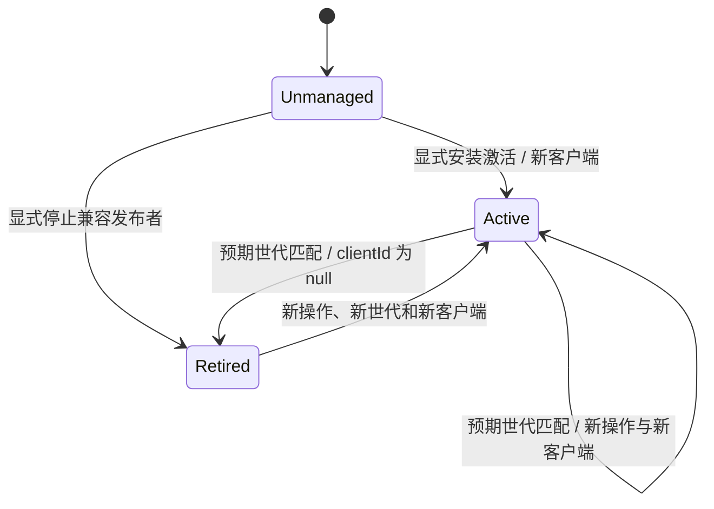

# 资源注册部署世代

日期：2026-10-21。范围：identity 拥有的静态资源声明注册；属于模块组合计划 G23。

## 目标与边界

资源目录的事务锁只能确定写入先后，不能判断持锁实例是否来自已退役的部署。
本协议把安装侧认可的注册客户端持久化，由提供方在同一目录写事务内核对。
逻辑模块、资源拥有方、资源 ID 和授权记录不因宿主或部署客户端改变而改名。

这是资源声明发布者的世代，不是业务资源上线/下线，也不是所有服务操作的全局租约。
停用发布者保留资源、数据与授权；正式业务下线仍走事件化生命周期和授权撤销协议。
管理页面的显式管理员修改仍是本地管理操作；不能把该协议当作管理员权限的替代品。

## 身份与兼容协议

每次部署使用安装日志中持久保存的 UUID operationId；重试复用，下一次发布和回退使用新 UUID。
`ModuleClientPlan.deploymentIdentities` 基于完整部署计划和已有客户端别名生成：

```text
<逻辑模块客户端基础名>-deployment-<operationId 的 32 位十六进制值>
```

规则由 `ModuleClientPlan.deploymentClientId` / `belongsToDeployment` 共同实现，规划器与
identity 激活校验不维护两份格式。宿主重定位不改变同一操作的结果；跨宿主重复身份、未选模块别名、
非法值及追加部署标识后超过 256 字符均拒绝，不截断标识。
`ModuleResourcePlan.deploymentRegistrationClients` 从同一计划生成拥有方到客户端的映射。

安装器必须实际创建新的 OAuth 客户端与秘密，不能仅为旧凭据更换显示名，也不能让旧进程收到新秘密。
规划函数不创建或授权客户端。全部消费领域的 caller policy、事件身份及运行配置仍需按完整计划协调，
不能只更新资源注册策略便认为整个平台已完成凭据轮换。

注册契约当前为 `security.resource:4`（v3 引入部署世代，v4 引入共享目录挂载），请求仍为完整拥有方声明，不接受请求自报客户端或世代。
身份来自平台验证后的 OAuth `client_credentials` 与 `service-router.invoke` scope。
本地调用仍强制隔离，使用相同认证、JSON 和事务边界。新提供方不导出 v1/v2/v3，不降级到缺少部署世代或共享目录校验的旧提供方。
消费者和提供方须协调升级；旧源码入口重新构建后会使用 v4。

## 共享菜单目录（2026-10-24）

当前契约为 `security.resource:4`，在 v3 的部署世代边界上增加声明式目录挂载。
旧 v1/v2/v3 提供方不能处理该声明，消费者禁止降级调用；升级必须协调提供方与消费者。

目录仍由原资源拥有方独占管理。拥有方将无执行组件、无方法/匹配器且不可授权的
MODULE/GROUP 标记为 `sharedDirectory`，其他拥有方通过
`parentReference: {owner, code}` 挂载自身完整子树，不使用环境相关的数据库 ID。
引用不得与嵌套父节点或 `parentId` 同时出现。注册在目录写锁内验证拥有方、共享属性、
作用域、完整树循环与深度；被外部资源引用的目录不能被静默移动、删除或取消共享。

首次启动仍使用各模块已有的资源初始化器。准备阶段声明目录依赖，框架按选中模块的
实际资源代码与拥有方拓扑排序，基础数据阶段继续优先。远程拥有方必须先完成注册，
缺失或不匹配会阻止启动，不临时创建目录或猜测拥有方。重复启动沿用已有资源 ID。
独立微服务安装应按同一目录依赖先启动目录拥有方；共享数据库环境仅保留一个注册权威。

本次菜单调整保留应用平台原目录 `app.platform.view`，供应用页面和流程管理共用，
已发布业务应用及其自定义目录继续沿用原位置。其余跨域运维分类由 common 声明共享目录。
租户镜像仅在父节点仍等于变更前的来源父节点时跟随移动，保留租户名称翻译与真正自定义的位置；
移动不产生套餐权益、不恢复撤销授权。identity V21 只增加来源目录的共享标记列。

国际化初始化沿用“仅补充缺失词条”的约定，避免启动时覆盖管理员维护的翻译。
新安装直接获得随包的新菜单文案；已有环境升级须通过平台翻译管理服务同步本次获准改名的
词条，并保存变更前后记录。不要通过全量覆盖翻译或重建资源来实现改名。
前端使用同一可见性规则排除空目录与隐藏兼容页；本地工作空间组件由宿主组件注册表解析，
不得进入远程模块预加载。

## 持久模型与状态机

identity V5 创建 `simpoint_resource_registration_deployments`：

| 字段 | 含义 |
| --- | --- |
| owner | 完整资源快照的稳定拥有方 |
| generation | 从 1 递增的拥有方世代，不能递减或重置 |
| operation_id | 安装操作 UUID，同一拥有方不可重复用于不同变更 |
| client_id | 当前世代获准的客户端；NULL 明确表示停止注册 |
| created_at | 数据库生成的记录时间，不能替代 generation 排序 |

另有 `simpoint_resource_registration_operations` 保存安装操作 UUID、批量摘要和数据库时间。
同一批次必须使用同一个操作 UUID；摘要按拥有方排序，以带长度的 UTF-8 字段、预期世代和客户端空值标志进行版本化 SHA-256 编码。
因此重试可改变输入顺序，不能增加/删除拥有方或改变内容。操作摘要与全部世代历史在同一事务写入，历史外键指向操作记录。

历史只追加，主键为 `(owner, generation)`；`(owner, operation_id)` 及非空客户端 ID 唯一。
已有客户端不能在另一个拥有方或后继世代再次登记。最新一条记录是当前权威状态。
没有记录表示尚未接管，允许按冻结的显式 legacy owner/client 策略核对；未配置策略仍默认拒绝。
一旦登记 ACTIVE 或 RETIRED，历史记录永不删除以恢复兼容模式，旧静态配置不再拥有决定权。



## 原子变更与运行期检查

`ResourceRegistrationDeployments.apply` 是 identity 内部的受信安装管理端口，没有 RPC 或 HTTP 导出，
不由业务模块启动初始化器自动调用。输入最多 256 项，包含 owner、expectedGeneration、operationId 和 clientId。

1. 校验整批的唯一拥有方、客户端格式、非负预期世代和最大值。
2. 进入 `ResourceCatalogWriteBoundary`，锁与资源注册、管理修改和插件贡献共用。
3. 逐项核对当前世代及历史身份；全部准备完成后才追加记录。
4. 精确重复当前已完成变更返回原结果；相同操作却内容不同、过期预期世代、重用旧操作/客户端均拒绝。
   较早操作即使历史成功，也不能覆盖当前后继世代。
5. 任一失败回滚整批；外层事务回滚也撤销全部激活，不提前提交。

`ResourceRegistrationProvider` 只提取经过验证的调用方身份，传递到本地 `syncRegistered`。
领域服务取得目录锁后检查最新权威状态，再应用完整声明；两者在同一数据库事务内。
旧配置的接收实例也会看到新世代，无需依赖进程缓存刷新。缺少 V5 表不会退回兼容模式。
已经在执行的旧快照可以先提交；激活等待其释放锁。激活提交后旧客户端的后续调用被拒绝，
包括空清单或 null 清单。不存在“校验通过后等待写锁期间世代已经改变”的窗口。

受信插件使用的 `sync` / `removeByOwner` 只允许尚未被部署管理接管的拥有方。
不能通过插件安装/卸载重新获得已管理或已停用拥有方的写入资格。
浏览器角色、显示名称、请求 owner 和请求正文都不能选择服务客户端。

公开拒绝采用 `RESOURCE_REGISTRATION:GENERATION_REJECTED` / `DEPLOYMENT_CONFLICT` 和中英文翻译键，
不回显客户端凭据、资源声明或授权内容。数据库不可用继续使用 `CATALOG_UNAVAILABLE`。

## 安装器必须完成的顺序（尚待正式接入）

1. 保存安装日志和 operationId，读取当前拥有方世代，固定目标产物及完整部署计划。
2. 升级迁移并确认全部资源提供方已支持 v4；停止仍能绕过新检查的旧提供方和直接写入方。
   不能靠新版代码阻止仍持数据库写权限的旧二进制程序。
3. 创建本次客户端与秘密；准备路由、所有领域策略、订阅及不可变部署配置。禁止把新秘密广播给旧实例。
4. 原子激活本次拥有方集合，并显式停止从原部署移除的拥有方；不能仅删除配置项或历史行。
5. 发布配置并启动新实例，完成资源注册、能力检查和业务 readiness；按操作日志核对实际结果。
6. 停止旧消费者，撤销旧 OAuth 客户端与相关运行凭据，回读验证。提供方数据库权限按安装/运行职责配置。

数据库世代变更与 OAuth、Consul、进程启动并非分布式原子事务。响应丢失先回读并使用同一操作重试；
新实例失败时不能直接降低世代或恢复旧凭据。回退旧产物也必须创建新的操作、客户端和更高世代，
并独立核对数据迁移是否允许回退。安装日志/权限配置/进程编排仍需后续完成。

## 验证范围

- 纯计划：同部署重定位结果一致，不同部署身份不同；别名、唯一性及长度约束。
- 真实资源事务：初次激活、旧客户端拒绝、停用、重新激活、插件路径拒绝、资源 ID 保留。
- 竞争与恢复：并发安装只有一个 CAS 成功、在途快照与激活串行、精确重试、过期操作、整批失败及外层回滚。
- 迁移：实际 V3/V4 → V5、资源/已撤销授权保持、锁版本不重置、历史保留和约束。
- 传输：签名 JWT、本地隔离、JSON 契约错误与拒绝旧协议。密码发放、真实 OAuth/Consul/浏览器及完整部署仍需 S5/S6 验收。

本轮实测与产物摘要见[验证记录](../verification/20261021-composition-resource-generations.json)：609 项相关后端测试全部通过；其中资源模块 28 项使用临时 PostgreSQL，包含 10 项世代用例。签名 JWT 测试使用显式域服务 mock，世代 JSON 测试使用受信测试身份和真实域事务，两组证据分别验证身份与持久授权边界，不代表外部 OAuth 的端到端部署已验收。Common 完整发行包已重建并核对，尚未部署。
