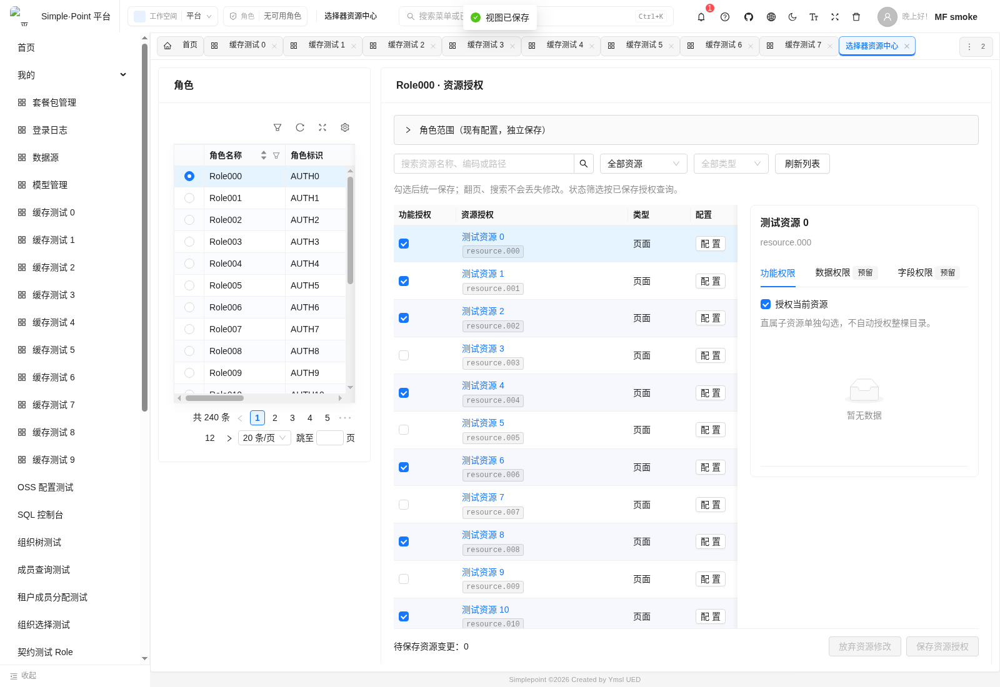

# 角色资源配置：分页编辑与权限扩展入口

2026-09-21。当前适用：角色管理的“配置资源”抽屉。独立资源授权中心已于 2026-09-22 移除；下文保留当时的设计和验证历史。

## 用户可见变化

- 两个入口复用同一编辑器：搜索、授权状态/类型筛选、服务器分页资源列表，以及单资源详情。
- 勾选只修改草稿，点击“保存资源授权”统一提交。翻页、搜索、刷新列表不会覆盖草稿；“待保存”可查看所有改动并逐项撤销。
- 状态筛选按服务器已保存状态执行。每页最多 100 项，每次最多保存 200 项变更；不存在跨页隐式全选或目录级联授权。
- 详情内提供功能、数据、字段三个页签。功能可编辑，直属子资源另行分页；数据与字段明确标注“预留”，目前没有资源级策略编辑或执行能力。
- 角色范围保留为独立折叠区，展开后加载、独立保存。关闭、切换角色和关闭页面时保护未保存修改；切换身份/租户重新建立编辑状态。



## 接口契约

### 读取

`GET /role-resource-configuration/roles/{roleId}/resources`

参数：`page`（从 0 开始）、`size`（1–100）、`keyword`（最长 128 字符）、`state`（`all/granted/ungranted`）、可选 `type`、可选 `parentId`。按资源编码与 ID 固定排序，`parentId` 仅查询直属子资源，不递归加载目录。

分页前在 SQL 中执行当前租户角色校验、资源工作空间范围、套餐或公共资源可见性、禁用/软删除和授权状态筛选。搜索仅使用可读字段，`%`、`_` 按普通文字处理。当前页资源批量查询对应授权，正常非空页共 4 次 SQL，没有按行查询或全量树接口调用。

响应为 `Page<Row>`。核心字段：`id/code/label/type/path/parentId/description/grantable/granted/revision`。展示字段声明 `PermissionFields` 来源映射；如果资源标识、授权状态来源字段不可读，则拒绝查询，避免通过数量推断隐藏授权。

扩展槽：

```json
{
  "dataPermission": {"supported": false, "policyId": null},
  "fieldPermission": {"supported": false, "policyId": null}
}
```

`policyId` 预留用于引用独立策略配置；字段权限的具体字段矩阵应放在策略详情中。槽位不是功能资源节点，也不是已生效授权。本次不新增规则引擎、策略表或数据库迁移。

### 保存

`PUT /role-resource-configuration/roles/{roleId}/resource-changes`

```json
{
  "changes": [
    {
      "resourceId": "资源 ID",
      "resourceCode": "users.view",
      "revision": "读取时返回的版本摘要",
      "granted": true
    }
  ]
}
```

成功返回 204。只修改明确提交的资源，未出现在数组中的资源不变。缺少授权决定、重复资源或超过 200 项返回 400。

服务在角色锁内检查全部资源及其授权版本，任何一项失效返回 409，整批不写入。版本包含资源标识、更新时间及角色现有授权记录标识/更新时间。旧资源授权入口也取得同一角色锁；新增接口委托现有角色服务完成写入、审计和授权版本刷新。

旧全量替换接口仍保留兼容，但两个前端配置入口已停止使用它；外部调用者应迁移到新接口，旧调用者提交全量旧快照仍可能覆盖其他修改。

如果待撤销的旧授权携带数据/字段策略，而角色尚无独立范围绑定，返回 409 并提示先确认保存角色范围。这防止删除旧授权时一并丢失其范围策略；本次不会自动选择或合并冲突的旧策略。

## 后续扩展位置

- 前端：`Role/config/resource/index.tsx` 中的 `data`、`field` 页签；两个配置入口共用，后续不再分别实现。
- 后端：`RoleResourceConfigurationService.Row` 的策略槽。当前资源变更请求只负责功能授权，后续策略编辑宜使用独立、版本化接口。
- 数据规则定义、角色与资源的策略绑定、接口/实体元数据解析和执行过滤应分层实现。菜单负责展示分组，后端以稳定资源标识和适用操作执行策略，不能依赖前端菜单状态作为安全边界。
- 本次解决全量树传输、渲染及分页保存误覆盖。没有生产规模压测；模糊搜索与深页 OFFSET 的成本仍取决于实际数据量和数据库执行计划。

## 验证

- 10 项新增 H2/HTTP 测试：240 项有效资源分页、租户和工作空间范围、套餐可见性、重复授权计数、字段隐藏、增量保存、冲突不写入、旧范围保护及非法请求。
- 19 项既有角色授权、权限中心和角色范围测试通过。
- 3 项前端草稿测试通过；`pnpm typecheck`、`pnpm build:common`、国际化检查通过。
- 新接口与仓储改动的定向 Checkstyle 通过。相关模块全量 Checkstyle 存在既有告警，未在本次顺带修改。
- 生产前端产物 + 隔离 API fixture 的浏览器验证通过，覆盖超过 200 项资源的分页、跨页/搜索草稿、冲突保留、关闭/切换确认、预留页签，以及范围选择器和影响用户列表回归。

重跑主要检查（本机 Gradle 使用 JDK 21）：

```bash
JAVA_HOME=/home/ymsl/jdk-21 PATH=/home/ymsl/jdk-21/bin:$PATH ./gradlew \
  :simplepoint-services:simplepoint-service-common:test --tests '*RoleResourceConfigurationHttpTest' \
  :simplepoint-plugins:simplepoint-plugins-rbac:simplepoint-plugin-rbac-core-implementation:test \
  --tests '*RolesServiceImplTest' --tests '*RoleScopeBindingServiceTest' \
  -Psimplepoint.frontend.skip=true

cd simplepoint-react
pnpm typecheck
pnpm build:common
pnpm i18n:check
node --experimental-strip-types --test modules/simplepoint-common/src/views/system/Role/config/resource/resourceDraft.test.mjs
MF_SMOKE_RESOURCE_ONLY=1 node --experimental-strip-types scripts/smoke-mf.mjs
```

浏览器脚本需要 Chrome 和已有 host 生产产物；使用隔离 fixture，不写真实业务数据。

## 部署结果（2026-09-21）

- Common 已发布为 `simplepoint203/common:20260921-resources1`，运行镜像 ID 与构建产物一致，健康检查通过、发布后日志无 ERROR；其余服务未替换。
- 保持 `https://home.simplepoint.online:8000`，现有 CA 校验和 HTTP/2 正常，未登录入口返回正常的 302 登录重定向。浏览器刷新后加载新资源配置页面。
- 发布前保留可用回滚镜像 `simplepoint203/common:rollback-20260921-resources1`、部署配置和数据库 custom dump，并归档原运行容器静态资源；备份及回滚脚本位于本地忽略目录 `.simplepoint/deploy203/release-20260921-resources1/`。不应自动恢复数据库覆盖发布后的业务写入。
- 使用运行中 Host 的静态产物及 HTTPS 入口实际 Common 产物完成 Chrome 回归，分页草稿、显式保存、冲突保留、关闭/切换保护、范围选择器和影响用户列表均通过。业务接口在该浏览器测试中仍为隔离 fixture。
- 实际 OAuth 登录检查未完成：原部署配置的测试密码与数据库中当前账号密码不匹配（本地 BCrypt 比较只输出布尔结果）；账号启用、未锁定。未修改密码、角色授权或用户偏好，因此未声称完成登录后的真实业务接口验收。
