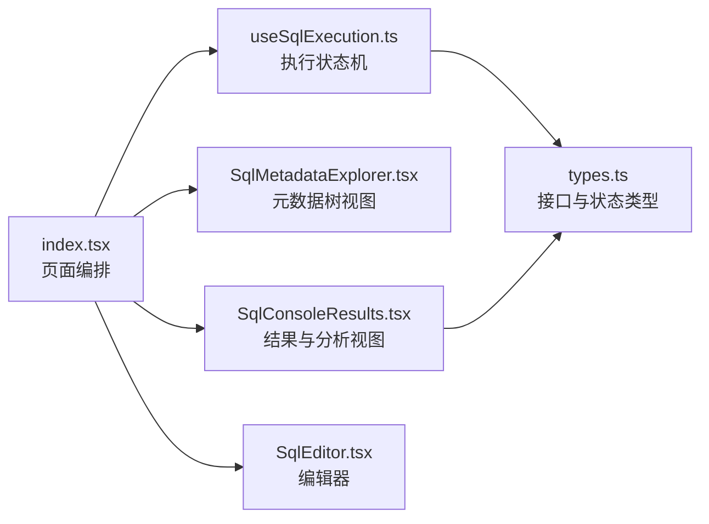
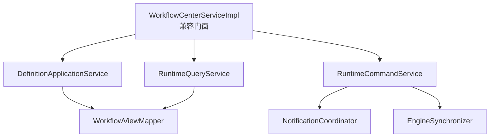

# 全仓代码组织审查与拆分计划（2026-10-13）

## 结论

当前最主要的代码质量风险不是重复的小工具函数，而是少数应用服务和页面入口同时承担过多职责。审查开始时全仓生产源码中有 27 个文件超过 800 行；完成 SQL 控制台拆分后为 26 个。其中一部分是 JDBC 接口适配器，行数主要来自标准接口方法面，不能仅为降低行数拆分；另有 8 处高优先级对象需要按职责逐步拆分。

本次先完成 SQL 控制台的低风险拆分：入口从 1477 行降到 770 行，执行状态机、结果面板、元数据树视图和协议类型分别独立。请求路径、权限判断、Calcite 执行、批量执行、结果导出和平台 `DataTable` / `TableActions` 契约没有改变。

工作流中心当前包含一批尚未提交的建模与运行时改动。它是最高优先级的后端拆分对象，但不应把大范围结构重排混入这批功能开发；下面给出保持事务、锁和权限边界的分阶段方案。

## 审查范围与判定方法

本次以当前工作区为准，扫描 Java、Kotlin、TypeScript 和 TSX 生产源码，排除测试、构建产物、依赖目录和 `.simplepoint` 运行副本。

文件大小只用来触发审查，不直接判定设计有问题。拆分判定同时满足以下一项或多项：

- 一个类或组件包含三个以上可独立变化的业务职责。
- 同一文件同时处理协议解析、权限、事务、持久化、外部调用和 UI 展示。
- 构造函数或页面状态依赖大量互不相关的协作者。
- 修改某一功能时需要理解文件中大部分无关逻辑。
- 已有稳定边界可以通过委托拆出，并保持公开 API 不变。

前端另按平台强制 UI 标准扫描。业务页面没有直接导入 Ant Design 原生 `Table`；命中只存在于平台 `Table` 和 `DataTable` 自身。原生 `Button` 的业务侧命中集中在树节点、代码编辑器、上传、导航和弹窗等专用交互，未发现用原生按钮重复实现资源列表标准动作的确定违规。

## 已落地：SQL 控制台

原入口同时包含数据源目录加载、懒加载树、补全元数据缓存、SQL 执行与批处理、结果表格、执行分析、导出和整页布局。

现有边界如下：

| 文件 | 当前职责 | 行数 |
| --- | --- | ---: |
| `SqlConsole/index.tsx` | 页面状态协调、元数据加载、补全与布局 | 770 |
| `SqlConsole/useSqlExecution.ts` | 单条/批量执行、参数校验、执行结果状态机 | 366 |
| `SqlConsole/SqlConsoleResults.tsx` | 查询、DML、DDL、计划和批量结果展示 | 376 |
| `SqlConsole/SqlMetadataExplorer.tsx` | 树搜索、展开、错误恢复和对象路径交互 | 147 |
| `SqlConsole/types.ts` | 控制台协议和视图状态类型 | 106 |

后续只有在元数据加载继续增长时，才把 `index.tsx` 中的目录缓存、定位和表结构读取抽成 `useSqlMetadata`。当前入口剩余逻辑共享同一组树状态和缓存，继续强拆会产生大量参数透传，收益不够明确。

## P0：下一批必须拆分

### 1. `WorkflowCenterServiceImpl`（1967 行）

已确认职责包括：定义查询与发布、版本复制、流程启动与重提、表单装载和校验、任务认领/完成/驳回、实例查询和可见性、Flowable 状态同步、人员目录校验、抄送人和通知 outbox 写入、DTO 映射。

建议保留 `WorkflowCenterServiceImpl` 作为兼容现有接口的薄门面，按下面顺序拆分：

1. `WorkflowViewMapper`：仅负责 definition/version/task/instance DTO 映射和时间转换。
2. `WorkflowNotificationCoordinator`：负责 watcher、任务接收人解析和 outbox 幂等写入。
3. `WorkflowDefinitionApplicationService`：定义 CRUD、草稿、发布、版本读取和复制。
4. `WorkflowRuntimeQueryService`：待办/已办/实例/进度/审计/图形查询及可见性检查。
5. `WorkflowRuntimeCommandService`：启动、重提、认领、完成、驳回、撤回和取消。
6. `WorkflowEngineSynchronizer`：引擎任务目录校验和异步状态同步。

拆分约束：

- 写命令的事务必须落在 Spring 管理的公开协作者方法上，不能依赖同类自调用触发事务。
- `PESSIMISTIC_WRITE`、版本修订校验、租户条件和 Flowable tenant 条件保持在同一个事务边界。
- 引擎状态与平台实例/outbox 的提交顺序不能改变。
- `WorkflowAccess` 权限检查集中在应用服务入口；底层 mapper 不读取当前用户上下文。
- 现有 `WorkflowEngineFixture` 和直接构造该实现的测试先改用测试装配器，再调整构造依赖。

### 2. `AiMcpServerDefinitionServiceImpl`（1804 行）

该类同时承担服务器 CRUD、字段规范化和凭据加密、能力发现及快照、工具/资源/提示词调用、OAuth PKCE 全流程、发布运行时、上游事件同步和作用域授权。构造函数已有 15 个协作者，修改 OAuth 或发布逻辑都会触及同一个事务类。

建议边界：

- `McpServerDefinitionApplicationService`：CRUD、可见性、状态转换和凭据写入策略。
- `McpDiscoveryService`：发现、快照持久化、快照读取和差异数据。
- `McpCapabilityInvocationService`：工具调用、资源读取、提示词获取和 invocation ledger。
- `McpOauthConnectionService`：发现、动态注册、PKCE state、token 刷新和断开连接。
- `McpPublicationRuntimeServiceImpl`：manifest、已发布能力调用和上游事件。
- `McpServerAccessPolicy`：集中 `requireVisible`、`requireUsable`、scope 校验，所有入口复用。
- `McpServerNormalizer`：端点、资源 URI、scope、凭据和序列化规范化。

拆分时公开的 `AiMcpServerDefinitionService` 和 `AiMcpPublicationRuntimeService` 可由不同实现承接；不要继续由一个类实现两个生命周期不同的接口。OAuth state 消费、token 更新和发布事件仍需保留当前锁定及事务原子性。

### 3. `PluginClassloader`（1527 行）

该类已经有 dependency resolver、plan factory 和 registry view factory 等协作者，但仍同时管理安装/升级计划、JAR 分析、实例注册、启停、回滚、任务队列、审计事件和 classloader 资源。

建议保持它为串行化插件生命周期的协调器，并继续抽出：

- `PluginArtifactLoader`：descriptor/JAR 读取、hash、URLClassLoader 创建和关闭。
- `PluginInstanceActivator`：包扫描、实例注册、handler 分派和回滚。
- `PluginLifecycleTransaction`：安装、升级、卸载的补偿步骤。
- `PluginOperationQueue`：`PluginTask` 状态、重试、取消和快照。

全局同步锁、依赖启用顺序、旧版本恢复和 classloader 关闭顺序留在协调器。不能把每个私有方法简单移动后形成跨对象共享可变 Map。

## P1：协议和平台核心拆分

### 4. `OpenAiResponsesProtocol`（1264 行）

当前类同时解析请求、转换输入消息和工具、校验能力、构造非流式响应、维护流式状态并编码所有 SSE 事件。建议拆为：

- `ResponsesRequestMapper`：请求校验、输入/工具/response format 转换。
- `ResponsesResponseMapper`：最终 response 和 usage/output item 生成。
- `ResponsesStreamEncoder`：事件序列与 delta 编码。
- `ResponsesStreamState`：文本、拒绝和 tool call 聚合状态。

`OpenAiResponsesProtocol` 保留为门面。拆分完成条件不是编译通过，而是现有 Responses 协议回归对事件名称、顺序、索引、ID、usage 和错误参数逐项一致。

### 5. `AbstractRuntimeSchemaDialect`（1248 行）

当前抽象类同时做 schema 规划、迁移差异、JDBC 元数据读取、快照规范化、默认值解析、标识符校验和 SQL 片段生成。建议使用组合而非增加继承层级：

- `RuntimeSchemaPlanner`：初始/evolution 计划和风险聚合。
- `JdbcSchemaInspector`：table/column/index/comment 元数据读取。
- `PhysicalSchemaNormalizer`：默认值、类型和快照规范化。
- 方言类只保留 capability 描述和数据库特定 SQL renderer。

拆分必须用 PostgreSQL、MySQL 等现有方言的 golden SQL 与 drift 检测测试覆盖；不能在共享 normalizer 中抹平方言差异。

### 6. `McpServers/Capabilities.tsx`（1180 行）

一个页面同时维护服务器目录、能力加载、快照比较、工具参数表单/JSON 双模式、资源读取和 prompt 调用。建议拆为 `useMcpCapabilities`、`useMcpSnapshotComparison`、`ToolInvocationPanel`、`ResourceReadPanel`、`PromptInvocationPanel` 和 `CapabilitySnapshotTable`。服务端权限仍决定动作可见性；列表继续用平台 `DataTable` / `TableActions`。

### 7. 平台 `Table/index.tsx`（982 行）

该文件是平台组件，使用 Ant Design `Table` 属于正确封装边界。内部可进一步拆出 `useTablePreferences`、`useTableSelection`、`useTableViewport` 和 `buildSchemaColumns`，默认导出与 props 契约保持稳定。优先为这些纯逻辑补齐已有设置/筛选/行身份测试，再移动代码。

### 8. `libs/shared/api/client.ts`（794 行）

建议将错误解析移到 `api/errors.ts`，未授权会话探测与恢复移到 `api/sessionRecovery.ts`，请求体和响应解析移到 `api/transport.ts`。`request`、`HttpError` 和 `resolveApiErrorMessage` 的导出路径先保持兼容，避免一次修改所有调用方。租户/角色/context headers 的生成仍由统一客户端负责，不能下放到业务模块。

## P2：列入模块演进计划

以下文件达到 800 行左右并存在可分边界，但优先级低于上述对象：

| 文件 | 行数 | 建议边界 |
| --- | ---: | --- |
| `RoleResourceConfigurationServiceImpl` | 968 | 角色资源命令、范围策略、查询投影 |
| `AiRuntimeWorkloadCoordinator` | 967 | 调度决策、状态持久化、运行时调用 |
| `BaseServiceImpl` | 964 | 查询编排、写命令、字段权限/审计；公开基类 API 先保持 |
| `FederationCalciteCatalogAssembler` | 949 | catalog 发现、schema 装配、缓存键和逻辑视图 |
| `AbstractJdbcDatabaseDialect` | 942 | JDBC 元数据读取、DDL 渲染和约束组装 |
| `DefaultRemoteMcpGatewayOperations` | 936 | transport/session、协议请求、事件流 |
| `AiCompatibleGatewayController` | 913 | HTTP 参数/错误映射与协议执行门面 |
| `FederationJdbcDriverServiceImpl` | 911 | 驱动安装、验证、连接测试和查询 |
| `FederationJdbcMetadataSupport` | 877 | 元数据读取、路径规范化、结果映射 |
| `TenantResourceCatalogImpl` | 858 | 目录查询、授权过滤、DTO 组装 |
| `ResourceServiceImpl` | 854 | 资源命令、树查询、缓存/发布 |
| `TenantServiceImpl` | 841 | 租户命令、成员/目录查询、资料更新 |
| `SchemaPublicationStateService` | 837 | 发布状态机、锁/租约、历史查询 |
| `navigation-bar/index.tsx` | 853 | 路由标签、菜单状态、页面保活和布局视图 |

这些对象不能成批机械改名或移动。每次拆分只处理一个领域，先锁定公开契约、事务、权限和查询数量，再迁移实现。

## 不按行数拆分的文件

以下文件虽大，但目前主要来自标准接口覆盖或稳定数据模型，暂不列为重构目标：

- `DnaJdbcDatabaseMetaData`、`SimpleDatabaseMetaData`：实现 JDBC `DatabaseMetaData` 的大方法面。
- `SimpleCallableStatement`、`SimplePreparedStatement`、`SimpleResultSet`、`DnaJdbcStatement`、`DnaJdbcConnection`：JDBC 接口适配和委托方法。
- `JdbcDatabaseDialect`：SPI 默认方法集合，拆成多个接口会直接扩大实现方兼容成本；需要在新增第二套独立实现族时再评估接口分层。
- 实体和纯规格模型只因字段/嵌套 record 较多而变长时，优先检查序列化兼容性，不为行数创建无意义包装类。

这些文件仍需正常接受逻辑重复、异常吞噬和资源泄漏审查；“允许大文件”只表示没有确认到合理的职责拆分收益。

## 实施顺序与完成标准

1. 合并并验证本次 SQL 控制台拆分。
2. 当前工作流建模功能稳定后，按 mapper → notification → query → command → facade 顺序拆 `WorkflowCenterServiceImpl`。
3. 拆 MCP OAuth 和发布运行时，再拆 definition/discovery/invocation。
4. 拆 Responses 协议和 runtime schema dialect，并用协议/方言 golden tests 锁定行为。
5. 最后处理平台 Table、共享 API client 和 P2 服务。

每个拆分必须满足：

- 对外接口、路由、权限码和错误语义不变，除非有单独批准的契约升级。
- Spring 事务、数据库锁、租户过滤、审计和 outbox 原子性有定向测试。
- 前端资源列表继续使用 `SimpleTable` / `DataTable` / `TableActions`；专业编辑器交互的原生控件例外需保留代码说明。
- 原文件不再保留被抽取逻辑的第二份实现。
- 模块类型检查或编译、相关单元测试及 `git diff --check` 通过。
- 不以统一的硬行数门禁代替设计审查。生产文件超过 800 行或单次新增超过 300 行时应触发职责审查，并在无法拆分时记录原因。

## 本次验证

- `pnpm run typecheck`：Common、Audit、DNA、AI、App、Workflow、Host、Mocks 全部通过。
- `pnpm run build:dna`：通过，SQL 控制台 Module Federation 暴露模块正常产出。
- `node --experimental-strip-types --test modules/simplepoint-dna/src/views/platform/SqlConsole/*.test.mjs`：22 项通过。
- `git diff --check`：通过。
- `./gradlew checkstyleMain`：未进入项目任务。当前默认 JDK 为 27，Gradle 8.12 的 Kotlin DSL 在初始化时以 `JavaVersion.parse: 27` 失败；仓库声明的 toolchain 为 Java 21，需在 JDK 21 环境补跑。

本次没有执行整仓后端测试，也没有修改正在开发的工作流、MCP、插件加载或协议实现。对应拆分必须在各自阶段单独完成并验证，不能把本报告当作这些重构已经落地。
