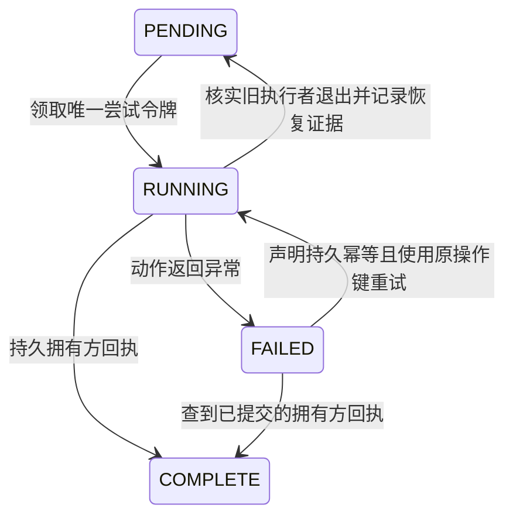

# 统一安装编排内核

安装操作由不可变计划、领域动作和持久日志组成。当前交付的是 Java 库及字典接管适配器，
不是完整安装 CLI、自动部署服务或 standalone 宿主。操作完成只表示该计划列出的步骤完成，
不能代替全部模块的安装、配置、启动和业务就绪验收。

## 分层

| 工程 | 职责 | 生产依赖 |
| --- | --- | --- |
| `simplepoint-platform-installation` | 计划、动作契约、日志接口、顺序执行及恢复规则 | Java 21，无框架依赖 |
| `simplepoint-platform-installation-jdbc` | 安装器自己的四张控制表、短事务状态更新、迁移声明 | 纯迁移 API 与安装内核；JDBC 使用 JDK 接口 |
| `simplepoint-platform-installation-dictionary` | registry 退役与 identity 字典接管的真实回执读取、校验和转换 | 安装内核、纯 bootstrap 接管 API 与字典注册契约 |

业务模块不依赖安装器，也不访问安装日志或对方领域表。适配器位于安装侧，不作为平台业务模块自动扫描，
也不新增运行时 RPC。现有微服务启动器不会因为引入日志库就自动执行安装。

## 计划与并发边界

`InstallationPlan` 固定操作 UUID、目标、预期安装世代、发布指纹以及最多 512 个有序步骤。
每步包含稳定 ID、适配器类型/版本、输入指纹和重试保证。日志只保存这些非秘密元数据、状态、
回执指纹及尝试记录；不保存配置值、密码、令牌或异常消息。

完整计划指纹包括步骤顺序和重试保证。恢复时必须提供同一份已审查输入与匹配的适配器；
增删步骤、改变版本/输入/发布指纹会拒绝。执行器在首次写日志前检查全部适配器定义。
发布指纹是调用方提供的绑定值，内核不验证发行包签名或自动证明实际配置与该指纹相符；正式安装入口须完成来源核验。

JDBC 为每个目标锁定一行，原子创建计划或更新一步状态。首次并发创建使用唯一键和保存点；
未完成操作占用该目标，后续世代不能越过它。新操作启动后旧操作不再作为当前结果返回。
安装世代属于操作日志，与资源授权/字典批准各自的领域世代不同。

**领域动作执行期间不持有安装日志事务。** 安装日志和领域数据库独立提交，不能假装组成分布式事务。
JDBC 适配器要求可独立管理事务的连接，拒绝已经关闭 auto-commit 的外部事务连接。

## 状态与恢复

- COMPLETE 步骤不会再次执行；全部步骤都有回执后才能完成该操作。
- `InstallationAction.apply` 必须返回已持久化的拥有方结果指纹，不能把 HTTP/MQ 传输确认当作业务完成。
- 业务提交后日志确认丢失：保留 RUNNING；再次运行先只读查询拥有方回执，找到后补齐日志。
- 动作抛异常：记录固定 `ACTION_FAILED`，不推断业务已回滚。先查回执；无结果时，仅 `DURABLE_IDEMPOTENT` 可用同一操作键再次调用。
- RUNNING 没有回执：返回 `RECOVERY_REQUIRED`，不依据超时窃取执行权。拥有方查询失败返回 `RECONCILIATION_FAILED`，原尝试保持不变。
- 受信恢复流程核实旧执行者退出后，可调用 `authorizeRetry`，保存证据指纹并替换执行资格。仅支持持久幂等步骤；迟到旧尝试不能回写新状态。
- 证据指纹不是自动认证证明。日志只记录它；实际进程退役验证、操作者授权和证据来源由正式安装/恢复入口负责。
- `RECONCILE_ONLY` 的不确定结果只允许通过已完成回执恢复，不提供盲目重放或通用取消接口。后续需要显式补偿/中止协议的动作不得伪装为幂等动作。

## 日志安装

先由安装器将 `InstallationJournalMigrations.plan("journal")` 交给已有 `ModuleMigrationEngine`，
为专用控制存储执行版本化迁移，再构造 `JdbcInstallationJournal`。复用平台 Flyway 校验和与锁；
不另写隐式建表或 schema repair 逻辑。生产迁移声明目前为 PostgreSQL。

这四张表归 `installation-journal` 所有，不把它当作一个必须加载进所有业务宿主的领域模块。
日志、领域数据源和环境凭据的实际绑定仍由正式安装入口接入。

## 字典首批接入

`DictionaryAdoptionInstallation.prepare` 接受已核对的历史声明、字典数据预览和 registry 接管命令，
自动生成 registry 退役、字典接管两步及精确输入指纹。准备阶段不访问或修改数据库。

源步骤从 registry 的实际持久回执生成结果；目标步骤重新读取并校验该回执后转换为字典接管输入。
恢复查找使用两个领域各自的只读 `findCompletion`，不会借查询执行写入。
适配器不直接读数据库，不相信调用方自行提供的“成功”标记。

安装侧只依赖 `BootstrapLegacyTransferPort`、`DictionaryLegacyAdoptionPort` 和纯 DTO。
`simplepoint-platform-bootstrap-registry-api` 保留旧 DTO 的完整类名，但不加载 Spring、JPA、消息客户端或领域实现；
字典安装库也有相同的生产依赖白名单门禁，门禁接入根模块边界检查。
拥有方分别通过 `BootstrapLegacyTransferAdapter`、`DictionaryLegacyAdoptionAdapter` 绑定既有事务代理。
这些绑定属于领域，不属于安装库；不改变原事务代理类型、持久化归属或运行时 scope 检查，
也不把安装端口导出成 RPC/HTTP。完整安装宿主负责显式提供这些受信端口，库本身不启动 Spring 或查找全局 Bean。

这两步完成不代表模块客户端已经创建、字典已批准上线或服务已就绪。其余必需阶段仍须加入正式部署计划。
完整操作输入的持久化位置、发布产物核验、模块自动映射、凭据预置/撤销、MQ ACL、配置发布、
进程启停、业务就绪及恢复管理入口尚未完成。
